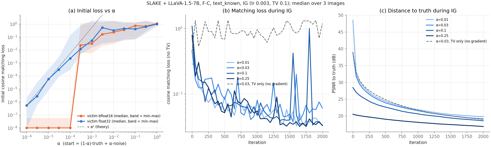

## 要点

- **回放没有问题**：重新加载数据得到完全相同的输入，真实输入的回放损失 ≤ 1.2e-7。
- **目标函数更偏好错误的图像**：IG 重建的损失比接近真实的图像更低，但 PSNR 只有 6–9 dB。
- **真实图像作为起始点无效**：从 α=0.01（PSNR 46–49 dB）出发，2000 次迭代后也会降到约 19–20 dB，同时损失持续下降。
- **把图像推离真实值的是梯度项**：只用 TV 先验时图像结构还能保留，加上梯度匹配后结构被破坏。

## 关键数字

不同图像的匹配损失（余弦）：

| Image | Cosine loss | PSNR |
|---|---:|---:|
| Truth (replay) | ≤ 1.2e-7 | – |
| IG reconstruction, 2000 iterations | 0.09–0.18 | 6–9 |
| IG reconstruction, 100k run (stopped at 15150) | 0.027 | 6–9 |
| Truth + 2% Gaussian noise | 0.18–0.90 | ~34 |
| Truth + 1 px blur | 0.36–0.65 | – |

## 研究问题

- **回放与目标函数**：IG 失败的原因是回放不一致、目标函数本身，还是优化过程？
- **近真值起点**：从真实图像附近出发，匹配目标能否让 IG 留在真实图像附近？

## 实验设置

| Item | Setting |
|---|---|
| 性质 | 使用私有数据的诊断：读取了 `capture/private`，超出威胁模型 |
| 模型 | LLaVA-1.5-7B，bf16 |
| 数据 | SLAKE `tune`，3 张图像（`iterations_2000` 的 3 个捕获） |
| 联邦设置 | FedSGD，batch 1，第 0 轮 |
| 上传梯度 | F-C |
| 攻击者知识 | `text_known` |
| 工具 | `python -m core.commands diagnose-gradient` `attack.init_source=private_reference`（见 `docs/protocol.md#Attack Initialization`） 早期 pilot 使用的命令后来并入了 `attack.init_*` |
| 近真值起点 | 起点 = (1−α)·真实图像 + α·均匀噪声 IG lr 0.003，TV 0.1，2000 次迭代 除特别标注外，候选图像为 fp32 |

## 结果

### 回放与目标函数

**回答**：回放是精确的；失败来自目标函数本身，IG 重建的匹配损失比接近真实的图像更低。

- **回放是精确的**：重新加载数据得到完全相同的图像和公开 token ID，回放不一致的假设被排除。
- **IG 重建的损失比近真值图像更低**：见关键数字表。
- **特征没有被恢复**：重建图像在 CLIP connector 输入处与真实图像的余弦相似度为 0.29–0.34，和均匀噪声（0.33–0.34）一样。
- **CLIP 对像素极其敏感**：0.2% 的像素噪声就让 token 余弦相似度降到约 0.87。
    - fp32 和 bf16 的结果相同，说明不是数值精度问题。
    - 有 3 个高范数的异常 token（范数约 200，中位数 22），在极小的扰动下就会改变。
- **真实图像不是吸引点**（pilot，300 次迭代，run-00000）：
    - 从 3% 噪声混合（PSNR 38.9）出发，损失从 0.30 降到 0.057，PSNR 却降到 29.8。
    - 用错误的更新做对照，最终 PSNR 也是相近的 29.1。
    - 从 25% 噪声混合出发，PSNR 基本不变（20.5 → 20.1）。

### 近真值起点

**回答**：不能。所有起点都很快漂离真实图像，α ≤ 0.1 的起点最终停在约 19–20 dB，同时匹配损失仍在下降。

- 全部 12 次 IG 运行，从第一个检查点开始就远离真实图像，同时匹配损失持续下降（降到 0.04–0.12）。
- α ≤ 0.1 的起点最终都停在约 19–20 dB。
- bf16 候选图像漂移得更慢，是因为小步长被舍入掉了，并不是更好的攻击；改用 fp32 后结论不变。
- 只用 TV 先验的对照同样会损失 PSNR，但保留了结构（3 张图中有 2 张 SSIM 为 0.68–0.73）；IG 则破坏了结构（SSIM 0.17–0.30）。

| α | Candidates | Objective | Start PSNR | Final PSNR | Start SSIM | Final SSIM |
|---|---|---|---:|---:|---:|---:|
| 0.01 | fp32 | IG | 46–49 | 19.3–20.0 | 0.91–0.99 | 0.16–0.30 |
| 0.03 | fp32 | IG | 36–39 | 19.0–20.0 | 0.68–0.93 | 0.17–0.30 |
| 0.1 | fp32 | IG | 26–29 | 18.5–19.4 | 0.49–0.62 | 0.16–0.29 |
| 0.25 | fp32 | IG | 18–21 | 16.1–18.3 | 0.21–0.31 | 0.13–0.24 |
| 0.03 | bf16 | IG | 36–39 | 19.3–22.2 | – | 0.37–0.46 |
| 0.03 | fp32 | TV only (plain Adam) | 36–39 | 15.9–20.3 | – | 0.15–0.73 |

下图是 F-C 近真值起点实验的汇总（3 张图像的中位数）：

- (a) 初始损失随 α 的变化：bf16 受害模型在 α ≤ 1e-4 时损失不变（死区）；fp32 先按约 α² 增长，之后很快饱和。
- (b) IG 过程中的匹配损失：所有 α 下都在下降；只用 TV（虚线）时匹配损失基本不变。
- (c) 同一过程中与真实图像的 PSNR：所有起点都在持续下降，最终约 19–20 dB。
- 把 (b) 和 (c) 放在一起看：损失下降的同时，图像在远离真实值。

#### 初始损失随 α 的变化

- 统计方式：3 张图像 × 5 个噪声方向，每种精度都和自己的真实梯度比较。
- fp32：只有 α ≤ 1e-3（PSNR ≳ 65 dB）时，损失随 α 平滑增长（log-log 斜率约 1.5–2）；之后在 0.3–1 饱和，且不单调。
- bf16 受害模型存在死区：α ≤ 1e-4 时扰动被舍入掉，损失与真实图像相同；α = 3e-4 时跳到约 0.02。
- 网格中的所有 α（0.01–0.25）都处在饱和区。
- IG 最终损失为 0.03–0.06，大约相当于真实图像加 α ≈ 3e-4–1e-3 扰动后的损失，但此时 PSNR 只有约 19 dB。

## 结论

- IG 失败不是回放问题，也不只是优化问题：匹配目标本身就更偏好非真实图像。
- 梯度项会主动把图像推离真实值。
- [[gradient-discriminability]] 进一步解释了原因：损失在全局上能区分远近，但局部梯度不指向真实图像。

## 局限

- 这是使用私有数据的诊断，只有 3 张图像。

## 下一步

- 增加对照：同样的起点和 sign step，但匹配一个错误的更新。
- 在真实图像附近使用小得多的学习率。
- 这两项用来区分"目标函数偏好其他图像"和"sign step 的噪声下限"两种解释（见 Handoff 中的假设）。

??? note "运行记录"
    - `step0` 和 `step1_pilot` 的捕获是 Observation v4，当前的 `attack` 和 `diagnose-gradient` 会拒绝读取；要复用需要重新捕获。已报告的数字仍然有效。
