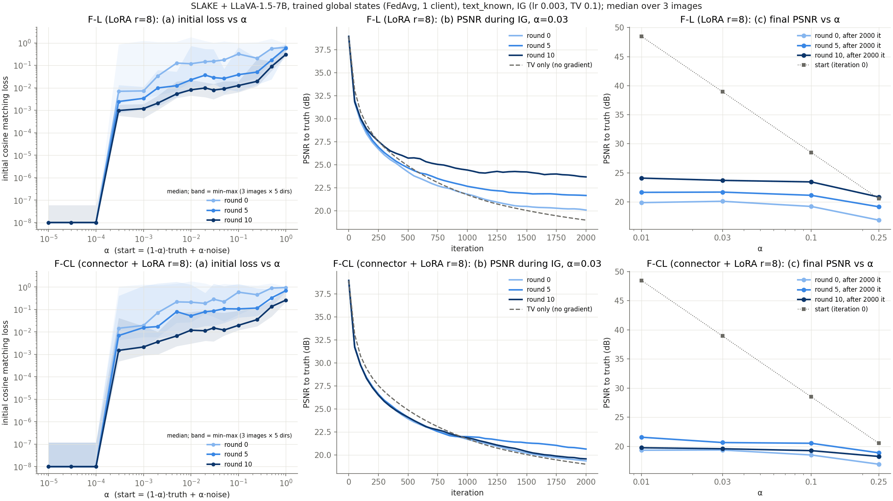

## 要点

- **第 0 轮时三种策略没有区别**：α=0.03 时最终 PSNR 中位数为 F-C 19.1、F-L 20.1、F-CL 19.4 dB。
- **训练后 F-L 出现弱的回复力**：α=0.01 时最终 PSNR 中位数从第 0 轮的 19.9 升到第 10 轮的 24.1 dB，但离真实图像仍然很远。
- **F-CL 没有持续改善**：第 5 轮比第 0 轮高 1–3 dB，第 10 轮又回落到第 0 轮水平。
- **更低的损失不代表更好的重建**：F-L 下 IG 的匹配损失更低，PSNR 却和 F-C 相同。

## 关键数字

最终 PSNR 中位数（dB）：

| Strategy | α | Round 0 | Round 5 | Round 10 |
|---|---|---:|---:|---:|
| F-C | 0.03 | 19.1 | not run | not run |
| F-L | 0.03 | 20.1 | – | 23.5–24 |
| F-L | 0.01 | 19.9 | 21.6 | 24.1 |
| F-CL | 0.03 | 19.4 | +1–3 vs round 0 | ≈ round 0 |

## 研究问题

- 第 0 轮时，F-L 或 F-CL 的更新能否比 F-C 更好地引导 IG？
- 训练后 LoRA-A 梯度变为非零，F-L 和 F-CL 的更新能否把 IG 拉向真实图像？

## 实验设置

| Item | Setting |
|---|---|
| 性质 | 使用私有数据的诊断：从真实图像附近出发 |
| 起点与攻击 | 与 [[ig-failure-diagnosis]] 相同 起点 = (1−α)·真实图像 + α·均匀噪声 IG lr 0.003，TV 0.1，2000 次迭代 |
| 模型 | LLaVA-1.5-7B，bf16 |
| 数据 | SLAKE `tune`，3 张图像 |
| 捕获 | FedSGD，batch 1，`text_known` `server_round` 取自对应的快照 |
| LoRA | r=8，alpha=16，dropout 0（保证回放是确定性的） |
| 训练 | 1 个客户端，FedAvg + AdamW，lr 1e-4 有效 batch 8（batch 2 × 梯度累积 4，当时 GPU 6 只有约 31 GB 空闲） 每轮 10 个本地步，共 10 轮 |
| 复现 | `outputs/federation/slake_llava_{f_l,f_cl}_fedavg.protocol.json` 加上 `outputs/federation/slake_llava_f_cl_pipeline.sh` 中的 `--set` 覆盖项 |

可训练参数规模（LLaVA-1.5-7B，在 meta device 上核对）：

| Strategy | Trainable parameters |
|---|---|
| F-C | 20,979,712（projector） |
| F-L | 2,498,560 × r（r=8 时为 19,988,480） |
| F-CL | F-C 与 F-L 之和 |

- F-L 在全部 224 个 LLaMA Linear 层（q/k/v/o/gate/up/down）上加 LoRA，不含 lm_head，与 FedVLMBench 的 `find_all_linear_names` 一致。
- 与 FedVLMBench 的差异：它的配置使用 alpha 32、dropout 0.05 和 Llama-3.2-3B + CLIP ViT-B/32；本项目使用 alpha 16、dropout 0 和 LLaVA-1.5-7B。
- `train` 会把每轮的整个 batch 放到 GPU 上做一次前向，所以无法像 FedVLMBench 那样跑完整的本地 epoch。

## 结果

### 第 0 轮：三种策略对比（2026-09-25）

- PSNR 和 SSIM 轨迹在每个 α 下都无法区分，SSIM 都在 0.15–0.32。
- 三种策略都有 bf16 死区（α ≤ 1e-4），并在 α = 3e-4 处跳变。
- **F-L 的更新对图像更不敏感**：每个 α 下，F-L 的初始损失都约为 F-C 的一半。
    - α=0.1 时为 0.32（F-C 为 0.75）；纯噪声时为 0.63（F-C 为 1.09）。
    - 说明 LoRA 更新中有很大一部分与图像无关，主要由文本驱动。
- F-CL 接近 F-C：第 0 轮时，connector 占 F-CL 更新平方范数的 48–78%。
- F-L 下 IG 的匹配损失更低（0.007–0.015，F-C 为 0.03–0.06），PSNR 却相同。
- 第 0 轮、r=8 时，仅靠秩不太可能有帮助：B 的梯度秩 ≤ r，且混合了图像和文本 token。

### 训练过程

- 每轮损失：F-L 从 4.36 降到 1.32，F-CL 从 3.80 降到 1.16。
- LoRA B 变为非零：‖B‖_F 在第 5 轮约为 3，第 10 轮约为 4；各模块 ‖ΔW‖_F 的中位数约为 0.2–0.3。
- 第 5、10 轮的捕获中，全部 224 个 LoRA-A 梯度都非零。
- F-C 于 2026-09-29 在 GPU 5 上用相同设置训练（`slake_llava_f_c_pipeline.sh`，只训练）：
    - 每轮损失依次为 4.51、3.70、3.77、3.61、2.24、2.10、2.06、3.11、2.18、1.58。
    - 第 8 轮的尖峰在 F-L 和 F-CL 中也出现了。

### 训练后：F-L 与 F-CL（2026-09-27）

- **F-L 随训练单调改善**：
    - 每个 α、每张图像上，最终 PSNR 都随第 0 → 5 → 10 轮上升；α=0.01 时 SSIM 从约 0.2 升到约 0.38。
    - 第 10 轮时，α = 0.01–0.1 的最终 PSNR 都在 23.5–24 dB，与起点无关。
    - 曲线在约 1000 次迭代后趋平，而只用 TV 的对照仍在下降。
    - α=0.25 时，3 张图像中有 2 张最终高于起点（20.5 → 20.8，20.8 → 21.3）。
    - 这是第一次出现回复力，但约 24 dB 的平衡点离真实图像仍很远，且前 50 次迭代的下降和第 0 轮完全一样。
- **F-CL 没有持续改善**：
    - 第 5 轮比第 0 轮高约 1–3 dB，第 10 轮在每个 α 下都回落到第 0 轮水平。
    - 梯度范数占比解释不了这一点：第 10 轮 F-CL 的 ‖g‖² 中，connector 占 6–11%，LoRA-A 占 6–13%，LoRA-B 占 79–83%；F-L 的 LoRA-A 只占 1–5%。
    - 可能是训练后的 connector 改变了模型状态。
- **初始损失随训练下降**：
    - F-L 在 α=0.1 时，第 0、5、10 轮分别为 0.32、0.039、0.013；纯噪声时分别为 0.63、0.59、0.31。
    - 说明更新对图像越来越不敏感，越来越由与图像无关的成分主导。
    - bf16 死区（α ≤ 1e-4）和 α = 3e-4 处的跳变在所有设置中都存在。

下图对比了 F-L（上排）和 F-CL（下排）在第 0、5、10 轮的表现（3 张图像的中位数）：

- (a) 初始损失随 α 的变化：训练轮次越多损失越低，说明更新对图像越来越不敏感。
- (b) α=0.03 时 IG 过程中的 PSNR：F-L 第 10 轮明显高于第 0 轮和只用 TV 的对照；F-CL 各轮几乎重合。
- (c) 2000 次迭代后的最终 PSNR：灰色虚线是起点；所有终点都远低于起点，F-L 第 10 轮最高，约 24 dB。

## 结论

- 第 0 轮时，LoRA 梯度不提供额外的图像引导。
- 训练后 F-L 出现弱的回复力，但平衡点（约 24 dB）离真实图像很远。
- F-CL 的改善不稳定，第 10 轮又回落。
- 训练让更新越来越由与图像无关的成分主导。

## 局限

- 这是使用私有数据的诊断，只有 3 张图像。
- F-CL 第 10 轮的回落可能只是偶然，n=3 无法排除。

## 下一步

- 在训练好的 F-C 快照上跑 IG 网格（尚未运行）。
- 得出论文结论前：用 10–20 张图像代替 3 张，增加种子和训练轮次。

??? note "运行记录"
    - F-C 训练在共享 GPU 上约占用 50 GB 显存。
