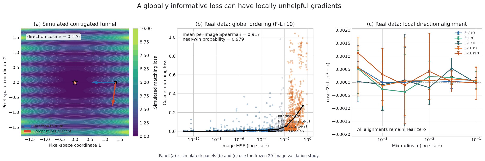

## 要点

- **损失能区分远近候选**：在验证集上，近候选比远候选损失更低的概率（near-win）第 0 轮为 0.860–0.877，第 10 轮为 0.963–0.979。
- **这个信号不只来自共享成分**：去掉所有候选共有的梯度成分后，near-win 仍为 0.878–0.898（第 0 轮）和 0.967–0.969（第 10 轮）。
- **局部梯度不指向真实图像**：损失对图像的负梯度，与指向真实图像的方向之间的余弦相似度约为 0。
- **所以 IG 利用不了这个信号**：在像素空间做一阶优化，无法沿着全局排序找到真实图像。

## 关键数字

验证集（20 张独立图像）；每个范围覆盖该轮次下的各个微调策略：

| Round | Near-win (cosine) | Near-win (relative L2) | Near-win (centered cosine) | Spearman (cosine loss vs MSE) |
|---|---:|---:|---:|---:|
| 0 | 0.860–0.877 | 0.812–0.830 | 0.878–0.898 | 0.71–0.74 |
| 10 | 0.963–0.979 | 0.960–0.972 | 0.967–0.969 | 0.88–0.92 |

## 研究问题

- IG 失败了，但匹配损失还能否区分离真实图像近的候选和远的候选？
- 如果能，为什么梯度下降利用不了这个信号？

## 实验设置

| Item | Setting |
|---|---|
| 性质 | 使用私有数据的诊断，不是攻击基准 |
| 模型 | LLaVA-1.5-7B |
| 条件 | F-C 第 0 轮 F-L 第 0、10 轮 F-CL 第 0、10 轮 |
| 攻击者知识 | `text_known` |
| 候选集 | 用真实图像构造的有限候选集，包含离真实图像近的候选和远的候选 |
| 样本 | pilot：3 张图像（原生精度和 fp32 各一次） 开发集：20 张 `tune` 图像 验证集：20 张独立的 `eval` 图像 |
| 防过拟合 | 分析方法在开发集上冻结后，才应用到验证集 |

## 结果

下图概括了本研究的结论：

- (a) 是模拟示意：损失面整体朝真实图像（星号）下降，但表面有起伏，最陡下降方向（红色箭头）偏离了指向真实图像的方向（蓝色箭头）。
- (b) 是真实数据（F-L 第 10 轮，验证集）：图像误差越大，损失越高，近候选的损失明显更低。
- (c) 是真实数据：各条件下，负梯度与指向真实图像方向的余弦相似度都在 0 附近（量级 1e-3）。

### 全局排序

- 近候选的损失明显低于远候选，near-win 见关键数字表。
- 在构造的候选集中，损失最低的 1% 里没有任何远候选。
- 余弦损失与 MSE 的图像级 Spearman 相关：第 0 轮为 0.71–0.74，第 10 轮为 0.88–0.92。
- LoRA 训练后，排序信号明显更强。

### 去掉共享成分

- 用 centered cosine 去掉所有候选共有的梯度成分后，near-win 几乎不变。
- 说明排序不只是由与图像无关的共享成分造成的。

### 局部方向

- 在 6 个扰动半径下，`-d(loss)/d(image)` 与指向真实图像的位移之间的余弦相似度约为 0（约 -3.8e-4 到 1.1e-3）。
- 只看符号方向时也约为 0（约 -4.5e-3 到 4.5e-3）。
- 在测试的半径和步长组合中，只有约 1–12% 能同时降低损失和 MSE（5 张图像平均，随条件、目标函数和方向而变化）。

## 结论

- 匹配损失包含有用的全局排序信号，LoRA 训练后更强。
- 但在原始像素空间中，一阶优化很难利用这个信号。
- 这解释了为什么噪声图像的梯度在全局上看起来相似，重建却仍然失败。

## 局限

- 结论只适用于这里构造的有限候选集。
- 不能证明真实图像可以被唯一识别，也不代表攻击能够成功。
- 候选集是用真实图像构造的，结论只能用于诊断。

## 下一步

- 查看按模块和候选类型拆分的结果。
- 测试粗粒度搜索或无需梯度的搜索，能否在不依赖私有参考的情况下利用这个排序。

??? note "运行记录"
    - 在物理 GPU 5 和 6 上运行，最多两张卡，每张卡一个 worker。
    - 所有打分和方向任务都正常结束（返回码 0）。
