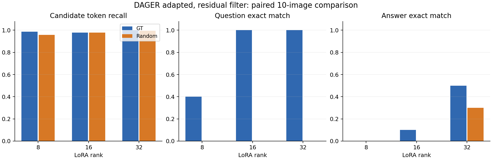

## 要点

- **Residual 筛选几乎找全私有 token**：rank 8 下已知真实图像（GT）时 Recall@100 为 0.98，改用随机替代图（Random）仍有 0.96；不去除公开方向的 Raw 只有 0.61。
- **rank 8 下没有恢复任何完整问答**：四种条件的 Joint EM 都是 0/10。
- **提高 rank 明显改善已知图像时的恢复**：Residual (GT) 的完整问答从 rank 8 的 0/10 升到 rank 16 的 1/10、rank 32 的 5/10。
- **提升不只来自候选覆盖**：rank 16 已知图像的全覆盖从 8/10 降到 7/10，问题恢复却从 4/10 升到 10/10；搜索实现和预算未变。
- **随机图像下仍未恢复完整问答**：rank 32 答案恢复 3/10，但完整问答为 0/10。

## 关键数字

**rank 8 的四种条件**：

| Method | Image | Recall@100 | Full coverage (actual) | Question EM | Answer EM | Joint EM |
|---|---|---:|---:|---:|---:|---:|
| Residual | GT | **0.98** | 8/10 | 4/10 | **0/10** | **0/10** |
| Residual | Random | **0.96** | 6/10 | 0/10 | **0/10** | **0/10** |
| Raw | GT | 0.61 | 0/10 | 2/10 | **0/10** | **0/10** |
| Raw | Random | 0.61 | 0/10 | 0/10 | **0/10** | **0/10** |

**不同 rank**：

| Item | Count |
|---|---:|
| Paired images | 10 |
| New model ranks | 2 |
| Conditions per rank | 4 |
| Completed new reconstructions | 80 |
| Training rounds per new model | 10 |
| Unique QA sequences | 6 |

以下为 Residual 条件。Recall@100 按固定 100 个排名统计；Full coverage 使用实际 109 个候选，包括额外保留的 9 个 ambiguous ID。

| Rank | Image | Recall@100 | Full coverage | Question EM | Answer EM | Joint EM |
|---|---|---:|---:|---:|---:|---:|
| 8 | GT | 0.9795 | 8/10 | 4/10 | 0/10 | 0/10 |
| 16 | GT | 0.9786 | 7/10 | 10/10 | 1/10 | 1/10 |
| 32 | GT | 1.0000 | 10/10 | 10/10 | 5/10 | 5/10 |
| 8 | Random | 0.9580 | 6/10 | 0/10 | 0/10 | 0/10 |
| 16 | Random | 0.9786 | 7/10 | 0/10 | 0/10 | 0/10 |
| 32 | Random | 0.9938 | 9/10 | 0/10 | 3/10 | 0/10 |

## 研究问题

- **Token 筛选**：Residual 筛选能否从单个样本推广到多个样本？图像私有时 random surrogate 是否仍有用？提高 LoRA rank 是否增强筛选信号？
- **句子恢复**：rank 8 下 token 覆盖得好，能否进一步恢复出句子？
- **漏检分析**：漏掉的是哪些 token，增大 K 能否补回？
- **LoRA rank**：提高 rank 能否把候选覆盖转化为问题、答案或完整问答的恢复？是否依赖真实图像已知？

## 实验设置

两轮使用同一组 10 张 SLAKE `tune` 图像和同一套攻击实现、搜索预算；第二轮只改变 LoRA rank，并为每个 rank 重新训练模型。

### rank 8 多样本（2026-10-03）

| Item | Setting |
|---|---|
| 模型 | LLaVA-1.5-7B，F-L 第 10 轮快照，LoRA rank 8，bf16 |
| 联邦设置 | FedSGD |
| 样本 | SLAKE `tune` 集中 10 个不同的图像组（offset 0–9） 是 10 个不同样本，不是同一个样本换 10 个随机种子 |
| 攻击者知识 | 知道问题和答案的 token 长度 不知道问题和答案的内容 |
| 图像条件 | 攻击者知道真实图像 或者图像私有，攻击者用自己生成的随机像素图（random surrogate）代替 random surrogate 由攻击种子 0 生成，没有针对私有数据优化或挑选 |
| 打分方式 | Residual：先去除公开方向再打分 Raw：直接打分 |
| 条件命名 | `Method`：Residual / Raw（方法变体） `Image`：GT（真实图像）/ Random（random surrogate）（实验条件） 两者组合成 4 个条件，正文写作 Residual (GT)、Raw (Random) 等 |
| 候选数量 | 取 100 个 informative 候选 residual 条件另外保留 9 个 ambiguous ID，实际共 109 个 raw 条件正好 100 个 |
| 搜索设置 | 联合 QKV，beam 16 最多 200,000 次前缀评估，限时 3,600 秒 不做全梯度重排 |
| 防泄露措施 | 图像私有的条件下，没有任何公开图像产物 同一样本在两种图像条件下上传的更新，哈希值完全一致 40 次攻击全部提交之后，评估才读取私有参考 |

### LoRA rank（2026-10-10）

| Item | Setting |
|---|---|
| Model | LLaVA-1.5-7B，原固定 revision，bf16，model seed 17 |
| Training | F-L，FedAvg，AdamW，lr 0.0001，10 rounds |
| Client schedule | 1 client，batch 2，10 local steps，gradient accumulation 4，seed 42 |
| Snapshots | 每个 rank 保存初始模型与第 5、10 轮模型，原生最新状态按轮保存 |
| LoRA scaling | rank 8 的 alpha 为 16；rank 16 为 32；rank 32 为 64 |
| Initialization | 各 rank 使用同一原生初始化策略和种子；同一 rank 的所有条件共享模型快照 |
| Attack observation | 单样本 FedSGD 梯度，公开 token 长度 |
| Samples | 原开发集的 tune offsets 0–9，10 张不同图像 |
| Image knowledge | image_known；private 条件使用 seed 0 的随机替代图像 |
| Filter | 原始 Raw 与 Public residual，QKV 联合，informative K=100 |
| Sequence search | 原 dager_adapted，beam 16，prefix batch 32，200000 evaluations，3600 seconds，不做梯度重排 |
| Execution | 每个 rank 只加载一次攻击模型，逐次创建原有攻击器，不改变搜索实现 |
| Evaluation boundary | 两个新 rank 的全部重构提交后才读取参考评估；随后检查与 rank 8 样本一致性 |

## 结果

### Token 筛选

**回答**：能。rank 8 下 Residual 在全部 10 个样本上都优于 Raw，random surrogate 保留了大部分收益；提高 rank 后 Raw 明显改善，Residual 到 rank 32 才在已知图像时覆盖全部样本。

- residual 在全部 10 个配对样本上都优于 raw。
- 真实图像只在 2 个样本上优于 random surrogate，其余 8 个持平，两者的平均 AP 只差 0.0167。
- raw 打分不使用图像信息，所以两种图像条件下的 raw 排名完全相同。

指标是每个样本"问题和答案去重 token"上的宏平均：

| Method | Image | Actual candidates | Candidate recall | Recall@100 | AP | Full coverage (actual) | Full coverage (K=100) |
|---|---|---:|---:|---:|---:|---:|---:|
| Residual | GT | 109 | 0.9866 | 0.9795 | 0.3526 | 8/10 | 7/10 |
| Residual | Random | 109 | 0.9580 | 0.9580 | 0.3359 | 6/10 | 6/10 |
| Raw | GT | 100 | 0.6094 | 0.6094 | 0.2540 | 0/10 | 0/10 |
| Raw | Random | 100 | 0.6094 | 0.6094 | 0.2540 | 0/10 | 0/10 |

#### 不同 rank 的筛选

- Raw 的排名不依赖替代图像，两个图像条件的 token 指标相同；Recall@100 从 0.6094 升到 0.8120，再到 0.9358。
- Residual 在 rank 8 已接近全覆盖，rank 16 并没有在已知图像条件下继续改善；rank 32 才达到全部样本完整覆盖。
- rank 32 的随机图像条件仍有一个样本漏检，不能称作筛选问题已完全解决。
- 两层 QKV 子空间的数值秩分别为 24、48、96；数值秩增加并不意味着新增方向全是有效文本信号。

| Rank | Method | Image | Candidate recall | AP | Full coverage |
|---|---|---|---:|---:|---:|
| 8 | Raw | Both | 0.6094 | 0.2540 | 0/10 |
| 16 | Raw | Both | 0.8120 | 0.3381 | 2/10 |
| 32 | Raw | Both | 0.9358 | 0.4979 | 4/10 |
| 8 | Residual | GT | 0.9866 | 0.3526 | 8/10 |
| 16 | Residual | GT | 0.9786 | 0.3580 | 7/10 |
| 32 | Residual | GT | 1.0000 | 0.3718 | 10/10 |
| 8 | Residual | Random | 0.9580 | 0.3359 | 6/10 |
| 16 | Residual | Random | 0.9786 | 0.3563 | 7/10 |
| 32 | Residual | Random | 0.9938 | 0.3697 | 9/10 |

### 句子恢复

**回答**：rank 8 下不能。有真实图像时只完整恢复 4 个问题，答案在四种条件下全部为 0。

#### 问题重建

- 有真实图像时，residual 能完整恢复 4 个问题。
- 只有 random surrogate 时，一个问题也恢复不出来。

| Method | Image | EM | ROUGE-1 | ROUGE-2 | ROUGE-L | Word recall | WER |
|---|---|---:|---:|---:|---:|---:|---:|
| Residual | GT | 0.400 | 0.700 | 0.516 | 0.685 | 0.670 | 0.368 |
| Residual | Random | 0.000 | 0.467 | 0.264 | 0.454 | 0.471 | 0.680 |
| Raw | GT | 0.200 | 0.323 | 0.240 | 0.323 | 0.295 | 0.705 |
| Raw | Random | 0.000 | 0.299 | 0.210 | 0.299 | 0.295 | 0.768 |

#### 答案重建

- 四种条件下，答案的 EM、normalized EM、ROUGE-1/2/L 和 word recall 全部为 0。
- 答案的平均 WER 为 1.32–1.34。
- 问题和答案同时完整恢复的样本：所有条件下都是 0/10。

### 漏检分析

**回答**：漏掉的大多是答案末尾的子词，增大 K 能补回大部分，但对简单样本会引入很多无关候选。本节是 2026-10-05 的事后审计。

这是对已提交打分结果的事后分析，没有重跑实验，也不能当作选 K 的规则。

- 漏掉的大多是答案的最后一个子词。
- 增大 K 能补回大部分漏检。
- 但对简单样本，固定 K=100 会引入很多无关候选。

统计说明：先在排名中排除 ambiguous token，每个 Top-K 集合再额外加上 9 个 ambiguous 候选。
这和之前报告里"在全部允许词表上取固定 K"的口径不同。

不同 K 下的 full coverage 样本数：

| Image | K=20 | K=100 | K=200 | K=500 | K=1000 |
|---|---:|---:|---:|---:|---:|
| GT | 6/10 | 8/10 | 9/10 | 9/10 | 9/10 |
| Random | 5/10 | 6/10 | 7/10 | 9/10 | 9/10 |

漏检明细（JSON 中的 token 片段保留了前导空格）：

| Image | Run | Missed token (rank) |
|---|---|---|
| GT | 2 | 答案末尾 `ay`（135） |
| GT | 9 | 答案末尾 `ine`（1090） |
| Random | 0 | `ay`、`image`、`take`（169 / 243 / 319） |
| Random | 2 | `ay`（253） |
| Random | 4 | `ay`（182） |
| Random | 9 | `ine`（1441） |

- 简单样本的例子：Run 5 和 Run 6 在两种图像条件下，6 个真实 token 都排在前 6 位。
- 对这两个样本，固定 K=100 会多引入 94 个无关候选，另外还有 9 个 ambiguous ID。
- 一个待验证的假设：损失包含 EOS，答案最后一个位置只参与预测 EOS，监督信号可能偏弱。
- 这个假设还没有得到验证。

### LoRA rank

**回答**：已知图像时能：Residual 的完整问答从 rank 8 的 0/10 升到 rank 32 的 5/10；随机图像时问题更接近原文，但完整问答仍为 0/10。

- 已知图像时，rank 16 和 32 的 Residual 都完整恢复全部问题。rank 32 还完整恢复了五个答案，因此 Joint EM 为 5/10。
- rank 16 的候选覆盖没有改善，但问题恢复显著提高，说明变化不仅发生在第一阶段。不能把此前失败全部归因于固定 beam search 实现。
- 随机图像时，Residual 的问题 ROUGE-L 从 0.454 升到 0.825 和 0.898，WER 也下降；问题仍有错误，Question EM 保持为零。
- rank 32 已知图像时全部候选集都完整覆盖，但仍有五个答案未完整恢复，第二阶段仍有改进空间。

| Rank | Image | Question ROUGE-L | Question WER | Answer ROUGE-L | Answer WER |
|---|---|---:|---:|---:|---:|
| 8 | GT | 0.685 | 0.368 | 0.000 | 1.320 |
| 16 | GT | 1.000 | 0.000 | 0.286 | 0.930 |
| 32 | GT | 1.000 | 0.000 | 0.573 | 0.440 |
| 8 | Random | 0.454 | 0.680 | 0.000 | 1.340 |
| 16 | Random | 0.825 | 0.291 | 0.190 | 1.010 |
| 32 | Random | 0.898 | 0.204 | 0.410 | 0.590 |

#### Raw 对照

- 不使用 Residual 时，提高 rank 也能改善已知图像下的问题与答案恢复。
- rank 32 的 Raw 在已知图像时恢复 3/10 个完整问答，低于 Residual 的 5/10。
- 随机图像下，Raw 在 rank 16 恢复过一个完整问题，在 rank 32 却没有，说明每项指标并非都单调改善。

| Rank | Image | Question EM | Answer EM | Joint EM |
|---|---|---:|---:|---:|
| 8 | GT | 2/10 | 0/10 | 0/10 |
| 16 | GT | 5/10 | 0/10 | 0/10 |
| 32 | GT | 8/10 | 4/10 | 3/10 |
| 8 | Random | 0/10 | 0/10 | 0/10 |
| 16 | Random | 1/10 | 0/10 | 0/10 |
| 32 | Random | 0/10 | 3/10 | 0/10 |

#### 重复问答与答案长度审计

- 十张图像对应六种不同问答，重复次数为 3、2、2、1、1、1。不能把十张图像当成十种独立文本模式。
- rank 32 已知图像时恢复的五个完整问答覆盖三种不同问答，且通过了实际 token ID 完全一致的复核。
- 答案共有三个单 token 样本、七个多 token 样本。rank 32 的改善不只来自单 token 答案。

| Rank | Image | Single-token answer EM | Multi-token answer EM | Distinct recovered QA |
|---|---|---:|---:|---:|
| 16 | GT | 0/3 | 1/7 | 1 |
| 16 | Random | 0/3 | 0/7 | 0 |
| 32 | GT | 1/3 | 4/7 | 3 |
| 32 | Random | 1/3 | 2/7 | 0 |

## 结论

- residual 的 token 筛选信号可以在多个样本上复现；不知道真实图像时，random surrogate 仍能保留 K=100 下的大部分收益，真实图像对 token 排序帮助很小。
- rank 8 的瓶颈在第二阶段：固定宽度的累积 beam search 在 full coverage 时也排不出正确句子，答案部分失败尤其明显；真实图像只改善了问题部分的重建。
- rank 32 在已知图像条件下明显改善文本重构，原搜索实现无需修改也能恢复部分完整问答。
- 更大的 rank 同时改变梯度可见维度和训练后的模型状态，结果支持继续研究 rank 的影响，但尚不能分离这两个因素。
- 随机图像条件仍是主要困难：token 集合接近完整，部分答案可以恢复，问题序列也更接近原文，但完整问答仍为零。

## 局限

- 这是开发阶段的证据：十张图像、六种问答、一个训练种子；按图像 bootstrap 的区间不能代表独立问答模板上的泛化误差。
- rank 8 下被完整恢复的问题（Residual (GT) 4 个，Raw (GT) 2 个）可能来自重复的问题模板，也不代表答案或整个样本被恢复。
- `dager_adapted` 的解码器和固定 beam search 不是论文原版，结论不能直接套用到原版 DAGER。
- 不同 rank 的参数形状不同；同一种子并不意味着不同 rank 的 LoRA 矩阵逐元素一致。
- 这是各 rank 经过相同训练预算后的模型比较，不能将差异全部归因于固定权重下梯度维数的变化。
- 使用共享 GPU，耗时不能直接解释成不同 rank 的固有速度差异。

## 下一步

- 在独立图像和更多不同问答上验证 rank 32，重点检查随机图像条件。
- 对 rank 32 已覆盖全部 token 但恢复失败的样本，诊断真实前缀在第二阶段每一层的排名及淘汰位置。
- 对随机图像下高 ROUGE-L 但零 Question EM 的结果，区分少量 token 错误、位置偏差和上下文打分偏差。
- 实现一个单独命名、忠于原论文的阈值解码器作为对照。
- token 层面可以继续检查 public projection 残差的范数、梯度的奇异值谱、信号秩和噪声秩的敏感性，以及候选集大小与 full coverage 的关系。
- 任何选择规则都要先在开发集上冻结，再做独立验证；不能用参考 token 为每个样本单独挑选 K。

??? note "运行记录"

    **rank 8 多样本（2026-10-03 至 2026-10-05）**

    - 所有任务都已完成。
    - 没有出现 OOM，也没有耗尽预算。
    - GPU 显存已释放。

    **LoRA rank（2026-10-10）**

    **首次运行与失败位置**

    - rank 16 的初始快照已经保存并通过哈希检查，包含 39,976,960 个可训练参数。
    - 第一次 FedAvg 更新已执行，但随后计算记录用的 loss 时 OOM；最后提交的训练轮次仍为 0。
    - 记录用前向将该轮的 80 个样本一次送入模型，而优化器更新使用 batch 2。
    - 启动前 GPU 5 空闲约 50.6 GB；出错时又有一个其他进程占用约 17.7 GiB。分配请求为 4.46 GiB，当时只剩 3.04 GiB。
    - 首次尝试中 rank 32 尚未启动，两个新 rank 都没有生成文本重构结果。该次失败不是重构方法的阴性结果。

    **已完成的修复**

    - `core.commands.selected_client_loss` 使用声明的训练 batch 大小做前向，按各块有效目标 token 数加权，包含 EOS。
    - 该函数只用于训练后日志，不参与优化器或模型选择；训练数据、batch、local steps、累积次数和精度均未修改。
    - bf16 下分块归约可能改变日志数值的微小舍入，不能要求与旧日志逐位一致。
    - CPU 测试覆盖不同目标长度、空答案、最后一个不满块、参数不变，以及与整批计算的数值对照。
    - 遵守仓库 `Never retry OOM` 的限制，首次失败后没有自动重试；用户随后明确回复“允许”，授权修复后的新实验。

    **授权后的新运行**

    - 新目录为 `outputs/diagnostics/dager_rank_gpu5_20261010_v2/`，旧产物完整保留。
    - 修复后所有日志前向都使用原训练 batch 2，启动门槛为 32,000 MiB 空闲显存，低于门槛时等待；不结束其他任务。
    - rank 16 和 rank 32 均已完成十轮训练，第十轮模型哈希和 rank、alpha 配置校验通过；80 次重构全部 completed。
    - 与 rank 8 的实际图像和 token 张量逐样本一致性检查通过；两个新 rank 的全部重构提交后才运行评估。

    **运行与核验**

    - 使用用户授权的 GPU 5。
    - detached worker PID 743410，watcher PID 743411 均已退出，显存已释放；失败状态保存在 failed.json。
    - 授权后的 worker PID 745473、watcher PID 745474 均已正常退出，完成标记与汇总哈希匹配；总耗时 6310.4 秒，约 105.2 分钟。
    - 两项新 CPU 测试通过，验证训练配置不变与公开输入封装和原攻击结果一致；Ruff 通过。
    - 测试初稿误用了 token 产物文件名，已更正并通过重测；没有因此启动失败的 GPU 实验。
    - 日志修复及相关工作流的 38 项测试通过；修复后全量 CPU 回归 293 通过、3 跳过，Ruff 通过。
    - 11 条实验记录通过索引和产物检查，MkDocs 本地构建通过；修复后的 GPU 路径已通过首轮训练验证。
