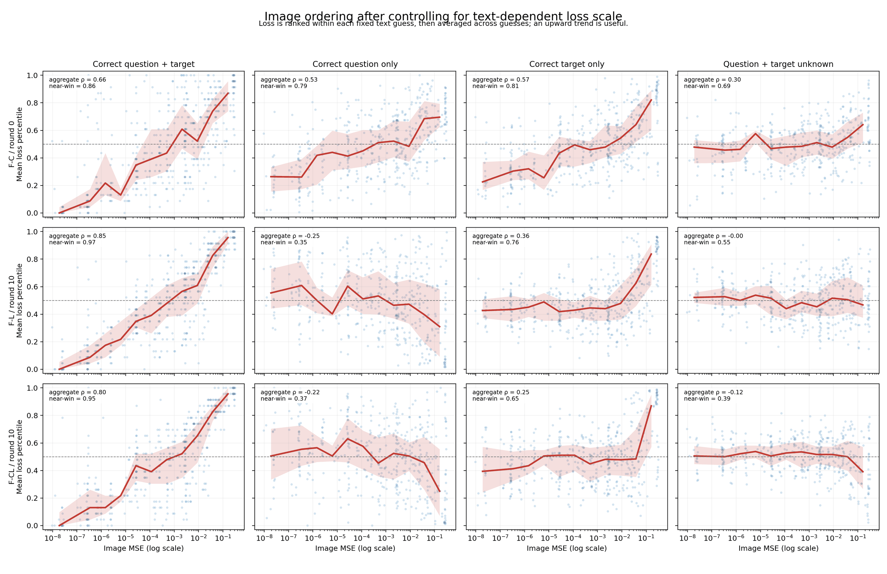
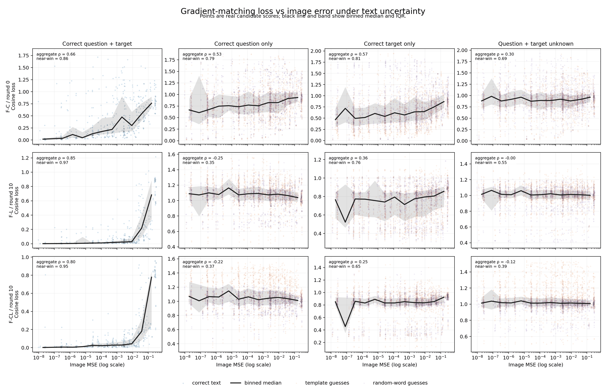
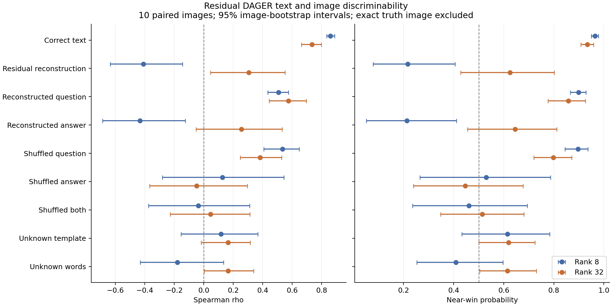
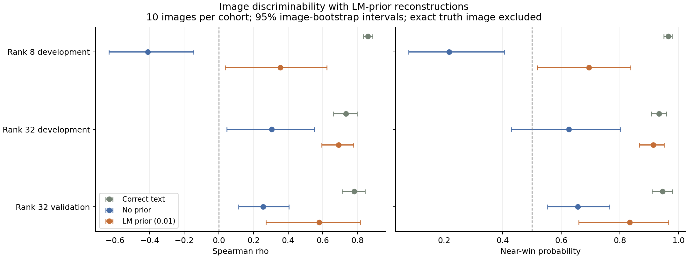
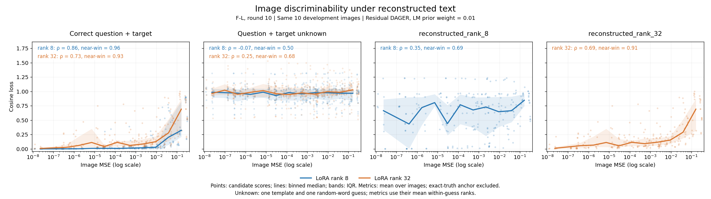
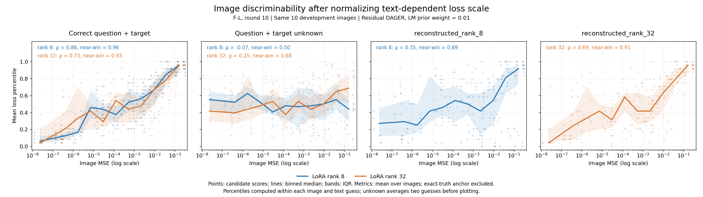

## 要点

- **语言先验让两个 rank 的开发集排序都改善**：权重 0.01 下，rank 8 的 rho 从 −0.409 升到 0.355，rank 32 从 0.305 升到 0.690。
- **rank 32 验证均值改善，但文本错误仍可使排序反转**：rho 从 0.256 升到 0.578；两个未完整恢复样本均为负相关，配对增益区间跨过 0。

- **正确 token 全部保留仍不足以维持排序**：问题和答案都乱序时，rank 8、32 的 rho 为 −0.037、0.046，接近零。
- **无先验的 Residual 重构效果取决于恢复质量和模型状态**：rank 8 的 rho 为 −0.409，rank 32 为 0.305；rank 32 仍明显弱于正确文本的 0.733。
- **纯乱序对照中，答案顺序更敏感**：只乱序问题仍有正向排序；仅看多 token 答案，只乱序答案时两个 rank 都呈负相关。

- **文本已知时排序很强**：三个条件下 Spearman rho 为 0.66–0.85，near-win 为 0.86–0.97。
- **只知道答案时还保留部分排序**：训练后的 F-L、F-CL，rho 分别为 0.363 和 0.248。
- **只知道问题时排序反转**：F-L、F-CL 的 rho 分别为 −0.248 和 −0.220。
- **问题和答案都靠猜时排序消失**：F-L 的 rho 为 −0.005，接近随机；F-CL 为 −0.118，呈弱负相关。
- **未训练的 F-C 保留了弱信号，但主要依赖模板**：只用随机词猜测时，rho 只有 0.082，near-win 为 0.540。

## 关键数字

2026-10-12 的固定 LM prior 权重对比，每个队列十张图像：

| Rank | Split | Prior weight | Spearman rho | Near-win |
|---|---|---|---:|---:|
| 8 | Development | 0 | −0.409 | 0.217 |
| 8 | Development | 0.01 | 0.355 | 0.694 |
| 32 | Development | 0 | 0.305 | 0.625 |
| 32 | Development | 0.01 | 0.690 | 0.913 |
| 32 | Validation | 0 | 0.256 | 0.656 |
| 32 | Validation | 0.01 | 0.578 | 0.834 |

Prior 固定为 0.01；该值只用于已完成的文本重构，图像评分中不额外加入先验。

2026-10-11 的 Residual 重构文本诊断（同一组十张图像；F-L round 10）：

| Rank | Correct text rho | Reconstructed text rho | Shuffled text rho | Reconstructed near-win |
|---|---:|---:|---:|---:|
| 8 | 0.859 | −0.409 | −0.037 | 0.217 |
| 32 | 0.733 | 0.305 | 0.046 | 0.625 |

Shuffled text 表示分别在问题和答案内部打乱全部内容 token；EOS、padding 和两者边界保持不变。

开发集（20 张图像），各条件下的 Spearman rho（损失排名与图像误差排名的相关性）：

| Strategy | Round | text_known | question_known | target_known | private |
|---|---|---:|---:|---:|---:|
| F-C | 0 | 0.658 | 0.529 | 0.569 | 0.299 |
| F-L | 10 | 0.846 | −0.248 | 0.363 | −0.005 |
| F-CL | 10 | 0.800 | −0.220 | 0.248 | −0.118 |

## 研究问题

- 攻击者需要猜问题、答案或两者时，匹配损失还能否给候选图像正确排序？
- Residual DAGER 的最终重构文本能否恢复图像排序？全部正确 token 都保留但顺序改变时，排序还能保留多少？

## 实验设置

| Item | Setting |
|---|---|
| 性质 | 使用私有数据的诊断，不是攻击基准 |
| 命令 | `python -m core.commands diagnose-text-unknown-discriminability` |
| 模型 | LLaVA-1.5-7B |
| 条件 | F-C 第 0 轮 F-L 第 10 轮 F-CL 第 10 轮 |
| 攻击者知识 | `text_known`：问题和答案都知道 `question_known`：只知道问题 `target_known`：只知道答案 `private`：问题和答案都不知道 |
| 候选集 | 25 张图像；每个文本猜测在整个候选集上保持不变 |
| 文本猜测 | 4 个公开模板，加上 4 个确定性的随机词猜测 |
| 聚合方式 | 对各个猜测下的排名取平均（mean-rank aggregate） |
| 样本 | pilot：F-L 第 10 轮，3 张图像 开发集：20 张图像 |
| 隐私保护 | 报告中只保留不透明的猜测 ID，不包含私有文本，也不包含猜测的文本 |

## 结果

### 开发集（20 张图像）

- 知道问题和答案时，三个条件都有很强的排序。
- 训练后的 F-L 和 F-CL 强烈依赖正确的答案：只知道答案时排序为正，只知道问题时排序反转。
- 问题和答案都靠猜时，F-L 接近随机，F-CL 呈弱负相关。
- 未训练的 F-C 在各种知识条件下都保留了一定排序，但这主要来自模板。

Near-win（图像误差更小的候选，损失也更低的概率；0.5 为随机）：

| Strategy | Round | text_known | question_known | target_known | private |
|---|---|---:|---:|---:|---:|
| F-C | 0 | 0.864 | 0.793 | 0.811 | 0.692 |
| F-L | 10 | 0.966 | 0.348 | 0.765 | 0.547 |
| F-CL | 10 | 0.950 | 0.375 | 0.649 | 0.391 |

下图把每个条件下损失排名与图像误差的关系画了出来，是本研究的主要对比图：

- 每行是一个模型状态，每列是一种攻击者知识；点是候选图像，红线和色带是分箱中位数和四分位范围。
- 损失先在每个固定的文本猜测内排名，再在各个猜测间取平均，以消除不同猜测带来的损失尺度差异。
- 曲线越往右上升，说明损失越能把误差小的图像排在前面；平线表示没有排序能力。

??? note "原始损失与图像误差（未控制尺度，仅作参考）"
    - 纵轴是原始余弦损失；不同文本猜测下损失的尺度不同，所以不能直接跨列比较。
    - 点的颜色区分正确文本、模板猜测和随机词猜测；黑线和灰色带是分箱中位数和四分位范围。

    

### Pilot（F-L 第 10 轮，3 张图像）

- pilot 的结果方向与开发集一致。
- Truth-image percentile 是真实图像在候选集中的排名百分位，越低越好。

| Knowledge | Spearman rho | Near-win | Truth-image percentile |
|---|---:|---:|---:|
| text_known | 0.865 | 0.980 | 0.000 |
| question_known | −0.339 | 0.263 | 0.568 |
| target_known | 0.252 | 0.714 | 0.497 |
| private | 0.025 | 0.528 | 0.498 |

### Residual DAGER 重构文本诊断（2026-10-11）

- 复用当前 `dager_adapted` 的 Residual (Random) 最终 token 产物，不重新运行攻击，不使用 Raw 版本。
- 测试 F-L round 10 的 rank 8、32，使用原 DAGER 开发集同一组十张图像。它与上文二十张图像的开发集不是同一队列，不直接比较均值。
- 正确文本、实际重构文本、仅问题使用重构、仅答案使用重构四个条件配对评分。
- 纯顺序对照在问题、答案或两者内部打乱全部内容 token，分别使用两个固定种子，保留 token 重复次数、EOS 与 padding；单 token 或全部相同的序列无法改变顺序，结果中单独报告。
- 图像候选沿用原来的 25 张；主要 Spearman rho 与 near-win 排除真实图像。乱序条件先对每次排列的损失排名，再取平均排名。
- 两个未知文本对照分别使用长度匹配的公开模板与随机词；它们不是上文八个猜测的聚合结果。
- 所有最终图像评分保存后才汇总；报告不包含解码后的私有文本。

| Item | Setting |
|---|---|
| Method | dager_adapted |
| Filter | Residual |
| Reconstruction image | Random surrogate，seed 0，图像私有 |
| Knowledge | private，token_lengths_known=true |
| Model | F-L round 10，rank 8、32，bf16 |
| Samples | 10 paired images，6 unique QA |
| Image bank | 原实验 25 candidates；主排序使用其中 24 张扰动图 |
| Text cases | 每个样本 12 个预声明条件；相同 token 序列共用评分 |
| Primary | 全上传梯度 cosine loss，Spearman rho，near-win |
| Near-win pairs | 近候选 MSE ≤ 0.001，远候选 MSE ≥ 0.01；近候选损失更低计 1，相同计 0.5 |
| Secondary | LoRA-A、LoRA-B、first QKV-A，relative L2 |
| Status | 两个 rank 全部完成，哈希与回放复核通过 |

### Residual 实际重构文本的排序

- rank 8 的实际重构使排序反转，平均 rho 为 −0.409，按图像 bootstrap 的 95% 区间为 [−0.635, −0.145]。
- rank 32 的实际重构保留了部分正向排序，rho 为 0.305，95% 区间为 [0.047, 0.552]；仍弱于同一模型下正确文本的 0.733。
- rank 32 的 near-win 为 0.625，但 95% 区间 [0.428, 0.802] 跨过随机基线 0.5，不能据此声称稳定可靠。
- 保持正确答案、只使用重构问题时，两个 rank 都保留较强排序；rank 8 的退化主要出现在答案也使用重构时。
- rank 32 已完整恢复答案的三个样本，实际重构的 rho 为 0.620、near-win 为 0.881；其余七个样本分别为 0.170、0.516。这是按答案正确性做的事后分组，不是独立验证。

| Rank | Question | Answer | Spearman rho | Near-win |
|---|---|---|---:|---:|
| 8 | Correct | Correct | 0.8594 | 0.9648 |
| 8 | Reconstructed | Reconstructed | -0.4090 | 0.2169 |
| 8 | Reconstructed | Correct | 0.5068 | 0.8990 |
| 8 | Correct | Reconstructed | -0.4322 | 0.2133 |
| 32 | Correct | Correct | 0.7331 | 0.9339 |
| 32 | Reconstructed | Reconstructed | 0.3052 | 0.6255 |
| 32 | Reconstructed | Correct | 0.5736 | 0.8580 |
| 32 | Correct | Reconstructed | 0.2560 | 0.6452 |

### 全部真实 token 保留，仅改变顺序

- 问题和答案都乱序时，两个 rank 的平均 rho 都接近零；rank 8 为 −0.037，rank 32 为 0.046。
- 对应 rho 的 95% 区间分别为 [−0.374, 0.311] 和 [−0.227, 0.314]，不支持稳定的正向排序。
- 保持答案正确、只乱序问题时，排序仍为正；答案乱序造成的退化更大。
- 下表按预声明方法对两次排列取平均排名，再计算排序；单次排列 rho 的均值另保存在 report.json 的 conditional_rho 中，结论方向一致。

| Rank | Question | Answer | Spearman rho | Near-win |
|---|---|---|---:|---:|
| 8 | Shuffled | Correct | 0.5336 | 0.8964 |
| 8 | Correct | Shuffled | 0.1272 | 0.5301 |
| 8 | Shuffled | Shuffled | -0.0370 | 0.4611 |
| 32 | Shuffled | Correct | 0.3831 | 0.7977 |
| 32 | Correct | Shuffled | -0.0489 | 0.4463 |
| 32 | Shuffled | Shuffled | 0.0461 | 0.5146 |

### 多 token 答案中的纯顺序效应

- 三个单 token 答案无法被乱序，所以全部十样本的均值会被这些保持正确的答案抬高。
- 只看其余七个多 token 答案，两个 rank 在只乱序答案时都出现负相关；所有这些答案的乱序都实际改变了序列。
- 这说明即使答案 token 的内容与重复次数全部正确，错误顺序仍足以破坏本轮的图像排序。

| Rank | Question | Answer | N | Spearman rho | Near-win |
|---|---|---|---:|---:|---:|
| 8 | Correct | Shuffled | 7 | -0.1981 | 0.3422 |
| 8 | Shuffled | Shuffled | 7 | -0.3007 | 0.2778 |
| 32 | Correct | Shuffled | 7 | -0.3534 | 0.2510 |
| 32 | Shuffled | Shuffled | 7 | -0.1392 | 0.3975 |

### 长度匹配的未知文本对照

- 两个对照分别使用一条公开模板和一个固定随机词猜测；每个样本中，文本在全部候选图像上保持一致。
- 这些结果用于本轮同一队列内比较，不能直接与上文八个猜测的 mean-rank aggregate 数值比较。
- rank 32 实际重构的 rho 高于两个未知对照的均值，但样本少、区间宽，不将这种均值差异视作已独立验证的提升。

| Rank | Question | Answer | Spearman rho | Near-win |
|---|---|---|---:|---:|
| 8 | Template | Template | 0.1174 | 0.6144 |
| 8 | Random words | Random words | -0.1781 | 0.4084 |
| 32 | Template | Template | 0.1641 | 0.6197 |
| 32 | Random words | Random words | 0.1641 | 0.6150 |

- 图中点为十张图像的均值，误差线为按图像 bootstrap 的 95% 区间；两者都不是新问答模板上的泛化区间。
- Reconstructed question 与 Shuffled question 都保留正确答案；Reconstructed answer 与 Shuffled answer 都保留正确问题。

### 最终重构序列中的 token 保留情况

- Bag recall 按最终序列计算，计入重复 token 的次数，不考虑顺序；它不等于第一阶段候选集的 Recall@100。
- 两个 rank 都没有出现“内容 token 完全保留、仅顺序错误”的问题或答案。rank 32 有三个答案完全正确，其余实际重构仍含 token 内容错误。
- 因此，实际重构与纯乱序对照回答不同的问题，必须分别报告。

| Rank | Role | Bag recall | Position accuracy | Exact sequence |
|---|---|---:|---:|---:|
| 8 | Question | 0.4633 | 0.3472 | 0/10 |
| 8 | Answer | 0.3250 | 0.2875 | 0/10 |
| 32 | Question | 0.8564 | 0.5981 | 0/10 |
| 32 | Answer | 0.5875 | 0.5000 | 3/10 |

### LM prior 重构文本的图像排序（2026-10-12）

- 复用 [[dager-lm-prior]] 已保存的权重 0 与 0.01 重构，不重新搜索文本或调整先验权重。
- rank 8 和 32 使用原十个配对开发样本；另测试 rank 32 已有的十个验证样本，不将它们混入跨 rank 比较。
- 每个队列都比较正确文本、无先验重构、带先验重构，以及只替换问题、只替换答案两个诊断对照。
- 图像排序仅使用梯度匹配损失，LM NLL 不进入图像评分；每条文本固定用于整个候选图像集。
- 两个开发队列重新计算的正确文本和无先验逐候选损失，与 2026-10-11 的结果完全一致。

| Item | Setting |
|---|---|
| Model | F-L round 10，rank 8、32，bf16 |
| Prior weight | 0、0.01，固定已有权重 |
| Reconstruction | dager_adapted，Residual (Random)，private，token_lengths_known=true |
| Development | 两个 rank 使用相同十张图像、六种问答 |
| Validation | 仅 rank 32，十张验证图像、十种问答 |
| Image bank | 原实验的 25 candidates；排序排除真图，保留 24 张扰动图 |
| Primary | 全梯度 cosine loss，Spearman rho，near-win |
| Near-win pairs | 近候选 MSE ≤ 0.001，远候选 MSE ≥ 0.01；相同损失计 0.5 |
| Controls | 正确文本、仅问题使用先验重构、仅答案使用先验重构 |
| Secondary | LoRA-A、LoRA-B、first QKV-A，relative L2，真实图像排名百分位 |
| Status | 三个队列全部完成，输入与评分完整性检查通过 |

### 先验改善了两个 rank 的开发集图像排序

- rank 8 的 rho 从 −0.409 提高到 0.355，排序由反向变为部分正向；仍低于正确文本的 0.859。
- rank 32 的 rho 从 0.305 提高到 0.690，near-win 从 0.625 提高到 0.913，接近同一模型下正确文本的 0.733、0.934。
- rank 32 验证集的均值也改善：rho 从 0.256 提高到 0.578，near-win 从 0.656 提高到 0.834；它仍有个别失败样本，不能只看总体均值。
- 图像评分使用的实际 token 产物保持原样，Question EM、Answer EM、Joint EM 与先验实验逐队列一致。

| Rank | Split | Text | Prior weight | Spearman rho | Near-win |
|---|---|---|---|---:|---:|
| 8 | Development | Correct | — | 0.8594 | 0.9648 |
| 8 | Development | Reconstructed | 0 | -0.4090 | 0.2169 |
| 8 | Development | Reconstructed | 0.01 | 0.3546 | 0.6944 |
| 32 | Development | Correct | — | 0.7331 | 0.9339 |
| 32 | Development | Reconstructed | 0 | 0.3052 | 0.6255 |
| 32 | Development | Reconstructed | 0.01 | 0.6903 | 0.9134 |
| 32 | Validation | Correct | — | 0.7805 | 0.9456 |
| 32 | Validation | Reconstructed | 0 | 0.2557 | 0.6563 |
| 32 | Validation | Reconstructed | 0.01 | 0.5784 | 0.8339 |

- 图中误差线是按图像 bootstrap 的 95% 区间，开发集只有六种问答，不代表新问答模板的泛化区间。

### 四列图：正确文本、未知文本与重构文本

- 四列依次为 `Correct question + target`、`Question + target unknown`、`reconstructed_rank_8`、`reconstructed_rank_32`。
- 使用同一组十张开发图像和每张图像的 24 个非真值候选；模型为 F-L round 10，重构方法为 Residual DAGER，LM prior 权重固定为 0.01。
- 前两列分别绘制 rank 8、32 的对照，颜色与后两列一致；不将两个模型的损失混成一条曲线。
- 未知文本使用每张图像已有的一组模板猜测和一组随机词猜测，长度与真实文本匹配。原始图展示两组分数，指标先对每种猜测的候选损失排名取平均，再逐图像计算 rho 和 near-win。
- 这张图的未知文本对照与前文二十张图像、八种猜测的旧图不同，不能直接替换旧图的数字。

| Rank | Text | Spearman rho | Near-win |
|---|---|---:|---:|
| 8 | Correct | 0.8594 | 0.9648 |
| 8 | Unknown | -0.0698 | 0.5013 |
| 8 | Reconstructed | 0.3546 | 0.6944 |
| 32 | Correct | 0.7331 | 0.9339 |
| 32 | Unknown | 0.2466 | 0.6763 |
| 32 | Reconstructed | 0.6903 | 0.9134 |

- 横轴为 Image MSE，纵轴为全部上传梯度的 Cosine loss；折线为十二个对数分箱的中位数，阴影为四分位区间，不是置信区间。
- 图内指标是逐图像计算后的均值，不是所有散点混合后的相关系数；真实图像锚点不参与指标计算或散点展示。
- 下图先在每张图像、每种固定文本内部将损失转为 percentile，再对未知文本的两种猜测取平均，用于比较不同文本条件的排序能力。

- rank 32 的重构文本接近同模型正确文本的排序表现；rank 8 只恢复部分排序能力。
- 图中候选依赖真实图像构造，因此它展示的是可区分性诊断，不是图像重构或属性恢复的成功率。

### 配对增益及其不确定性

- Gain 定义为同一张图像上权重 0.01 的指标减去权重 0 的指标，再对十张图像取平均。
- 两个开发队列的配对 rho 和 near-win 增益区间均为正。
- rank 32 验证集的两个增益区间都跨过 0；十个新样本支持均值改善，但尚不足以宣称稳定的整体提升。

| Rank | Split | rho gain | rho gain CI95 | Near-win gain | Near-win gain CI95 |
|---|---|---:|---|---:|---|
| 8 | Development | 0.7636 | [0.3910, 1.1299] | 0.4775 | [0.2419, 0.6897] |
| 32 | Development | 0.3851 | [0.1169, 0.6724] | 0.2879 | [0.1000, 0.4855] |
| 32 | Validation | 0.3227 | [-0.0092, 0.6184] | 0.1776 | [-0.0356, 0.3578] |

### 完整恢复与残余文本错误

- 文本完整恢复时，实际输入 token 与正确文本完全相同，对应图像损失也相同；这不是独立于文本正确性的额外恢复能力。
- rank 8 未完整恢复的八个样本仍有平均 rho 0.225、near-win 0.625，但区间较宽；不能将全部收益只归于两个完整恢复样本。
- rank 32 开发集中唯一未完整恢复的样本仍有部分排序；验证集两个未恢复样本则都出现负相关，说明错误文本的影响取决于具体样本。
- 下表是按已保存重构是否正确做的事后分组，不能用于攻击者筛选文本或选择图像；一个、两个样本的结果仅作个案描述。

| Rank | Split | Joint exact | N | Spearman rho | Near-win |
|---|---|---|---:|---:|---:|
| 8 | Development | Yes | 2 | 0.8726 | 0.9700 |
| 8 | Development | No | 8 | 0.2251 | 0.6255 |
| 32 | Development | Yes | 9 | 0.7257 | 0.9316 |
| 32 | Development | No | 1 | 0.3722 | 0.7500 |
| 32 | Validation | Yes | 8 | 0.7925 | 0.9551 |
| 32 | Validation | No | 2 | -0.2778 | 0.3491 |

### 验证集的问题错误和答案错误都可能使排序反转

- Run 4 的答案正确、问题错误，先验后的 rho 为 −0.379，低于无先验的 0.543；不能把所有失败都归结为答案错误。
- Run 5 的问题正确、答案错误，先验后的 rho 为 −0.177；换回正确答案时，rho 恢复到 0.839。
- 这两个样本也正是 [[dager-lm-prior]] 中最终 beam 保留真值但未选中的失败例。图像排序的结果不被用于反向选择 beam 或调整权重。

| Run | Incorrect field | Spearman rho | Near-win |
|---|---|---:|---:|
| 4 | Question | -0.3791 | 0.2436 |
| 5 | Answer | -0.1765 | 0.4545 |

### 问题、答案分别替换的诊断对照

- rank 8 保持正确答案、只使用先验重构问题时，排序比完整使用重构文本更好。
- rank 32 开发集的问题全部恢复，所以 prior_question 等同于正确文本；prior_answer 等同于完整先验重构。
- rank 32 验证集中分别修正问题或答案，都能改善均值；具体的错误问题仍可能破坏排序，不能将前一轮平均的答案敏感性推广为普遍规律。

| Rank | Split | Question | Answer | Spearman rho | Near-win |
|---|---|---|---|---:|---:|
| 8 | Development | Prior reconstruction | Correct | 0.6426 | 0.9165 |
| 8 | Development | Correct | Prior reconstruction | 0.3697 | 0.6589 |
| 32 | Development | Prior reconstruction | Correct | 0.7331 | 0.9339 |
| 32 | Development | Correct | Prior reconstruction | 0.6903 | 0.9134 |
| 32 | Validation | Prior reconstruction | Correct | 0.6800 | 0.8828 |
| 32 | Validation | Correct | Prior reconstruction | 0.6790 | 0.8967 |

## 结论

- 2026-10-12 的固定先验重构改善了两个 rank 的开发集图像排序；rank 32 的表现更接近正确文本，rank 8 只恢复部分信号。
- rank 32 的新问答验证也有平均改善，但配对增益区间跨 0；文本恢复仍有错误时，个别图像的排序可能反转。
- 本轮结果支持“改善文本恢复可以改善全局图像排序”，没有证明已经能够重构图像或稳定识别图像属性。

- 2026-10-11 的配对诊断表明，找齐 token 集合不足以保证图像排序：问题和答案都乱序时，两个 rank 的平均排序都接近随机。
- 关闭语言先验时，Residual `dager_adapted` 的实际重构在 rank 32 保留了部分正向信号，在 rank 8 则反转；不能把使用重构文本视为已经解决了图像区分性。
- 本轮对照表明答案内容和顺序更值得优先改进；正确答案配合重构或乱序的问题仍可保留较强排序。

- 知道正确的问题和答案时，所有条件下都有很强的图像排序。
- 训练后的模型，图像排序强烈依赖正确的答案。
- 只用公开模板或随机词猜测未知文本时，匹配损失不能提供稳定、与模型无关的图像排序信号。

## 局限

- LM prior 对比没有在 rank 8 上增加新问答验证；rank 32 验证集仅十张图像，且其中七个答案只有一个 token。
- 图像候选的远近仍由真实图像定义，本轮不验证攻击者能否在没有参考图像时构造同样的候选集。

- 这是开发阶段的证据，独立验证还没有开始。
- 比较时应以控制尺度的 `loss_rank_vs_mse` 图为主，因为不同猜测文本下原始损失的尺度不同。
- 重构文本诊断使用十张图像、六种问答。按图像 bootstrap 的区间不能代表新问答模板上的泛化误差。
- rank 8、32 的模型状态和重构文本同时变化；跨 rank 差异不能单独归因于文本质量。各 rank 内部的配对对照才固定了模型和目标梯度。
- 纯乱序对照保留了问题、答案边界及所有 token 的重复次数，比实际的未知文本条件更有利；两个排列种子不足以覆盖全部可能顺序。
- 本轮只评估候选图像的全局排序，没有运行图像重构优化器，也没有验证局部像素梯度能否恢复图像。

## 下一步

- 扩大固定权重下的新问答测试，重点保留未完整恢复文本的失败样本；分别评估问题和答案错误对排序的影响。
- 若继续属性方向，单独声明属性候选与评分规则，使用攻击者可得信息构造候选，不将本轮远近排序等同于属性恢复。

- 在新的多 token 答案上验证实际重构和纯乱序条件，优先检查答案恢复的影响。
- 若要分离文本质量与模型状态，固定一个模型，比较不同来源的重构文本，再判断是否值得进入图像优化实验。
- 冻结开发阶段的分析方法，再在独立样本上验证。

??? note "运行记录"

    - 2026-10-12：复用已完成评分生成四列原始损失图和损失排名图，没有新增 GPU 实验。核验 121 个输入文件，检查来源模型、观测与候选配对；正确文本和带先验重构的指标与既有报告一致。
    - 2026-10-12：三个队列共 2,075 次候选梯度计算及 30 次原始回放，回放 relative L2 全为 0；开发集与上一轮逐候选梯度损失最大差值为 0。
    - rank 32 验证集完成 550 次候选梯度计算，含加载用时 256.9 秒，峰值 allocated 21,141.2 MiB；三队列评分阶段合计约 14.7 分钟。
    - worker PID 936285、watcher PID 936286 均正常退出，watcher 报告 completed。全部输入与评分哈希、跨 rank 开发样本配对及重构 token 未修改检查通过。
    - 验证观测保留原 server_round=0 元数据；实际模型哈希与 round 10 快照一致，十次精确回放通过，没有改写原观测。
    - 2026-10-12：rank 32 开发集完成 525 次候选梯度计算和十次精确回放，含加载用时 252.4 秒，峰值 allocated 21,141.2 MiB。
    - 2026-10-12：rank 8 完成 1,000 次候选梯度计算和十次精确回放，含加载用时 371.2 秒，峰值 allocated 20,217.7 MiB；基线重算与旧结果最大差值为 0。
    - 2026-10-12：LM prior 区分性诊断与相关测试共 12 项通过，实验索引测试 19 项通过；Ruff 全目录、产物检查与 MkDocs 严格构建通过。三组来源重构的完成状态、观测标识、rank、Residual 模式、随机图像和先验权重校验通过。
    - 2026-10-11：rank 32 全部完成，2,450 次候选梯度计算，含模型加载用时 803.6 秒，峰值 allocated 21,141.2 MiB。两个 rank 的评分阶段合计约 27.8 分钟。
    - 2026-10-11：rank 8 全部完成，评分阶段含模型加载用时 862.2 秒，峰值 allocated 20,217.7 MiB；十次真实梯度回放 relative L2 均为 0。
    - 2026-10-11：新增诊断及相关测试 14 项通过，实验索引测试 19 项通过；Ruff 全目录、产物检查和 MkDocs 严格构建均通过。首次 launcher 因 shell 引号语法失败退出，没有运行 GPU 实验；修复脚本并通过 `bash -n` 后，在新目录启动，保留旧日志。
    - 2026-10-11：worker PID 849694、watcher PID 849695 均正常退出，watcher 报告 completed。共 5,050 次候选梯度计算，另有 20 次原始回放；回放 relative L2 全为 0，全部报告、来源输入及评分哈希通过复核。
    - pilot：1,875/1,875 条记录，用时 997 秒；GPU 峰值显存 allocated 20.14 GiB，reserved 20.83 GiB。
    - 开发集：物理 GPU 4，37,500/37,500 条记录（每个条件 12,500 条）；所有报告都已完成，没有失败记录。
    - 第一次 pilot 在第 425 条记录时中断，因为 YAML 把未加引号的 `yes`、`no` 词表项解析成了布尔值。commit `eb2a799` 给它们加了引号，并让读取配置时拒绝非字符串的模板和词表。
