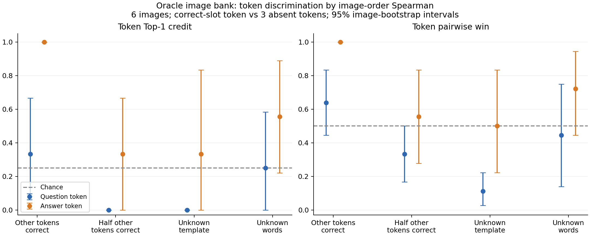

## 要点

- **全梯度排序尚不能用作通用 token 筛选器**：其余文本未知时，问题 token 的区分能力弱，答案效果依赖猜测背景。
- **正确图像排序不意味着 token 正确**：其余文本正确时，错误问题 token 也能保持很好的图像排序。
- **LoRA-A 的答案信号值得独立验证**：两个未知背景下的次要指标较好，且优于同组平均损失；这是同一小样本上的探索性发现。
- **本轮只验证使用真值的诊断假设**：图像候选集与探测位置依赖真值，尚未解决图像私有时如何构造有远近标签的候选集。

## 关键数字

| Item | Count |
|---|---:|
| Images | 6 |
| Probe roles | 2 |
| Text contexts | 4 |
| Token candidates per probe | 5 |
| Perturbed images per bank | 8 |
| Truth-image replay controls per bank | 1 |
| Unique QA sequences | 4 |
| Unique text conditions | 233 |
| Gradient evaluations including replays | 2103 |

## 研究问题

- **全梯度排序**：正确 token 是否比错误 token 更能恢复近图损失低、远图损失高的排序？其余文本未知时，这种差异是否仍然存在？
- **成员还是位置**：该信号反映的是 token 出现过，还是它恰好填对了某个位置？
- **LoRA-A 答案排序**：只用 LoRA-A 的梯度，答案 token 的排序能否更可靠？

## 实验设置

| Item | Setting |
|---|---|
| Model | LLaVA-1.5-7B，F-L round 10，LoRA rank 8，bf16 |
| Observation | 复用已有的单样本 FedSGD 更新，保持目标梯度不变 |
| Sample selection | 原十样本开发集固定随机排列，seed 20261006，取前六张不同图像 |
| Image bank | uniform_mix 和 gaussian 两种扰动，level 0.03、0.1、0.3、0.8；实际远近按像素 MSE 判断 |
| Probe positions | 问题和答案中最后一个包含字母的 token；位置使用私有文本确定 |
| Context | oracle_rest、half_rest、unknown_template、unknown_words |
| Candidates | correct_slot、present_elsewhere、absent_hard、absent_neighbor、absent_random |
| Negative selection | 错误候选不出现在整条真实问答中；分别选原过滤器高排名项、embedding 近邻和随机字母 token |
| Primary loss | 全部上传梯度的 cosine matching loss |
| Primary ranking | 排除真图后，在八张扰动图上计算 Spearman rho |
| Secondary metrics | near-win、近远损失差距、relative L2，以及 LoRA-A、LoRA-B、首层 QKV-A 分组 |
| Token comparison | 正确位置候选对三个缺席候选；Token Top-1 credit 的随机基线为 0.25，Token pairwise win 为 0.5 |
| Commit boundary | 保存全部图像损失后，再统一计算 token 区分指标；实验构造阶段使用真值并明确标为诊断 |

### 样本与运行状态

- 六个样本全部完成；每个样本的回放 relative L2 都为 0。
- 真图及完整真文本用于回放校验；真图不进入主要图像排序指标。
- 四种不同问答的样本数为 2、2、1、1。以下均是六张图像的均值，不是六条独立问答的均值。

## 结果

### 全梯度排序

**回答**：只在其余文本正确时成立：此时正确答案 token 在六个样本上全部胜出；其余文本未知后，问题 token 没有稳定优势，答案效果依赖猜测背景。

- Token Top-1 credit 比较一个正确位置候选与三个缺席候选；并列第一时平分得分，随机基线 25%。
- Token pairwise win 是正确候选超过缺席候选的比例，并列计半分，随机基线 50%。
- 正确问题 token 在未知模板下甚至比缺席 token 的排序更差；未知词语背景也没有稳定优势。
- 正确答案 token 在其余文本全部正确时六个样本均胜出；其余文本未知后明显退化。

| Role | Context | Token Top-1 credit | Token pairwise win | Correct rho | Absent rho |
|---|---|---:|---:|---:|---:|
| Question | oracle_rest | 33.3% | 63.9% | 0.921 | 0.779 |
| Question | half_rest | 0.0% | 33.3% | -0.508 | -0.090 |
| Question | unknown_template | 0.0% | 11.1% | 0.075 | 0.365 |
| Question | unknown_words | 25.0% | 44.4% | 0.123 | 0.204 |
| Answer | oracle_rest | 100.0% | 100.0% | 0.921 | -0.655 |
| Answer | half_rest | 33.3% | 55.6% | -0.123 | -0.365 |
| Answer | unknown_template | 33.3% | 50.0% | -0.032 | 0.062 |
| Answer | unknown_words | 55.6% | 72.2% | 0.313 | -0.050 |

#### 答案长度的影响

- unknown_words 的答案结果部分来自两个单 token 答案；填对这个位置即提供整个正确答案。
- 去掉这两个样本后，全梯度排序的 Top-1 得分为 33.3%，pairwise win 为 58.3%。
- 同样的单 token 答案在 unknown_template 下表现很差，进一步说明背景会改变排序信号。

| Context | Answer length | N | Token Top-1 credit | Token pairwise win |
|---|---|---:|---:|---:|
| unknown_template | Single token | 2 | 0.0% | 16.7% |
| unknown_template | Multiple tokens | 4 | 50.0% | 66.7% |
| unknown_words | Single token | 2 | 100.0% | 100.0% |
| unknown_words | Multiple tokens | 4 | 33.3% | 58.3% |

#### 与直接比较平均梯度损失的对照

- 使用相同八张扰动图，选择平均 cosine loss 最低的候选；这是评分结束后的对照，不改变预先声明的主指标。
- 全梯度的答案排序没有超过平均损失对照；half_rest 中只比较损失即可选中全部正确答案候选，但图像排序只得到 33.3%。
- 问题位置在 oracle_rest 下直接比较损失也明显更好。排序丢失了损失绝对高低中的信息。

| Role | Context | Ordering Top-1 | Mean-loss Top-1 |
|---|---|---:|---:|
| Question | oracle_rest | 33.3% | 83.3% |
| Question | half_rest | 0.0% | 0.0% |
| Question | unknown_template | 0.0% | 33.3% |
| Question | unknown_words | 25.0% | 16.7% |
| Answer | oracle_rest | 100.0% | 100.0% |
| Answer | half_rest | 33.3% | 100.0% |
| Answer | unknown_template | 33.3% | 66.7% |
| Answer | unknown_words | 55.6% | 66.7% |

### 成员还是位置

**回答**：更像位置与上下文的交互：错误 token 填在正确背景中也能保留排序，同一类 token 换个位置结果就变。

- 在 oracle_rest 下，问题位置换成完全缺席的 embedding 近邻后，平均 rho 仍为 0.893，接近正确候选的 0.921。错误 token 也可以保留排序。
- 同一背景下，答案位置填入缺席候选的平均 rho 为 -0.655；填入真实问答其他位置的 token 也只有 -0.552。信号取决于位置和上下文，不能仅解释为 token 是否出现过。
- unknown_template 下，正确问题候选的 rho 为 0.075，缺席高排名候选为 0.496。错误 token 并不总是只能造成微小变化，也可能得到更符合远近关系的排序。
- present_elsewhere 按其他真实 token 中的最小 ID 选取，可能是标点；它是位置对照，不是语义匹配的困难负例。

### LoRA-A 答案排序

**回答**：两个未知背景中答案 Top-1 为 83.3% 和 75.0%，优于全梯度；这是看到结果后才选的次要指标，需要独立验证。

- 梯度分组预先列入诊断，但在看到结果后才把 LoRA-A 选作后续关注点，不能当作预先验证通过的主结果。
- 只使用 LoRA-A cosine loss 时，两个未知背景中的答案 Top-1 得分分别为 83.3% 和 75.0%。对应按图像 bootstrap 的 95% 区间为 [50.0%, 100.0%] 和 [41.7%, 100.0%]。
- 排除单 token 答案后仍保留优势，说明这个次要信号不完全由短答案造成。
- 该优势没有普遍延伸到问题 token：两个未知背景的问题 Top-1 分别为 0.0% 和 33.3%。
- relative L2 并未一致改善：全梯度下问题位置在两个未知背景中为 33.3% 和 50.0%，答案位置为 50.0% 和 0.0%；完整分组统计保存在 report.json。

| Context | Answer length | N | Ordering Top-1 | Mean-loss Top-1 | Ordering pairwise win |
|---|---|---:|---:|---:|---:|
| unknown_template | All | 6 | 83.3% | 66.7% | 88.9% |
| unknown_words | All | 6 | 75.0% | 33.3% | 80.6% |
| unknown_template | Multiple tokens | 4 | 100.0% | 75.0% | 100.0% |
| unknown_words | Multiple tokens | 4 | 75.0% | 25.0% | 75.0% |

## 结论

- 用户提出的联系在受限条件下成立，尤其是其余文本正确时的答案候选；但没有得到全梯度排序可直接替代第一阶段 token filter 的证据。
- 更符合本轮观测的解释是：图像排序反映了候选文本、具体位置与目标梯度之间的交互，不是独立的 token 成员信号。此处是基于实验的解释，尚未做因果分解。
- 保留 LoRA-A 的答案排序作为后续独立验证方向；目前没有更改攻击实现或默认筛选器，也没有得到新的序列恢复结果。

## 局限

- 攻击者通常无法构造具有真实远近标签的图像银行。
- 探测位置使用真值，不能据此声称恢复了词表或序列。
- 其中两个样本的答案只有一个 token；填对该 token 等于提供整个正确答案，需要与多 token 答案分开解释。
- 图像远近仅按像素 MSE 定义，不等同于语义远近。
- 每个位置只比较三个缺席候选，不能外推成全词表筛选能力。
- 六张图像仅覆盖四种问答，区间按图像进行 bootstrap，不能代表问答分布上的泛化误差；退化的 [0,0] 或 [1,1] 区间也不代表确定性保证。
- LoRA-A 优势来自多个次要分组中的选择；独立验证前不能宣称显著、稳定的改进。

## 下一步

- 若继续此方向，冻结 LoRA-A cosine 排序及候选规则，在新的多 token 答案上验证，并与同组平均损失做配对比较。
- 若独立验证通过，再扩大候选数量、探测位置与背景集合；检验背景平均是否保留优势。
- 最后单独解决无真实图像时的候选集构造及远近标签问题，避免把使用真值的诊断直接当成攻击方法。

??? note "运行记录"

    - 用户授权 GPU 5。
    - 通过 detached worker 与 watcher 启动。
    - GPU 5 评分用时 683.1 秒，包含模型加载；worker 与 watcher 均正常退出。
    - 共 233 组不重复文本条件，每组 9 次梯度计算，另有 6 次真实回放。
    - 全部图像评分在分析前落盘；逐评分文件、计划和报告的哈希复核通过。
    - 图像银行、并列排名和文本背景构造的三项新 CPU 测试已通过；全量 CPU 回归为 289 通过、3 跳过，Ruff 无报错。
