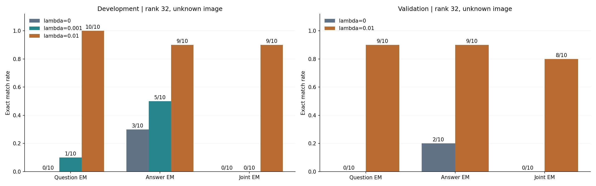
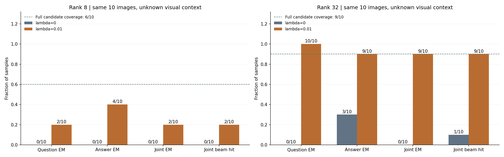

## 要点

- **rank 8 使用相同权重只得到有限改善**：权重 0.01 将 Joint EM 从 0/10 提高到 2/10；两个成功样本对应同一种问答，不能照搬 rank 32 的收益。
- **rank 8 仍有候选漏检和早期剪枝两种限制**：四个样本候选不完整；另外四个候选完整的样本，真实前缀仍在问题阶段被剪掉。
- **rank 32 冻结权重后，完整问答恢复在新样本上升到 8/10**：验证集 Question EM、Answer EM 均为 9/10，原基线分别为 0/10、2/10，Joint EM 为 0/10。
- **rank 32 语言先验改善了真实前缀的保留**：验证集十个正确完整问答都进入最终 beam，剩余两个错误发生在最终排序。
- **rank 32 开发集的完整问答恢复升到 9/10**：权重 0.01 下 Question EM 为 10/10、Answer EM 为 9/10；原基线分别为 0/10、3/10。
- **rank 32 原搜索同时存在剪枝失败和最终排序失败**：十个样本中一个正确完整问答仍在最终 beam，其余九个的真实前缀已被淘汰。
- **rank 32 首次淘汰不由候选漏检直接触发**：九次首次淘汰对应的真实 token 均在候选集中；其中一个样本在后续位置仍存在筛选漏检。
- **语言先验采用软评分**：只在序列评分中增加纯文本 NLL，不按语言概率删除候选。
- **默认行为尚未切换**：权重仍为 0，实现与实验记录已按用户要求提交，原始产物保存在本地。

## 关键数字

rank 32 开发集三十次、验证集二十次，以及 rank 8 原开发集二十次重构全部完成。同一 rank 内两种权重使用相同随机替代图与第一阶段候选集；rank 8 和 32 的开发样本已核实逐项配对：

| Rank | Split | Prior weight | Image | Full coverage | Question EM | Answer EM | Joint EM | Joint beam hit |
|---|---|---|---|---:|---:|---:|---:|---:|
| 8 | Development | 0 | Random | 6/10 | 0/10 | 0/10 | 0/10 | 0/10 |
| 8 | Development | 0.01 | Random | 6/10 | 2/10 | 4/10 | 2/10 | 2/10 |
| 32 | Development | 0 | Random | 9/10 | 0/10 | 3/10 | 0/10 | 1/10 |
| 32 | Development | 0.001 | Random | 9/10 | 1/10 | 5/10 | 0/10 | 3/10 |
| 32 | Development | 0.01 | Random | 9/10 | 10/10 | 9/10 | 9/10 | 9/10 |
| 32 | Validation | 0 | Random | 10/10 | 0/10 | 2/10 | 0/10 | 2/10 |
| 32 | Validation | 0.01 | Random | 10/10 | 9/10 | 9/10 | 8/10 | 10/10 |

Joint beam hit 表示最终 beam 中包含正确的完整问答；按实际 token ID 判断。

原 rank 32 Residual (Random) 的已完成十样本审计：

| Item | Count |
|---|---:|
| Full candidate coverage | 9/10 |
| Correct question at question boundary | 5/10 |
| Correct question in final beam | 4/10 |
| Correct answer in final beam | 4/10 |
| Correct joint sequence in final beam | 1/10 |
| First drop in question | 5/10 |
| First drop in answer | 4/10 |
| First dropped token in candidate set | 9/9 |

Beam 命中只说明正确候选被保留，不等于最终输出正确。此处的命中按实际 token ID 判断。

## 研究问题

- 在未知真实图像时，纯文本语言先验能否让真实前缀更容易留在 beam 中？
- 改善能否转化为 Question EM、Answer EM 和 Joint EM，而不只是句子更通顺？

## 实验设置

| Item | Setting |
|---|---|
| Model | 复用 rank 32、F-L round 10 快照，不重新训练 |
| Rank 8 extension | 复用 rank 8、F-L round 10 快照与原开发集十个观测；用户固定权重 0.01，仅对比 0 与 0.01，不调参 |
| Observation | 原十样本单样本 FedSGD，公开 token 长度 |
| Knowledge | private；固定 seed 0 随机替代图 |
| Filter | 原 Residual，informative K=100；额外 ambiguous 候选照旧保留 |
| Search | beam 16，prefix batch 32，原时间与评估预算，无全梯度重排 |
| Prior weights | 0、0.001、0.01 |
| Validation weights | 0、0.01；在验证集评估前冻结 |
| Prior model | 同一公开受害模型的完整语言模块，只输入文本，不输入视觉特征 |
| Prior context | USER、新行、候选问题、ASSISTANT、候选答案；不输入 EOS 或 padding |
| Scoring | 原累计 Residual 距离加权重乘累计内容 token NLL；使用全词表概率 |
| Cost | 每个父前缀一次完整纯文本前向，为全部候选提供概率；无反向，无外部模型 |
| Development selection | 先最大化 Joint EM，再最大化 Question EM 与 Answer EM 之和，同分选更小权重 |
| Validation gate | 正权重必须优于权重 0 才进入冻结验证 |
| Validation selection | 新 eval 图像组，十种不同实际 token 问答，排除开发集问答；不按攻击效果筛样本 |
| Reference boundary | 本阶段全部攻击保存后才读取私有参考进行评估和 LM 排名诊断 |

## 结果

### rank 32 原搜索的保存状态审计

- 已保存的 checkpoint 包含完整 beam，且十个样本均能找到每个完成深度的 beam。
- 可以直接确定真实前缀首次丢失的位置，不必重跑完整搜索树。
- 问题部分的五次首次淘汰均发生在该样本的第十个私有位置。
- 最终 beam 中的正确完整问答仅一个；单独改变终检排序最多能恢复这个候选，不能补回其他已被剪掉的序列。

### rank 32 三权重配对测试

- 权重 0 在十个样本上逐项复现旧 token 产物、筛选分数和最终 beam。
- 两个正权重条件的第一阶段候选产物均与权重 0 完全一致。
- 权重 0.01 的问题全部正确，九个候选完整覆盖的样本均恢复了完整问答；剩余一个样本仍有第一阶段漏检。
- Question EM 与 Answer EM 的提升也通过了实际 token ID 完全一致检查。
- 权重 0.001 虽改善了部分答案和最终 beam 命中，但没有改善完整问答输出。

| Prior weight | Question ROUGE-L | Answer ROUGE-L | Prefix survival fraction | Mean seconds |
|---|---:|---:|---:|---:|
| 0 | 0.8980 | 0.4100 | 0.7601 | 87.49 |
| 0.001 | 0.9358 | 0.5727 | 0.8763 | 86.97 |
| 0.01 | 1.0000 | 0.9727 | 0.9882 | 86.64 |

用于展示的 rank 32 全文指标如下。问题与答案以单个空格拼接，不包含公开模板；逐样本计算 ROUGE F1、EM 和 Word Recall 后取平均。Development 与 rank 8 使用同一批十个样本，Validation 是另外十个样本，不能混合为同一对照：

| Split | Method | Prior weight | Image | EM | ROUGE-1 | ROUGE-2 | ROUGE-L | Word Recall |
|---|---|---|---|---:|---:|---:|---:|---:|
| Development | Erasure | 0.01 | Random | 0.900 | 0.988 | 0.987 | 0.988 | 0.992 |
| Development | Erasure | 0 | Ground-Truth | 0.500 | 0.944 | 0.933 | 0.944 | 0.929 |
| Development | Erasure | 0 | Random | 0.000 | 0.838 | 0.730 | 0.838 | 0.870 |
| Development | Raw | 0 | Ground-Truth | 0.300 | 0.918 | 0.881 | 0.918 | 0.898 |
| Development | Raw | 0 | Random | 0.000 | 0.790 | 0.607 | 0.790 | 0.794 |
| Validation | Erasure | 0.01 | Random | 0.800 | 0.960 | 0.939 | 0.960 | 0.965 |
| Validation | Erasure | 0 | Random | 0.000 | 0.840 | 0.726 | 0.826 | 0.852 |

Erasure 对应本实现的 Residual，沿用用户展示表的名称；带先验的展示行可写作 DAGER-Erasure-LM。结果来自 `full_text_table.json`，未测试 Ground-Truth 图像条件下的语言先验。

- 共享 GPU 下的耗时只能作本次运行描述，不能把小幅差异解释为先验加速。
- 先验确实执行了额外完整纯文本前向；本轮没有增加反向传播，也没有减少第一阶段候选数。

### rank 32 首次淘汰位置的语言模型信号

- 在所有攻击保存之后，使用原基线首次淘汰位置的真实前缀做诊断。
- 五个问题位置的真实 token 在纯文本 LM 中均排第 1。
- 四个答案位置的真实 token 分别排第 2、2、3、19。
- 这些位置存在支持真值的语言信号，与软先验的开发收益方向一致。
- 本轮这九个位置没有出现 Top-20 误删反例；这不证明全序列硬剪枝安全，也不能据此改成硬剪枝。

### rank 32 冻结的新问答验证

- 按预声明规则选择权重 0.01；验证只比较 0 与 0.01，不继续调整权重。
- 选择十个新的 eval 图像组，实际 token 问答彼此不同，并排除开发集的问答。
- 十个验证问题彼此不同，其中八个问题文本未在开发集出现；另外两个问题对应不同答案。开发与验证之间没有相同问答或相同图像哈希。
- Question EM 从 0/10 升到 9/10，Answer EM 从 2/10 升到 9/10，Joint EM 从 0/10 升到 8/10。
- 文本 EM 与实际 token ID 的完全一致比例相同，没有把不同 token 序列解码后的相似文本当成精确 token 恢复。
- 正确完整问答在最终 beam 中的覆盖从 2/10 升到 10/10；原来存在的真前缀剪枝问题在这十个验证样本上消失。

| Prior weight | Question ROUGE-L | Answer ROUGE-L | Prefix survival fraction | Mean seconds |
|---|---:|---:|---:|---:|
| 0 | 0.8862 | 0.2500 | 0.8508 | 59.05 |
| 0.01 | 0.9615 | 0.9000 | 1.0000 | 59.15 |

| Split | Images | Distinct QA | Distinct questions |
|---|---:|---:|---:|
| Development | 10 | 6 | 4 |
| Validation | 10 | 10 | 10 |

### rank 32 两个未恢复样本的最终排序

- 两个真实完整序列都保留在最终 beam 中，但没有排在第一。
- Run 4 的真实序列几何分数略好，语言先验却更偏好错误问题，最终真值排第十三。
- Run 5 的真实序列在几何分数和语言先验上都落后，最终真值排第四；仅改变非负权重无法让它超过当前错误赢家。
- 下表差值均为真值分数减去最终赢家分数，越小越好；Combined difference 等于 Span difference 加 0.01 乘 NLL difference。

| Run | Incorrect field | True sequence rank | Span difference | NLL difference | Combined difference |
|---|---|---:|---:|---:|---:|
| 4 | Question | 13 | -0.009823 | 4.175855 | 0.031936 |
| 5 | Answer | 4 | 0.012158 | 3.437500 | 0.046533 |

- 这两例说明语言先验有帮助，但不等于真值判据。没有根据验证集失败例再调权重或重跑攻击。

### rank 8 固定权重扩展

- 按用户指定固定权重 0.01，复用原十个开发样本，没有重新训练或按效果调整设置。
- 权重 0 精确复现十个旧结果的 token、筛选分数和最终 beam；正权重的第一阶段候选产物逐项不变。
- Question EM 从 0/10 提高到 2/10，Answer EM 从 0/10 提高到 4/10，Joint EM 从 0/10 提高到 2/10；实际 token ID 的 EM 与文本 EM 一致。
- 原十个样本只有六种问答；两个完整恢复样本是 Run 5、6，对应同一种问答，成功不能视为两种独立问答的验证。
- 与 rank 32 的原开发集逐项核对了文本 token 和图像哈希，确认两者使用同一批样本；rank 8 未追加新问答验证。

| Prior weight | Question ROUGE-L | Answer ROUGE-L | Prefix survival fraction | Mean seconds |
|---|---:|---:|---:|---:|
| 0 | 0.4541 | 0.0000 | 0.3400 | 43.41 |
| 0.01 | 0.4863 | 0.4182 | 0.4442 | 44.07 |

展示用全文指标采用 `question + 单个空格 + answer`，不加入公开对话模板。逐样本计算后对十张图像取平均；ROUGE 使用 F1，不启用 stemming，Word Recall 使用忽略大小写的词频重叠。这一口径精确复现旧表四行的三位小数，与上表单独 Question、Answer 指标不同：

| Method | Prior weight | Image | EM | ROUGE-1 | ROUGE-2 | ROUGE-L | Word Recall |
|---|---|---|---:|---:|---:|---:|---:|
| Erasure | 0.01 | Random | 0.200 | 0.455 | 0.334 | 0.455 | 0.442 |
| Erasure | 0 | Ground-Truth | 0.000 | 0.585 | 0.427 | 0.572 | 0.551 |
| Erasure | 0 | Random | 0.000 | 0.386 | 0.209 | 0.374 | 0.389 |
| Raw | 0 | Ground-Truth | 0.000 | 0.256 | 0.175 | 0.256 | 0.243 |
| Raw | 0 | Random | 0.000 | 0.241 | 0.157 | 0.241 | 0.243 |

这里沿用用户展示表中的 Erasure 名称，对应实现的 Residual；所有行均为 rank 8。尚未测试 Ground-Truth 图像条件下的语言先验，不能用 Random 的结果填入该条件。

- 图中虚线表示完整候选覆盖比例，仅约束完整序列的精确恢复，不是单独 Question EM 或 Answer EM 的上限。
- 以下按“候选是否完整”和“完整问答是否恢复”划分样本；候选缺失是不可恢复的限制，不表示首次剪枝一定由漏检触发。

| Full coverage | Joint EM | Count | Observation |
|---|---|---:|---|
| No | No | 4 | 缺少 1–3 个不同真实 token，当前候选集无法表达完整真值 |
| Yes | No | 4 | 真前缀在问题第 3、4、5、7 个 token 处被剪掉 |
| Yes | Yes | 2 | 正确完整序列进入最终 beam 并排第一 |

- 四个候选缺失样本也都先在一个已包含的真实 token 处被剪枝；不能把所有失败单独归因于第一阶段。
- 八个未恢复样本都在问题阶段丢失真实前缀。最终 beam 仅包含两个正确完整问答，且都已选中；单纯重排当前最终 beam 无法补回其他完整问答。
- 权重 0 的十个首次淘汰位置，其真实 token 在真实父前缀的纯文本 LM 中均排第 1；这是攻击结束后的诊断。局部语言信号存在，但不代表权重 0.01 足以改变整个 beam 的竞争结果。
- 在候选全覆盖的六个样本中仅恢复两个，说明 rank 8 的收益受序列评分与剪枝继续限制，不能仅靠补齐漏检解释与 rank 32 的差距。
- 本实验不证明增大权重就一定有效，也不证明 rank 8 在其他设置下无法恢复；当前结论限定为固定权重 0.01。

## 结论

- 本轮已保存的文本进一步用于图像排序诊断：两个 rank 的开发集平均排序都改善，rank 32 验证集仍受两个错误文本样本影响。图像评分没有加入语言先验；完整设置、区间和失败例统一记录在 [[text-unknown-discriminability]] 的 2026-10-12 部分，不与本页文本恢复指标混用。

- 保存状态支持研究第二阶段的评分与剪枝。
- 纯文本先验在本开发集上改善了剪枝和最终恢复，权重 0.01 将 Joint EM 从 0/10 提高到 9/10。
- 冻结相同权重后，新问答验证的 Joint EM 从 0/10 提高到 8/10，支持保留该实验变体。
- 不声称解决了全部文本恢复：开发集仍有筛选漏检，验证集仍有最终排序失败。
- 相同权重在 rank 8 只有有限收益，Joint EM 为 2/10，且成功集中于同一种问答；rank 32 的强收益不能直接外推。
- 本页的私有数据标记对应事后审计，实际攻击没有读取真实图像、真实文本或私有样本标识。

## 局限

- 原开发集十张图像只有六种问答，不能把逐 token 淘汰规律解释成独立泛化结论。
- 新问答验证仅在 rank 32 进行，覆盖十个新图像组和一个随机替代图种子；rank 8 只复测原十样本，不外推到新问答、rank 16 或未知长度条件。
- 验证集有十种不同问题，但其中两种问题文本在开发集出现过；相应问答和图像不重复。
- 文本先验可能压低罕见医学词和正确但不常见的答案。
- Residual 距离没有经过概率校准，组合评分是正则化目标，不是精确后验或恢复保证。
- 使用纯文本路径避免了先验读取错误图像，但原 Residual 路径仍使用随机替代图，图像失配没有被消除。

## 下一步

- 若继续研究，先扩大不同问题文本与随机替代图种子上的冻结验证。
- 两个排序失败保留为后续诊断，不以本验证集反复调参。
- rank 8 若继续，先诊断候选完整但早期被剪的四个样本的几何分差与 NLL 分差，区分权重尺度和几何排序问题；当前未追加调参。
- 实现已于 2026-10-17 按用户要求提交；后续跨数据集验证保持默认先验关闭。

??? note "运行记录"

    - 2026-10-12 rank 8 扩展在 GPU 5 完成：worker PID 927227、watcher PID 927228 均已退出，二十次重构全部 completed；阶段耗时 1032.3 秒，峰值 allocated 18831.3 MiB。
    - rank 8 十个基线精确复现，二十次公共输入、产物哈希、随机图像及候选一致性检查通过；全部重构保存后才进行私有参考评估与跨 rank 配对审计。
    - 扩展实验脚本支持按 rank 选择快照并固定权重，攻击实现和默认权重不变；全量 CPU 回归 311 通过、3 跳过，Ruff 通过；当时保留在工作区，现已提交。
    - GPU 5；开发 worker PID 884346、watcher PID 884347 已正常退出。
    - 开发阶段三十次重构全部 completed，总耗时 2769.7 秒，峰值 allocated 18950.2 MiB；十个基线均通过精确复核。
    - 2026-10-12：验证 worker PID 899086、watcher PID 899087 已完成；二十次重构全部 completed，总耗时 1650.3 秒，峰值 allocated 20527.3 MiB。
    - 两阶段五十次攻击的公共观测、输出哈希、模型指纹、同一随机图像及候选不变检查全部通过。
    - 第一次启动器因输出父目录不存在而在日志重定向阶段失败，未启动 GPU 实验；已保存失败说明并修复启动器。
    - 实现初检 35 项相关测试通过；新增边界测试后全量 CPU 回归 309 通过、3 跳过，Ruff 通过。
    - 开发完成后修正了权重选择时的浮点并列比较，避免 `0.1 + 0.2` 与 `0.3` 被误判；本轮选中的 0.01 不受影响，攻击实现未改变。相关十项测试及 Ruff 再次通过。
    - 标准 Hydra 配置解析通过；实验索引十九项测试、本地产物检查和 MkDocs 严格构建通过。
    - 最终全量 CPU 回归 310 通过、3 跳过，Ruff 通过；本次修改现已提交。
    - 验证观测的 `server_round` 沿用了原配置文件的 0；实际模型哈希仍对应训练第十轮快照。F-L 的参数组和 FedSGD 更新计算不使用该计数，两种权重的计数也相同；新增对照测试确认计数 0 与 10 的上传梯度逐项完全一致。原始观测未改写，运行结束后已修正后续捕获，使其显式使用模型快照的轮次标记。
    - 攻击 checkpoint schema 升为 2，不静默迁移旧 checkpoint；旧状态仅供只读事后审计。
