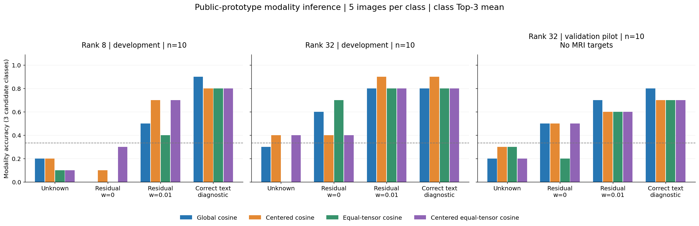
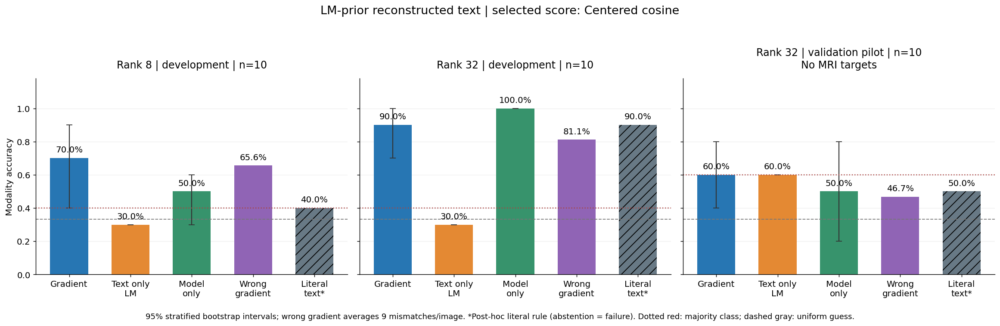
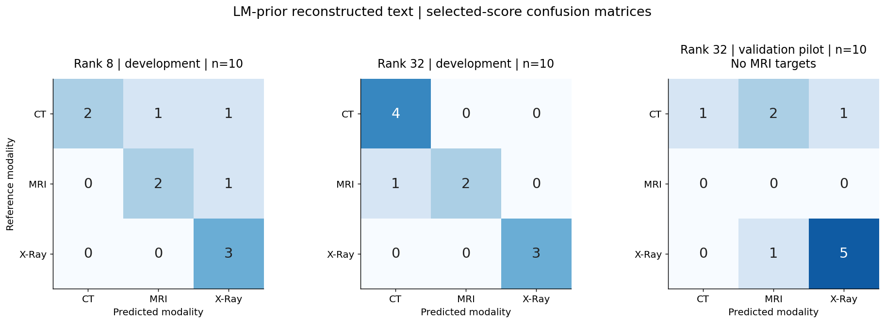
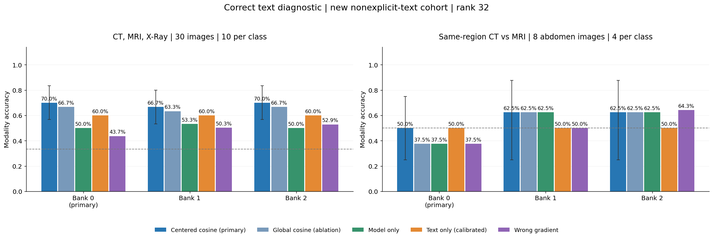
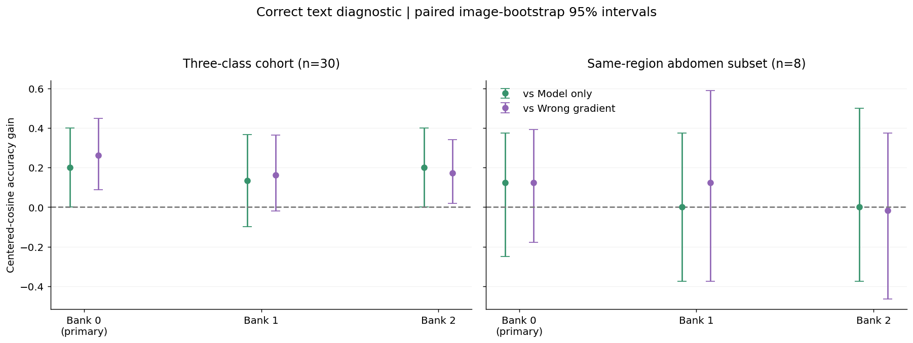
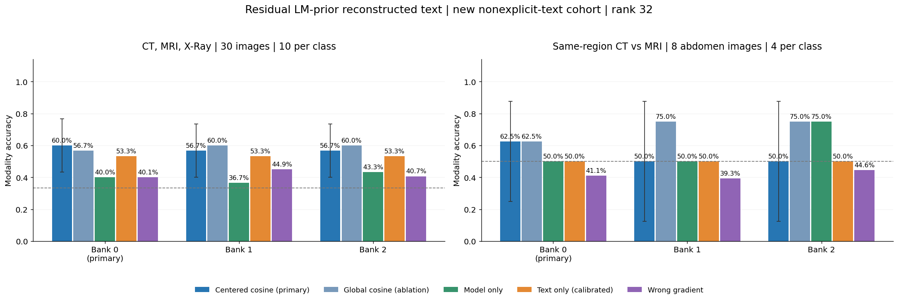
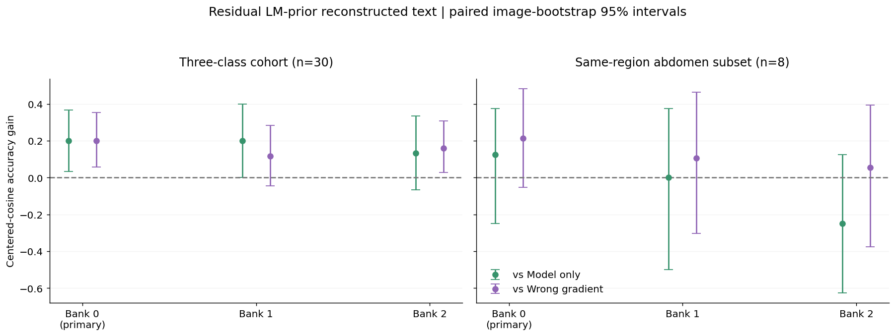

## 要点

- **新队列上梯度评分优于 Model-only**：重构文本下主方法正确 18/30，Model-only 为 12/30；相对校准 Text-only（16/30）的优势仍不确定。
- **评分依赖目标梯度**：重构文本下正确梯度准确率 0.600，错配梯度 0.401，配对增益区间 [0.056, 0.353]；这不等于分离出了纯视觉信息。
- **文本恢复误差带来小幅损失**：正确文本下 21/30，重构文本下 18/30；新队列完整问答恢复 17/30。
- **同部位子集尚不稳定**：腹部子集上冻结方法在三个公开库为 4–5/8；探索性的中心化等权评分均为 7/8，不替换主结果。
- **两轮准确率不能合并**：首轮二十张的问答常直接透露模态，且验证集缺 MRI；新队列补齐三类并排除显式提示，但仍有部位等间接线索。

## 关键数字

扩展使用 Rank 32，冻结的主方法为 Centered cosine，Bank 0 是预先指定的主公开库。新队列为 CT、MRI、X-Ray 各十张，候选图像每类五张。

| Phase | Images | Gradient accuracy | Model-only accuracy | Calibrated text-only accuracy | Wrong-gradient accuracy |
|---|---:|---:|---:|---:|---:|
| New cohort, correct text | 30 | 0.700 | 0.500 | 0.600 | 0.437 |
| New cohort, reconstructed text | 30 | 0.600 | 0.400 | 0.533 | 0.401 |

| Question EM | Answer EM | Joint EM |
|---:|---:|---:|
| 23/30 | 21/30 | 17/30 |

**首轮 pilot**（复用重构产物）：

主结果使用在 rank 32 开发集选择、验证前冻结的 Centered cosine。所有队列的候选类别始终为 CT、MRI、X-Ray。

| Cohort | Rank | Images | Unknown accuracy | Residual accuracy | LM-prior accuracy | Correct-text accuracy | Model-only accuracy |
|---|---:|---:|---:|---:|---:|---:|---:|
| Development | 8 | 10 | 0.200 | 0.100 | 0.700 | 0.800 | 0.500 |
| Development | 32 | 10 | 0.400 | 0.400 | 0.900 | 0.900 | 1.000 |
| Validation | 32 | 10 | 0.300 | 0.500 | 0.600 | 0.700 | 0.500 |

Residual 的先验权重为 0；LM-prior 为 0.01；Model-only 使用同一份带先验重构文本。两个开发队列使用同一组图像，独立目标合计二十张，观测合计三十个。

## 研究问题

- **首轮 pilot**：固定重构问答后，梯度匹配能否通过独立公开图像库预测目标图像的成像模态？语言先验带来的文本改善能否提高分类效果？
- **扩展队列**：在三类平衡、文本不显式透露模态的新队列上，梯度评分能否超过不使用梯度的对照？
- **评分方式**：中心化和张量等权是否值得采用？
- **两轮综合**：两轮条件不同，结果应如何合并解释？

## 实验设置

### 首轮 pilot

下表描述首轮 pilot。扩展保留评分和模型设置，改用三十张新图像、三个公开库，并重新运行固定权重的文本重构；差异见后面的扩展结果。

| Item | Setting |
|---|---|
| Model | LLaVA-1.5-7B；复用 rank 8、32 的 F-L round 10 快照 |
| Observation | 单样本 FedSGD，private，公开 token 长度 |
| Text | 固定模板、Residual 权重 0 重构、Residual 权重 0.01 重构、正确文本诊断 |
| Reconstruction | 复用已有产物；不训练模型，不重新搜索文本 |
| Classes | CT、MRI、X-Ray |
| Bank | 声明为攻击者辅助数据的 tune 子集；排除全部开发和验证目标 |
| Sampling | 每类五张，seed 20261016；不使用目标梯度或匹配效果选图 |
| Aggregation | 类内最低三个损失的平均值；分数越低越好 |
| Scores | Global cosine、Centered cosine、Equal-tensor cosine、Centered equal-tensor cosine |
| Centering | 每条固定文本下，十五张公开候选的平均梯度；观测与候选减去同一个均值 |
| Selection | rank 32 开发集、权重 0.01 下的 Balanced accuracy；预先固定同分顺序 |
| Frozen score | Centered cosine；验证结果不用于重新选择 |
| Controls | Text-only LM、Model-only、同队列其他九个观测梯度的错配对照 |
| Uncertainty | 按图像、按类分层的 2,000 次 paired bootstrap；seed 20261016 |
| Boundary | 每个队列全部非 oracle 属性预测保存后，才读取参考文本和图像进行诊断与精确回放 |

评分使用上传的全部参数张量。Global cosine 拼接张量后比较方向；Centered cosine 先减去公开候选均值；Equal-tensor cosine 将各张量余弦等权平均。中心化等权版本同时执行这两项操作。近零张量采用所有候选共用的有效掩码，无法定义的评分作为失败处理，不删除样本。

Text-only LM 不输入图像，用同一语言模型比较三个类别名称的平均续写 NLL。Model-only 将同一重构问答与每张公开候选图像输入模型，按答案 NLL 做相同的类内聚合，不读取目标观测梯度。两种对照仍使用从梯度恢复的文本，因此检验的是**属性评分阶段额外使用观测梯度的收益**。

AUROC 使用类别相对最强竞争类别的分差，即 `min(other scores) - class score`；没有正例或负例时记为不可评估。验证集只另报 Supported-class balanced accuracy，不把它称为三分类 Balanced accuracy。

### 标签与候选库

- 现有数据导入没有保留模态元数据，使用作者发布的 [SLAKE 标注](https://huggingface.co/datasets/BoKelvin/SLAKE/tree/a9083ce6c34ac3ffb17671a605962924d8a8f9e9)，按每张图像的完整英文问答多重集合精确匹配。
- 只在全部匹配记录的模态一致时接受标签；一张开发图像存在多个原始图像匹配，但模态一致。
- 公开库只从具有唯一原始图像匹配的辅助样本中抽取；没有把整个 tune 划分自动视为公开。
- 十五张候选没有解码像素重复，也不与二十张目标重复；事后预处理空间检查的最小 MSE 为 0.009697，没有 MSE ≤ 0.001 的目标近邻。

| Cohort | Rank | CT | MRI | X-Ray | Nonexplicit |
|---|---:|---:|---:|---:|---:|
| Development | 8 | 4 | 3 | 3 | 1 |
| Development | 32 | 4 | 3 | 3 | 1 |
| Validation | 32 | 4 | 0 | 6 | 2 |
| Public bank | — | 5 | 5 | 5 | — |

| Class | Eligible auxiliary images | Selected | Selected location distribution |
|---|---:|---:|---|
| CT | 21 | 5 | Abdomen 4；Pelvic Cavity 1 |
| MRI | 14 | 5 | Brain_Tissue 4；Abdomen 1 |
| X-Ray | 9 | 5 | Lung 5 |

### 扩展队列

- 本轮新增三十张 eval 图像，与首轮二十张目标隔离；CT、MRI、X-Ray 各十张，三十组原始问答互不相同。
- 预先排除模态名称、扫描方式及相关提示，再逐条复核选中的问答；仍可能存在部位、病变、切面和外观的间接线索。
- 三种模态无法完全匹配部位，因此预设腹部 CT 与 MRI 同部位子集，目标每类四张，候选每类三张；该子集按两类重新计算候选均值。
- 同部位子集由评估端定义，用于控制部位混淆；不能解释为攻击者已经恢复了目标部位。
- 主库 seed 2026101601；另两个种子为 2026101602、2026101603。公开库有重叠，三个种子不是三批独立目标。
- 仅用上一轮 rank 32 开发集选择 Text-only 的类别偏置，新目标未参与校准。冻结偏置为 CT 0、MRI −2、X-Ray 0，施加于平均续写 NLL。
- 主方法继续为 Centered cosine、类内 Top-3；Global cosine 作为预先声明的消融，不事后替换主方法。

| Class | Target region distribution | Bank region distribution |
| --- | --- | --- |
| CT | Abdomen 4；Chest 4；Head 2 | Abdomen 3；Chest 1；Head 1 |
| MRI | Abdomen 4；Head 6 | Abdomen 3；Head 2 |
| X-Ray | Chest 10 | Chest 5 |

## 结果

### 首轮 pilot

**回答**：带先验文本的准确率较高（rank 32 开发 0.900），但很大程度来自文本字面信息：验证集始终猜 X-Ray 也有 0.600，梯度评分没有稳定超过 Model-only。

#### 文本条件与评分消融

- 带先验文本在两个开发队列上改善模态预测。
- Centered cosine 的 rank 32 开发 Balanced accuracy 为 0.889，其他三项均为 0.806，因此选择并冻结 Centered cosine。
- Global cosine 在验证集准确率为 0.700，超过冻结方法的 0.600；这是消融结果，不能事后替换主方法。
- 张量等权没有稳定优势；去中心化也不能保证在新样本上更好。

| Cohort | Rank | Scoring | LM-prior accuracy | Supported-class balanced accuracy |
|---|---:|---|---:|---:|
| Development | 8 | Global cosine | 0.500 | 0.472 |
| Development | 8 | Centered cosine | 0.700 | 0.722 |
| Development | 8 | Equal-tensor cosine | 0.400 | 0.389 |
| Development | 8 | Centered equal-tensor cosine | 0.700 | 0.722 |
| Development | 32 | Global cosine | 0.800 | 0.806 |
| Development | 32 | Centered cosine | 0.900 | 0.889 |
| Development | 32 | Equal-tensor cosine | 0.800 | 0.806 |
| Development | 32 | Centered equal-tensor cosine | 0.800 | 0.806 |
| Validation | 32 | Global cosine | 0.700 | 0.667 |
| Validation | 32 | Centered cosine | 0.600 | 0.542 |
| Validation | 32 | Equal-tensor cosine | 0.600 | 0.542 |
| Validation | 32 | Centered equal-tensor cosine | 0.600 | 0.542 |

#### 梯度是否提供额外信息

- rank 32 开发的 Model-only 正确率高于梯度评分；rank 8 开发和 rank 32 验证的小幅优势均未得到配对区间支持。
- 错配观测梯度后，两个开发队列仍保留较高准确率；它不是随机猜测，候选文本与公开图像库仍含有信息。
- 验证集始终猜 X-Ray 就有 0.600 准确率，与冻结梯度评分持平；仅与三类均匀猜测的 1/3 比较会夸大效果。
- Text-only LM 在全部队列都倾向预测 X-Ray；rank 32 开发的各类 AUROC 却均为 1，表明这个固定提示下的类别分数校准较差，不能用它的低准确率证明视觉泄漏。

| Cohort | Rank | Gradient accuracy | Text-only LM accuracy | Model-only accuracy | Wrong-gradient accuracy | Majority-class accuracy |
|---|---:|---:|---:|---:|---:|---:|
| Development | 8 | 0.700 | 0.300 | 0.500 | 0.656 | 0.400 |
| Development | 32 | 0.900 | 0.300 | 1.000 | 0.811 | 0.400 |
| Validation | 32 | 0.600 | 0.600 | 0.500 | 0.467 | 0.600 |

Wrong-gradient 是每张图像与其他九个上传梯度错配后的平均准确率，独立样本仍是十张图像，不是九十个。Majority-class 是按本队列标签分布计算的描述性基线，不参与评分选择。

| Cohort | Rank | Comparison | Accuracy gain | Paired 95% CI |
|---|---:|---|---:|---|
| Development | 8 | LM-prior vs Residual | 0.600 | [0.300, 0.900] |
| Development | 32 | LM-prior vs Residual | 0.500 | [0.200, 0.800] |
| Validation | 32 | LM-prior vs Residual | 0.100 | [−0.200, 0.400] |
| Development | 8 | Gradient vs Model-only | 0.200 | [−0.100, 0.500] |
| Development | 32 | Gradient vs Model-only | −0.100 | [−0.300, 0.000] |
| Validation | 32 | Gradient vs Model-only | 0.100 | [−0.200, 0.400] |

#### 文本字面判别的事后诊断

- 发现 Text-only LM 类别偏置后，补充固定字面规则：答案恰为模态名称，或对只提及一种模态的确认问句回答 Yes；其余拒答。
- 规则只读取带先验重构文本，不读取参考问答或标签；预测保存后才评估，没有改变冻结评分。
- 以下结果是事后诊断，拒答计为失败；没有按验证结果扩充规则。

| Cohort | Rank | Coverage | Accuracy | Selective accuracy |
|---|---:|---:|---:|---:|
| Development | 8 | 0.400 | 0.400 | 1.000 |
| Development | 32 | 0.900 | 0.900 | 1.000 |
| Validation | 32 | 0.500 | 0.500 | 1.000 |

图中区间是固定类别组成下的分层 bootstrap，不能覆盖公开库抽样、模型训练或总体类别比例的不确定性；全对、全错或始终猜同一类时，区间可能退化。

#### 分类细节与非显式文本子集

| Cohort | Rank | Accuracy | Accuracy 95% CI | Balanced accuracy | Supported-class balanced accuracy | Macro-F1 | CT AUROC | MRI AUROC | X-Ray AUROC |
|---|---:|---:|---|---:|---:|---:|---:|---:|---:|
| Development | 8 | 0.700 | [0.400, 0.900] | 0.722 | 0.722 | 0.694 | 0.917 | 0.905 | 1.000 |
| Development | 32 | 0.900 | [0.700, 1.000] | 0.889 | 0.889 | 0.896 | 0.875 | 0.905 | 1.000 |
| Validation | 32 | 0.600 | [0.400, 0.800] | — | 0.542 | — | 0.667 | — | 0.875 |

- 验证集中 CT 只正确 1/4，X-Ray 正确 5/6；三张图像被误判为 MRI，缺少 MRI 真值并不表示移除了 MRI 候选。
- 非显式文本子集上，rank 8 开发、rank 32 开发、rank 32 验证分别正确 1/1、1/1、1/2；Model-only 分别为 0/1、1/1、0/2。
- 两个开发结果来自同一张图像；非显式目标总共只有三张且全为 CT，不能据此声称三类视觉属性恢复成功。

### 扩展队列

**回答**：主方法在重构文本下正确 18/30，高于 Model-only 的 12/30，且依赖正确梯度；相对校准 Text-only 的优势仍不确定。

#### 预先冻结的继续条件

- 启动私有文本重构的条件：主公开库上的 oracle Centered cosine 准确率同时严格超过 Model-only 与错配梯度平均准确率。该条件只决定是否继续，不筛选个别样本，也不是显著性检验。
- 正确文本诊断通过预设门槛，因此继续对全部三十张图像运行原 Residual v1、固定 LM Prior 权重 0.01、random surrogate 的文本重构，并评估三个公开库。
- 私有重构只接收独立 private Observation；正确文本诊断的问答不会传给重构器。

| Question EM | Answer EM | Joint EM |
| --- | --- | --- |
| 0.767 | 0.700 | 0.567 |

| Subset | Joint text exact | Images | Centered accuracy |
| --- | --- | --- | --- |
| all | True | 17 | 0.647 |
| all | False | 13 | 0.538 |
| abdomen | True | 5 | 0.600 |
| abdomen | False | 3 | 0.667 |

#### 正确文本诊断与公开库稳定性

- 正确问答通过独立的 `text_known` Observation 提供；这属于正确文本诊断，不能称为 private 条件的级联攻击成功。
- 每个阶段的全部预测保存后才读属性标签；错配梯度在各目标内部平均，置信区间以图像为单位。

| Subset | Bank | Text | Centered accuracy | Global accuracy | Model-only accuracy | Calibrated text-only accuracy | Wrong-gradient accuracy |
| --- | --- | --- | --- | --- | --- | --- | --- |
| Three-class | 0 | Correct text | 0.700 | 0.667 | 0.500 | 0.600 | 0.437 |
| Three-class | 1 | Correct text | 0.667 | 0.633 | 0.533 | 0.600 | 0.503 |
| Three-class | 2 | Correct text | 0.700 | 0.667 | 0.500 | 0.600 | 0.529 |
| Abdomen | 0 | Correct text | 0.500 | 0.375 | 0.375 | 0.500 | 0.375 |
| Abdomen | 1 | Correct text | 0.625 | 0.625 | 0.625 | 0.500 | 0.500 |
| Abdomen | 2 | Correct text | 0.625 | 0.625 | 0.625 | 0.500 | 0.643 |

| Subset | Images | Centered accuracy | Accuracy 95% CI | Macro-F1 | Gain vs Model-only | Paired 95% CI | Gain vs wrong gradient | Paired 95% CI |
| --- | --- | --- | --- | --- | --- | --- | --- | --- |
| Three-class | 30 | 0.700 | [0.567, 0.833] | 0.666 | 0.200 | [0.000, 0.400] | 0.263 | [0.087, 0.448] |
| Abdomen | 8 | 0.500 | [0.250, 0.750] | 0.467 | 0.125 | [-0.250, 0.375] | 0.125 | [-0.179, 0.393] |

| Subset | Bank | Text | Centered accuracy | Global accuracy | Model-only accuracy | Calibrated text-only accuracy | Wrong-gradient accuracy |
| --- | --- | --- | --- | --- | --- | --- | --- |
| Three-class | 0 | Reconstructed text | 0.600 | 0.567 | 0.400 | 0.533 | 0.401 |
| Three-class | 1 | Reconstructed text | 0.567 | 0.600 | 0.367 | 0.533 | 0.449 |
| Three-class | 2 | Reconstructed text | 0.567 | 0.600 | 0.433 | 0.533 | 0.407 |
| Abdomen | 0 | Reconstructed text | 0.625 | 0.625 | 0.500 | 0.500 | 0.411 |
| Abdomen | 1 | Reconstructed text | 0.500 | 0.750 | 0.500 | 0.500 | 0.393 |
| Abdomen | 2 | Reconstructed text | 0.500 | 0.750 | 0.750 | 0.500 | 0.446 |

| Subset | Images | Centered accuracy | Accuracy 95% CI | Macro-F1 | Gain vs Model-only | Paired 95% CI | Gain vs wrong gradient | Paired 95% CI |
| --- | --- | --- | --- | --- | --- | --- | --- | --- |
| Three-class | 30 | 0.600 | [0.433, 0.767] | 0.594 | 0.200 | [0.033, 0.367] | 0.199 | [0.056, 0.353] |
| Abdomen | 8 | 0.625 | [0.250, 0.875] | 0.619 | 0.125 | [-0.250, 0.375] | 0.214 | [-0.054, 0.482] |

#### 分类细节与小样本敏感性

- 主库中，正确文本下 CT、MRI、X-Ray 的 Recall 分别为 0.300、0.800、1.000；重构文本下为 0.400、0.600、0.800，CT 仍是薄弱类别。
- 重构文本下，主方法相对 Model-only 增益为 0.200，预设分层 bootstrap 的 95% CI 为 [0.0325, 0.3675]；相对校准 Text-only 增益仅 0.067，区间为 [−0.133, 0.267]。
- 事后补充双侧精确 McNemar 检验：相对 Model-only 有八张仅梯度方法正确、两张仅对照正确，p=0.109；相对 Text-only 为七张与五张，p=0.774。这是未校正多重比较的敏感性检查，不改变冻结选择。
- 小样本下，分层 bootstrap 与精确检验的结论有差异，因此把当前结果表述为正向增益迹象，不宣称已稳定优于所有对照。
- 正确梯度优于错配梯度，说明评分对目标观测有依赖；这仍可能包含图文交互，不能直接解释为独立视觉属性泄漏。
- 字面规则在新队列的正确文本和重构文本下都拒答，覆盖率为 0；其准确率 0 是拒答计失败，不代表无图语言模型完全没有间接信息。

### 评分方式

**回答**：首轮选中的 Centered cosine 在验证集不如 Global cosine；扩展队列中，中心化等权在腹部子集三个库都是 7/8，但只是探索性结果。

- 扩展阶段的主比较冻结为 Centered cosine，正式消融为 Global cosine；同次评分缓存还保存了张量等权版本，以下作为探索性分析，不重新选择主方法。
- 中心化等权在正确文本下的三类结果较高，但重构文本下跨库波动仍明显。
- 腹部子集仅八张，三个库使用同一批目标且候选重叠；重复出现 7/8 不能当成三次独立验证。

| Text | Subset | Bank 0 accuracy | Bank 1 accuracy | Bank 2 accuracy |
|---|---|---:|---:|---:|
| Correct text | Three-class | 0.800 | 0.833 | 0.800 |
| Reconstructed text | Three-class | 0.600 | 0.667 | 0.533 |
| Correct text | Abdomen | 0.750 | 0.875 | 0.875 |
| Reconstructed text | Abdomen | 0.875 | 0.875 | 0.875 |

### 两轮综合

**回答**：两轮条件不同，不能合并准确率；当前支持继续研究，但不足以宣称得到独立于文本和部位线索的模态恢复。

- 首轮使用实际重构文本，很多问答直接透露模态；新轮排除了显式模态信息，并加入 MRI，但先以正确文本诊断检验公开库评分。两轮条件不同，不能把准确率变化归因于单一因素。
- 两轮合计五十张独立目标图像；两个 rank 的首轮开发使用同十张图像，三个公开库也共享本轮目标，因此不按重复运行数量扩大独立样本数。
- 同部位 CT 与 MRI 子集比三类总体更能控制部位混淆，但只有八张目标，仍不足以支持广泛泛化。

## 结论

- 两轮都实际使用了梯度匹配判断模态，同时设置不使用目标梯度的属性评分对照。
- 首轮的高准确率受文本字面信息影响，不能单独支持图像属性泄漏结论。
- 新的三类非显式文本队列显示，冻结梯度方法相对 Model-only 有正向增益，并且依赖正确的观测梯度；但相对校准 Text-only 的优势尚不确定。
- 同部位主方法尚未显示稳定收益；中心化等权的腹部结果是值得在新图像上冻结验证的候选方向。
- 当前支持继续研究属性推断，但还不足以宣称得到可泛化、独立于文本和部位线索的模态恢复方法。

## 局限

- 首轮原验证队列没有 MRI；扩展队列已补齐三类，不能用扩展结果补算首轮缺失的 MRI 指标。
- 首轮非显式文本目标只有三张且全是 CT；扩展为三类各十张后，“未显式提及”仍不等于与模态统计独立。
- 原型库中的模态与解剖部位明显相关，不能将分类成功解释为独立模态特征的恢复。
- 标签来自原始标注的整组问答匹配；重复问答组的一致标签不等于原始图像身份得到唯一确认。
- 缺少患者标识，尚未核验患者级隔离；像素不重复也不保证患者独立。
- 首轮目标曾参与前期分析；扩展目标与首轮隔离，但当前等权方案的探索性比较仍需要另一个冻结验证队列。
- 首轮只有一个公开库；扩展检查三个重叠公开库，但目标数仍少，区间不包含库抽样及评分选择的不确定性。
- 中心化移除的是公开库估计的共享分量，不能保证分离文本与图像贡献。
- 评估代码已提交，结果引用带哈希核验的本地产物；尚未注册为正式攻击方法。

## 下一步

- 优先扩大同部位 CT 与 MRI 的目标与公开辅助库，减少部位对模态判断的影响；当前本地 eval 中符合条件的腹部 MRI 仅四张，继续扩大需要补充独立数据或明确新增划分。
- 将 Centered equal-tensor cosine 作为待验证方案，在新图像上冻结评估，不按当前八张目标反复改评分。
- 保留校准 Text-only、Model-only、错配梯度和配对检验；先证明相对文本基线的收益，再扩展到病理属性。
- 文本重构继续使用现有 Residual v1 和固定先验；本轮不追加 Beam 或生成模型以追求更高数字。

??? note "运行记录"

    - 2026-10-16：CPU 标签准备完成；用户确认原验证队列缺 MRI 时保留现有样本作为 pilot。
    - 首轮 GPU 5 三个队列均完成，无训练、无新文本搜索、无 GPU 失败或重试；只新增 evaluation 模块和测试。
    - rank 8 开发完成 420 次候选梯度回放，用时 325.3 秒，峰值 allocated 20,604.4 MiB。
    - rank 32 开发完成 315 次候选梯度回放，用时 457.2 秒，峰值 allocated 22,671.4 MiB。
    - rank 32 验证完成 450 次候选梯度回放，用时 351.4 秒，峰值 allocated 22,671.4 MiB。
    - 上述时间含加载、哈希核验、Model-only 和 Text-only 对照；每个候选另有一次 Model-only 前向。复用相同文本的候选梯度，共 79 个独立文本缓存。
    - 三个队列合计 1,185 次候选回放、1,185 次 Model-only 前向、237 次 Text-only 前向及 30 次真实回放。不能把整个 pilot 称为仅需几秒；三个队列内部计时合计约 18.9 分钟，不含调度和后处理。
    - 30 次真实回放 relative L2 均为 0；184 个输入文件、120 份预测及 79 份评分缓存的哈希核验通过。模型参数没有变化；验证前已冻结选择，各队列先保存非 oracle 预测再读参考。
    - 首次绘图发现 bootstrap 元数据覆盖评分方法名；修复字段名并增加回归断言，从原始评分重新汇总。未改动预测或 GPU 评分，旧汇总保存在本次输出的 postprocessing_v1/。
    - 全量 CPU 回归 325 通过、3 跳过；字段修复后针对性 11 项再验证通过。Ruff、实验索引和本地文档构建通过。
    - 绘图、完整性审计及事后诊断脚本在 outputs/diagnostics/analysis_scripts/，名称分别为 plot_image_property_20261016.py、audit_image_property_20261016.py、posthoc_image_property_20261016.py。

    - 扩展阶段：三十次观测的真实梯度回放误差均为 0；全量 CPU 测试 328 通过、3 跳过。
    - 扩展 GPU 总用时 4595.3 秒；通过预设门槛后完成全部私有级联。阶段与种子成本见本次输出各 complete.json。
    - 扩展阶段：正确文本与重构文本分别完成 1,350 次候选梯度回放；总计 2,700 次候选梯度回放、2,700 次 Model-only 前向、180 次 Text-only 前向及 30 次精确回放。
    - 三十次文本重构全部完成，未更改预算或重试；新观测没有字段截断。峰值 allocated 22,670.2 MiB；GPU 总流程约 76.6 分钟，包含模型指纹与产物 I/O。
    - 扩展阶段 180 份属性预测及 180 份文本与公开库评分缓存核验通过；三个公开库合计 29 张不同图像，与目标最小预处理 MSE 为 0.003426，没有 MSE ≤ 0.001 的近邻。
    - GPU worker PID 1188149、watcher PID 1188150 均正常退出；本阶段代码现已提交。本阶段脚本为 evaluation/image_property_followup_data.py 和 evaluation/image_property_followup.py，后处理脚本保存于 outputs/diagnostics/analysis_scripts/。
