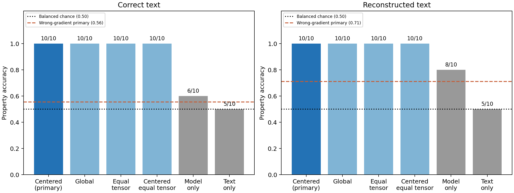
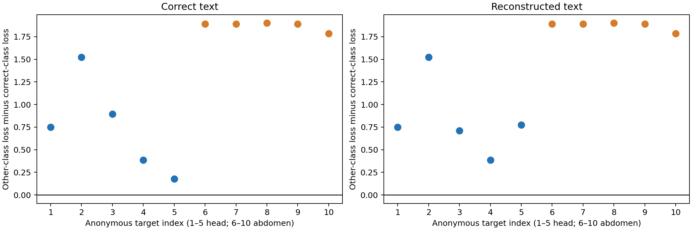

## 要点

- **合成原型库已完成 CT 部位推断 pilot**：固定的十张候选在正确文本与实际重构文本下都判断正确 10/10，四种梯度评分结果一致。
- **相同问答的一对图像能够由观测梯度区分**：头部、腹部各一张，文本完全相同，正确梯度时为 2/2，互换梯度后为 0/2；仅为两图诊断。
- **文本未完全恢复也保留了本轮部位判断**：问题恢复 10/10，答案及完整问答恢复 8/10，两例错误答案没有改变最终部位分类。
- **Text-only 的低准确率不等于没有文本线索**：未校准分类为 5/10，但 AUROC 为 0.90；重构文本下 Model-only 已为 8/10，不能把全部收益归为独立于文本的语义泄露。
- **本轮只判断 CT 内的部位**：真实目标与合成候选都限定为 CT，比较头部和腹部，不是在任意图像中联合识别“脑部 CT”。

[查看具体例子：真实图像、问答、十张候选与判断结果](#example-head-abdomen)。

## 关键数字

| Item | Value |
|---|---:|
| Target head CT images | 5 |
| Target abdomen CT images | 5 |
| Synthetic head CT candidates | 5 |
| Synthetic abdomen CT candidates | 5 |
| Unique original QA pairs | 6 |
| Target images overlapping earlier pilots | 4 |

预定主方法为 Centered cosine；每类五张候选，取损失最低的三张求均值。类别平衡，因此本轮 Accuracy 与 Balanced accuracy 相同。

| Text condition | Gradient correct | Gradient accuracy | Model-only accuracy | Text-only accuracy | Wrong-gradient accuracy |
|---|---:|---:|---:|---:|---:|
| Correct text | 10/10 | 1.000 | 0.600 | 0.500 | 0.556 |
| Reconstructed text | 10/10 | 1.000 | 0.800 | 0.500 | 0.711 |

| Question EM | Answer EM | Joint EM |
|---:|---:|---:|
| 10/10 | 8/10 | 8/10 |

Wrong-gradient 是每张图替换其余九个观测后的正确率均值，共九十对，但独立图像仍只有十张。

## 研究问题

在没有私有图像的情况下，能否用文生图模型生成属性原型，再通过目标更新与候选更新的匹配分数，识别 CT 图像属于头部还是腹部？文本恢复误差对结果有多大影响？

## 实验设置

| Item | Setting |
|---|---|
| Victim | LLaVA-1.5-7B，F-L，LoRA rank 32，第十轮快照 |
| Target cohort | SLAKE eval，头部 CT 五张、腹部 CT 五张 |
| Target selection | 原始标注、目视部位核验、原始非部位模态问答资格；不使用梯度得分筛选 |
| Generator | 本地 Qwen-Image-2.1-Turbo，1024 × 1024，bfloat16，原生 8 步，CFG 1.0 |
| Candidate bank | 同一组五个种子分别生成两类；每类五张，所有目标共享 |
| Main score | Centered cosine；候选均值去中心化，全梯度余弦 |
| Secondary scores | Global cosine、Equal-tensor cosine、Centered equal-tensor cosine |
| Class aggregation | 每类五张中最低三个损失的均值；主评分不按本轮结果更换 |
| Text conditions | 正确文本诊断；Residual v1，LM prior 0.01，随机图像，已知 token 长度 |
| Controls | Model-only、未校准 Text-only、错配梯度、相同问答错配子集 |
| Wrong gradients | 每个目标分别替换为其余九个观测，固定本目标文本和候选库 |
| Reference boundary | 真图和标签在评估端；候选生成不读目标，属性预测不读真实标签 |

## 结果

### 具体例子：相同问答下的头部与腹部 CT {#example-head-abdomen}

本地示例使用相同问答的两张目标图像，对比各自梯度给出的属性判断，并展示合成候选的评分。真实图像、逐样本文本和对应图表仅保存在本地，不纳入 Git。下方内容在本地示例片段存在时显示；没有本地产物时仍可阅读本页的聚合结果。

--8<-- "docs/experiments/examples/synthetic-ct-property/details.md"

### 目标与候选核验

- 首次检查六张标为头部的 CT，排除一张主要显示颈部的切片，保留五张头部或颅底切片。
- 腹部候选目标中排除一张主要显示胸部的图像；另外两张虽部位合适，但缺少符合规则的原始模态问答，改用已检查的备选图像。
- 十张合成图均通过大类部位外观筛查，未因梯度分数删选；部分图存在不自然的解剖细节，未做临床真实性验证。
- 图像 ID 和像素均去重，但无法核验患者独立性，部分头部切片外观相近。

### 正确文本与重构文本

- 四种梯度评分在两种文本条件下均正确 10/10，头部和腹部分别为 5/5；主评分无需事后更换。
- 主方法的 Macro-F1 与二分类 AUROC 均为 1.00；这些数字只描述本批样本。
- 所有目标的正确类损失均低于另一类。正确文本下最小分差约 0.177，重构文本下约 0.386。
- 两例答案重构错误均出现在头部目标；错误答案下仍分类正确，但不能据此推断对任意文本错误都鲁棒。

| Score | Correct-text accuracy | Reconstructed-text accuracy |
|---|---:|---:|
| Centered cosine, primary | 1.000 | 1.000 |
| Global cosine | 1.000 | 1.000 |
| Equal-tensor cosine | 1.000 | 1.000 |
| Centered equal-tensor cosine | 1.000 | 1.000 |

图中分差为另一类别损失减去正确类别损失，大于 0 表示分类正确。编号是匿名评估序号，不是原始样本 ID。

### 对照如何解释

- Model-only 使用同一份问答，比较各候选图上的答案 NLL，不匹配观测更新。正确文本下为 6/10，重构文本下为 8/10。
- Text-only 只给语言模型同一份问答，比较 head 与 abdomen 的续写平均 NLL，不输入图像、不匹配观测更新；本轮没有进行校准，不能沿用以前模态任务的校准偏置。
- Text-only 在两种条件下都预测为 abdomen，固定分类准确率为 5/10，但连续分差的 AUROC 都为 0.90。这说明原始问答措辞仍有排序线索；不能把该对照解释为“文本完全没有信息”。
- 主方法相对 Model-only 的准确率增益为正确文本下 0.40、重构文本下 0.20；按图像分层 bootstrap 的对应区间为 [0.20, 0.50] 和 [0.00, 0.40]。后者包含零，且患者相关性未计入。
- 错配梯度后准确率下降，但重构文本下仍有 0.711；文本条件化的候选偏好与跨问答错配效应均可能参与，不能把剩余正确率解释为梯度失效。

| Text condition | Gradient AUROC | Model-only AUROC | Text-only AUROC |
|---|---:|---:|---:|
| Correct text | 1.000 | 0.260 | 0.900 |
| Reconstructed text | 1.000 | 0.660 | 0.900 |

| Text condition | Wrong gradient, all | Wrong gradient, same class | Wrong gradient, opposite class |
|---|---:|---:|---:|
| Correct text | 0.556 | 0.825 | 0.340 |
| Reconstructed text | 0.711 | 0.925 | 0.540 |

同类与异类仅在预测保存后按真实标签分组；它们没有参与候选选择或评分。

### 相同问答的直接对照

- 十个目标中仅有一对跨部位图像使用完全相同的原始问答；两者的实际重构文本也与原文相同。
- 固定文本、候选图和模型时，使用各自观测，两张均分类正确；交换观测，两张预测随之交换，均与各自真值不符。
- 这对图像表明观测更新能够提供文本之外的图像相关区分信号，但没有排除主体大小、窗口或背景等图像因素，也不是额外独立样本。

| Text condition | Images | Correct-gradient correct | Swapped-gradient correct |
|---|---:|---:|---:|
| Correct text | 2 | 2/2 | 0/2 |
| Reconstructed text | 2 | 2/2 | 0/2 |

## 结论

- “通用文生图候选 → 梯度回放 → 按属性聚合评分”在本批 CT 部位诊断上已经跑通，实际重构文本下仍能识别十张图像的头部或腹部标签。
- 相同问答两图的观测互换提供了直接的图像相关信号证据；仍需在更多患者、统一问答和受控构图下重复。
- 本轮不能证明合成库优于真实公开库，也不能证明对任意医学属性有效；没有在同一队列上比较两种库。

## 局限

- 只有十张图像，四张与以前的 pilot 重叠；本轮是冻结设置的诊断，不是新的正式验证集。
- 问答没有直接部位词，但保留原始措辞差异；因此同时保留 Text-only 和相同问答子集对照。
- 真实图与生成图存在黑边、成像窗口、切片层面和主体大小差异，区分信号不一定只来自解剖语义。
- 多张切片可能来自同一患者，不能把十张图像当作十名独立患者。
- Text-only 的 AUROC 为 0.90，且未进行独立校准；仅比较 10/10 与 5/10 会夸大相对文本的优势。
- 相同问答对照只有两张图；全对时普通 bootstrap 也会退化，不能把退化的区间当作总体准确率保证。
- 全部目标已限定为 CT，不能将结果表述为在任意图像中识别“脑部 CT”，也没有评估疾病属性。

## 下一步

- 下一轮优先在更多真实图像上使用完全相同的模态问答，明确标为受控诊断，排除原始问答措辞与部位的相关性。
- 增加生成种子和主体大小、窗口等变化；冻结生成库后再评价，不按目标梯度分数选择候选。
- 在同一目标队列上配对比较合成原型与真实公开原型；扩大样本时优先核验患者独立性。

??? note "运行记录"

    - GPU 5；生成 worker PID 1247991、watcher PID 1247992 已退出。十张候选生成脚本总耗时约 74.47 秒。
    - 首次梯度 worker PID 1250721、watcher PID 1250722 已在预测前停止；十个观测均已保存且精确回放误差为 0。
    - 输入审计后将属性评分入口收紧为仅传入 classes、top_m、text_only_prompt，排除评估端路径元数据；同时每阶段仅计算一次模型指纹。旧源码、计划和日志保存在 attempt-1，未产生属性预测，未发生 OOM。
    - 第二次执行复用已校验的十个观测，目标、候选、模型和科学参数不变；worker PID 1255465、watcher PID 1255466 均正常退出，GPU 5 已释放本次占用。
    - 最终执行耗时 662.65 秒，不含此前生成和首次捕获；峰值 PyTorch allocated 为 21905.62 MiB。两种文本条件各有六种独立文本，各需要六十次候选梯度回放。
    - 十张生成图、十个配对观测、十次重构与二十份属性预测的哈希和输入边界核验通过，模型未改变。
    - 准备阶段一次资格检查失败：部位合适的腹部图像没有合格的原始问答；在冻结计划前更换为已目视检查的备选，没有 GPU 重试或修改核心方法。
    - 评分、属性评估与文档索引测试共 33 项通过；新增脚本 Ruff 通过。
