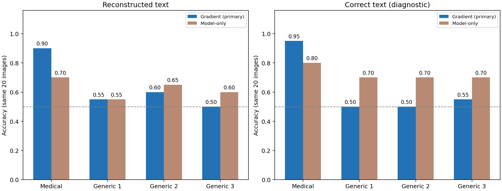

## 要点

- **医学合成候选能判断部位**：CT 队列的头部与腹部 10/10；混合模态队列的头部与非头部在重构文本下 18/20。
- **换成通用摄影候选后效果消失**：三套通用库在重构文本下平均 0.550，区间包含随机水平。
- **相对 Model-only 的优势尚不确定**：混合模态队列的配对增益为 0.20，区间为 [0.00, 0.40]；CT 队列中 Text-only 的 AUROC 也有 0.90。
- **同一问答的两张图可由梯度区分**：CT 队列中正确梯度 2/2，互换梯度后 0/2；只是两图诊断。
- **生成提示不能当作模态真值**：Qwen-Image 的腹部 MRI 输出偏 CT 风格，只认可其部位属性。

[查看 CT 队列的具体例子：真实图像、问答、十张候选与判断结果](#example-head-abdomen)。

## 关键数字

**CT 队列**（目标与候选均为 CT，判断头部或腹部）：

| Item | Value |
|---|---:|
| Target head CT images | 5 |
| Target abdomen CT images | 5 |
| Synthetic head CT candidates | 5 |
| Synthetic abdomen CT candidates | 5 |
| Unique original QA pairs | 6 |
| Target images overlapping earlier pilots | 4 |

预定主方法为 Centered cosine；每类五张候选，取损失最低的三张求均值。类别平衡，因此本轮 Accuracy 与 Balanced accuracy 相同。

| Text condition | Gradient correct | Gradient accuracy | Model-only accuracy | Text-only accuracy | Wrong-gradient accuracy |
|---|---:|---:|---:|---:|---:|
| Correct text | 10/10 | 1.000 | 0.600 | 0.500 | 0.556 |
| Reconstructed text | 10/10 | 1.000 | 0.800 | 0.500 | 0.711 |

| Question EM | Answer EM | Joint EM |
|---:|---:|---:|
| 10/10 | 8/10 | 8/10 |

Wrong-gradient 是每张图替换其余九个观测后的正确率均值，共九十对，但独立图像仍只有十张。

**混合模态队列**（CT、MRI、X-Ray 混合，判断头部或非头部）：

以下首先列出原医学候选库结果；2026-10-18 增加的通用摄影库对照见结果部分。

| Modality | Head targets | Non-head targets |
|---|---:|---:|
| CT | 5 | 3 |
| MRI | 5 | 3 |
| X-Ray | 0 | 4 |
| Total | 10 | 10 |

共十九组不同的原始问答，四张头部图像的问答出现头部相关词。十三张图与此前不同 pilot 重叠，七张此前未用于这些属性实验。

| Text condition | Gradient correct | Accuracy | Balanced accuracy | Head precision | Head recall | Head AUROC | Model-only correct | Text-only correct |
|---|---:|---:|---:|---:|---:|---:|---:|---:|
| Reconstructed text | 18/20 | 0.900 | 0.900 | 1.000 | 0.800 | 1.000 | 14/20 | 10/20 |
| Correct text | 19/20 | 0.950 | 0.950 | 1.000 | 0.900 | 1.000 | 16/20 | 10/20 |

| Search completed | Question EM | Answer EM | Joint EM |
|---:|---:|---:|---:|
| 20/20 | 15/20 | 16/20 | 14/20 |

主方法重构文本准确率的图像级 Wilson 95% 区间约为 [0.699, 0.972]；患者独立性未知，该区间不包含患者相关性带来的额外不确定性。

## 研究问题

- **候选生成**：本地 Qwen 文生图模型能否按描述生成 CT、MRI、X-Ray 合成候选？
- **CT 队列**：没有私有图像时，能否用合成候选和梯度匹配判断 CT 图像属于头部还是腹部？文本完全相同时，观测梯度能否区分？
- **混合模态队列**：不知道目标模态时，能否用共享的医学合成候选库判断头部与非头部？文本恢复误差影响多大？
- **梯度增益**：匹配本目标的梯度，是否带来 Model-only、Text-only 和错配梯度之外的信息？
- **通用候选库**：换成不含医学提示的通用摄影候选库，判断是否仍然有效？

## 实验设置

两个推断队列共用同一受害模型状态（LLaVA-1.5-7B，F-L，第十轮，LoRA rank 32）和 Residual v1 文本重构；候选图像都由本地 Qwen-Image-2.1-Turbo 生成。

### 候选生成（2026-10-16）

| Item | Setting |
|---|---|
| Model | 本地 Qwen-Image-2.1-Turbo |
| Runtime | 已安装的 qwen-image-21 环境；vLLM-Omni |
| GPU | 用户指定的 GPU 5，A100-SXM4-80GB |
| Precision | bfloat16 |
| Sampling | 原生 8 步 sample_sigmas；CFG 1.0 |
| Resolution | 1024 × 1024 |
| Execution | 单图顺序生成，模型加载一次，enforce_eager=true |
| Control prompts | 同一日常场景，英文与中文各一张，seed 42 |
| Medical prompts | 腹部 CT、腹部 T2 MRI、胸部 CT、胸部 X-Ray，各 seed 42、43 |
| Private inputs | 无；全部提示词独立编写，没有查看或描述目标私有图像 |
| Victim gradients | 未使用 |

前置元数据的 `knowledge: private` 表示没有提供私有字段；本轮属于候选生成 smoke test，没有构建攻击 Observation，也不是 private 条件下的攻击效果评测。`n=10` 指生成图数，不是十个受害者样本。

腹部 CT 与 MRI 提示词尽量保持部位、切面和构图一致，仅调整成像描述；相同种子仍不保证两种提示生成相同解剖结构。胸部 CT 为横断面，X-Ray 为正面投影，因此它们不能构成仅改变模态的严格配对实验。

### CT 队列（2026-10-16）

| Item | Setting |
|---|---|
| Victim | LLaVA-1.5-7B，F-L，LoRA rank 32，第十轮快照 |
| Target cohort | SLAKE eval，头部 CT 五张、腹部 CT 五张 |
| Target selection | 原始标注、目视部位核验、原始非部位模态问答资格；不使用梯度得分筛选 |
| Generator | 本地 Qwen-Image-2.1-Turbo，1024 × 1024，bfloat16，原生 8 步，CFG 1.0 |
| Candidate bank | 同一组五个种子分别生成两类；每类五张，所有目标共享 |
| Main score | Centered cosine；候选均值去中心化，全梯度余弦 |
| Secondary scores | Global cosine、Equal-tensor cosine、Centered equal-tensor cosine |
| Class aggregation | 每类五张中最低三个损失的均值；主评分不按本轮结果更换 |
| Text conditions | 正确文本诊断；Residual v1，LM prior 0.01，随机图像，已知 token 长度 |
| Controls | Model-only、未校准 Text-only、错配梯度、相同问答错配子集 |
| Wrong gradients | 每个目标分别替换为其余九个观测，固定本目标文本和候选库 |
| Reference boundary | 真图和标签在评估端；候选生成不读目标，属性预测不读真实标签 |

#### 目标与候选核验

- 首次检查六张标为头部的 CT，排除一张主要显示颈部的切片，保留五张头部或颅底切片。
- 腹部候选目标中排除一张主要显示胸部的图像；另外两张虽部位合适，但缺少符合规则的原始模态问答，改用已检查的备选图像。
- 十张合成图均通过大类部位外观筛查，未因梯度分数删选；部分图存在不自然的解剖细节，未做临床真实性验证。
- 图像 ID 和像素均去重，但无法核验患者独立性，部分头部切片外观相近。

### 混合模态队列（2026-10-17）

服务器知道应用场景是医学影像，但不知道某张目标图像的模态和部位。本轮只预测部位属性，不同时预测 CT、MRI 或 X-Ray 标签。

客户端仍执行原始视觉问答（VQA）任务：根据图像和问题学习回答，并产生上传更新。服务器将这些更新用于额外的部位推断。主实验使用从梯度恢复的文本；正确文本诊断单独提供真实问答，用于分析文本恢复误差的影响。

| Item | Setting |
|---|---|
| Victim | LLaVA-1.5-7B，F-L，第十轮，LoRA rank 32 |
| Victim task | 原始 VQA：客户端根据真实图像和问题学习回答，产生上传更新 |
| Inference target | Head versus non-head：服务器判断图像是否为头部影像 |
| Domain prior | 已知医学影像场景，预设 CT、MRI、X-Ray 候选类型；不知道单个目标的模态或部位 |
| Sampling | SLAKE eval，固定种子 20261017；按部位和模态分层抽样，每图一条随机原始问答 |
| Labels | 原始模态与部位标注，评估端目视核验部位；不标注疾病 |
| Reconstruction | Residual v1，LM prior 0.01，随机图像；已知 token 长度 |
| Generator | 本地 Qwen-Image-2.1-Turbo；1024 × 1024，bfloat16，原生 8 步，CFG 1.0 |
| Candidate bank | 固定 24 张合成候选，头部与非头部各 12 张；每个目标均使用完整候选库 |
| Primary score | Centered cosine；每组最低三个候选损失的均值；选得分较低的组 |
| Controls | 同一份恢复文本的 Model-only、未校准 Text-only、错配梯度；另做正确文本诊断 |
| Main endpoint | 所有二十张图像上的重构文本条件 Balanced accuracy |
| Subgroups | 模态、原始问答是否出现头部相关词、完整文本是否恢复正确 |
| Incomplete attack | 保存攻击状态并计为未作出属性预测；不删除样本、不用原文替换 |

#### 候选库与攻击者已知信息

- CT、MRI、X-Ray 是依据医学影像场景预先列出的可能类型，用于覆盖不同外观，不表示服务器已经知道目标的真实模态。
- 生成器只读取通用属性提示和固定种子，不读取目标真图、问答或上传更新。每个目标都与全部 24 张候选比较，不按真实模态筛选候选。
- 下表统计的是生成提示数量。生成图只核验头部或非头部外观，模态提示不能直接作为生成结果的真实模态标签。

| Prompt modality | Head candidates | Non-head candidates |
|---|---:|---:|
| CT | 4 | 4 |
| MRI | 4 | 4 |
| X-Ray | 4 | 4 |
| Total | 12 | 12 |

#### 属性判断方法与对照

- 同一文本条件下，各方法使用同一份问答。下表区分的是属性判断阶段使用的信息，所有方法均不读取目标真图。
- 主实验的问答先由梯度重构得到。因此 Model-only 和 Text-only 在属性打分时不匹配上传梯度，但仍间接使用了梯度恢复出的信息。
- Model-only 用答案负对数似然（NLL）衡量模型对该答案的支持程度，越低表示答案越容易成立。Text-only 比较模型续写 `head` 与 `non-head` 的平均 token NLL，未额外校准类别偏置。

| Method | Property decision | Control purpose |
|---|---|---|
| Gradient | 用候选图和问答计算候选梯度，与本目标上传梯度比较 | 检验目标梯度能否支持部位判断 |
| Model-only | 用候选图和问题预测给定答案，比较两类候选的答案 NLL | 检验仅靠模型的图文关联能达到什么效果 |
| Text-only | 不输入图像，只根据问答判断头部或非头部 | 检验问答自身是否透露部位 |
| Wrong-gradient | 保留本目标的问答与候选图，将匹配对象换成其他样本的上传梯度 | 检验匹配本目标梯度是否带来额外信息 |

#### 四种梯度评分

- 四种方法都比较候选梯度与观测梯度，使用余弦损失（1 减去余弦相似度），越低越匹配。比较范围是本实验上传的 LoRA 参数梯度。
- Centered 表示先计算当前问答下 24 张候选的平均梯度，再从每张候选梯度和观测梯度中减去同一个均值。它尝试减少候选间的共同成分，包括部分文本背景，但不保证完全去除文本影响。
- Equal-tensor 表示每个有效参数张量分别计算余弦损失，再等权平均，减少大梯度范数张量的支配。一个参数张量不等于一个模型层。

| Score | Centering | Tensor aggregation |
|---|---|---|
| Global cosine | 不减均值 | 拼接全部上传梯度，整体计算一次余弦损失 |
| Centered cosine | 减去候选平均梯度 | 拼接去中心化后的梯度，整体计算一次余弦损失 |
| Equal-tensor cosine | 不减均值 | 每个有效张量单独计算，再等权平均 |
| Centered equal-tensor cosine | 减去候选平均梯度 | 每个有效张量单独计算，再等权平均 |

- 每种梯度评分都在头部与非头部两组内，分别取损失最低的三个候选求均值，选择均值更低的一组。Model-only 对答案 NLL 使用相同的组内聚合规则。
- 四种评分用于分别检验去中心化和张量等权是否有效，不联合投票。运行前固定 Centered cosine 为主方法，其余三种为对照，不按测试结果更换主方法。

#### 数据与生成库准备

- 只从此前未使用的图像抽取二十张时，固定种子抽到的头部样本均为 MRI。正式方案在评分前改为上述分层配额，以便在 CT、MRI 内分别评价部位区分。
- 目视核验排除一张主要显示颈部的“头部”图像和一张主要显示胸部的“腹部”图像，使用预先随机排序的备选替换；不按梯度或重构得分更换样本。
- 初始合成库中四张非头部 MRI 输出未通过核验，保留其余二十张，并用明确的通用腹部描述补生成四张；不读取任何目标图像来设计提示。
- 补生成的四张图部位明确，但骨骼和对比度仍偏 CT 外观；仅认可 non-head 属性。生成库的模态数量指提示词数量，不代表经过临床核验的真实模态平衡。

## 结果

### 候选生成

**回答**：普通场景的描述都得到遵循；CT 和 X-Ray 呈现预期外观，但两张腹部 MRI 偏 CT 风格，不能直接作为可靠的 MRI 原型。后面两个队列的候选库都先经过目视核验。

- 普通场景的物体数量、颜色、左右关系均符合要求。
- 医学输出均呈灰阶外观，未见明显文字、水印、箭头或多图拼接。
- 腹部 MRI 两张原图的中央骨样结构亮白，整体与 CT 输出相似，未通过本轮目视可信度筛查；这不是专业模态鉴定。
- 医学图像的器官形状、空间关系、具体 MRI 序列或 X-Ray 投照几何均未获得独立验证。

| Prompt | Images | Mean seconds | Visual assessment |
|---|---:|---:|---|
| Control English | 1 | 4.41 | 数量、颜色、位置符合 |
| Control Chinese | 1 | 4.05 | 数量、颜色、位置符合 |
| Abdomen CT | 2 | 3.88 | 腹部横断面，呈 CT 样式；解剖真实性未验证 |
| Abdomen MRI | 2 | 3.74 | 腹部横断面，但偏 CT 样式；MRI 标签待核验 |
| Chest CT | 2 | 3.93 | 肺野横断面，呈 CT 样式 |
| Chest X-Ray | 2 | 4.12 | 胸部正面投影，呈 X-Ray 样式 |

所有原图、逐图提示词、种子和 JSON 记录保留在 `outputs/diagnostics/qwen_image_gpu5_20261016/`。`contact_sheet.jpg` 是十图预览，`medical_preview.jpg` 是四类医学提示的首个种子预览；均未复制到文档站点。

#### 完整性检查

- 十张 PNG 均可解码，尺寸符合计划，保存后的 SHA-256 与逐图记录一致。
- 十张图像的哈希互不相同；实际提示词与种子集合和生成前计划一致。
- 生成代码哈希与运行计划一致，未发生失败重试或参数降级。
- 所有数字与目视结论来自上方列出的本地产物；评估代码已提交，原始产物保存在本地。

#### 生成耗时

| Metric | Value |
|---|---:|
| Generated images | 10/10 |
| Resolution | 1024 × 1024 |
| Model initialization seconds | 15.99 |
| Total generation and save seconds | 39.79 |
| Mean generation and save seconds | 3.98 |
| Min generation and save seconds | 3.73 |
| Max generation and save seconds | 4.41 |
| Total script seconds | 76.72 |

总脚本时间包括依赖导入、初始化、生成、拼图和关闭模型。相同提示词的第二个种子可能复用文本编码，以上不是每张图都重新加载模型的耗时。

### CT 队列

**回答**：能。正确文本和重构文本下都是 10/10，两例答案重构错误没有改变判断；文本完全相同的一对图像用各自梯度都判对，互换梯度后都判错。

- 四种梯度评分在两种文本条件下均正确 10/10，头部和腹部分别为 5/5；主评分无需事后更换。
- 主方法的 Macro-F1 与二分类 AUROC 均为 1.00；这些数字只描述本批样本。
- 所有目标的正确类损失均低于另一类。正确文本下最小分差约 0.177，重构文本下约 0.386。
- 两例答案重构错误均出现在头部目标；错误答案下仍分类正确，但不能据此推断对任意文本错误都鲁棒。

| Score | Correct-text accuracy | Reconstructed-text accuracy |
|---|---:|---:|
| Centered cosine, primary | 1.000 | 1.000 |
| Global cosine | 1.000 | 1.000 |
| Equal-tensor cosine | 1.000 | 1.000 |
| Centered equal-tensor cosine | 1.000 | 1.000 |

图中分差为另一类别损失减去正确类别损失，大于 0 表示分类正确。编号是匿名评估序号，不是原始样本 ID。

#### 具体例子：相同问答下的头部与腹部 CT {#example-head-abdomen}

本地示例使用相同问答的两张目标图像，对比各自梯度给出的属性判断，并展示合成候选的评分。真实图像、逐样本文本和对应图表仅保存在本地，不纳入 Git。下方内容在本地示例片段存在时显示；没有本地产物时仍可阅读本页的聚合结果。

--8<-- "docs/experiments/examples/synthetic-ct-property/details.md"

#### 相同问答的直接对照

- 十个目标中仅有一对跨部位图像使用完全相同的原始问答；两者的实际重构文本也与原文相同。
- 固定文本、候选图和模型时，使用各自观测，两张均分类正确；交换观测，两张预测随之交换，均与各自真值不符。
- 这对图像表明观测更新能够提供文本之外的图像相关区分信号，但没有排除主体大小、窗口或背景等图像因素，也不是额外独立样本。

| Text condition | Images | Correct-gradient correct | Swapped-gradient correct |
|---|---:|---:|---:|
| Correct text | 2 | 2/2 | 0/2 |
| Reconstructed text | 2 | 2/2 | 0/2 |

### 混合模态队列

**回答**：能。重构文本下主方法 18/20，正确文本下 19/20，两个错误都是头部漏检；文本有误的 6 张仍判对 4 张。新增 7 张判对 6 张，但新增头部样本全部是 MRI。

- 私有条件下不提供真图、原始问答或目标标签，先保存重构结果，再用固定生成库评分。全部二十次搜索完成，四十份属性预测均已保存，无样本因恢复失败被剔除。
- 主方法在重构文本下正确十八张，两个错误均为头部漏检；十张非头部图全部正确。正确文本下仍有一张头部 CT 漏检。
- 四种评分均在运行前声明，Centered cosine 始终作为主方法。Global cosine 与 Equal-tensor cosine 的重构文本结果为 19/20，只作为次要结果，不据此事后改主方法。
- 本批样本中，去中心化没有带来更高的分类准确率；是否采用该处理，需要在独立开发数据上确定。

| Score | Reconstructed-text correct | Correct-text correct |
|---|---:|---:|
| Centered cosine, primary | 18/20 | 19/20 |
| Global cosine | 19/20 | 20/20 |
| Equal-tensor cosine | 19/20 | 20/20 |
| Centered equal-tensor cosine | 18/20 | 20/20 |

Wrong-gradient 柱为每个目标替换其余十九个观测后的正确率均值；共有 380 个配对，但独立图像仍只有二十张。

#### 分模态结果

- CT 与 MRI 各包含五张头部、三张非头部，重构文本下各正确七张，组内 Balanced accuracy 均为 0.900。
- X-Ray 四张均为非头部，不能由该组的 4/4 推断 X-Ray 内的头部区分能力；该组二分类 Balanced accuracy 不定义。

| Modality | Head | Non-head | Reconstructed correct | Reconstructed BA | Correct-text correct | Model-only reconstructed correct |
|---|---:|---:|---:|---:|---:|---:|
| CT | 5 | 3 | 7/8 | 0.900 | 7/8 | 6/8 |
| MRI | 5 | 3 | 7/8 | 0.900 | 8/8 | 5/8 |
| X-Ray | 0 | 4 | 4/4 | — | 4/4 | 3/4 |

#### 两个错误与判别边界

- 匿名目标 4 为头部 CT：问题恢复正确、答案恢复错误；换成正确文本后，主方法仍误判，说明不能把这例全部归因于文本恢复。正确文本下其余三种评分均判对。
- 匿名目标 9 为头部 MRI：问题和答案均未完全恢复，重构文本下主方法漏检；正确文本下主方法判对。这例显示文本误差会改变属性判断。
- 两张错误目标的“non-head 损失减去 head 损失”都小于 0，所以按预定规则判为 non-head；但它们的分差仍高于所有真实非头部样本，因此 AUROC 为 1.00。排序指标与固定阈值准确率衡量不同事情。

| Anonymous target | Modality | True property | Text condition | Head loss ↓ | Non-head loss ↓ | Prediction |
|---|---|---|---|---:|---:|---|
| 4 | CT | Head | Reconstructed | 0.9280 | 0.6885 | Non-head |
| 4 | CT | Head | Correct | 0.8280 | 0.6669 | Non-head |
| 9 | MRI | Head | Reconstructed | 0.7314 | 0.5848 | Non-head |
| 9 | MRI | Head | Correct | 0.2402 | 0.8994 | Head |

零线以上判为 head，零线以下判为 non-head。编号为匿名评估序号，不是原始数据 ID；得分不是概率。本轮未根据这二十张的标签搜索阈值或改变类别偏置。

#### 文本恢复与词面线索

- 完整问答正确的十四张，主方法属性判断全部正确。完整问答有误的六张仍判断正确四张，说明属性判断不要求每个 token 都恢复一致。
- 原始问答没有出现头部相关词的十六张中，主方法为 15/16，Model-only 为 11/16；这一组正负不均衡，主方法 Balanced accuracy 为 0.917。
- 词面检测只用于评估分组。没有头部词不等于没有间接部位线索，也没有排除其他器官词或语义关联。
- 未校准 Text-only 在两种条件下都预测 non-head，因此分类准确率为 0.50；其 AUROC 为重构文本 0.64、正确文本 0.74，不能据此说文本毫无信息。

| Group | n | Head | Non-head | Reconstructed gradient correct | Reconstructed Model-only correct |
|---|---:|---:|---:|---:|---:|
| Joint EM true | 14 | 7 | 7 | 14/14 | 10/14 |
| Joint EM false | 6 | 3 | 3 | 4/6 | 4/6 |
| Head terms absent | 16 | 6 | 10 | 15/16 | 11/16 |
| Head terms present | 4 | 4 | 0 | 3/4 | 3/4 |

#### 新增图像与历史重叠

- 这一分组在预测完成后用于审计，不参与选样或评分。新增七图中正确六张，重叠十三图中正确十二张。
- 新增七图的四张正例全部为 MRI，三张负例为一张 CT 和两张 X-Ray。因此新增子集不能单独证明同模态部位泛化；同模态证据仍包含历史重叠目标。

| Image history | n | Head | Non-head | Reconstructed gradient correct | Correct-text gradient correct | Reconstructed Model-only correct | Joint EM |
|---|---:|---:|---:|---:|---:|---:|---:|
| New to prior property pilots | 7 | 4 | 3 | 6/7 | 7/7 | 3/7 | 3/7 |
| Previously used images | 13 | 6 | 7 | 12/13 | 12/13 | 11/13 | 11/13 |

### 梯度增益

**回答**：尚不确定。混合模态队列中主方法比 Model-only 高 0.20，区间为 [0.00, 0.40]；CT 队列中 Text-only 的 AUROC 也有 0.90。换成同模态、异属性目标的梯度后，准确率从 0.875 降到 0.621，但错配对照仍混有图文不匹配的影响。

#### CT 队列的对照

- Model-only 使用同一份问答，比较各候选图上的答案 NLL，不匹配观测更新。正确文本下为 6/10，重构文本下为 8/10。
- Text-only 只给语言模型同一份问答，比较 head 与 abdomen 的续写平均 NLL，不输入图像、不匹配观测更新；本轮没有进行校准，不能沿用以前模态任务的校准偏置。
- Text-only 在两种条件下都预测为 abdomen，固定分类准确率为 5/10，但连续分差的 AUROC 都为 0.90。这说明原始问答措辞仍有排序线索；不能把该对照解释为“文本完全没有信息”。
- 主方法相对 Model-only 的准确率增益为正确文本下 0.40、重构文本下 0.20；按图像分层 bootstrap 的对应区间为 [0.20, 0.50] 和 [0.00, 0.40]。后者包含零，且患者相关性未计入。
- 错配梯度后准确率下降，但重构文本下仍有 0.711；文本条件化的候选偏好与跨问答错配效应均可能参与，不能把剩余正确率解释为梯度失效。

| Text condition | Gradient AUROC | Model-only AUROC | Text-only AUROC |
|---|---:|---:|---:|
| Correct text | 1.000 | 0.260 | 0.900 |
| Reconstructed text | 1.000 | 0.660 | 0.900 |

| Text condition | Wrong gradient, all | Wrong gradient, same class | Wrong gradient, opposite class |
|---|---:|---:|---:|
| Correct text | 0.556 | 0.825 | 0.340 |
| Reconstructed text | 0.711 | 0.925 | 0.540 |

同类与异类仅在预测保存后按真实标签分组；它们没有参与候选选择或评分。

#### 混合模态队列的对照

- 重构文本下主方法相对 Model-only 的准确率增益为 0.20，图像分层 bootstrap 区间为 [0.00, 0.40]；正确文本下增益为 0.15，区间为 [-0.05, 0.35]。尚不足以确认稳定优于模型对照。
- 换成其他目标的梯度后，重构文本条件下正确率降至 0.692。进一步只交换同模态、异属性目标的梯度，降至 0.621；该子集为 CT、MRI 的十六张，原正确观测下为 14/16，即 0.875。
- 错配对照固定本目标文本和生成库，但其他观测来自不同问答；下降可能同时反映图文不匹配，不能解释为已完全分离出视觉语义信号。

| Text condition | Correct gradient, all 20 | Wrong gradient, all 20 | Wrong gradient, same modality, 20 | Correct gradient, 16 images | Wrong gradient, same modality and opposite property, 16 |
|---|---:|---:|---:|---:|---:|
| Reconstructed text | 0.900 | 0.692 | 0.671 | 0.875 | 0.621 |
| Correct text | 0.950 | 0.795 | 0.779 | 0.938 | 0.746 |

每列按目标先求平均，再对参与目标求平均；错配配对数不是独立样本数。

### 通用候选库

**回答**：不能。三套通用摄影库在重构文本下平均只有 0.550，正确文本下 0.517，也没有相对 Model-only 或错配梯度的稳定优势。

- 在同一批二十张目标上增加通用摄影候选库，复用已保存的上传梯度和问答重构结果。三套库共七十二张均通过部位目视核验，全部保留、没有补生成；六个阶段共 120 份预测全部完成。
- 三套库只改变生成种子，每套头部与非头部各十二张。正例覆盖正面、侧面和后脑勺，负例覆盖躯干、手臂和腿部，每种四张；采用普通彩色摄影、浅灰背景和相近主体占比。
- 提示不包含医学、CT、MRI 或 X-Ray 信息，不根据目标真图设计候选。重构问答仍可能透露医学背景，所以本对照检验的是不预先提供领域信息的候选生成，而非整个流程始终不知道领域。
- 每套库都运行重构文本与正确文本两种条件，保留四种评分、Model-only、Text-only 和 Wrong-gradient。主评分及类别聚合不变，不按结果挑选候选库。
- 三套库是同一批目标上的重复测量。报告逐库结果及平均表现，置信区间按二十张目标重采样，不将其算作六十张独立图像。

| Candidate bank | Head content | Non-head content | Candidates per class |
|---|---|---|---:|
| Medical | 头部 CT、MRI、X-Ray 提示 | 胸腹部 CT、MRI、X-Ray 提示 | 12 |
| Generic 1 | 正面、侧面、后脑勺摄影 | 躯干、手臂、腿部摄影 | 12 |
| Generic 2 | 同上，独立生成种子 | 同上，独立生成种子 | 12 |
| Generic 3 | 同上，独立生成种子 | 同上，独立生成种子 | 12 |

- 重构文本下，三套通用库主方法平均准确率为 0.550，目标级 95% 区间为 [0.367, 0.733]，包含随机猜测基线 0.500。平均 Head AUROC 为 0.583，未呈现医学库中的强排序效果。
- 相对同一批目标的医学库，重构文本下准确率平均下降 0.350，配对区间为 [-0.517, -0.183]。这反映当前候选库替换的影响，不是对新目标泛化性能的估计。
- 正确文本下通用库平均准确率为 0.517，平均 Head AUROC 为 0.550。完整问答已经恢复正确的十四张目标，在三套库中均只判对八张；医学库在这十四张上全部正确。因此，本轮失败不能只归因于文本恢复误差。

| Text condition | Candidate bank | Gradient correct | Accuracy | Head recall | Head AUROC | Model-only correct |
|---|---|---:|---:|---:|---:|---:|
| Reconstructed | Medical | 18/20 | 0.900 | 0.800 | 1.000 | 14/20 |
| Reconstructed | Generic 1 | 11/20 | 0.550 | 0.600 | 0.600 | 11/20 |
| Reconstructed | Generic 2 | 12/20 | 0.600 | 0.700 | 0.560 | 13/20 |
| Reconstructed | Generic 3 | 10/20 | 0.500 | 0.500 | 0.590 | 12/20 |
| Correct | Medical | 19/20 | 0.950 | 0.900 | 1.000 | 16/20 |
| Correct | Generic 1 | 10/20 | 0.500 | 0.500 | 0.580 | 14/20 |
| Correct | Generic 2 | 10/20 | 0.500 | 0.600 | 0.480 | 14/20 |
| Correct | Generic 3 | 11/20 | 0.550 | 0.600 | 0.590 | 14/20 |

#### 图像直观对比：真实目标、医学候选与通用候选 {#image-comparison}

下面按头部与非头部并排展示三种来源的图像，用于观察候选外观差异；通用非头部示例采用手臂局部图。生成候选不是对应真图的重构结果，也没有使用真图作为生成参考。图片仅在本地示例文件存在时显示；图片与来源清单保存在 `outputs/`，不纳入 Git。

--8<-- "docs/experiments/examples/synthetic-head-property/details.md"

#### 通用库中的对照与评分差异

- 重构文本下，通用库主方法平均准确率为 0.550，Model-only 为 0.600；配对差异为 -0.050，区间为 [-0.317, 0.217]，未见梯度匹配相对模型对照的稳定优势。
- 换成其他样本的梯度后，平均准确率为 0.533，与正确匹配的 0.550 接近。正确文本下也未观察到匹配本目标梯度带来的平均优势；错配对照仍混合了图像和问答差异，不能作为纯视觉信号的因果分解。
- Text-only 的输入与旧实验一致，分数复核一致，两种文本条件均为 10/20。三套库的重复运行不构成新的文本基线证据。

| Text condition | Gradient mean accuracy | Model-only mean accuracy | Text-only accuracy | Wrong-gradient mean accuracy |
|---|---:|---:|---:|---:|
| Reconstructed | 0.550 | 0.600 | 0.500 | 0.533 |
| Correct | 0.517 | 0.700 | 0.500 | 0.539 |

- 其余三种评分的平均准确率也没有恢复到医学库水平。Centered equal-tensor cosine 在两种文本条件下均为 0.583，仅作为预先声明的次要结果，不替换主方法。

| Score | Reconstructed mean accuracy | Correct mean accuracy |
|---|---:|---:|
| Centered cosine | 0.550 | 0.517 |
| Global cosine | 0.467 | 0.500 |
| Equal-tensor cosine | 0.483 | 0.533 |
| Centered equal-tensor cosine | 0.583 | 0.583 |

- CT、MRI 内的通用库效果也有限，未由某个模态组保留原医学库的水平。X-Ray 仍只有非头部，不能据此评价该模态内的头部识别能力。

| Text condition | Modality | Targets | Generic 1 correct | Generic 2 correct | Generic 3 correct |
|---|---|---:|---:|---:|---:|
| Reconstructed | CT | 8 | 4 | 6 | 5 |
| Reconstructed | MRI | 8 | 5 | 4 | 3 |
| Reconstructed | X-Ray | 4 | 2 | 2 | 2 |
| Correct | CT | 8 | 4 | 5 | 5 |
| Correct | MRI | 8 | 4 | 3 | 4 |
| Correct | X-Ray | 4 | 2 | 2 | 2 |

上述均值先按库计算，再对三套库平均，不是将候选库合并或投票后的新攻击。区间在目标内平均三套库的正确指示，再按真实类别分层重采样五千次；仅覆盖固定三套库下的目标级不确定性，未覆盖患者相关性和任意新生成库的变化。

## 结论

- “文生图候选 → 梯度回放 → 按属性聚合评分”已在两个队列上跑通：CT 队列 10/10，混合模态队列 18/20；服务器不需要先知道目标属于 CT、MRI 还是 X-Ray。
- 相同问答两图的观测互换提供了直接的图像相关信号证据；同模态内的 CT、MRI 也保留了部位区分能力，但没有排除构图、文本关联与历史重叠的影响。
- 当前瓶颈同时涉及文本误差和评分决策边界；不能只修文本，也不能因其他评分在这批数据更好就宣布新方法胜出。
- 普通人体摄影候选未实现稳定的跨领域头部推断，正确文本也未恢复效果；现有成功证据限于具有医学外观的候选库，这不等于证明梯度中没有头部信息。
- 不能把提示词中的属性直接视为生成图像的真实标签；MRI 输出是当前最明确的风险点。
- 本页不能证明合成库优于真实公开库，也不能证明对任意医学属性有效；两种库没有在同一队列上比较。

## 局限

- 两个队列都很小：CT 十张、混合模态二十张，且分别有四张、十三张与此前 pilot 重叠；它们是冻结设置的诊断，不是新的正式验证集。
- 缺少患者 ID，多张切片可能来自同一患者，头部 CT 切片尤其相近；不能把图像数当作独立患者数。
- 原始问答可能透露部位：CT 队列的 Text-only AUROC 为 0.90 且未校准；混合模态队列的“出现头部相关词”只是词面分组，不等于标签必然可从文本确定。
- 真实图与生成图存在黑边、成像窗口、切片层面和主体大小差异，区分信号不一定只来自解剖语义。
- 生成图只经目视核验大类部位外观，由助手完成，没有医学专家或独立模态标注复核；不保证临床真实性、模态或序列细节准确。
- 每种医学提示的种子很少，医学候选只有一个最终库；没有评估病例多样性、与真实图像的分布差异，或生成器训练集与目标数据的重叠。
- 医学库使用医学领域先验；通用库只移除了生成提示中的医学信息，模型与恢复问答仍可能提供领域线索。从医学库换成摄影库同时改变了结构、颜色、背景和构图，通用库人物以成年男性为主。
- CT 队列全部限定为 CT，不能表述为在任意图像中识别“脑部 CT”；混合模态队列的 X-Ray 只有非头部；两个队列都没有评估疾病属性。
- 混合模态队列按标签分层平衡，不代表自然患病或部位比例；Precision 也依赖这一采样比例。
- 相对 Model-only 的配对区间包含零；相同问答对照只有两张图，全对时普通 bootstrap 区间会退化，不能当作总体准确率保证。
- 已知 token 长度、单样本 FedSGD 更新和可见模型状态均属于本页的明确条件。

## 下一步

- 优先检验候选图与目标领域的匹配程度：控制灰度、背景、主体占比和成像窗口，检查外观差异对当前失败的影响。
- 修正生成 MRI 的外观偏差；冻结通过核验的候选库与类别标签后再评价，不按目标梯度分数挑选候选。
- 在更多真实图像上用完全相同的问答做受控诊断，排除原始问答措辞与部位的相关性；优先取得同模态、跨部位且患者独立的数据。
- 在独立公开开发数据上固定评分与阈值，再用未参与选择的图像评估；不在当前样本上调到全对后回报同一准确率。
- 在同一目标队列上配对比较合成原型库与真实公开原型库，保留 Model-only、校准 Text-only 和错配梯度对照；先用正确文本诊断，再用已保存的重构文本。
- 如根据重构问答自动判断领域并生成候选，同时生成两类属性假设，不使用真实标签选择提示。

??? note "运行记录"

    **候选生成（2026-10-16）**

    - 日期：2026-10-16；GPU 5；worker PID 1242426、watcher PID 1242427 均已退出，显存回到启动前约 20 GB 的既有占用。
    - 复用用户已配置的专用环境与本地权重；离线运行，缓存写入 `/tmp`，未修改模型目录、核心攻击代码或默认参数。
    - 启动脚本：`outputs/diagnostics/analysis_scripts/launch_qwen_image_gpu5_20261016.sh`；日志：`outputs/diagnostics/qwen_image_gpu5_20261016.log`。
    - 原生采样步数由模型配置加载；没有额外设置 num_inference_steps，没有使用负面提示。
    - 本轮无失败、无 OOM、无重试。新增生成脚本 Ruff 通过；十图产物检查通过。

    **CT 队列（2026-10-16）**

    - GPU 5；生成 worker PID 1247991、watcher PID 1247992 已退出。十张候选生成脚本总耗时约 74.47 秒。
    - 首次梯度 worker PID 1250721、watcher PID 1250722 已在预测前停止；十个观测均已保存且精确回放误差为 0。
    - 输入审计后将属性评分入口收紧为仅传入 classes、top_m、text_only_prompt，排除评估端路径元数据；同时每阶段仅计算一次模型指纹。旧源码、计划和日志保存在 attempt-1，未产生属性预测，未发生 OOM。
    - 第二次执行复用已校验的十个观测，目标、候选、模型和科学参数不变；worker PID 1255465、watcher PID 1255466 均正常退出，GPU 5 已释放本次占用。
    - 最终执行耗时 662.65 秒，不含此前生成和首次捕获；峰值 PyTorch allocated 为 21905.62 MiB。两种文本条件各有六种独立文本，各需要六十次候选梯度回放。
    - 十张生成图、十个配对观测、十次重构与二十份属性预测的哈希和输入边界核验通过，模型未改变。
    - 准备阶段一次资格检查失败：部位合适的腹部图像没有合格的原始问答；在冻结计划前更换为已目视检查的备选，没有 GPU 重试或修改核心方法。
    - 评分、属性评估与文档索引测试共 33 项通过；新增脚本 Ruff 通过。

    **混合模态队列（2026-10-17 至 2026-10-18）**

    - 2026-10-18 通用候选库对照已获准共享 GPU 5，后台已有约 20 GB 占用。生成使用 `qwen-image-21`，评分使用 `gia`；均使用冻结源码，不修改原始观测或重构结果。
    - 首次 detached 启动在 Python 执行前退出，未创建生成产物；相同配置重新建立后台进程，并等待初始化。生成 worker PID 2123789、watcher PID 2123790 已正常退出；七十二张生成总耗时 572.28 秒，包含权重加载。
    - 通用库评估 worker PID 2142475、watcher PID 2142476 已正常退出。评分、输入校验及评估共耗时 1478.86 秒，约 24.65 分钟；峰值 PyTorch allocated 为 24048.47 MiB。六个阶段各 456 次候选回放，共 2736 次，没有重新训练或搜索文本。
    - 120 份预测全部保存后读取评估标签。模型参数未改变，冻结输入、源码及预测哈希通过核验，重构文本和 Text-only 分数与原实验一致；没有 OOM、样本剔除或参数调整。本次进程已退出，GPU 资源已释放。
    - 通用库相关二十项 CPU 测试、十九项文档测试、Ruff、产物索引校验及 MkDocs 严格构建通过；图像文件留在本地 `outputs/`，文档仅保存聚合图和指标。通用库代码随后提交为 e2ce836，原医学库提交号保持不变。
    - 用户授权 GPU 5，样本数由一百张收缩至二十张；本轮仅新增评估脚本，不修改核心攻击方法。
    - 初始生成 worker PID 1339451、watcher PID 1339452 已完成；二十四张输出全部保存，四张在评分前因目视核验未通过而替换。
    - 补生成 worker PID 1341487、watcher PID 1341488 已完成；无 OOM，没有改变 batch size 或模型 dtype。
    - 主实验 worker PID 1343162、watcher PID 1343163 均已正常退出；按顺序执行捕获、私有文本重构、重构文本属性评分和正确文本对照，没有训练或重试攻击。
    - 主实验总耗时 2103.76 秒，约 35.06 分钟，包含模型加载、捕获及完整性检查；峰值 PyTorch allocated 为 24006.91 MiB。初始生成另耗时 142.33 秒，补生成 50.92 秒。
    - 两种文本条件各十九种独立文本，各 456 次候选回放，共 912 次；错配对照复用候选更新，不额外回放模型。
    - 二十个观测精确回放误差均为 0，四十份属性预测与冻结输入哈希核验通过，模型参数未改变；全部二十次文本搜索正常完成。
    - 评分及新实验针对性 CPU 测试十七项、文档测试十九项通过；新增评估脚本 Ruff 通过。
