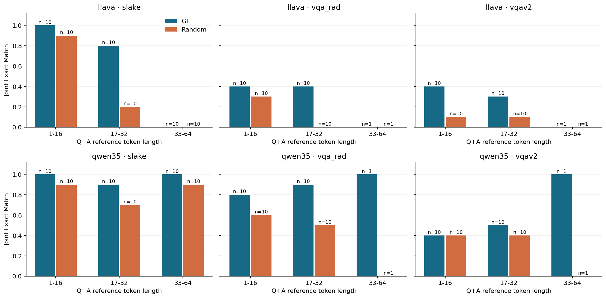
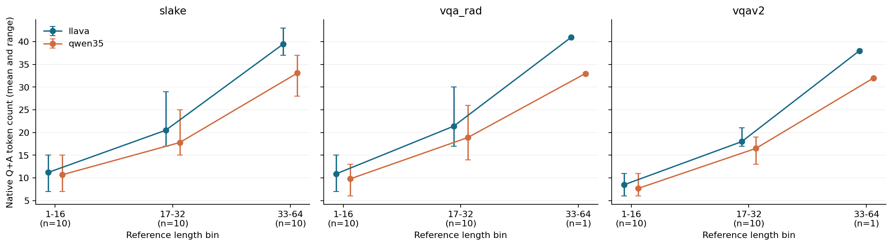
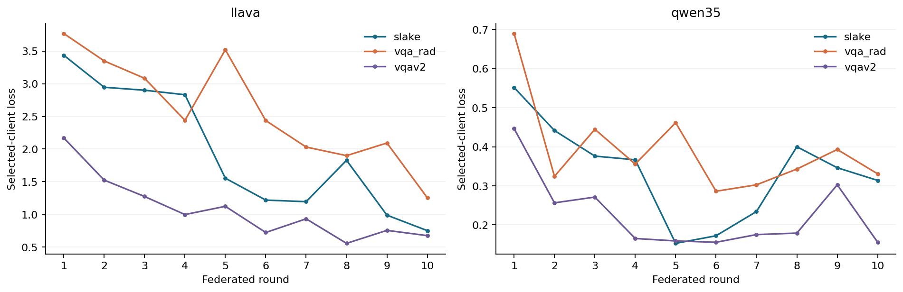
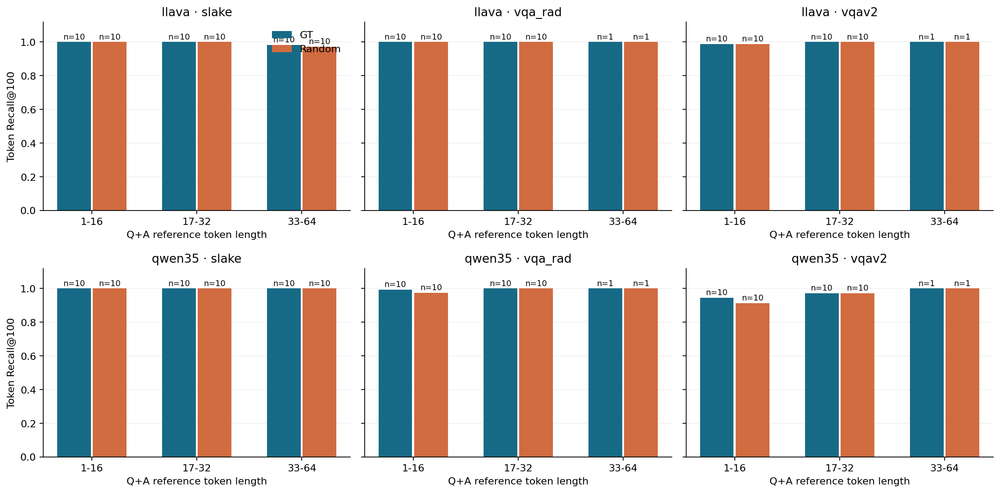

## 要点

- **Qwen3.5 比 LLaVA 更容易恢复**：Random 条件下，Qwen 在 SLAKE、VQA-RAD、VQAv2 的 Joint EM 为 25/30、11/21、8/21，LLaVA 为 11/30、3/21、2/21。
- **恢复率随数据集变化**：两个模型都是 SLAKE 最高、VQAv2 最低；SLAKE 有 14/30 个 QA 出现在实际训练调度中。
- **候选找齐仍可能恢复失败**：LLaVA 在 VQA-RAD 全部 21 个样本的候选都完整，Joint EM 只有 GT 8/21、Random 3/21。
- **Qwen 在 VQAv2 还有候选漏检**：实际候选 FullCoverage 只有 GT 13/21、Random 11/21。
- **长文本的结论有限**：LLaVA 在 SLAKE 33–64 token 桶两种图像条件都是 0/10，Qwen 没有同样的下降；VQA-RAD、VQAv2 的长桶各只有一个 QA。

## 关键数字

| Model | Dataset | Image | N | Joint EM | ROUGE-1 | ROUGE-2 | ROUGE-L | Word Recall |
| --- | --- | --- | --- | --- | --- | --- | --- | --- |
| LLaVA-1.5-7B | SLAKE | GT | 30 | 0.6000 | 0.8170 | 0.7395 | 0.8104 | 0.8164 |
| LLaVA-1.5-7B | SLAKE | Random | 30 | 0.3667 | 0.7433 | 0.6271 | 0.7354 | 0.7373 |
| Qwen3.5-4B | SLAKE | GT | 30 | 0.9667 | 0.9974 | 0.9972 | 0.9974 | 0.9974 |
| Qwen3.5-4B | SLAKE | Random | 30 | 0.8333 | 0.9846 | 0.9786 | 0.9846 | 0.9866 |
| LLaVA-1.5-7B | VQA-RAD | GT | 21 | 0.3810 | 0.8985 | 0.8590 | 0.8938 | 0.8715 |
| LLaVA-1.5-7B | VQA-RAD | Random | 21 | 0.1429 | 0.7852 | 0.6732 | 0.7744 | 0.7634 |
| Qwen3.5-4B | VQA-RAD | GT | 21 | 0.8571 | 0.9770 | 0.9720 | 0.9770 | 0.9777 |
| Qwen3.5-4B | VQA-RAD | Random | 21 | 0.5238 | 0.9335 | 0.9008 | 0.9335 | 0.9397 |
| LLaVA-1.5-7B | VQAv2 | GT | 21 | 0.3333 | 0.9299 | 0.9190 | 0.9299 | 0.9170 |
| LLaVA-1.5-7B | VQAv2 | Random | 21 | 0.0952 | 0.8427 | 0.7938 | 0.8399 | 0.8442 |
| Qwen3.5-4B | VQAv2 | GT | 21 | 0.4762 | 0.9305 | 0.9179 | 0.9305 | 0.9327 |
| Qwen3.5-4B | VQAv2 | Random | 21 | 0.3810 | 0.9168 | 0.8989 | 0.9168 | 0.9174 |

72 个 QA × 两模型 × 两图像条件，共 288 次正式攻击全部 completed，无预算耗尽。Joint EM 要求问题与答案均精确匹配；FullCoverage 表示实际候选集覆盖该样本全部真实内容 token 的样本比例。

VQA-RAD 和 VQAv2 的长桶均仅 n=1，柱上已标注实际样本数。

## 研究问题

- **Qwen3.5 适配**：Qwen3.5 的层输入、梯度和训练是否符合攻击的假设？
- **模型与数据集**：同样训练到 Round 10 后，文本恢复是否随模型和数据集变化？未知图像相对 GT 的损失是否在不同模型中一致？
- **失败来源**：第一阶段候选漏检与第二阶段序列搜索分别贡献多少失败？
- **文本长度**：恢复率是否随文本长度下降？

完整执行清单见 [实验计划](../plans/2026-10-17-crossmodel-text-benchmark.md)。

## 实验设置

| Item | Setting |
|---|---|
| Current evidence | 一组公开合成 smoke 输入；72 个冻结 QA、六个模型与数据集组合、288 次正式攻击均完成 |
| Model | 本地 Qwen3.5-4B；revision `851bf6e806efd8d0a36b00ddf55e13ccb7b8cd0a` |
| Environment | Python 3.10.13; Torch 2.6.0; Transformers 5.20.1; PEFT 0.21.2; Accelerate 1.15.0 |
| Precision | bfloat16 model; float64 subspace analysis |
| Input | image size 256; Q64; A64; fixed-slot native SFT |
| LoRA | rank 32; alpha 64; 所有语言 Linear 模块，排除 LM head |
| Warm-up | 对公开合成输入执行一次 SGD 更新，使初始为零的 LoRA-B 非零 |
| Smoke filter | `public_residual`; `linear_inputs`; informative top-k 32 |
| Smoke search | beam 2; prefix batch 32; LM prior weight 0.01 |
| Smoke budget | 5000 evaluations; 600 seconds; 不重试 OOM |
| Benchmark training | 每个模型与数据集独立训练 10 rounds；主表不使用 smoke state |
| Benchmark filter | `public_residual`; informative top-k 100；保留既定 ambiguous IDs |
| Benchmark search | beam 16; prefix batch 32; LM prior weight 0.01; rerank 0 |
| Benchmark budget | 200000 evaluations; 3600 seconds; 不重试 OOM |
| Benchmark lengths | 参考 tokenizer 按 Q 与 A 内容长度之和分桶；公开精确长度；两模型固定 Q64、A64 |

### 测试集长度统计

- 仅统计本轮实际测试的 72 个 QA，不代表完整原始数据集的长度分布。
- 长度单位为 token，Total 为问题与回复分别编码后的 token 数之和；不计模板、图像 token、EOS 和 padding。
- 两种 tokenizer 统计同一批 QA；GT 与 Random 条件不重复计入样本数。

| Dataset | Tokenizer | N | Mean Q | Mean A | Mean total | Min total | Max total |
|---|---|---:|---:|---:|---:|---:|---:|
| SLAKE | LLaVA-1.5-7B | 30 | 14.50 | 9.23 | 23.73 | 7 | 43 |
| SLAKE | Qwen3.5-4B | 30 | 13.90 | 6.63 | 20.53 | 7 | 37 |
| VQA-RAD | LLaVA-1.5-7B | 21 | 11.48 | 5.86 | 17.33 | 7 | 41 |
| VQA-RAD | Qwen3.5-4B | 21 | 10.33 | 4.90 | 15.24 | 6 | 33 |
| VQAv2 | LLaVA-1.5-7B | 21 | 12.10 | 2.33 | 14.43 | 6 | 38 |
| VQAv2 | Qwen3.5-4B | 21 | 10.95 | 2.10 | 13.05 | 6 | 32 |

按统一参考 LLaVA tokenizer 计算，三个测试集的平均问题与回复总长度分别为 SLAKE 23.73、VQA-RAD 17.33、VQAv2 14.43 tokens。数据来源：[长度统计 CSV](data/crossmodel-text-benchmark/length-summary.csv)。

## 结果

### Qwen3.5 适配

**回答**：符合。前两层输入与完整前向一致，LoRA-A 梯度的链式关系核验通过，三个数据集的两模型都完成十轮训练。

- 本机在共享 NAS 上创建 `gia-qwen35`，WN-A100 直接使用；原 `gia` 的 pip 依赖快照前后一致。
- 新环境来自原 `gia` 的独立文件副本，依赖升级只发生在新 prefix。
- 新环境清除了克隆得到、与 benchmark 无关且依赖冲突的包，`pip check` 无冲突。
- 新模型类只在实例化 Qwen3.5 时导入；原环境可继续运行现有模型与测试。
- Qwen3.5 每层使用 `in_proj_qkv`、`in_proj_z`、`in_proj_b`、`in_proj_a` 的 LoRA-A 梯度，共四个输入梯度块。
- LLaVA 每层使用三个 q/k/v 梯度块。相同 rank 下两模型的观测约束数不同，需要在正式结果中报告实际子空间秩。
- 公开合成输入上的真实权重 smoke test 已跑通前向、反向、观测保存及 GT 和 Random 搜索：

| Check | N | Passed | Skipped |
|---|---:|---:|---:|
| Existing environment CPU suite | 339 | 335 | 4 |
| Qwen3.5 offline checks | 3 | 3 | 0 |

| Model | Image | Search status | Search seconds |
|---|---|---|---:|
| Qwen3.5-4B | GT | completed | 4.87 |
| Qwen3.5-4B | Random | completed | 4.06 |

搜索耗时来自缩小候选集与 beam 的公开合成 smoke test，不能外推正式 benchmark 耗时。整个验证用时 108.48 秒，峰值 allocated GPU memory 约 12.09 GiB。

#### 层输入与梯度检查

- 小模型测试检查首两层输入与完整前向 hook 的一致性。
- 小模型测试直接核验 LoRA-A 与基础 Linear 权重梯度的链式关系。
- LM prior 检查只读取候选前缀，并与全词表归一化的下一 token NLL 对齐。
- 真实权重在 bfloat16 下的四步 prefix 最大绝对误差为 0.125、0.03125、0.015625、0.03125，均通过预先设定的 `atol=0.06, rtol=0.03` 联合检查。不能把这解释成逐位完全一致。
- 原生 Qwen 图像处理器与本实现的 patch 排列完全一致，256 像素输入的 grid 为 `[1, 16, 16]`。

#### 十轮训练

- 三个数据集的两模型均完成 10 rounds，Round 0 和 Round 10 overlay 文件哈希已核验。
- 每个模型使用相同的 800 次样本呈现预算，不能据此认定两者已同等收敛。
- 下表为所选训练客户端的 loss，不是 VQA 答题准确率，也不是文本恢复指标。

| Model | Dataset | Round | LoRA parameters | Selected-client loss |
|---|---|---:|---:|---:|
| LLaVA-1.5-7B | SLAKE | 10 | 79953920 | 0.751819 |
| Qwen3.5-4B | SLAKE | 10 | 64929792 | 0.313789 |
| LLaVA-1.5-7B | VQA-RAD | 10 | 79953920 | 1.254772 |
| Qwen3.5-4B | VQA-RAD | 10 | 64929792 | 0.330633 |
| LLaVA-1.5-7B | VQAv2 | 10 | 79953920 | 0.675470 |
| Qwen3.5-4B | VQAv2 | 10 | 64929792 | 0.155620 |

训练曲线与完整 history 来源为 `setup/training-llava-slake-summary.json` 与 `setup/training-qwen35-slake-summary.json`，相对于本轮产物根目录。
VQA-RAD 的训练 history 分别为 `models/vqa_rad/llava/training.json` 和 `models/vqa_rad/qwen35/training.json`，同样相对于本轮产物根目录。
VQAv2 的训练 history 分别为 `models/vqav2/llava/training.json` 和 `models/vqav2/qwen35/training.json`。

### 模型与数据集

**回答**：会变化。Qwen 在三个数据集上都比 LLaVA 更容易恢复，两模型都是 SLAKE 最高、VQAv2 最低；所有组合中 GT 都优于 Random。

按数据集分标签页；每页先列 Qwen3.5-4B，再列 LLaVA-1.5-7B。

=== "SLAKE"

    **Qwen3.5-4B**

    - 30 个冻结 QA 在 GT 和 Random 两种图像条件下均已完成，共 60 次攻击，无预算耗尽。
    - 所有重构结果先落盘，再统一读取真值评估；真值未参与候选选择或参数调整。
    - 两种图像条件的 Recall@100 和实际候选 FullCoverage 都为 1；剩余错误发生在序列恢复阶段。
    - Random 的 Joint EM 比 GT 低 4/30；当前样本未显示 Joint EM 随长度单调下降。

    | Model | Image | Length bin | N | Question EM | Answer EM | Joint EM | ROUGE-L | Recall@100 | AP | Search seconds |
    |---|---|---|---:|---:|---:|---:|---:|---:|---:|---:|
    | Qwen3.5-4B | GT | 1–16 | 10 | 1.0000 | 1.0000 | 1.0000 | 1.0000 | 1.0000 | 0.5997 | 37.57 |
    | Qwen3.5-4B | GT | 17–32 | 10 | 1.0000 | 0.9000 | 0.9000 | 0.9923 | 1.0000 | 0.6821 | 60.16 |
    | Qwen3.5-4B | GT | 33–64 | 10 | 1.0000 | 1.0000 | 1.0000 | 1.0000 | 1.0000 | 0.7633 | 121.21 |
    | Qwen3.5-4B | Random | 1–16 | 10 | 1.0000 | 0.9000 | 0.9000 | 0.9875 | 1.0000 | 0.5959 | 40.03 |
    | Qwen3.5-4B | Random | 17–32 | 10 | 0.8000 | 0.9000 | 0.7000 | 0.9730 | 1.0000 | 0.6821 | 67.33 |
    | Qwen3.5-4B | Random | 33–64 | 10 | 1.0000 | 0.9000 | 0.9000 | 0.9933 | 1.0000 | 0.7633 | 126.46 |

    Search seconds 为各桶单次攻击耗时的均值。聚合快照位于 `docs/experiments/data/crossmodel-text-benchmark/slake-qwen35.json`，包含完整来源路径与 SHA256。本轮代码和产物均尚未提交。

    **LLaVA-1.5-7B**

    - 相同 30 个 QA 的两种图像条件均已完成，共 60 次攻击，无预算耗尽。
    - GT 的 Joint EM 为 18/30，Random 为 11/30；两种条件在长桶均未完整恢复任何问答。
    - 长桶的实际候选 FullCoverage 在两种条件下均为 6/10；这 6 个候选完整的样本仍未精确恢复，不能只将长文本失败归因于第一阶段漏检。
    - 本轮固定协议下 Qwen 的整体恢复率更高，但模型结构、梯度块数、词表和原生 token 长度均不同，不能据此单独归因于模型架构。

    | Model | Image | Length bin | N | Question EM | Answer EM | Joint EM | ROUGE-L | Recall@100 | AP | Search seconds |
    |---|---|---|---:|---:|---:|---:|---:|---:|---:|---:|
    | LLaVA-1.5-7B | GT | 1–16 | 10 | 1.0000 | 1.0000 | 1.0000 | 1.0000 | 1.0000 | 0.3712 | 54.13 |
    | LLaVA-1.5-7B | GT | 17–32 | 10 | 0.9000 | 0.9000 | 0.8000 | 0.9727 | 1.0000 | 0.4747 | 99.15 |
    | LLaVA-1.5-7B | GT | 33–64 | 10 | 0.0000 | 0.0000 | 0.0000 | 0.4585 | 0.9830 | 0.5736 | 262.08 |
    | LLaVA-1.5-7B | Random | 1–16 | 10 | 1.0000 | 0.9000 | 0.9000 | 0.9875 | 1.0000 | 0.3712 | 71.55 |
    | LLaVA-1.5-7B | Random | 17–32 | 10 | 0.2000 | 0.7000 | 0.2000 | 0.7719 | 1.0000 | 0.4747 | 98.56 |
    | LLaVA-1.5-7B | Random | 33–64 | 10 | 0.0000 | 0.0000 | 0.0000 | 0.4466 | 0.9717 | 0.5627 | 259.48 |

    来源为 `docs/experiments/data/crossmodel-text-benchmark/slake-llava.json`；Search seconds 同样为桶内均值。

=== "VQA-RAD"

    **Qwen3.5-4B**

    - 21 个 QA 的两种图像条件均完成，共 42 次攻击，无预算耗尽。
    - GT 的 Joint EM 为 18/21，Random 为 11/21；实际候选 FullCoverage 分别为 20/21 和 19/21，不能只用候选漏检解释全部序列错误。
    - 长桶只有一个 QA，GT 成功而 Random 未完整恢复，仅作为单样本现象记录。

    | Model | Image | Length bin | N | Question EM | Answer EM | Joint EM | ROUGE-L | Recall@100 | AP |
    |---|---|---|---:|---:|---:|---:|---:|---:|---:|
    | Qwen3.5-4B | GT | 1–16 | 10 | 1.0000 | 0.8000 | 0.8000 | 0.9607 | 0.9923 | 0.5734 |
    | Qwen3.5-4B | GT | 17–32 | 10 | 1.0000 | 0.9000 | 0.9000 | 0.9909 | 1.0000 | 0.6910 |
    | Qwen3.5-4B | GT | 33–64 | 1 | 1.0000 | 1.0000 | 1.0000 | 1.0000 | 1.0000 | 0.7649 |
    | Qwen3.5-4B | Random | 1–16 | 10 | 0.9000 | 0.7000 | 0.6000 | 0.9306 | 0.9756 | 0.5649 |
    | Qwen3.5-4B | Random | 17–32 | 10 | 0.7000 | 0.6000 | 0.5000 | 0.9318 | 1.0000 | 0.6910 |
    | Qwen3.5-4B | Random | 33–64 | 1 | 1.0000 | 0.0000 | 0.0000 | 0.9787 | 1.0000 | 0.7649 |

    来源为 `docs/experiments/data/crossmodel-text-benchmark/vqa_rad-qwen35.json`。

    **LLaVA-1.5-7B**

    - 相同 21 个 QA 的两种图像条件均完成，共 42 次攻击，无预算耗尽。
    - 两种条件的 Recall@100 和实际候选 FullCoverage 均为 1，Joint EM 分别仅为 GT 8/21、Random 3/21；本组剩余失败均不能归因于候选漏检。
    - GT 短桶的问题全部恢复，但答案仅 4/10 精确匹配；主表的完整问答指标不能用单独问题恢复率替代。

    | Model | Image | Length bin | N | Question EM | Answer EM | Joint EM | ROUGE-L | Recall@100 | AP |
    |---|---|---|---:|---:|---:|---:|---:|---:|---:|
    | LLaVA-1.5-7B | GT | 1–16 | 10 | 1.0000 | 0.4000 | 0.4000 | 0.9416 | 1.0000 | 0.3612 |
    | LLaVA-1.5-7B | GT | 17–32 | 10 | 0.7000 | 0.5000 | 0.4000 | 0.8509 | 1.0000 | 0.4861 |
    | LLaVA-1.5-7B | GT | 33–64 | 1 | 0.0000 | 0.0000 | 0.0000 | 0.8444 | 1.0000 | 0.5974 |
    | LLaVA-1.5-7B | Random | 1–16 | 10 | 0.9000 | 0.4000 | 0.3000 | 0.8634 | 1.0000 | 0.3612 |
    | LLaVA-1.5-7B | Random | 17–32 | 10 | 0.2000 | 0.3000 | 0.0000 | 0.7116 | 1.0000 | 0.4861 |
    | LLaVA-1.5-7B | Random | 33–64 | 1 | 0.0000 | 0.0000 | 0.0000 | 0.5128 | 1.0000 | 0.5974 |

    来源为 `docs/experiments/data/crossmodel-text-benchmark/vqa_rad-llava.json`。

=== "VQAv2"

    **Qwen3.5-4B**

    - 21 个 QA 的两种图像条件均完成，共 42 次攻击，无预算耗尽。
    - GT 的问题全部精确恢复，但完整问答仅 10/21；Random 的问题为 20/21，完整问答为 8/21，答案恢复是主要限制。
    - 实际候选 FullCoverage 为 GT 13/21、Random 11/21，低于 SLAKE 和 VQA-RAD；较高的平均 token recall 不能保证每个样本候选完整。

    | Model | Image | Length bin | N | Question EM | Answer EM | Joint EM | ROUGE-L | Recall@100 | AP |
    |---|---|---|---:|---:|---:|---:|---:|---:|---:|
    | Qwen3.5-4B | GT | 1–16 | 10 | 1.0000 | 0.4000 | 0.4000 | 0.8965 | 0.9440 | 0.4963 |
    | Qwen3.5-4B | GT | 17–32 | 10 | 1.0000 | 0.5000 | 0.5000 | 0.9574 | 0.9730 | 0.6375 |
    | Qwen3.5-4B | GT | 33–64 | 1 | 1.0000 | 1.0000 | 1.0000 | 1.0000 | 1.0000 | 0.7487 |
    | Qwen3.5-4B | Random | 1–16 | 10 | 1.0000 | 0.4000 | 0.4000 | 0.8965 | 0.9131 | 0.4785 |
    | Qwen3.5-4B | Random | 17–32 | 10 | 0.9000 | 0.4000 | 0.4000 | 0.9374 | 0.9730 | 0.6375 |
    | Qwen3.5-4B | Random | 33–64 | 1 | 1.0000 | 0.0000 | 0.0000 | 0.9130 | 1.0000 | 0.7487 |

    来源为 `docs/experiments/data/crossmodel-text-benchmark/vqav2-qwen35.json`。

    **LLaVA-1.5-7B**

    - 相同 21 个 QA 的两种图像条件均完成，共 42 次攻击，无预算耗尽。
    - GT 问题全部恢复，答案仅 7/21 精确匹配；Random 的 Joint EM 为 2/21。
    - GT 的实际候选 FullCoverage 为 21/21，Random 为 20/21；剩余失败主要来自序列恢复。

    | Model | Image | Length bin | N | Question EM | Answer EM | Joint EM | ROUGE-L | Recall@100 |
    | --- | --- | --- | --- | --- | --- | --- | --- | --- |
    | LLaVA-1.5-7B | GT | 1-16 | 10 | 1.0000 | 0.4000 | 0.4000 | 0.9479 | 0.9889 |
    | LLaVA-1.5-7B | GT | 17-32 | 10 | 1.0000 | 0.3000 | 0.3000 | 0.9337 | 1.0000 |
    | LLaVA-1.5-7B | GT | 33-64 | 1 | 1.0000 | 0.0000 | 0.0000 | 0.7111 | 1.0000 |
    | LLaVA-1.5-7B | Random | 1-16 | 10 | 0.7000 | 0.2000 | 0.1000 | 0.8087 | 0.9889 |
    | LLaVA-1.5-7B | Random | 17-32 | 10 | 0.9000 | 0.1000 | 0.1000 | 0.8840 | 1.0000 |
    | LLaVA-1.5-7B | Random | 33-64 | 1 | 1.0000 | 0.0000 | 0.0000 | 0.7111 | 1.0000 |

    来源为 `docs/experiments/data/crossmodel-text-benchmark/vqav2-llava.json`。

#### 训练文本重叠与长度审计

- 两模型使用相同原始 QA 和训练抽样调度，图像组隔离不等于文本内容从未出现。
- SLAKE 的 30 个 QA 中有 14 个出现在实际训练调度；VQA-RAD 为 0/21，VQAv2 为 1/21。不能将 SLAKE 的高恢复率全部归因于梯度约束。
- 表中的训练池重叠与实际调度重叠分别统计；本轮没有按恢复结果挑选样本。

| Dataset | Length bin | N | QA seen in training pool | QA seen in actual schedule |
|---|---|---:|---:|---:|
| SLAKE | 1-16 | 10 | 10 | 7 |
| SLAKE | 17-32 | 10 | 6 | 4 |
| SLAKE | 33-64 | 10 | 7 | 3 |
| VQA-RAD | 1-16 | 10 | 1 | 0 |
| VQA-RAD | 17-32 | 10 | 0 | 0 |
| VQA-RAD | 33-64 | 1 | 0 | 0 |
| VQAv2 | 1-16 | 10 | 6 | 1 |
| VQAv2 | 17-32 | 10 | 1 | 0 |
| VQAv2 | 33-64 | 1 | 0 | 0 |

来源为 `docs/experiments/data/crossmodel-text-benchmark/training-qa-overlap.json`。原生长度误差条表示范围，不是置信区间；训练 loss 不是 VQA 答题准确率。

### 失败来源

**回答**：两个阶段都有失败。LLaVA 在 VQA-RAD 候选全部覆盖仍恢复不全，瓶颈在序列恢复；Qwen 在 VQAv2 的候选覆盖只有 13/21 和 11/21，第一阶段漏检也是限制。

- Recall@100 评价完整允许词表的前 100 位；实际候选还包含既定 ambiguous token，大小可能超过 100。
- 因此 Recall@100 小于 1 与实际候选 FullCoverage 等于 1 可以同时出现，LLaVA 的 VQAv2 GT 即为该情况。
- 下表均按各数据集选定的 QA 逐样本平均，不是全数据集自然分布的指标。

| Model | Dataset | Image | N | Recall@100 | AP | FullCoverage |
| --- | --- | --- | --- | --- | --- | --- |
| LLaVA-1.5-7B | SLAKE | GT | 30 | 0.9943 | 0.4731 | 0.8667 |
| LLaVA-1.5-7B | SLAKE | Random | 30 | 0.9906 | 0.4695 | 0.8667 |
| Qwen3.5-4B | SLAKE | GT | 30 | 1.0000 | 0.6817 | 1.0000 |
| Qwen3.5-4B | SLAKE | Random | 30 | 1.0000 | 0.6805 | 1.0000 |
| LLaVA-1.5-7B | VQA-RAD | GT | 21 | 1.0000 | 0.4319 | 1.0000 |
| LLaVA-1.5-7B | VQA-RAD | Random | 21 | 1.0000 | 0.4319 | 1.0000 |
| Qwen3.5-4B | VQA-RAD | GT | 21 | 0.9963 | 0.6385 | 0.9524 |
| Qwen3.5-4B | VQA-RAD | Random | 21 | 0.9884 | 0.6345 | 0.9048 |
| LLaVA-1.5-7B | VQAv2 | GT | 21 | 0.9947 | 0.3889 | 1.0000 |
| LLaVA-1.5-7B | VQAv2 | Random | 21 | 0.9947 | 0.3886 | 0.9524 |
| Qwen3.5-4B | VQAv2 | GT | 21 | 0.9605 | 0.5756 | 0.6190 |
| Qwen3.5-4B | VQAv2 | Random | 21 | 0.9458 | 0.5671 | 0.5238 |

### 文本长度

**回答**：只在部分组合中下降。LLaVA 在 SLAKE 33–64 token 桶两种图像条件都是 0/10，Qwen 没有同样的下降；VQA-RAD、VQAv2 的长桶各只有一个 QA，下表说明原始数据中这类样本本来就很少。

#### 原始数据的长度分布

- 参考长度使用 LLaVA tokenizer 的问题与答案内容长度之和。
- 下表统计全部可用 eval 标注，不是冻结样本数；它说明了 VQA-RAD 和 VQAv2 的长桶为何各只有一个 QA。
- VQAv2 包含官方 train 与 val 标注，并按项目固定图像分组重新划分；官方 split 仅作为来源记录。

| Dataset | Length bin | Eligible eval rows | Eligible eval images |
|---|---|---:|---:|
| SLAKE | 1–16 | 1163 | 119 |
| SLAKE | 17–32 | 198 | 80 |
| SLAKE | 33–64 | 27 | 21 |
| VQA-RAD | 1–16 | 334 | 57 |
| VQA-RAD | 17–32 | 74 | 35 |
| VQA-RAD | 33–64 | 2 | 1 |
| VQAv2 | 1–16 | 129179 | 24762 |
| VQAv2 | 17–32 | 2215 | 2070 |
| VQAv2 | 33–64 | 1 | 1 |

## 结论

- **本轮 Qwen 比 LLaVA 更容易被重构**：三个数据集上的完整问答恢复率均更高。两模型的梯度块、tokenizer 和语言先验不同，尚不能确定是哪一项因素造成差异。
- **未知图像会降低恢复率，效果也随数据集变化**：所有组合中 GT 均优于 Random；Qwen 的 Random 完整恢复数从 SLAKE 的 25/30，降至 VQA-RAD 的 11/21 和 VQAv2 的 8/21。
- **找齐 token 仍不足以恢复原文**：LLaVA 在 VQA-RAD 的全部 21 个样本中均找齐真实 token，但完整问答仅恢复 GT 8/21、Random 3/21，说明第二阶段序列恢复仍是瓶颈。
- **Qwen 的 VQAv2 还存在第一阶段漏检**：候选包含全部真实 token 的样本仅为 GT 13/21、Random 11/21；完整问答分别恢复 10/21、8/21，说明筛选和序列恢复两个阶段都有失败。
- **长文本影响目前不能推广到所有模型和数据集**：LLaVA 在 SLAKE 长桶的两种图像条件下均为 0/10，Qwen 未呈现相同的单调下降趋势。VQA-RAD 和 VQAv2 的长桶各只有一个样本，无法据此判断稳定趋势。

## 局限

- smoke test 只使用一组公开合成输入，不能代替真实数据评估。
- 运行使用冻结源码快照（`source-benchmark-v1`）；代码随后提交为 2440189、6beafa7，数字来源为上述本地运行产物。
- 两个数据集的长桶样本很少，不能从单点推导稳定趋势。
- 模型词表、视觉 token 数、线性注意力与梯度块数量均不同，相同 rank 不等于完全相同的攻击信息量。
- 图像分组隔离不意味着问题和答案从未在训练池中出现；逐桶的文本重叠率已审计，后续正式结果应同时展示。
- 没有 LM-only 消融，无法单独量化语言先验或训练文本重复带来的贡献。

## 下一步

- 若继续改进，优先在独立开发样本上诊断候选完整但答案错误的序列打分，再单独验证；不复用本轮样本调参后仍称冻结评估。

??? note "运行记录"

    - GPU host：WN-A100，SSH alias `zx-wn-a100`。
    - smoke GPU：4，UUID `GPU-2a708237-db6b-fa0e-278b-17bd5427f669`；worker PID 658，watcher PID 659；已完成退出。
    - 环境创建与安装在本机完成；远端只运行 GPU 程序。
    - 首次离线 VQA-RAD 导入因本机缓存锁目录权限失败，允许缓存锁写入后成功；未改实验协议。
    - 一次新环境清理的自动审批超时，按工具说明重试一次后成功。
    - COCO HTTPS 域名证书与主机名不匹配，保留证书校验；图像下载使用官方页面给出的 HTTP 地址。
    - 首次 COCO 图像下载遇到 HTTP 502 后停止；补齐固定调度用图后完成 816 张图像校验，未更改冻结样本。
    - CPU 回归更新为 335 通过、4 跳过，包含新增 4 项 benchmark 检查；旧 Transformers 环境跳过新增 Qwen3.5 测试模块。
    - 按用户要求增加每 10 分钟只读巡检，使用本机独立后台定时进程；两次短间隔检查及正式首检通过。巡检仅保存聚合状态，不影响模型、攻击配置或候选选择。
    - Qwen 的 SLAKE 正式任务已返回 0，60 次攻击全部 completed；聚合统计核验通过。当前会话也按用户调整后的 10 分钟间隔主动巡检。
    - 2026-10-18：LLaVA 的 SLAKE 任务同样返回 0，60 次攻击全部 completed；两模型的正式聚合快照均已核验。VQA-RAD 两模型 Round 0 初始 overlay 已由调度器核验，未改变共享初始化。
    - 2026-10-18 00:46：VQA-RAD 两模型 Round 10 均完成，调度器已核验初始捕获产物并进入配对攻击；尚未读取本组恢复真值。
    - 2026-10-18 01:26：VQA-RAD 的 Qwen 返回 0，42 次攻击全部 completed；正式聚合快照核验通过，LLaVA 同组仍在运行。
    - 2026-10-18 01:57：VQA-RAD 的 LLaVA 返回 0，42 次攻击全部 completed；正式聚合快照核验通过。VQAv2 两模型训练已启动。
    - 2026-10-18 02:07：VQAv2 两模型 Round 10 均完成，首批捕获由调度器核验，已进入最后一组配对攻击；尚未读取本组恢复真值。
    - 2026-10-18 02:48：VQAv2 的 Qwen 返回 0，42 次攻击全部 completed；聚合快照核验通过，LLaVA 同组仍在运行。
    - 2026-10-18 03:18：最终巡检确认 288/288 completed，六组 summary 与报告来源 SHA256 一致，ZIP CRC 校验通过。GPU 调度器、本机汇总与定时巡检均正常结束；没有自动重试或协议降配。本轮未提交 Git。
    - 收尾核验：远端无本轮遗留进程，GPU 4、5 显存均为 0 MiB，本机汇总与巡检已退出；17 份记录及产物检查、MkDocs strict build 均通过。
