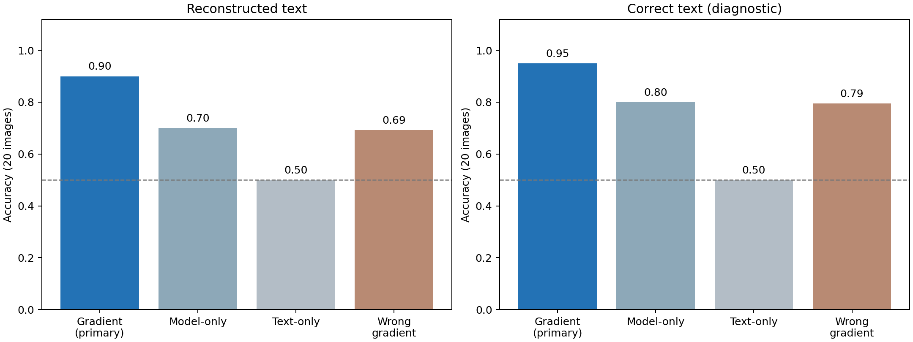
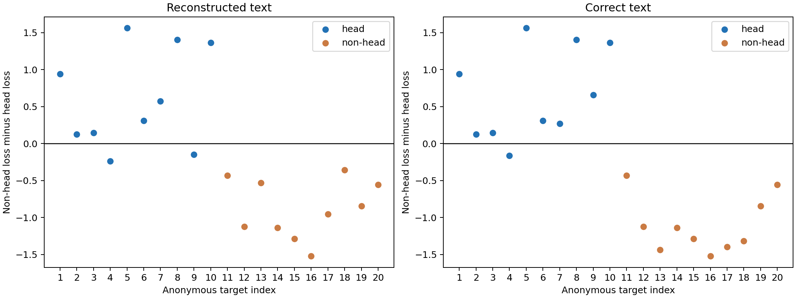

## 要点

- **混合模态下的头部属性推断正确十八张**：固定主方法在实际重构文本下为 18/20，正确文本诊断为 19/20；CT、MRI 均有正负样本。
- **梯度评分相对模型对照有正向增益，但稳定性尚未确定**：重构文本下 Model-only 为 14/20；配对增益为 0.20，图像级区间为 [0.00, 0.40]。
- **文本未完全恢复不必然导致属性判断失败**：完整问答恢复 14/20，这十四张属性全对，另外六张仍判断对四张。
- **高排序分数不等于固定判别规则全对**：主评分 AUROC 为 1.00，但两张头部图落在零分差边界的非头部一侧；本轮没有根据测试标签调整阈值。
- **本轮仍是有历史重叠的小规模诊断**：十三图与此前 pilot 重叠，七张新增图中判断正确六张；新增子集仍有模态与属性相关性。
- **生成提示不能直接当作模态真值**：四张非头部 MRI 输出在评分前补生成，最终部位明确，但模态外观仍偏 CT，只认可其 non-head 属性。

## 关键数字

| Modality | Head targets | Non-head targets |
|---|---:|---:|
| CT | 5 | 3 |
| MRI | 5 | 3 |
| X-Ray | 0 | 4 |
| Total | 10 | 10 |

共十九组不同的原始问答，四张头部图像的问答出现头部相关词。十三张图与此前不同 pilot 重叠，七张此前未用于这些属性实验。

| Text condition | Gradient correct | Accuracy | Balanced accuracy | Head precision | Head recall | Head AUROC | Model-only correct | Text-only correct |
|---|---:|---:|---:|---:|---:|---:|---:|---:|
| Reconstructed text | 18/20 | 0.900 | 0.900 | 1.000 | 0.800 | 1.000 | 14/20 | 10/20 |
| Correct text | 19/20 | 0.950 | 0.950 | 1.000 | 0.900 | 1.000 | 16/20 | 10/20 |

| Search completed | Question EM | Answer EM | Joint EM |
|---:|---:|---:|---:|
| 20/20 | 15/20 | 16/20 | 14/20 |

主方法重构文本准确率的图像级 Wilson 95% 区间约为 [0.699, 0.972]；患者独立性未知，该区间不包含患者相关性带来的额外不确定性。

## 研究问题

服务器事先不知道目标图像的模态和部位，能否从私有条件下恢复的问答与上传更新出发，利用一个所有目标共享的合成原型库识别“头部”属性？正确文本诊断用于区分文本重构误差与图像评分误差。

## 实验设置

| Item | Setting |
|---|---|
| Victim | LLaVA-1.5-7B，F-L，第十轮，LoRA rank 32 |
| Task | Head versus non-head；原始 VQA 问答 |
| Sampling | SLAKE eval，固定种子 20261017；按部位和模态分层抽样，每图一条随机原始问答 |
| Labels | 原始模态与部位标注，评估端目视核验部位；不标注疾病 |
| Reconstruction | Residual v1，LM prior 0.01，随机图像；已知 token 长度 |
| Generator | 本地 Qwen-Image-2.1-Turbo；1024 × 1024，bfloat16，原生 8 步，CFG 1.0 |
| Candidate bank | Head 与 non-head 各 12 张；每组 CT、MRI、X-Ray 提示各 4 张 |
| Primary score | Centered cosine；每组最低三个候选损失的均值；选得分较低的组 |
| Controls | 同一份恢复文本的 Model-only、未校准 Text-only、错配梯度；另做正确文本诊断 |
| Main endpoint | 所有二十张图像上的重构文本条件 Balanced accuracy |
| Subgroups | 模态、原始问答是否出现头部相关词、完整文本是否恢复正确 |
| Incomplete attack | 保存攻击状态并计为未作出属性预测；不删除样本、不用原文替换 |

Model-only 与 Text-only 共享同一份重构文本。前者比较候选图上的答案 NLL，后者只用问答判断属性；它们在属性评分阶段不再读取观测梯度，但上游文本恢复仍使用了梯度。因此，它们不是“整个流程完全不用梯度”的对照。

## 结果

### 数据与生成库准备

- 只从此前未使用的图像抽取二十张时，固定种子抽到的头部样本均为 MRI。正式方案在评分前改为上述分层配额，以便在 CT、MRI 内分别评价部位区分。
- 目视核验排除一张主要显示颈部的“头部”图像和一张主要显示胸部的“腹部”图像，使用预先随机排序的备选替换；不按梯度或重构得分更换样本。
- 初始合成库中四张非头部 MRI 输出未通过核验，保留其余二十张，并用明确的通用腹部描述补生成四张；不读取任何目标图像来设计提示。
- 补生成的四张图部位明确，但骨骼和对比度仍偏 CT 外观；仅认可 non-head 属性。生成库的模态数量指提示词数量，不代表经过临床核验的真实模态平衡。

### 属性推断

- 私有条件下不提供真图、原始问答或目标标签，先保存重构结果，再用固定生成库评分。全部二十次搜索完成，四十份属性预测均已保存，无样本因恢复失败被剔除。
- 主方法在重构文本下正确十八张，两个错误均为头部漏检；十张非头部图全部正确。正确文本下仍有一张头部 CT 漏检。
- 四种评分均在运行前声明，Centered cosine 始终作为主方法。Global cosine 与 Equal-tensor cosine 的重构文本结果为 19/20，只作为次要结果，不据此事后改主方法。

| Score | Reconstructed-text correct | Correct-text correct |
|---|---:|---:|
| Centered cosine, primary | 18/20 | 19/20 |
| Global cosine | 19/20 | 20/20 |
| Equal-tensor cosine | 19/20 | 20/20 |
| Centered equal-tensor cosine | 18/20 | 20/20 |

Wrong-gradient 柱为每个目标替换其余十九个观测后的正确率均值；共有 380 个配对，但独立图像仍只有二十张。

### 分模态结果

- CT 与 MRI 各包含五张头部、三张非头部，重构文本下各正确七张，组内 Balanced accuracy 均为 0.900。
- X-Ray 四张均为非头部，不能由该组的 4/4 推断 X-Ray 内的头部区分能力；该组二分类 Balanced accuracy 不定义。

| Modality | Head | Non-head | Reconstructed correct | Reconstructed BA | Correct-text correct | Model-only reconstructed correct |
|---|---:|---:|---:|---:|---:|---:|
| CT | 5 | 3 | 7/8 | 0.900 | 7/8 | 6/8 |
| MRI | 5 | 3 | 7/8 | 0.900 | 8/8 | 5/8 |
| X-Ray | 0 | 4 | 4/4 | — | 4/4 | 3/4 |

### 文本恢复与词面线索

- 完整问答正确的十四张，主方法属性判断全部正确。完整问答有误的六张仍判断正确四张，说明属性判断不要求每个 token 都恢复一致。
- 原始问答没有出现头部相关词的十六张中，主方法为 15/16，Model-only 为 11/16；这一组正负不均衡，主方法 Balanced accuracy 为 0.917。
- 词面检测只用于评估分组。没有头部词不等于没有间接部位线索，也没有排除其他器官词或语义关联。
- 未校准 Text-only 在两种条件下都预测 non-head，因此分类准确率为 0.50；其 AUROC 为重构文本 0.64、正确文本 0.74，不能据此说文本毫无信息。

| Group | n | Head | Non-head | Reconstructed gradient correct | Reconstructed Model-only correct |
|---|---:|---:|---:|---:|---:|
| Joint EM true | 14 | 7 | 7 | 14/14 | 10/14 |
| Joint EM false | 6 | 3 | 3 | 4/6 | 4/6 |
| Head terms absent | 16 | 6 | 10 | 15/16 | 11/16 |
| Head terms present | 4 | 4 | 0 | 3/4 | 3/4 |

### 梯度对照与增益

- 重构文本下主方法相对 Model-only 的准确率增益为 0.20，图像分层 bootstrap 区间为 [0.00, 0.40]；正确文本下增益为 0.15，区间为 [-0.05, 0.35]。尚不足以确认稳定优于模型对照。
- 换成其他目标的梯度后，重构文本条件下正确率降至 0.692。进一步只交换同模态、异属性目标的梯度，降至 0.621；该子集为 CT、MRI 的十六张，原正确观测下为 14/16，即 0.875。
- 错配对照固定本目标文本和生成库，但其他观测来自不同问答；下降可能同时反映图文不匹配，不能解释为已完全分离出视觉语义信号。

| Text condition | Correct gradient, all 20 | Wrong gradient, all 20 | Wrong gradient, same modality, 20 | Correct gradient, 16 images | Wrong gradient, same modality and opposite property, 16 |
|---|---:|---:|---:|---:|---:|
| Reconstructed text | 0.900 | 0.692 | 0.671 | 0.875 | 0.621 |
| Correct text | 0.950 | 0.795 | 0.779 | 0.938 | 0.746 |

每列按目标先求平均，再对参与目标求平均；错配配对数不是独立样本数。

### 两个错误与判别边界

- 匿名目标 4 为头部 CT：问题恢复正确、答案恢复错误；换成正确文本后，主方法仍误判，说明不能把这例全部归因于文本恢复。正确文本下其余三种评分均判对。
- 匿名目标 9 为头部 MRI：问题和答案均未完全恢复，重构文本下主方法漏检；正确文本下主方法判对。这例显示文本误差会改变属性判断。
- 两张错误目标的“non-head 损失减去 head 损失”都小于 0，所以按预定规则判为 non-head；但它们的分差仍高于所有真实非头部样本，因此 AUROC 为 1.00。排序指标与固定阈值准确率衡量不同事情。

| Anonymous target | Modality | True property | Text condition | Head loss ↓ | Non-head loss ↓ | Prediction |
|---|---|---|---|---:|---:|---|
| 4 | CT | Head | Reconstructed | 0.9280 | 0.6885 | Non-head |
| 4 | CT | Head | Correct | 0.8280 | 0.6669 | Non-head |
| 9 | MRI | Head | Reconstructed | 0.7314 | 0.5848 | Non-head |
| 9 | MRI | Head | Correct | 0.2402 | 0.8994 | Head |

零线以上判为 head，零线以下判为 non-head。编号为匿名评估序号，不是原始数据 ID；得分不是概率。本轮未根据这二十张的标签搜索阈值或改变类别偏置。

### 新增图像与历史重叠

- 这一分组在预测完成后用于审计，不参与选样或评分。新增七图中正确六张，重叠十三图中正确十二张。
- 新增七图的四张正例全部为 MRI，三张负例为一张 CT 和两张 X-Ray。因此新增子集不能单独证明同模态部位泛化；同模态证据仍包含历史重叠目标。

| Image history | n | Head | Non-head | Reconstructed gradient correct | Correct-text gradient correct | Reconstructed Model-only correct | Joint EM |
|---|---:|---:|---:|---:|---:|---:|---:|
| New to prior property pilots | 7 | 4 | 3 | 6/7 | 7/7 | 3/7 | 3/7 |
| Previously used images | 13 | 6 | 7 | 12/13 | 12/13 | 11/13 | 11/13 |

## 结论

- “重构文本 → 固定合成原型库 → 梯度属性评分”已在二十张混合模态图像上跑通，主方法为 18/20；服务器不需要先知道目标属于 CT、MRI 还是 X-Ray。
- 同模态内的 CT、MRI 结果都保留了部位区分能力，但没有排除构图、文本关联与历史重叠的影响，也不能外推到任意敏感属性。
- 当前瓶颈同时涉及文本误差和评分决策边界；不能只修文本，也不能因其他评分在这批数据更好就宣布新方法胜出。

## 局限

- 二十张目标按标签分层平衡，不代表自然患病或部位比例；Precision 也依赖这一采样比例。
- 十三张样本与先前 pilot 重叠，且缺少患者 ID；头部 CT 切片尤其相近，不能作为患者独立的新验证集。
- X-Ray 目标只有非头部，不能单独用这一组证明跨部位区分。
- 原始问答可能直接透露部位；“出现头部相关词”只是词面分组，不等于标签必然可从文本确定。
- 生成图只核验大类部位外观，不保证临床真实性、模态或序列细节准确；黑边与主体大小等混淆因素仍存在。
- 已知 token 长度、单样本 FedSGD 更新和可见模型状态均属于本轮明确条件。
- 只有一个最终合成库，没有跨生成种子的库级重复；相对 Model-only 的增益区间包含零，Text-only 未校准，尚不能确认稳定优于强文本基线。

## 下一步

- 优先在独立公开开发数据上固定评分与阈值，再用未参与选择的图像评估；不能在这二十张上调到全对后回报同一测试准确率。
- 在补充真实目标前，先检查是否能取得同模态、跨部位且患者独立的数据，避免新增子集再次把模态与属性混在一起。
- 修正生成 MRI 的外观偏差，并在冻结的新候选库上复核稳定性；保留本次库及结果作为对照。

??? note "运行记录"

    - 用户授权 GPU 5，样本数由一百张收缩至二十张；本轮仅新增评估脚本，不修改核心攻击方法。
    - 初始生成 worker PID 1339451、watcher PID 1339452 已完成；二十四张输出全部保存，四张在评分前因目视核验未通过而替换。
    - 补生成 worker PID 1341487、watcher PID 1341488 已完成；无 OOM，没有改变 batch size 或模型 dtype。
    - 主实验 worker PID 1343162、watcher PID 1343163 均已正常退出；按顺序执行捕获、私有文本重构、重构文本属性评分和正确文本对照，没有训练或重试攻击。
    - 主实验总耗时 2103.76 秒，约 35.06 分钟，包含模型加载、捕获及完整性检查；峰值 PyTorch allocated 为 24006.91 MiB。初始生成另耗时 142.33 秒，补生成 50.92 秒。
    - 两种文本条件各十九种独立文本，各 456 次候选回放，共 912 次；错配对照复用候选更新，不额外回放模型。
    - 二十个观测精确回放误差均为 0，四十份属性预测与冻结输入哈希核验通过，模型参数未改变；全部二十次文本搜索正常完成。
    - 评分及新实验针对性 CPU 测试十七项、文档测试十九项通过；新增评估脚本 Ruff 通过。
