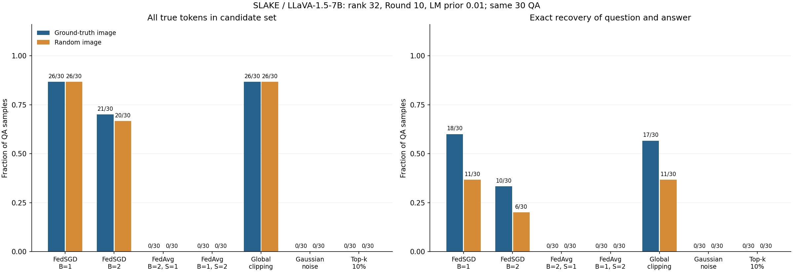
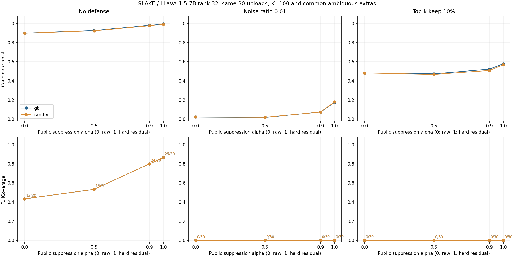
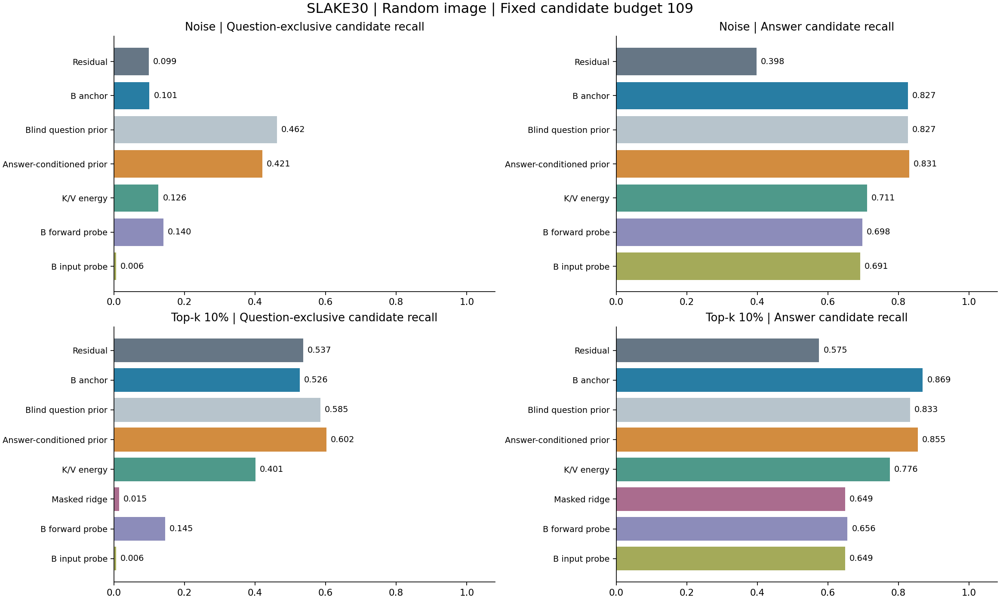
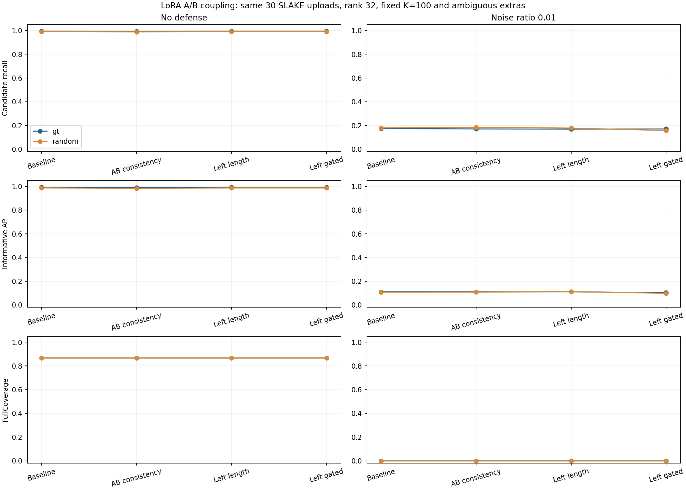
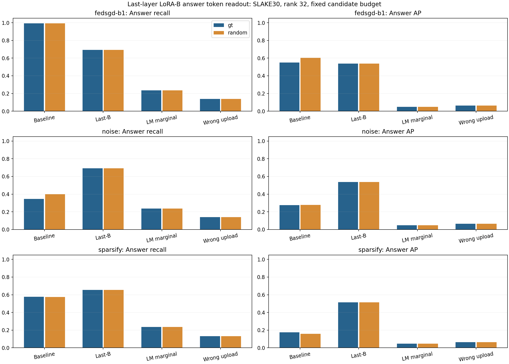
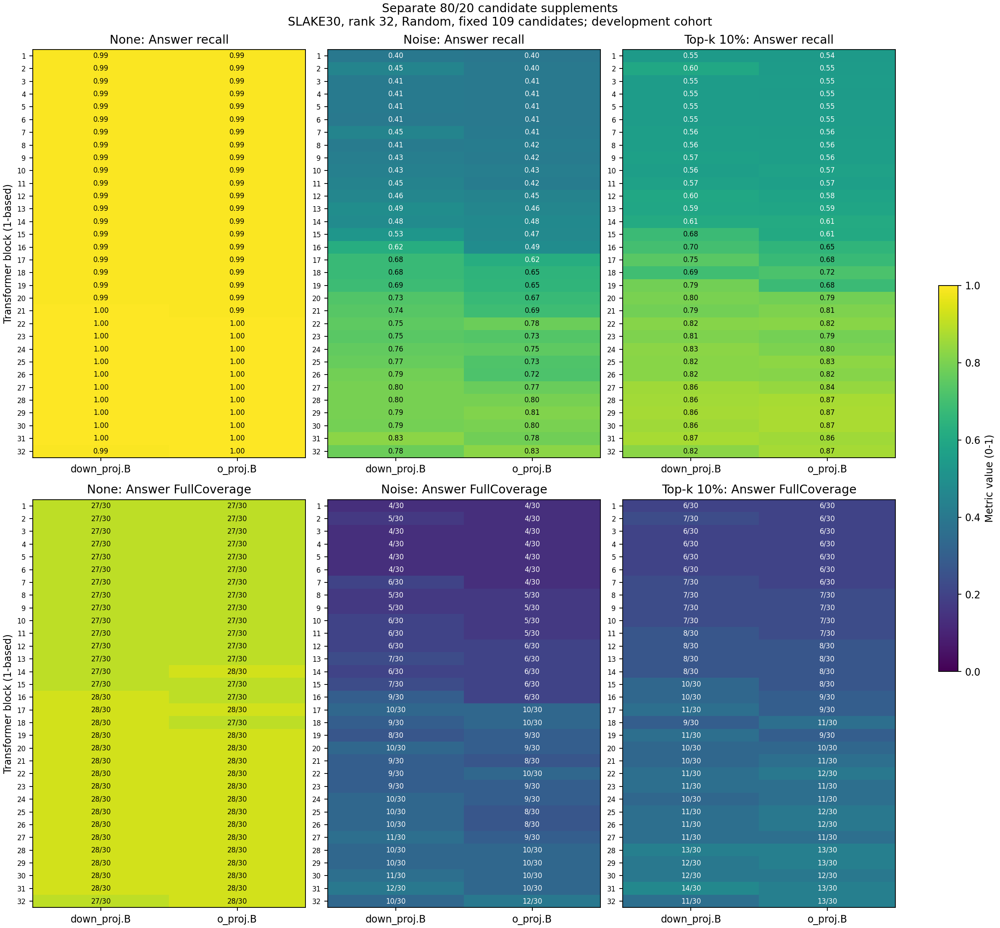
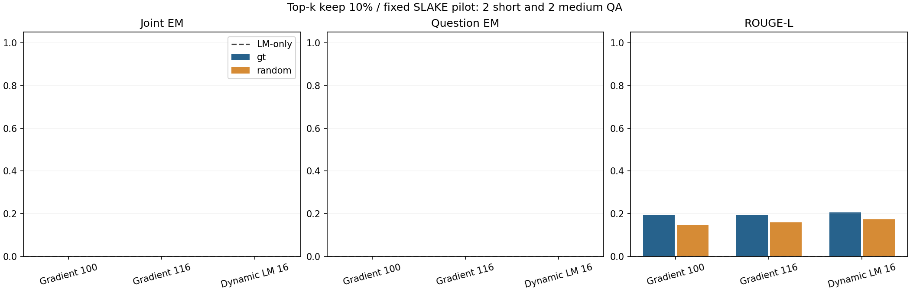

## 要点

- **全局裁剪几乎没有影响**：它的扰动最大（Relative L2 0.674），但只把 GT 的 Joint EM 从 18/30 降到 17/30，Random 保持 11/30；裁剪只缩放上传，不改变子空间方向。
- **加噪与 Top-k 让完整恢复归零**：两种图像下 FullCoverage 与 Joint EM 都降为 0/30；消除公开输入后干净梯度只剩约 3% 范数，噪声却保留约 86% 能量，残差被噪声主导。
- **六个筛选改进方向都没救回完整覆盖**：部分消除、谱加权、问题候选、A/B 校正、末层 B、动态候选，GT、Random 的最大完整覆盖仍为 Noise 0/30、Top-k 1/30。
- **问题先验主要补回通用词**：无答案线索先验把 Noise Random 问题 recall 从 0.1075 提高到 0.4659，但新增命中 98.5% 是问句结构、图像通用词或标点，未确认新增上传特异问题信号。
- **深层 B 提供答案证据，综合最优是 L31 down 和 L32 o**：64 个位置按跨防御答案 recall 均值排序两者第一（0.8482、0.8462），但不同准则最优位置不同，没有全面最优点；它改善答案侧，不解决问题侧漏检。

本页记录三种上传防御对 DAGER 文本恢复的影响，以及在防御下改进 token 筛选的尝试。本地更新方式（混合、精度、步数、AdamW）的结果见 [[federated-text-pilot]]。

## 关键数字

**防御矩阵**：SLAKE30，单样本 FedSGD 上传，defense-unaware 攻击。Relative L2 是防御后上传相对原上传的平均扰动。

| Defense | Image | Relative L2 | Candidate recall | FullCoverage | Joint EM | ROUGE-L |
|---|---|---:|---:|---:|---:|---:|
| None | GT | 0 | 0.9943 | 26/30 | 18/30 | 0.8104 |
| None | Random | 0 | 0.9906 | 26/30 | 11/30 | 0.7354 |
| Global clipping | GT | 0.674 | 0.9906 | 26/30 | 17/30 | 0.7609 |
| Global clipping | Random | 0.674 | 0.9859 | 26/30 | 11/30 | 0.7004 |
| Gaussian noise | GT | 0.545 | 0.1738 | 0/30 | 0/30 | 0.0306 |
| Gaussian noise | Random | 0.545 | 0.1792 | 0/30 | 0/30 | 0.0256 |
| Top-k 10% | GT | 0.359 | 0.5784 | 0/30 | 0/30 | 0.0781 |
| Top-k 10% | Random | 0.359 | 0.5689 | 0/30 | 0/30 | 0.0743 |

**六个筛选改进方向的小结**：没有一个方向让完整问答候选覆盖越过门槛。

| Idea | Main observation | Assessment |
|---|---|---|
| Partial erasure (alpha) | 减弱消除只把公开输入方向加回，噪声残差不减 | 无改善 |
| Spectral weighting (beta) | 加噪后奇异谱已变平，改权重无用 | 无改善 |
| Question prior | 无答案线索先验提高部分 recall，答案条件化未稳定超过同预算对照 | 部分召回有用，完整覆盖未过 |
| A/B coupling | 第零层 A/B 校正、残差左空间不改善覆盖 | 无改善 |
| Last-layer B | 提供上传特异答案证据，优于同配额 LM 补充 | 改善答案侧，不解决问题侧 |
| Dynamic candidates | 补回过真实 token，但正确前缀被打分淘汰 | Joint EM 仍 0/4 |

## 研究问题

- **防御影响**：全局裁剪、加噪和 Top-k 稀疏化分别对当前固定攻击有什么影响？
- **退化原因**：加噪和稀疏化为什么让真实 token 漏出候选集？
- **筛选改进**：改变公开消除、谱评分或问题候选来源，能否在防御下改善 token 覆盖？
- **A/B耦合**：利用 A/B 一致性、残差左空间或不同层 B 的答案证据，能否改善 token 覆盖？
- **动态候选**：让 LM 补充静态筛选之外的 token，能否在防御下恢复完整问答？

## 实验设置

**不变条件**（所有阶段共用）：

| Item | Setting |
|---|---|
| Model | [[crossmodel-text-benchmark]] 的 SLAKE LLaVA-1.5-7B 第 10 轮模型：F-L，rank 32，alpha 64 |
| Upload | 单客户端、单样本的 FedSGD 梯度，bf16；GT 与 Random 攻击同一份上传 |
| Method | `dager_adapted` 的 `public_residual` 筛选加 LM prior 0.01（DAGER-Erasure-LM）；beam 16，`rerank_candidates=0` |
| Candidates | informative top-100，另加固定保留的 ambiguous ID，实际共 109 个 |
| Knowledge | GT 为 `image_known`，Random 为 `private`（random surrogate）；问题与答案的内容长度公开 |
| Defense matching | defense-unaware：攻击端只接收防御后的上传，不做逆变换 |
| Budget | 每样本 200000 次评分、3600 秒 |
| Evaluation | 全部重构保存后才读取参考文本，一对一 Hungarian 匹配 |

### 样本集与防御

| Item | Setting |
|---|---|
| SLAKE30 | 原 benchmark 冻结的 30 条问答与 30 张图，短（1–16 token）、中（17–32）、长（33–64）各 10 条，同一客户端 |
| Pilot4 | SLAKE30 冻结顺序中前两条短、前两条中等问答；是 SLAKE30 的子集 |
| Global clipping | 全局 C≈2.097，取自 Pilot4，在 SLAKE30 捕获前固定 |
| Gaussian noise | 逐张量 std=0.01×max(abs(update))（`noise_ratio=0.01`），GT 与 Random 共用同一次扰动 |
| Top-k 10% | 逐张量保留绝对值最大的 10% 坐标（ceil），其余置零 |

### 阶段时间线

每个阶段的完整参数见 `docs/plans/` 下对应验证计划，详细产物见 frontmatter 的 artifacts 与运行记录；下表给出每阶段做了什么、得到什么。

| 阶段（date） | 内容 | 结论 |
|---|---|---|
| 防御矩阵（2026-10-23 至 24） | 与 [[federated-text-pilot]] SLAKE30 七条件同批运行，本页取无防御与三种防御四条件 | 裁剪无效，加噪/Top-k 完整覆盖归零 |
| 退化诊断（2026-11-01） | CPU 复用原结果；前两层奇异谱、残差范数比、K=100–5000 候选上限、参考项目报告核对 | 残差被噪声主导，扩大 K 找不回 |
| 部分消除与谱加权（2026-11-01） | alpha∈{0,0.5,0.9,1}、beta∈{0,0.01,0.1,1}，复用原上传只做筛选 | 两者都未改善完整覆盖 |
| LoRA A/B 耦合（2026-11-04） | 第零层 Q/K/V 的 A、B 一致性校正、残差左空间、gated 变体 | 恒等式成立仍不够，未修复漏检 |
| 末层 B 答案读出（2026-11-04） | 固定最后一层 down_proj.B 的词方向能量读出，加 LM marginal、错配对照 | 答案侧有上传特异收益，通过预设 80/20 融合门槛 |
| B 读出位置对照（2026-11-04） | L32 down、L32 o、L31 down 三位置 | 新位置答案候选优于原 L32 down，无单一最优 |
| B 全层扫描（2026-11-04） | L1–L32 的 down_proj.B 与 o_proj.B 共 64 位置，预设跨防御排序 | L31 down、L32 o 第一，高值集中后部，冻结为新样本确认候选 |
| 问题候选验证（2026-11-05） | 答案条件化先验、Top-k 支持集拟合、首层能量、浅层 A、配额/B 共识、B 特征探针共六方向 | 六方向均未增加完整覆盖，浅层 A 只有局部首词信号 |
| 动态候选（2026-11-01） | Pilot4 四条，Gradient-100/116、Dynamic-LM-16、LM-only 共 28 次重构 | ROUGE-L 微升，Joint EM 仍 0/4 |

动态候选方法定义：

| Method | Candidates per prefix |
|---|---|
| Gradient-100 | 原静态筛选：informative top-100 加 ambiguous，共 109 个 |
| Gradient-116 | 静态筛选放宽到 125 个，作为等预算对照 |
| Dynamic-LM-16 | Gradient-100 与当前前缀下 text-only LM 的 Top-16 取并集，按梯度排名补齐到 125 个 |
| LM-only | 只用声明长度与公开模型的 LM beam，不用图像、梯度或梯度候选 |

## 结果

### 防御影响

**回答**：全局裁剪几乎不影响恢复；加噪和 Top-k 稀疏化把两种图像下的完整候选覆盖和 Joint EM 都降为 0/30。完整矩阵见页首关键数字。

- 裁剪扰动最大却几乎不影响恢复：理想精度下裁剪只乘一个正标量，行空间不变。裁剪后各有 10/30 条重构文本变化、GT 少一条精确恢复，可能来自 bf16 舍入或搜索对微小扰动的敏感，尚未单独验证。
- `noise_ratio=0.01` 是逐张量最大绝对值的 1%，实际相对扰动为 0.312–0.746，不是弱噪声。
- 三种防御的强度没有配平，攻击也不感知防御；零恢复只说明当前方法在这些设置下失败，不是隐私保证。

#### 与纯文本参考项目的对比

两个项目的噪声公式（逐张量 `noise_ratio × max(abs(gradient))`）和 Top-k 规则一致，只在取整上差一个坐标。

| Reference method | Defense | Samples | Full-text R-L | PII micro recall |
|---|---|---:|---:|---:|
| DAGER | Noise ratio 0.01 | 40 | 0.0770 | 0.1900 |
| DAGER | Top-k 10% | 40 | 0.0543 | 0.1000 |
| RecFedLLM | Noise ratio 0.01 | 40 | 0.0356 | 0.4700 |
| RecFedLLM | Top-k 10% | 40 | 0.0393 | 0.5200 |

- 评价目标与设置都不同：参考项目的 PII recall 是部分实体恢复，为 Llama-3.2-3B、Enron、FP32、仅 q_proj LoRA、前两层距离候选；本项目的 Joint EM 要求整条问答精确匹配、任一 token 漏检即失败，为 LLaVA、SLAKE、bf16、Q/K/V 联合与公开输入消除。两者数字不能当作性能排名。

### 退化原因

**回答**：公开输入消除去掉了大部分干净梯度，却几乎去不掉噪声，所以残差被噪声主导；噪声下扩大候选上限也找不回真实 token，稀疏化下只有局部收益。

| Defense | Residual norm ratio |
|---|---:|
| None | 0.03134 |
| Clipping | 0.03134 |
| Noise ratio 0.01 | 0.41655 |
| Top-k 10% | 0.04385 |

- Residual norm ratio 是第一层各 Q/K/V 块归一化后、消除公开输入后剩下的范数比例（30 份上传均值）。干净上传只剩约 3%，加噪后升到约 42%。
- 第一层公开输入子空间秩为 587、维数 4096；各向同性噪声投影后仍保留约 (4096−587)/4096≈85.7% 的能量。
- Top-k 按整张量的大坐标筛选，\((M\odot G)Q\) 不等于对 \(GQ\) 统一缩放，对文本重要的微弱分量可能被删掉。

**扩大候选上限**（只重评已有分数，不重新搜索；表中为 FullCoverage）：

| Defense | Image | K=100 | K=200 | K=500 | K=1000 | K=5000 |
|---|---|---:|---:|---:|---:|---:|
| Gaussian noise | GT | 0/30 | 0/30 | 0/30 | 0/30 | 1/30 |
| Gaussian noise | Random | 0/30 | 0/30 | 0/30 | 0/30 | 0/30 |
| Top-k 10% | GT | 0/30 | 0/30 | 1/30 | 4/30 | 6/30 |
| Top-k 10% | Random | 0/30 | 0/30 | 1/30 | 5/30 | 7/30 |

- 全部 240 组 K=100 候选与原结果逐集合一致。噪声下真实 token 排序已严重退化；稀疏化扩大 K 有局部收益，但大部分问答仍缺 token。
- 加噪后奇异谱明显变平：GT 下 None 的 median(s)/s_max 为 0.001450、maximum adjacent gap 4.500，加噪后分别为 0.735557、1.145，看不到区分强弱方向的分界（数值秩都是 96）。

### 筛选改进

**回答**：部分消除与谱加权没有改善完整覆盖。新一轮问题先验提高了部分召回，答案条件化未稳定超过同预算先验；六个方向均未增加完整问答候选覆盖，浅层 A 的局部首词结果需单独理解。六方向小结见页首关键数字。

#### 部分消除与谱加权

两者都没有改善任何防御下的完整覆盖（FullCoverage 全为 0/30，详见下）。

| Defense | Alpha | Candidate recall (GT) | FullCoverage (GT) | Beta | Candidate recall (GT) | FullCoverage (GT) |
|---|---:|---:|---:|---:|---:|---:|
| None | 1 | 0.9943 | 26/30 | 1 | 0.9884 | 25/30 |
| Noise | 1 | 0.1738 | 0/30 | 1 | 0.1753 | 0/30 |
| Top-k | 1 | 0.5784 | 0/30 | 1 | 0.5560 | 0/30 |

- 减弱消除并不能减少残差方向上的噪声：\(G_{obs}Q_\alpha=G_{obs}(I-UU^\top)+(1-\alpha)G_{obs}UU^\top\)，只是把公开输入方向加回来；alpha 从 0 到 1 的各档见 `soft-residual-aggregate.json`。
- Noise 下 beta=1 的召回只增加 0.0015（GT）和 0.0044（Random），无样本获得完整覆盖；强加权还损伤无防御结果（beta=1 时 GT 丢 1 条、Random 丢 2 条完整覆盖），弱方向并不都是噪声。
- 加噪后奇异谱已变平，谱加权只能改权重、不能纠正已被扰动的方向。

#### 问题候选六方向

**回答**：无答案线索的问题先验提高了部分覆盖，预测答案条件化没有稳定超过同预算的先验对照；浅层 A 只出现局部首词信号。六个方向均未增加完整问答候选覆盖，GT、Random 的最大值仍为 Noise 0/30、Top-k 1/30。

**答案条件化与无条件先验**（Random；`B anchor` 为原 Residual 80 个 + L31 down 补 20；Q blind/conditioned/wrong 为原 Residual 60 + L31 down 补 20 + 问题先验补 20；共同 ambiguous 9）：

| Defense | Method | Question recall | Answer recall | Joint candidate recall | Joint FullCoverage |
|---|---|---:|---:|---:|---:|
| Noise | B anchor | 0.1075 | 0.8273 | 0.3143 | 0/30 |
| Noise | Q blind | 0.4659 | 0.8273 | 0.5664 | 0/30 |
| Noise | Q conditioned | 0.4275 | 0.8310 | 0.5441 | 0/30 |
| Noise | Q wrong | 0.3969 | 0.8294 | 0.5181 | 0/30 |
| Top-k | B anchor | 0.5322 | 0.8690 | 0.6464 | 1/30 |
| Top-k | Q blind | 0.5903 | 0.8329 | 0.6697 | 1/30 |
| Top-k | Q conditioned | 0.6072 | 0.8551 | 0.6884 | 1/30 |
| Top-k | Q wrong | 0.5985 | 0.8329 | 0.6752 | 1/30 |

- Q blind 把 Noise 问题召回从 0.1075 提到 0.4659，但问题完整覆盖仍 0/30；Q conditioned 的问题独有词召回相对 Q blind 差 −0.0412（区间 [−0.0735, −0.0092]），相对 Q wrong 差 0.0291（区间含零）。本批不支持答案线索提供可靠新增问题证据。
- E1 新增命中审计：相对 B anchor，Blind 在 Noise 下新增 136 次命中，其中 98.5% 是疑问词、功能词、图像通用词或标点，两防御下均无新增解剖内容词；Blind 相对 Residual 的解剖内容新增命中各 4 次均来自保留的 B 通道，不能归给 LM。详见 `e1-token-gain-aggregate.json`。

**实际上下文的首词诊断**（公开 Top-256 提议池仅含 21/30 真实首词，池外计未命中；Top-5 以 30 样本为分母）：

| Defense | Image | Probe | Top-5 hit | Wrong Top-5 |
|---|---|---|---:|---:|
| Noise | Random | L1 up | 8/30 | 4/30 |
| Noise | Random | L2 K | 5/30 | 2/30 |
| Noise | Random | L1 K/V | 2/30 | — |
| Top-k | Random | L1 up | 4/30 | 3/30 |

- Noise Random 的 L1 up 相对同池 K/V 多命中 6 条、相对错配多 4 条，L2 K 分别多 3、3，达到预设首词探索门槛；L1 up 相对错配 Top-5 差 0.1333（区间 [0.0000, 0.3000]），GT 差只有 1/30。这是同批多位置探索的局部线索，没有独立确认，不能推广到后续问题位置。
- Masked ridge（Top-k 支持集拟合）rho 只在公开 Fit 选 0.01、Audit 未通过，目标 Random 问题召回仅 0.0214；每种图像 1920 行 K/V 观测中 89.9% 的限制公开基满行秩，正则只选一种拟合，不保证保留真实问题分量。
- 配额与两位置 B 共识只带来很小变化，Noise 把答案名额减到 8 反而损失答案覆盖；联合完整覆盖不变。

### A/B耦合

**回答**：第零层 A/B 校正未改善完整覆盖，矩阵降噪也未修复 token 漏检。末层 B 的独立答案读出通过了预设信号门槛，但固定预算融合仍没有解决问题侧漏检。

#### 第零层 A/B 校正

所有行 n=30、候选 109。Noise 与 None 的 Candidate recall / Informative AP / FullCoverage：

| Defense | Method | Candidate recall (GT) | Candidate recall (Random) | FullCoverage (GT) | FullCoverage (Random) |
|---|---|---:|---:|---:|---:|
| Noise | Baseline | 0.1738 | 0.1792 | 0/30 | 0/30 |
| Noise | AB consistency | 0.1701 | 0.1841 | 0/30 | 0/30 |
| Noise | Residual left | 0.1691 | 0.1776 | 0/30 | 0/30 |
| Noise | Residual left gated | 0.1701 | 0.1566 | 0/30 | 0/30 |
| None | Baseline | 0.9943 | 0.9906 | 26/30 | 26/30 |

- 全部 120 组 Baseline 候选集合精确复现（最大分数差 3.25e-14），无防御时各方法仍 26/30；没有通过扩大候选池获得改善。
- **恒等式成立仍不够**：对有效权重 W+cBA，理想残差 sketch 为 \(C=B^\top G_B-G_A P A^\top=RA^\top\)。联合投影的校正量只能改动 A 张成的至多 32 个输入方向，满足该约束不等于恢复 4096 维干净梯度；且干净 bf16 上传本身不是精确恒等式（G_A Aᵀ 与 Bᵀ G_B 平均相对不一致约 0.00226，消除公开项后升到 GT 0.4308、Random 0.3887）。约束求解本身有效（校正后不一致最大仅 1.91e-15），但不足以修复漏检。
- **矩阵降噪不等于 token 恢复**（事后用配对干净上传，不进入打分）：Residual left 把 Random 平均残差误差从 71.64 降到 51.29，仍远大于 1 并损失约 14.5% 干净能量，Candidate recall 几乎不变（0.1792→0.1776）；门槛只检测到很少方向（Noise GT 90 个块中 76 个选 0 维、14 个选 1 维）。总矩阵误差下降不能保证 token 排序改善。详见 `lora-ab-aggregate.json`、`lora-ab-paired-clean-aggregate.json`。

#### 末层 B 答案读出

直接检查末层 B 是否提供答案词方向。u_w 只近似目标词反传方向，未处理 RMSNorm 径向项与预测分布项，不保证真实 token 必然高分。单独读出不接收图像，GT/Random 候选相同。

固定融合保留原 Top-80、补 20 个不重复新 token（LM 对照用相同配额，融合不定义全词表排序，故不报 AP）：

| Supplement | Defense | Image | Answer recall | Answer FullCoverage | Joint FullCoverage |
|---|---|---|---:|---:|---:|
| mix_last_b | None | gt | 0.9949 | 27/30 | 26/30 |
| mix_last_b | noise | random | 0.7757 | 10/30 | 0/30 |
| mix_lm_prior | noise | random | 0.5217 | 7/30 | 0/30 |
| mix_last_b | sparsify | random | 0.8244 | 11/30 | 1/30 |
| mix_lm_prior | sparsify | random | 0.6149 | 8/30 | 1/30 |

- **答案补充有上传特异性**：Last-B 单独评分的 Noise Answer recall 为 0.6921，错配上传只有 0.1391、LM marginal 0.2356，不能仅用常见答案词先验解释。
- **固定配额融合优于同配额 LM 补充**：Random 的 Noise Answer recall 为 Last-B 0.7757、LM 0.5217，Top-k 为 0.8244、0.6149。
- **没有解决完整问答覆盖**：Last-B 融合的 Noise、Top-k Joint FullCoverage 为 0/30、1/30，同配额 LM 也是 0/30、1/30，因此这条完整覆盖不能归为末层 B 独有收益；Last-B 单独 Question recall 仅约 0.018，适合作答案补充，不能单独替换原筛选。

#### B 读出位置对照与全层扫描

**回答**：按预设跨防御主排序，L31 down 与 L32 o 在 64 个位置中第一；高值集中在后部相邻多层，不是孤立点；但不同准则（单独 recall、AP、完整覆盖、跨防御均值）最优位置不同，没有全面最优。

单独读出（n=30，候选 109，不接收图像；Wrong recall 为该位置错配上传）：

| Defense | Position | Answer recall | Answer AP | Answer FullCoverage | Wrong recall |
|---|---|---:|---:|---:|---:|
| Noise | L32 down | 0.6921 | 0.5373 | 6/30 | 0.1391 |
| Noise | L32 o | 0.7925 | 0.5902 | 9/30 | 0.1807 |
| Noise | L31 down | 0.8162 | 0.5850 | 11/30 | 0.1966 |
| Top-k | L31 down | 0.7688 | 0.5463 | 8/30 | 0.1827 |

全层扫描前五名（Random、固定 80/20 补充，Mean recall 为 Noise、Top-k 答案 recall 均值）：

| Rank | Layer | Module | Noise recall | Top-k recall | Mean recall |
|---:|---:|---|---:|---:|---:|
| 1 | 31 | down | 0.8273 | 0.8690 | 0.8482 |
| 2 | 32 | o | 0.8265 | 0.8659 | 0.8462 |
| 3 | 29 | o | 0.8091 | 0.8738 | 0.8414 |
| 4 | 30 | o | 0.8002 | 0.8715 | 0.8359 |
| 5 | 28 | o | 0.7964 | 0.8685 | 0.8325 |

- 原 L32 down 的跨防御均值 0.8000 只排第 13，距离输出最近不等于最适合当前读出；最后一个 down 模块有明显回落（L31 down 单独 recall Noise 0.8162、L32 down 降至 0.6921），o 模块没有同样末层下降。
- 单看 Top-k 补充 recall 最高是 L29 o（0.8738），单独 AP 最高是 L32 o（Noise 0.5902），完整覆盖最高是 L31 down；不同准则最优不同，不能只报最有利指标。
- 整体候选召回提高幅度远小于答案侧：Random 的 L31 down 在 Noise 下答案 recall 0.8273、整体候选 recall 只有 0.3143，不能把答案侧的约 0.83 当作整体文本恢复。
- 按预设跨防御规则冻结 L31 down、L32 o 为新样本确认候选（使用开发集评价，不是攻击端按每条私有文本自适应选层）；本轮没有运行第二阶段序列搜索，因此没有这些新方案的 Word Recall、ROUGE 或 Joint EM。

### 动态候选

**回答**：不能。Dynamic-LM-16 只让 ROUGE-L 小幅上升，Question EM、Answer EM 和 Joint EM 都仍为 0/4；它补回过一次真实 token，但正确前缀随后被打分淘汰。

| Method | Image | N | Joint EM | ROUGE-L | Word Recall |
|---|---|---:|---:|---:|---:|
| Gradient-100 | GT | 4 | 0/4 | 0.1940 | 0.1990 |
| Gradient-116 | GT | 4 | 0/4 | 0.1940 | 0.1990 |
| Dynamic-LM-16 | GT | 4 | 0/4 | 0.2065 | 0.2115 |
| Gradient-100 | Random | 4 | 0/4 | 0.1483 | 0.1549 |
| Dynamic-LM-16 | Random | 4 | 0/4 | 0.1733 | 0.1799 |
| LM-only | None | 4 | 0/4 | 0.0000 | 0.0000 |

- 相对等预算的 Gradient-116，Dynamic-LM-16 的 ROUGE-L 在两种图像下都只高 0.0125；动态组确实提议静态集之外的新 token，但新候选也可能挤掉正确前缀。
- LM-only 四个问题解码后都为空，说明当前固定提示下的 LM beam 退化，其零分不能推广为语言模型先验无效。

#### 正确前缀在哪里丢失

全部重构提交后的审计，每种条件 n=4，没有把真实前缀输入搜索。`Not proposed`：下一个真实 token 不在候选中；`Scored out`：真实 token 在候选中但综合分数把正确前缀淘汰。

| Method | Image | Not proposed | Scored out | New true proposals |
|---|---|---:|---:|---:|
| Gradient-100 | Random | 2 | 2 | 0 |
| Dynamic-LM-16 | Random | 1 | 3 | 2 |

- 动态补充把一次"未提议"变成"被打分淘汰"，提示打分可能是下一个瓶颈；样本太少，不能下定论。

## 结论

- 原固定攻击在加噪与 Top-k 下完整恢复归零；全局裁剪仅缩放上传，几乎不改变恢复效果。当前方法的失败不提供隐私保证。
- 失败首先发生在 token 筛选：公开输入消除后残差被噪声主导（干净约 3% 范数、噪声保留约 86% 能量），奇异谱变平，扩大候选上限也找不回真实 token。
- 六个筛选改进方向都没有增加完整问答候选覆盖，GT、Random 的最大值仍为 Noise 0/30、Top-k 1/30。部分消除、谱加权、A/B 校正不改善；问题语言先验能增加部分候选覆盖，但答案条件化没有稳定超过同模板同预算对照，不能把先验收益归为新增梯度泄露。
- 深层 B 保留了答案词证据，跨防御综合候选为 L31 down 和 L32 o；较高答案 recall 来自原筛选与 B 的组合，单独少量 B 候选不能保证覆盖全部答案，问题侧仍缺直接证据。
- 实际上下文下的 L1 up、L2 K 有局部首词线索，但提议池仅覆盖 21/30 真实首词，同批多位置探索与含零的区间不足以证明稳定泛化，更不能推出完整问题可恢复。
- 逐行 Masked ridge 在大多数观测支持集上缺少私有分量的可辨识性，当前实验明显退化；按计划未运行新序列搜索，因此没有新的 Word Recall、ROUGE 或 Joint EM。

## 局限

- 只有一个模型、一个数据集、一个 rank 和 30 条问答；防御只测一档强度，没有强度曲线或任务效用评估。裁剪阈值取自 Pilot4，而 Pilot4 是 SLAKE30 的子集。
- 原攻击不感知防御；新支持集分支明确使用公开 Top-k 声明和观测掩码，A/B gated 对照额外假设噪声比例已知，分别标记。结果不提供 DP 保证，也不代表其他防御感知攻击同样失败。
- alpha、beta 各只测四档预设值；A/B 耦合只复用同一 SLAKE30 的 None、Noise 上传，三种新规则均无独立验证，不推广到 Top-k、AdamW 或多步参数差值；额外干净上传只用于事后诊断，不属于 noisy 攻击可用信息。
- 末层 B 及 80/20 融合只在同一 SLAKE30 上做机制验证，融合门槛使用本批答案指标、不是独立验证；近似词方向没有处理完整 RMSNorm Jacobian 或预测分布项。三位置与全层扫描也复用同一批样本，64 位置择优有多重比较与过拟合风险，冻结的两个模块候选需新样本确认。
- Gaussian null 没有精确建模 bf16 舍入，观测尺度代理也与噪声相关；gate 是预设启发式，不提供严格显著性保证。各层逐张量峰值与相对噪声强度不同，不能把差异全归为层数本身。
- 旧动态候选只覆盖 Pilot4 的 4 条短、中问答和 Top-k 一种防御，旧 LM-only 在当时提示下退化；本轮问题先验没有首步 EOS，但仍没有 LM-only 完整序列恢复或训练文本记忆的独立消融。
- 新六方向仍只复用旧 SLAKE30，10380 组候选不是新独立样本；浅层 A 仅测问题首词和固定 Top-256 提议池，没有验证后续位置的未知上下文。公开校准来自非医学图片与自造问答，领域失配尚未单独分离。
- 与参考项目的模型、数据、精度、候选评分和评价目标都不同，不能量化各项差异的贡献。

## 下一步

- 用公开问句设计更稳健的首词提议池，冻结 L1 up 与 L2 K 后在新图像组确认（当前池漏掉 9/30 首词）；后续位置只能使用攻击提出的前缀，不能使用真实前缀。
- 把无条件问题先验保留为部分恢复的对照；若研究实际文本质量，另行验证序列打分和语言先验，不能用 Candidate recall 代替 ROUGE。
- 固定 L31 down、L32 o 在新样本确认答案证据，不在旧三十条上继续换层、调提示或配额。
- 如继续 Top-k，优先研究未保留坐标的幅度约束，避免在满观测秩的公开基上做无约束逐行分解。
- 新规则冻结后再扩展防御强度、任务效用和随机种子；本轮没有待运行的新实验。

??? note "运行记录"

    通用约定：各阶段均冻结 `source-*` 源码（SHA256 见各 manifest）、基础 commit 2fd25b6、既有 gia 环境未修改、只新增 evaluation 与测试、不提交 Git；全部评分先保存后才读取参考 token，不输出 token 或原文，原图文与原始梯度只留在 outputs、文档仅发布聚合表图；单卡执行，遵守 WN-A100 至多两卡限制，进程完成后均退出。

    | 阶段 | 输出目录 | Host / GPU | 墙钟 | 核验 |
    |---|---|---|---|---|
    | 防御矩阵 | 见 [[federated-text-pilot]] 运行记录 | — | — | 与 SLAKE30 七条件同批运行 |
    | 退化诊断 | `defense_text_diagnosis_20261101` | 仅 CPU | — | 240 组 K=100 候选精确复现；参考项目四份 Enron 报告只读核对，均 noise_std=null |
    | 部分消除 | `soft_residual_filter_20261101` | WN-A100 GPU0 | 8.89 min，峰值 16.06 GiB | 720 组筛选分数提交后评价；五项离线测试、DAGER 回归 31 通过 |
    | 谱加权 | `spectral_filter_20261101` | WN-A100 GPU0 | 3.75 min，峰值 17.05 GiB | beta=0 候选与原方法精确一致，最大分数差 6.85e-14；回归 37 通过 |
    | LoRA A/B | `lora_ab_filter_20261104_v2` | 本机 zx-a1 GPU2 | 5.11 min，峰值 15.83 GiB | 首轮 CPU/CUDA 设备不一致失败（未读 token 真值）后冻结 v2；480 组评分提交后评价，240 个评分/诊断哈希核验，回归 39 通过 |
    | 末层 B 读出 | `last_b_token_readout_20261104_v2` | WN-A100 GPU1 | 122.92 s，峰值 14.42 GiB | 首轮 GPU 预检失败资源记录保留；词表 32064 误设 32000 报错后本机 finish.py 续 CPU 评价，90 份分数、180 组候选提交后评价，48 项测试通过 |
    | B 位置对照 | `last_b_positions_20261104` | WN-A100 GPU1 | 134.68 s，峰值 14.42 GiB | 270 组词表分数、2160 组候选提交后评价，L32 down 最大分数差为零，1080 组历史候选复现；38 项测试通过 |
    | B 全层扫描 | `last_b_layer_sweep_20261104` | WN-A100 GPU0 | 179.26 s，峰值 16.65 GiB | 5760 组词表分数、35100 组候选提交后评价，270 份历史词表分数差零，768 次旧实现重算；44 项测试通过 |
    | 整体指标核对（11-05） | 只读既有聚合 | — | — | 补 Question/Answer/Joint candidate recall 表；更正三位置 None 表 L32 o、L31 down 的 GT Joint FullCoverage 26→27/30，不改分数 |
    | 问题候选六方向 | `question_filter_defense_20261105` | WN-A100 GPU2 | 1311.05 s | 公开 48 样本等价复核、首份 448 张量逐值一致；10380 组候选提交后评价，83040 项独立候选指标核验，原基线最大差 7.55e-15；公开 Audit 失败仍冻结 rho=0.01 完成负结果诊断；53 项测试通过 |
    | E1 新增命中审计（11-05） | 仅 CPU | — | — | 144 组统计、6694 次 token 事件、27/27 分词对齐；每组 E1 候选由原 60+B20+LM20+ambiguous9 精确重建；29 项测试通过 |
    | 动态候选 | `dynamic_candidates_topk_20261101` | WN-A100 GPU0 | 27.04 min，峰值 18.47 GiB | 28 次重构提交后评价，八次 Gradient-100 winner 与历史精确一致；回归 44 通过；LM-only 沿用现有固定提示未重设计 |
