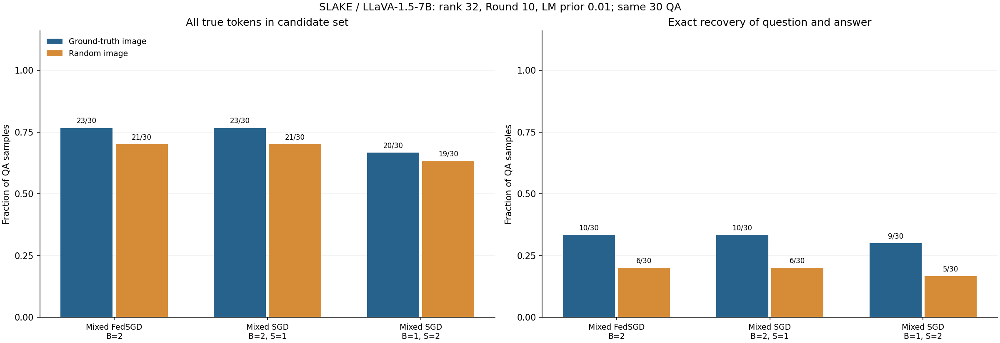
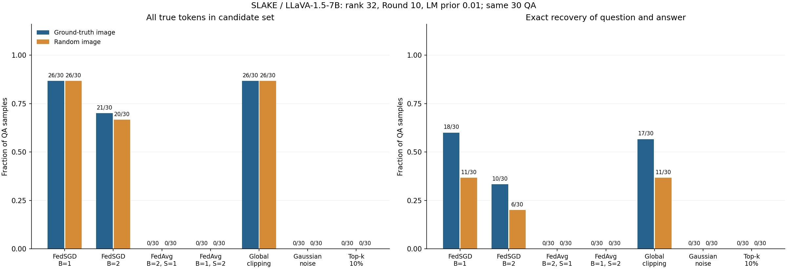
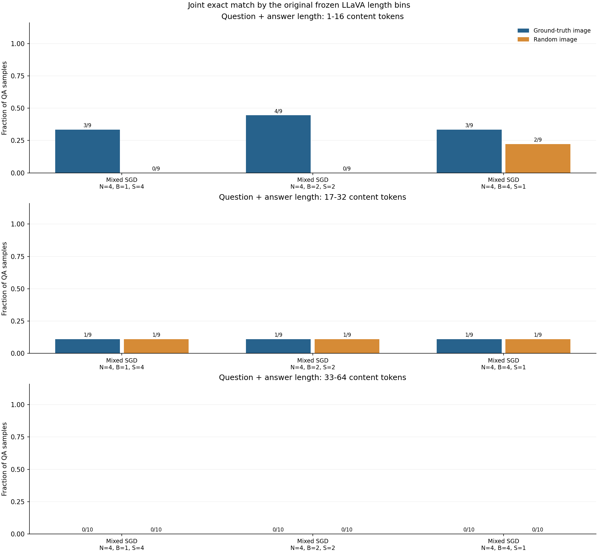
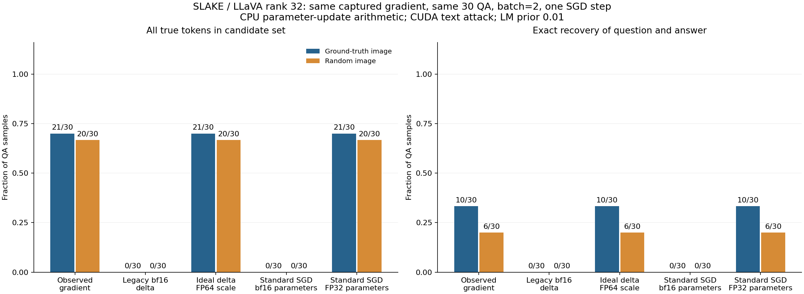
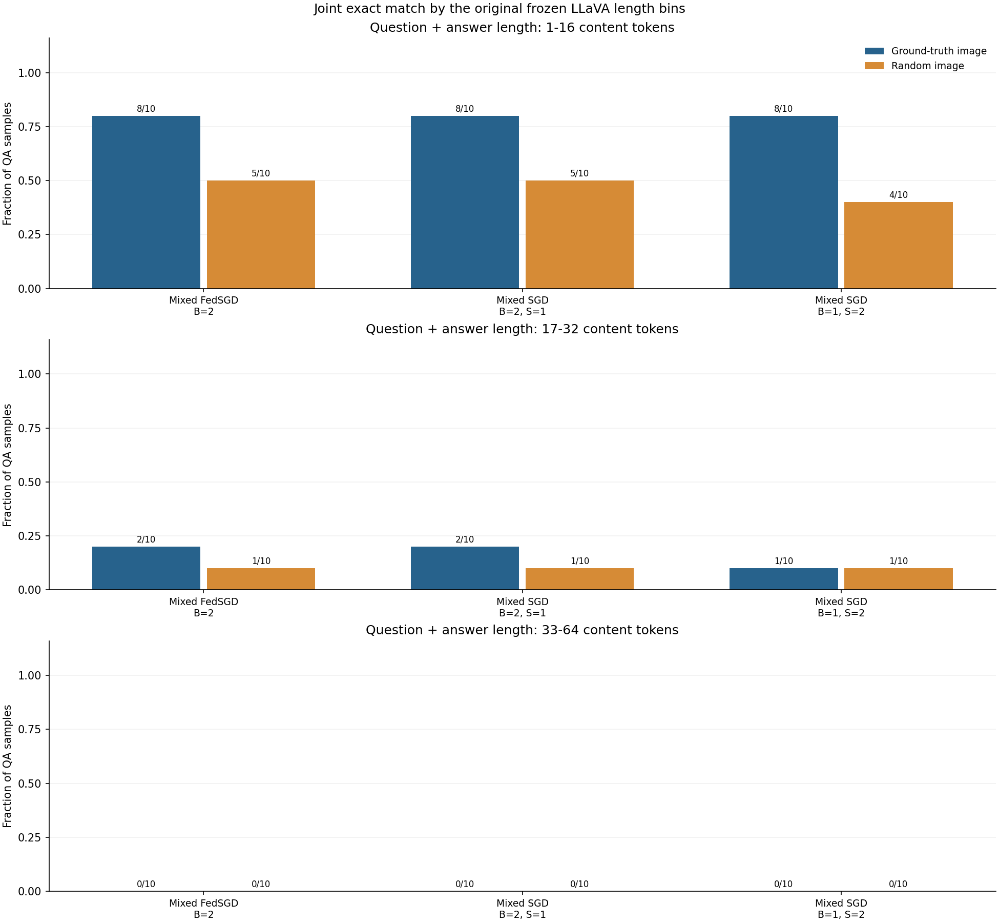
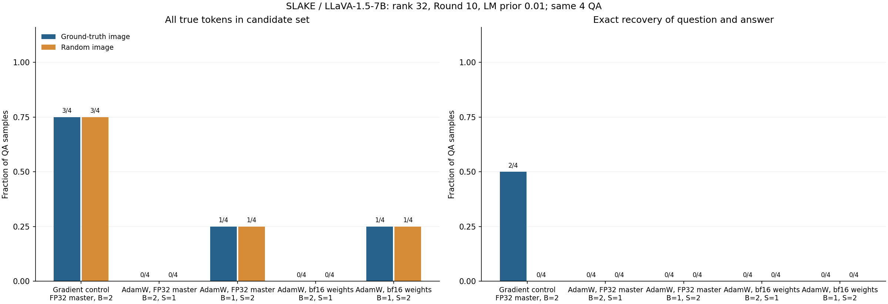

## 要点

- **固定四条问答时，四步仍泄露文本**：bf16 主干、FP32 LoRA 更新时，B1S4、B2S2、B4S1 的 Joint EM 分别为 GT 4/28、5/28、4/28，Random 1/28、1/28、3/28；没有一致的单调趋势。
- **AdamW 差值提案在四样本中失败**：FP32 与 bf16、单步与双步的 Joint EM 均为 0/4；FP32 下也先漏 token，最终十六个候选均无完整正确问答，暂不扩大矩阵。
- **SGD 单步失败主要来自 bf16 参数舍入**：同一梯度下，标准 bf16 SGD 仍为 0/30；FP32 更新回到 GT 10/30、Random 6/30，修正乘法写法本身没有恢复效果。
- **当前强度的噪声与稀疏化使恢复归零**：两者都让每条问答缺失真实 token，两种图像条件的 Joint EM 都是 0/30。
- **长问答仍未完整恢复**：三十样本矩阵的 33–64 token 桶在全部条件下均为 0/10，其中单样本两种图像条件各有 6/10 候选完整。

## 关键数字

Joint EM 要求问题和答案都精确匹配；FullCoverage 是实际候选集包含全部真实内容 token 的问答数。最新固定四 QA 阶段使用同样的 28 条问答、七组上传；后面的历史阶段使用原 30 条问答，两种分母不混合。

最新阶段固定每份上传四条不同 QA，只改变 minibatch 划分，三条件均为 bf16 计算、FP32 LoRA 参数与 SGD 差值，lr=0.01。

| Batch | Steps | QA per Upload | Joint EM (GT) | Joint EM (Random) | FullCoverage (GT) | FullCoverage (Random) |
|---:|---:|---:|---:|---:|---:|---:|
| 1 | 4 | 4 | 4/28 | 1/28 | 14/28 | 12/28 |
| 2 | 2 | 4 | 5/28 | 1/28 | 16/28 | 17/28 |
| 4 | 1 | 4 | 4/28 | 3/28 | 17/28 | 17/28 |

42 次重构全部 completed，没有预算耗尽或 OOM。四步仍能恢复完整问答；GT 三条件只相差一条成功问答，Random 单步比两步、四步多两条，不能据七组数据认定稳定的步数趋势。

[总体 CSV](data/federated-text-pilot/fixed4-summary.csv) · [长度桶 CSV](data/federated-text-pilot/fixed4-by-length.csv) · [可编辑 SVG](figures/federated-text-pilot/fixed4-recovery.svg) · [来源与 SHA256](data/federated-text-pilot/fixed4-manifest.json)

此前已完成的多步对照同样使用 bf16 计算、FP32 LoRA 参数和 SGD 更新。每份上传包含同样两条问答，每种图像条件的分母均为三十；以下三条件均重新捕获并攻击。

| Upload | Batch | Steps | Joint EM (GT) | Joint EM (Random) | FullCoverage (GT) | FullCoverage (Random) |
|---|---:|---:|---:|---:|---:|---:|
| Gradient | 2 | 1 | 10/30 | 6/30 | 23/30 | 21/30 |
| SGD delta | 2 | 1 | 10/30 | 6/30 | 23/30 | 21/30 |
| SGD delta | 1 | 2 | 9/30 | 5/30 | 20/30 | 19/30 |

九十次攻击全部 completed，没有预算耗尽或 OOM。单步差值与梯度的逐样本 Joint EM 成败完全一致；两步相对单步两种图像条件各少恢复一条。B2/S1 与 B1/S2 也改变 loss 加权，不能把全部差异只归因于步数。

[总体 CSV](data/federated-text-pilot/mixed-summary.csv) · [长度桶 CSV](data/federated-text-pilot/mixed-by-length.csv) · [可编辑 SVG](figures/federated-text-pilot/mixed-recovery.svg) · [来源与 SHA256](data/federated-text-pilot/mixed-manifest.json)

以下保留原 bf16 参数存储及更新的七条件结果，便于区分旧舍入条件与本轮 FP32 参数更新。

| Update | Samples | Batch | Steps | Defense | Joint EM (GT) | Joint EM (Random) | FullCoverage (GT) | FullCoverage (Random) |
|---|---:|---:|---:|---|---:|---:|---:|---:|
| FedSGD | 1 | 1 | 1 | None | 18/30 | 11/30 | 26/30 | 26/30 |
| FedSGD | 2 | 2 | 1 | None | 10/30 | 6/30 | 21/30 | 20/30 |
| FedAvg | 2 | 2 | 1 | None | 0/30 | 0/30 | 0/30 | 0/30 |
| FedAvg | 2 | 1 | 2 | None | 0/30 | 0/30 | 0/30 | 0/30 |
| FedSGD | 1 | 1 | 1 | Global clipping | 17/30 | 11/30 | 26/30 | 26/30 |
| FedSGD | 1 | 1 | 1 | Gaussian noise | 0/30 | 0/30 | 0/30 | 0/30 |
| FedSGD | 1 | 1 | 1 | Top-k 10% | 0/30 | 0/30 | 0/30 | 0/30 |

330 次攻击全部完成，没有预算耗尽。420 个条件内 QA 观测来自同一批 30 条问答，不是 420 个独立样本。

[总体 CSV](data/federated-text-pilot/slake30-summary.csv) · [长度桶 CSV](data/federated-text-pilot/slake30-by-length.csv) · [可编辑 SVG](figures/federated-text-pilot/slake30-recovery.svg) · [来源与 SHA256](data/federated-text-pilot/slake30-manifest.json)

单步精度对照另新增九十次攻击，均为 completed；其结果见下文“多步更新”的同梯度对照。上面的七条件矩阵保留原 bf16 上传口径，不覆盖旧结果。

## 研究问题

- **多样本混合**：多条问答混合为同一份上传后，token filter 与序列搜索各损失多少恢复能力？
- **多步更新**：参数精度、优化器与本地步数如何影响从参数差值恢复文本？
- **上传防御**：裁剪、加噪和稀疏化对当前固定攻击方法有什么影响？

## 实验设置

| Item | Setting |
|---|---|
| Model | [[crossmodel-text-benchmark]] 的 SLAKE LLaVA-1.5-7B 第十轮模型：F-L，rank 32，alpha 64，Q64，A64 |
| Update scope | 复用这份第十轮权重，只改变本次捕获的客户端更新；各条件不重新跑联邦训练 |
| Method | `dager_adapted` 的 `public_residual` 筛选加 LM prior 0.01，即 DAGER-Erasure-LM；beam=16，不做完整梯度重排（`rerank_candidates=0`） |
| Candidates | informative top-100，另加原 benchmark 固定保留的 ambiguous ID |
| Knowledge | GT 为 `image_known`，Random 为 `private`，使用 random surrogate |
| Token lengths | 逐样本问题与答案的内容长度公开（`token_lengths_known`） |
| Pairing | GT 与 Random 攻击同一份上传，更新值逐位一致；双样本上传按冻结顺序取相邻两条，三个双样本条件使用同样的配对 |
| Local optimizer | SGD，lr=0.01，weight decay=0，无梯度累积 |
| Precision | 原七条件为 bf16 模型、梯度和参数更新；后续精度对照分阶段列出，最新多步为 bf16 计算、FP32 LoRA 参数及 SGD 上传；子空间分析为 float64 |
| Upload unit | 单客户端；最新固定 N=4 为 B1S4、B2S2、B4S1；每条问答只访问一次；旧阶段分别列出 |
| Clipping | 全局 C≈2.097，取自先行四样本 pilot，在 30 样本捕获前固定 |
| Noise | 逐张量 Gaussian，std=0.01×max(abs(update))，GT 与 Random 共用同一次扰动 |
| Sparsification | 逐张量保留绝对值最大的 10% 坐标，ceil 取整，其余置零 |
| Defense matching | 显式 defense-unaware，只接收防御后上传，无防御逆变换 |
| Budget | 每样本 200000 evaluations、3600 秒，按上传 QA 数同比例增加；beam 不随样本数增加 |
| Evaluation | 全部重构保存后读取参考文本，一对一 Hungarian 文本匹配；总体与长度桶分开汇总 |

完整矩阵、参考实现及调度说明见[执行计划](../plans/2026-10-23-federated-text-pilot.md)。

### 四样本 pilot（2026-10-23）

- 取冻结顺序中前两个短桶和前两个中桶样本，短、中交错组成两组；共 22 份上传、44 次攻击。
- 用于核对更新公式、接口和首次运行。原表图与审计保留在 [pilot 聚合](data/federated-text-pilot/aggregate.json)，不代替 30 样本结果。
- pilot 中 batch=2 的 Random 为 0/4，裁剪后重构文本全部不变；这两项观察都没有在 30 样本中保持。

### SLAKE 30 样本扩展（2026-10-23 至 2026-10-24）

- 使用原 benchmark 冻结的全部 30 条问答和 30 张图像，三个长度桶各 10 条，全部属于同一客户端。
- 七个条件共 165 份上传、330 次配对攻击。pilot 的四条问答包含在本队列中，两阶段不是独立重复实验。
- 保留原精度与联合 beam，没有加入数值或搜索改进。新增长桶和配对变化使两阶段的差异不能只归因于样本量。

### 单步 SGD 精度对照（2026-10-25）

用户授权三种新上传的对照：理想 float64 标量差值、标准 bf16 SGD、标准 FP32 SGD。全部使用原三十样本、十五组配对的同一份已观测梯度；FP32 只用于更新算术，不重算前后向。原结果保留，新增九十次 GT 与 Random 配对攻击已完成，无预算耗尽或 OOM，并在全部重构保存后统一评分。

函数式 SGD 已改为标准 `add(..., alpha=-lr)` 数值路径。先完成全部 token filter 并保存检查点，再续跑序列；全部新重构保存后才统一读取参考文本评分，沿用原预算及一对一匹配。

### 真实 FP32 多步更新（2026-10-25）

用户进一步授权全 FP32 的真实本地更新：每一步都在当前参数上重新计算梯度。固定同一批三十条问答，对照 FP32 梯度、batch=2 单步 SGD 与 batch=1 两步 SGD；原计划九十次 GT/Random 攻击；用户因速度要求停止，完整矩阵没有完成。

- 恢复原已核验 bf16 Round-10 模型后，将原数值提升为 FP32；全模型前后向、参数更新和上传均为 FP32，TF32 和 autocast 关闭，初始模型文件保持不变。
- capture 与 attacker 使用同一公开转换规则和新的派生模型指纹；不直接重载一套数值不同的原生 FP32 预训练基座。
- 每份上传仍包含相同两条问答，两步各访问一条，记录第二步前向时参数已改变；没有重复 local epochs 或多客户端聚合。
- 与固定旧梯度的单步精度表不能只按“步数”解释差异；本轮新单步基线用于控制前后向精度变化，batch 与 loss 归一化仍是限制。

### 混合精度多步更新（2026-10-25）

用户要求以更快的混合精度替代全 FP32。冻结骨干保留原 bf16，只有可训练 LoRA 参数提升为 FP32；在 bf16 autocast 下每步重新前后向，梯度累积、SGD 参数运算及上传差值保留 FP32。capture 和 attacker 使用相同精度路径及派生指纹，重新捕获全部上传，不混用全 FP32 结果。45 份捕获、90 次攻击及统一评分已于 2026-10-25 23:19 完成，全部 completed，无预算耗尽或 OOM。

| Item | Setting |
|---|---|
| Cohort and model | 原 SLAKE 30 QA、原相邻配对，LLaVA rank 32、Round 10；无新增训练 rounds |
| Conditions | Mixed FedSGD B2/S1、Mixed FedAvg B2/S1、Mixed FedAvg B1/S2；每份上传仍含两条不同 QA |
| Precision | Frozen backbone bf16；trainable LoRA、SGD 和 upload FP32；bf16 autocast，关闭 cast cache，避免复用已更新参数的旧转换 |
| Attack | 原 token filter、K=100、beam=16、LM prior=0.01、rerank=0；不改变搜索预算 |
| Audit | 实际 PyTorch SGD 双步一致性；第二步参数变化、bf16 投影输出及 FP32 上传检查；单步差值与同精度新梯度对照 |
| Boundaries | 混合精度不是严格 FP32 前后向；两种精度结果分开报告，B2/S1 与 B1/S2 的 loss 加权限制仍存在 |
| Output | outputs/diagnostics/mixed_multistep_slake30_20261025/ |

### AdamW 单步舍入对照（2026-10-25）

| Item | Setting |
|---|---|
| Input | 原十五组公开 batch=2 bf16 梯度及原 Round-10 权重；只测前两层 q/k/v 六个 LoRA-A 块，共 11796480 个坐标 |
| Optimizer | 实际 CPU PyTorch 2.6.0 SGD lr=0.01；AdamW lr=1e-4、betas=(0.9,0.999)、eps=1e-8、weight_decay=0 |
| Reference | FedVLMBench encoder-based 配置生成器的初始 lr=1e-4、weight_decay=0，默认 adamw_torch；不是复现全部训练流程 |
| State | 每份上传重置零动量，只执行一步；参数及 moment 分别对照 bf16、FP32；foreach=False、fused=False |
| Rounding control | FP64 理想更新只在参数落盘时舍入为 bf16，分离参数舍入与低精度 moment 运算 |
| Boundaries | 固定已观测梯度；不重算前后向、不占 GPU、不跑 token filter 或文本重构；不代表成熟动量状态或多步 AdamW |
| Output | outputs/diagnostics/adamw_rounding_slake30_20261025/ |

### AdamW 文本重构 pilot（2026-10-25）

用户已授权执行待做的 AdamW 小规模重构。固定原四条 pilot QA（两短、两中），保持原 Round-10 模型数值；十份重新捕获的上传、二十次 GT/Random 攻击已于 2026-10-26 00:24 完成，全部 completed，无预算耗尽或 OOM。FP32 LoRA 参数与状态为主条件，纯 bf16 参数及状态为精度对照，每步在更新后参数上重新计算梯度，上传内保留动量。

| Item | Setting |
|---|---|
| Optimizer | AdamW lr=1e-4、betas=(0.9,0.999)、eps=1e-8、weight_decay=0，初始 moments=0 |
| Conditions | Mixed FedSGD B2/S1；AdamW FP32 master B2/S1、B1/S2；AdamW bf16 weights/state B2/S1、B1/S2 |
| Precision | bf16 autocast；FP32 master 或 bf16 参数/状态分别声明，TF32 与 cast cache 关闭 |
| Proposal | AdamW delta 的原始行空间仅作启发式候选提案；AdamW 逐坐标归一化不保留原梯度子空间，原方法默认仍拒绝 AdamW |
| Selection | 显式 adamw_delta_proposals=true，必须 rerank_candidates=16；基线也用同样重排，按真实优化器重放的全上传相对平方 L2 选取 |
| Validation | CPU 标准 AdamW bf16/FP32/FP64 单步及双步完全一致；GPU 公开合成双步 smoke 将先核验原生优化器、实际 moment dtype 与初值恢复 |
| Boundaries | 固定已有模型的本地更新诊断，不是完整 FedVLMBench 重训；候选漏检和 Random 图像失配仍限制恢复，B2/S1 与 B1/S2 同时改变 loss 加权 |
| Output | outputs/diagnostics/adamw_text_pilot_20261025/；统一评分及 report 已完成 |

### 固定四条问答的划分对照（2026-10-26）

用户授权比较固定本地四条 QA 的三种 SGD 划分；21 份捕获、三条件原生 SGD 检查及 42 次配对重构已全部完成，统一评分与表图已生成。执行计划见[固定四 QA 阶段](../plans/2026-10-23-federated-text-pilot.md#fixed-four-qa)。

| Item | Setting |
|---|---|
| Cohort | 原冻结三十 QA 排除短桶和中桶各自最后一条，保留 28 QA；短 9、中 9、长 10 |
| Grouping | 保留原顺序，连续四条一组，共七组；全部来自同一客户端，三条件使用同样分组与顺序 |
| Conditions | B1S4、B2S2、B4S1；每份上传四条不同 QA，各访问一次；21 份上传、42 次 GT/Random 重构 |
| Precision | 主干 bf16，LoRA 参数、梯度、更新及上传 FP32；bf16 autocast，关闭 cast cache 与 TF32 |
| Optimizer | 普通 SGD，lr=0.01，无 momentum、weight decay；每份上传从相同 Round-10 初值出发 |
| Attack | K=100、beam=16、LM prior=0.01、prefix batch=32、rerank=0；每份上传 800000 次评分、14400 秒 |
| Evaluation | 全部重构提交后评分；Joint EM、FullCoverage、候选召回、ROUGE 和原长度分桶；不读取既有恢复结果选样 |
| Boundaries | 固定学习率时，划分同时改变更新次数、累计幅度及 loss 加权；独立上传只有七组，不代表纯步数因果效应 |
| Output | outputs/diagnostics/fixed4_multistep_slake28_20261026/；环境不变，代码与结果不自动提交 |

## 结果

### 多样本混合

**回答**：batch=2 降低了候选完整覆盖与最终恢复率，但仍恢复 GT 10/30、Random 6/30。失败同时来自第一阶段漏检和候选完整后的序列搜索。

- 单样本基线的 Joint EM、ROUGE、Word Recall 和候选覆盖与 [[crossmodel-text-benchmark]] 的 SLAKE LLaVA 结果完全一致，说明本轮设置可复现。
- batch=2 的候选平均召回仍超过 0.97，但完整覆盖降为 GT 21/30、Random 20/30；平均召回接近 1 不代表每条问答的 token 都已找齐。
- 候选完整却未精确恢复的问答，单样本为 GT 8 条、Random 15 条，batch=2 为 GT 11 条、Random 14 条；序列评分或搜索是另一个瓶颈。
- 联合 beam 中跨样本分支的竞争也可能造成损失，不能把下降全部归因于上传混合。

| Batch | Image | Candidate recall | FullCoverage | Question EM | Answer EM | Joint EM | ROUGE-1 | ROUGE-2 | ROUGE-L |
|---|---|---:|---:|---:|---:|---:|---:|---:|---:|
| 1 | GT | 0.9943 | 26/30 | 19/30 | 19/30 | 18/30 | 0.8170 | 0.7395 | 0.8104 |
| 1 | Random | 0.9906 | 26/30 | 12/30 | 16/30 | 11/30 | 0.7433 | 0.6271 | 0.7354 |
| 2 | GT | 0.9830 | 21/30 | 13/30 | 12/30 | 10/30 | 0.6316 | 0.5266 | 0.6186 |
| 2 | Random | 0.9728 | 20/30 | 6/30 | 10/30 | 6/30 | 0.4506 | 0.3270 | 0.4393 |

Candidate recall 按实际候选集计算，不是严格的 Recall@100，定义见[术语表](../glossary.md)。

#### 文本长度

**长度单位是问题与答案的内容 token 总数**，不含图像、公开模板或 padding。每个桶 n=10；下表为 Joint EM。

| Update | Batch | Steps | Defense | Image | 1–16 | 17–32 | 33–64 |
|---|---:|---:|---|---|---:|---:|---:|
| FedSGD | 1 | 1 | None | GT | 10/10 | 8/10 | 0/10 |
| FedSGD | 1 | 1 | None | Random | 9/10 | 2/10 | 0/10 |
| FedSGD | 2 | 1 | None | GT | 8/10 | 2/10 | 0/10 |
| FedSGD | 2 | 1 | None | Random | 5/10 | 1/10 | 0/10 |
| FedSGD | 1 | 1 | Global clipping | GT | 10/10 | 7/10 | 0/10 |
| FedSGD | 1 | 1 | Global clipping | Random | 9/10 | 2/10 | 0/10 |

- 短文本的单样本恢复为 GT 10/10、Random 9/10；batch=2 后为 8/10、5/10。
- 中等文本对图像和 batch 更敏感：单样本 GT 8/10、Random 2/10，batch=2 后为 2/10、1/10。
- 长桶在全部条件下都未完整恢复，但单样本两种图像条件各有 6/10 候选完整，漏检解释不了全部长文本失败。
- 样本内容与长度同时变化，这组对比不是受控的因果实验。

### 多步更新

**回答**：固定每份上传四条 QA、使用 FP32 LoRA 更新时，B1S4、B2S2、B4S1 均仍能恢复完整问答，两种图像条件没有一致的单调趋势。此前 bf16 SGD 差值归零主要来自舍入；AdamW 四样本重构失败则首先暴露差值提案的候选漏检，不能把两者解释为步数保护。

#### 固定四条问答的划分对照

同样 28 QA 按预先固定的顺序分成七组，每组四条，三种划分各访问一次；下表来自 42 次全部完成后的统一评分。

| Batch | Steps | Image | Candidate recall | FullCoverage | Joint EM | ROUGE-1 | ROUGE-2 | ROUGE-L |
|---:|---:|---|---:|---:|---:|---:|---:|---:|
| 1 | 4 | GT | 0.9352 | 14/28 | 4/28 | 0.3465 | 0.2397 | 0.3412 |
| 1 | 4 | Random | 0.9196 | 12/28 | 1/28 | 0.2799 | 0.1345 | 0.2717 |
| 2 | 2 | GT | 0.9565 | 16/28 | 5/28 | 0.4277 | 0.3008 | 0.4179 |
| 2 | 2 | Random | 0.9447 | 17/28 | 1/28 | 0.2923 | 0.1379 | 0.2872 |
| 4 | 1 | GT | 0.9295 | 17/28 | 4/28 | 0.3590 | 0.2218 | 0.3499 |
| 4 | 1 | Random | 0.9212 | 17/28 | 3/28 | 0.2894 | 0.1606 | 0.2755 |

- **四步更新没有消除泄露**：B1S4 仍恢复 GT 4/28、Random 1/28。
- **候选覆盖与序列恢复均有限制**：GT 三条件分别有 10、11、13 条 QA 候选完整但未精确恢复；Random 分别有 11、16、14 条。仅提高平均候选召回不足以解释最终表现。
- **没有一致的单调趋势**：GT 的两步比其余两条件多恢复一条；Random 的单步比其余两条件多恢复两条。只有七组独立上传，不作显著性或最优步数判断。
- **长文本同时存在漏检**：33–64 token 的十条 QA 在全部条件下 Joint EM 均为 0/10；四步、两步 FullCoverage 均为 0/10，单步两种图像条件均为 1/10。此阶段不能沿用单样本“长文本主要只是排序失败”的解释。
- **比较范围固定**：相同学习率下，三种划分还改变累计更新幅度和 batch loss 加权；旧三十 QA 与新二十八 QA 也不直接相减解释为扩大 batch 的纯影响。

#### 早期 bf16 参数更新

以下先保留原 bf16 参数更新的两组结果；后续控制与新混合精度结果分小节列出。

- FedSGD batch=2 与 FedAvg batch=2、单步的模型、配对样本和训练配置一致；但后一条路径实际执行 bf16 参数更新后再取差值，并非对原梯度做精确的标量缩放。
- 两种 FedAvg 条件的候选平均召回只有 0.23–0.27，没有一条问答候选完整；失败首先出现在第一阶段，而不是序列搜索。

| Batch | Steps | Image | Candidate recall | FullCoverage | Joint EM | ROUGE-1 | ROUGE-2 | ROUGE-L |
|---|---:|---|---:|---:|---:|---:|---:|---:|
| 2 | 1 | GT | 0.2313 | 0/30 | 0/30 | 0.0856 | 0.0028 | 0.0856 |
| 2 | 1 | Random | 0.2372 | 0/30 | 0/30 | 0.0861 | 0.0104 | 0.0861 |
| 1 | 2 | GT | 0.2731 | 0/30 | 0/30 | 0.0891 | 0.0064 | 0.0891 |
| 1 | 2 | Random | 0.2673 | 0/30 | 0/30 | 0.0837 | 0.0076 | 0.0837 |

#### 四样本 pilot 的数值审计

- pilot 第一组双样本中，选用 LoRA-A 块的实际参数差值只有 1.58% 的坐标非零，其余约 98.4% 为零。
- 这些差值逐坐标符合 bf16 更新公式：理想精度下单步 SGD 的差值为 -lr×gradient，实际要先把参数舍入到 bf16 再相减，较小的坐标可能被抹去。
- 作为参照，Top-k 10% 保留 10% 的坐标，30 样本的恢复已经是 0/30。
- 1.58% 只来自 pilot 的一组，不能作为 30 样本统计；下面的十五组补充审计同时记录了梯度与差值的非零比例。
- 实际差值相对理想差值的相对 L2 误差，第一组为全局 0.3013、选定块 0.2249，第二组为全局 0.2097、选定块 0.1820。
- 两步条件还同时改变了本地权重与 loss 归一化，不能单独解释为步数效应。

#### 完整队列的单步数值审计（2026-10-25）

- 只读取公开模型及上传，核对全部十五组双样本配对、前两层六个选定 LoRA-A 块。模型指纹、公开图像、内容长度及除 algorithm 外的训练配置均一致。
- 直接上传的梯度在所检坐标中全部非零；实际参数差值的非零比例平均仅 6.71%，各组范围 0.52%–18.60%。因此所检块的大量零确实由当前更新数值路径造成。
- 实际差值逐坐标 100% 符合当前代码 `(theta - lr * G) - theta` 的 bf16 运算。相对理想 `-lr * G` 的 L2 误差平均 0.1343，范围 0.0196–0.3999。这些是选定块统计，不是全模型更新统计。
- 理想单步 SGD 满足 `delta = -lr * G`，非零标量不改变行空间；当前实现先在 bf16 参数上更新，较小更新会被舍入抹去，行空间不再有等价保证。对已经丢失的差值再转 FP32 无法恢复原信息。
- 还发现优化器数值一致性缺口：代码使用 `theta - lr * G`，存在单独的 bf16 乘法舍入；本环境标准 `torch.optim.SGD` 单张量路径使用 `param.add_(grad, alpha=-lr)`。CPU 对照中，两者在所检坐标上的平均不一致率约 0.091%，最大 0.271%；后续标准 SGD 对照仍为 0/30，说明修正该写法没有消除本轮恢复失败。
- 该审计最初只确认了数值损失；下述完整重构对照进一步显示，提高参数更新精度后 Joint EM 回到基线。该结论限于相同梯度的单步算术实验，不能推广为多步 FedAvg 的结论。

#### 标准 SGD 与 FP32 对照的数值结果（2026-10-25）

新增三条件的 45 份上传及九十次新攻击均已完成，CUDA 上函数式 `torch.add` 与实际标准 SGD 的逐坐标对照通过。下表统计十五组上传的六个选定 LoRA-A 块，原梯度在所检坐标中全部非零。

| Update arithmetic | Delta nonzero fraction | Relative L2 vs ideal delta |
|---|---:|---:|
| Legacy bf16 | 0.06712 | 0.13433 |
| Standard bf16 SGD | 0.06726 | 0.13431 |
| Standard FP32 SGD | 0.99837 | 0.00001916 |
| Ideal FP64 scaling | 1.00000 | 0 |

- 标准 bf16 SGD 仍使绝大多数原本非零的梯度坐标变成零；正常的低精度参数舍入并不只存在于原函数式写法。
- FP32 参数更新显著减小了差值误差；这里保留同一份 bf16 梯度，只提高参数更新算术精度，不是 FP32 前后向训练。
- 标准 bf16 仍丢失约 93.3% 的非零坐标；FP32 将差值相对误差从约 0.134 降到 0.000019，以下重构结果检验了这些数值变化的实际影响。

#### 同梯度的完整文本恢复对照

所有条件使用相同的初始权重、原三十样本的十五组配对和同一份已观测 bf16 梯度。直接梯度与旧差值两行复用原结果；后三行是本轮新增实验。每行分母均为三十条问答。

| Upload | Parameter arithmetic | Image | Candidate recall | FullCoverage | Joint EM | ROUGE-1 | ROUGE-2 | ROUGE-L |
|---|---|---|---:|---:|---:|---:|---:|---:|
| Gradient | None | GT | 0.9830 | 21/30 | 10/30 | 0.6316 | 0.5266 | 0.6186 |
| Gradient | None | Random | 0.9728 | 20/30 | 6/30 | 0.4506 | 0.3270 | 0.4393 |
| Legacy delta | bf16 | GT | 0.2313 | 0/30 | 0/30 | 0.0856 | 0.0028 | 0.0856 |
| Legacy delta | bf16 | Random | 0.2372 | 0/30 | 0/30 | 0.0861 | 0.0104 | 0.0861 |
| Ideal delta | FP64 scaling | GT | 0.9830 | 21/30 | 10/30 | 0.6316 | 0.5266 | 0.6186 |
| Ideal delta | FP64 scaling | Random | 0.9728 | 20/30 | 6/30 | 0.4506 | 0.3270 | 0.4393 |
| Standard SGD delta | bf16 | GT | 0.2316 | 0/30 | 0/30 | 0.0830 | 0.0028 | 0.0830 |
| Standard SGD delta | bf16 | Random | 0.2362 | 0/30 | 0/30 | 0.0860 | 0.0104 | 0.0860 |
| Standard SGD delta | FP32 | GT | 0.9804 | 21/30 | 10/30 | 0.6316 | 0.5266 | 0.6186 |
| Standard SGD delta | FP32 | Random | 0.9728 | 20/30 | 6/30 | 0.4660 | 0.3488 | 0.4548 |

[完整 CSV](data/federated-text-pilot/precision-comparison.csv) · [聚合 JSON](data/federated-text-pilot/precision-comparison.json) · [来源与 SHA256](data/federated-text-pilot/precision-manifest.json)。

- 理想差值 `-lr×G` 的候选集合与最终问答输出在全部十五组、两种图像下都与梯度基线完全相同，验证了标量缩放等价性。
- 换成标准 bf16 SGD 后，候选平均召回仍约 0.23，Joint EM 仍为零；原实现的额外乘法舍入不是本轮归零的主要原因。
- FP32 参数更新将 FullCoverage 和 Joint EM 恢复到基线。GT 的全部十五组最终输出相同；Random 有一组输出发生变化，但逐参考问答的 Joint EM 成败均与基线一致。
- 这里的标准 SGD 上传由 CPU 的 `torch.optim.SGD(foreach=False, fused=False)` 生成，GPU 执行文本攻击；FP32 只改变参数更新算术，不重新计算梯度，也不训练新的模型。
- 补充 CPU/CUDA 对照覆盖十五组所检六个 LoRA-A 块：FP32 差值逐坐标 100% 相同，bf16 为 99.9473%。因此不能将 CPU bf16 条件的完整恢复率直接标作 CUDA 更新重训的结果；本轮没有另做 CUDA bf16 差值的完整攻击。

#### 更新量与 bf16 分辨率

- bf16 的指数范围较大，但只有七个显式尾数位。一个小更新单独可表示，不代表加到较大参数后仍能改变该参数；决定因素是更新相对该处浮点间隔的大小。
- 对十五组上传、前两层六个选定 LoRA-A 块共 11796480 个坐标，参数绝对值中位数为 0.0078125，理想更新绝对值中位数约 0.0000005746；逐坐标相对更新量的中位数为 0.009375%。各中位数单独计算，不能将两个中位数相除当作相对更新的中位数。
- 93.2743% 的理想更新小于参数沿更新方向的相邻 bf16 间隔的一半，实际标准 bf16 差值的零比例也是 93.2743%；此阈值对本次所检坐标是否变零的预测逐坐标 100% 一致。
- 这进一步将零差值定位到参数更新的舍入，而不是梯度本身小到不能表示。统计仅覆盖所检 LoRA-A 块，不代表全模型所有参数都以相同比例丢失更新。

#### 混合精度下的真实单步与双步更新

四十五份上传均重新计算，前向使用 bf16 autocast，LoRA 参数、SGD 计算及上传差值为 FP32。十五份双步轨迹全部确认第二次前向使用第一步更新后的参数；不是重复使用固定梯度。K=100、beam=16、LM prior=0.01、rerank=0 及每样本预算不变。

| Upload | Batch | Steps | Image | Candidate recall | FullCoverage | Question EM | Answer EM | Joint EM | ROUGE-1 | ROUGE-2 | ROUGE-L |
|---|---:|---:|---|---:|---:|---:|---:|---:|---:|---:|---:|
| --- | --- | --- | --- | ---: | ---: | ---: | ---: | ---: | ---: | ---: | ---: |
| Gradient | 2 | 1 | GT | 0.9886 | 23/30 | 13/30 | 13/30 | 10/30 | 0.6219 | 0.5204 | 0.6122 |
| Gradient | 2 | 1 | Random | 0.9759 | 21/30 | 7/30 | 9/30 | 6/30 | 0.4588 | 0.3438 | 0.4496 |
| SGD delta | 2 | 1 | GT | 0.9886 | 23/30 | 13/30 | 13/30 | 10/30 | 0.6121 | 0.5167 | 0.6012 |
| SGD delta | 2 | 1 | Random | 0.9740 | 21/30 | 7/30 | 9/30 | 6/30 | 0.4592 | 0.3438 | 0.4500 |
| SGD delta | 1 | 2 | GT | 0.9792 | 20/30 | 11/30 | 10/30 | 9/30 | 0.5298 | 0.4157 | 0.5147 |
| SGD delta | 1 | 2 | Random | 0.9675 | 19/30 | 5/30 | 8/30 | 5/30 | 0.3849 | 0.2634 | 0.3711 |

- 单步差值与梯度的三十条问答逐样本 Joint EM 成败完全一致，GT 均十条、Random 均六条；ROUGE 或未精确恢复的文本仍有少量变化。
- 两步相对单步的成功集合各少一条、没有新增成功问答。FullCoverage 从 GT 23/30、Random 21/30 降到 20/30、19/30，第一阶段与序列阶段仍同时存在损失。
- 单步差值相对同精度梯度缩放的所检六个 LoRA-A 块 relative L2 最大为 9.85e-5，支持单步对照近似等价。混合精度重算梯度与原 bf16 参数计算的梯度不完全相同，不能将候选覆盖的变化仅归因于参数更新精度。
- 本轮运行模式是双样本上传的联合搜索，FedAvg 使用初始模型子空间近似；两步同时改变 batch 及原生 loss 加权，不证明更多 local steps 或其他优化器有同样结果。

| Upload | Batch | Steps | Length | Joint EM (GT) | Joint EM (Random) |
|---|---:|---:|---|---:|---:|
| Gradient | 2 | 1 | 1–16 | 8/10 | 5/10 |
| SGD delta | 2 | 1 | 1–16 | 8/10 | 5/10 |
| SGD delta | 1 | 2 | 1–16 | 8/10 | 4/10 |
| Gradient | 2 | 1 | 17–32 | 2/10 | 1/10 |
| SGD delta | 2 | 1 | 17–32 | 2/10 | 1/10 |
| SGD delta | 1 | 2 | 17–32 | 1/10 | 1/10 |
| Gradient | 2 | 1 | 33–64 | 0/10 | 0/10 |
| SGD delta | 2 | 1 | 33–64 | 0/10 | 0/10 |
| SGD delta | 1 | 2 | 33–64 | 0/10 | 0/10 |

长桶在两步下两种图像条件都只有 2/10 候选完整，且仍无完整问答恢复。三条件重复使用同一批三十 QA，180 个条件内评估行不代表 180 个独立样本。

#### AdamW 的更新是否也被舍入

在本次零初始动量的单步对照中，AdamW lr=1e-4 基本避免了差值归零，但仍有幅值量化误差。它的理想更新绝对值中位数约为 9.9983e-5，SGD lr=0.01 为 5.7459e-7；逐坐标幅度比的中位数约 174.0。

| Optimizer | LR | Parameter dtype | Moment dtype | Median absolute delta | Zero delta fraction | Relative L2 vs ideal |
|---|---:|---|---|---:|---:|---:|
| SGD | 0.01 | bf16 | None | 0 | 0.932743 | 0.0283350 |
| SGD | 0.01 | FP32 | None | 5.7463e-7 | 0.001628 | 1.46054e-6 |
| AdamW | 0.0001 | bf16 | bf16 | 1.0681e-4 | 0.000165 | 0.164890 |
| AdamW | 0.0001 | FP32 | FP32 | 9.9983e-5 | 0 | 2.24404e-6 |

- 表中零比例覆盖全部所检坐标，SGD bf16 的 93.2743% 与原审计完全一致；这不是全模型、LoRA-B 或每个样本的比例。
- `Relative L2 vs ideal` 是将十五组全部所检坐标拼接后计算的全局范数比，每个优化器分别与自己的 FP64 理想更新比较；不是此前逐上传误差的均值。
- 零动量、weight_decay=0 的第一步 AdamW 理想更新是 `-lr*g/(abs(g)+eps)`，与实际 FP64 torch.optim.AdamW 的相对 L2 误差为 4.17e-15；当梯度绝对值远大于 eps 时，更新幅度接近 lr。
- 只对理想 AdamW 更新后的参数做 bf16 舍入，零比例为 0.01635%、相对误差为 16.4885%；实际 bf16 AdamW 分别为 0.01646%、16.4890%。两条路径接近，说明此对照的幅值误差主要来自参数量化。
- AdamW FP32 差值与负原梯度的拼接向量余弦仅约 0.0478；AdamW 的逐坐标归一化改变了梯度结构，不能把“不再归零”解释为 DAGER 更易恢复。没有执行 AdamW 文本重构。

[聚合 JSON](data/federated-text-pilot/adamw-rounding.json) · [完整 CSV](data/federated-text-pilot/adamw-rounding.csv) · [来源与 SHA256](data/federated-text-pilot/adamw-rounding-manifest.json)

#### AdamW 文本重构与候选瓶颈

固定原两短、两中共四个 QA，五条件全部重捕获，启用相同的 K=100、beam=16、LM prior=0.01 和 rerank_candidates=16。AdamW 使用 lr=1e-4、零初始 moments；FP32/bf16 原生 GPU 双步 smoke 都与实际 torch.optim.AdamW 逐项完全一致。二十次攻击均 completed，共执行 320 次完整优化器重放。

| Upload | Parameter dtype | Batch | Steps | Candidate recall (GT) | Candidate recall (Random) | FullCoverage (GT) | FullCoverage (Random) | Joint EM (GT) | Joint EM (Random) |
|---|---|---:|---:|---:|---:|---:|---:|---:|---:|
| Gradient control | FP32 | 2 | 1 | 0.9792 | 0.9792 | 3/4 | 3/4 | 2/4 | 0/4 |
| AdamW delta | FP32 | 2 | 1 | 0.5770 | 0.6117 | 0/4 | 0/4 | 0/4 | 0/4 |
| AdamW delta | FP32 | 1 | 2 | 0.8056 | 0.7917 | 1/4 | 1/4 | 0/4 | 0/4 |
| AdamW delta | bf16 | 2 | 1 | 0.5543 | 0.5543 | 0/4 | 0/4 | 0/4 | 0/4 |
| AdamW delta | bf16 | 1 | 2 | 0.7639 | 0.7778 | 1/4 | 1/4 | 0/4 | 0/4 |

- FP32 主条件也失败，说明本次失败不能主要归因于 bf16 舍入。AdamW 的逐坐标归一化不保留 SGD 梯度行空间，直接从差值行空间提案没有保留原 token filter 的区分能力。
- 单步 FP32 的候选完整覆盖为 0/4，真实序列无法由当前候选集生成。双步虽有 1/4 候选完整，仍未恢复，序列提案阶段也存在问题。
- 在全部重构保存后，使用真实文本事后评分每个上传已有的十六个完整候选；所有 AdamW 条件的候选中都没有完整正确 QA，最优候选上界为 0/4。该评分仅用于诊断，没有把真值提供给攻击者、补充候选或改选实际输出；不是可实现的新攻击结果。
- 重排在每种 AdamW 条件下都改变了两个上传的 winner，但没有改善 Joint EM。当前没有证据支持通过加大 rerank_candidates 解决漏检；同样不能把失败推广为 AdamW 提供隐私保护。
- 梯度控制在 Random 下同样 0/4，其十六个候选上界也为 0/4；未知图像下的搜索难度和四样本容量仍限制结论。两步候选召回高于单步也不代表恢复能力提高，不能用本轮零恢复比较步数保护强弱。

[总体 CSV](data/federated-text-pilot/adamw-pilot-summary.csv) · [长度桶 CSV](data/federated-text-pilot/adamw-pilot-by-length.csv) · [候选事后评分审计](data/federated-text-pilot/adamw-pilot-finalization-audit.json) · [来源与 SHA256](data/federated-text-pilot/adamw-pilot-manifest.json)

#### 单步 AdamW 直接反变换的稳定性

先不新增 GPU 任务，只检查已有两个上传的六个 LoRA-A 块、共 1572864 个坐标。零初始 moments、weight_decay=0 的理想单步满足 `r=-delta/lr`、`g=eps*r/(1-abs(r))`，只对 `abs(r)<1` 的坐标做有限反变换，并与同输入的已捕获梯度控制比较。

| Parameter dtype | Invalid or saturated fraction | Relative L2 on finite coordinates | Cosine on finite coordinates | Median error amplification |
|---|---:|---:|---:|---:|
| FP32 | 0.0001113 | 0.8002 | 0.6194 | 1837.6 |
| bf16 | 0.6274490 | 0.99997 | 0.0559 | 11.8 |

- FP32 下虽然只有约 0.0111% 坐标超出理想有限反变换域，有限坐标的相对梯度误差仍约 80.0%；反变换对 `1-abs(r)` 的误差放大很强，不能仅套用闭式公式就声称恢复梯度。
- bf16 下约 62.74% 坐标超出有限反变换域。其基线是 FP32 master 的梯度控制，前向舍入也可能不同，因此该行仅作描述性对照，不能将误差全部归因于同一个算术环节。
- 上表没有反演全部梯度，也没有执行新的 token filter 或重构；它只说明直接反变换存在数值病态。原始更新、现有重构及评分没有改写。

[公开上传反变换审计](data/federated-text-pilot/adamw-pilot-inverse-audit.json)

### 上传防御

**回答**：全局裁剪仅使 GT 的 Joint EM 从 18/30 降到 17/30，Random 保持 11/30；当前噪声和稀疏化强度下，完整候选覆盖与 Joint EM 均为零。

`Relative L2` 是防御后上传相对原上传的平均相对 L2 扰动；GT 与 Random 共用同一份上传，数值相同。

| Defense | Image | Relative L2 | Candidate recall | FullCoverage | Joint EM | ROUGE-1 | ROUGE-2 | ROUGE-L |
|---|---|---:|---:|---:|---:|---:|---:|---:|
| Global clipping | GT | 0.674 | 0.9906 | 26/30 | 17/30 | 0.7741 | 0.6899 | 0.7609 |
| Global clipping | Random | 0.674 | 0.9859 | 26/30 | 11/30 | 0.7148 | 0.5919 | 0.7004 |
| Gaussian noise | GT | 0.545 | 0.1738 | 0/30 | 0/30 | 0.0324 | 0.0019 | 0.0306 |
| Gaussian noise | Random | 0.545 | 0.1792 | 0/30 | 0/30 | 0.0274 | 0.0019 | 0.0256 |
| Top-k 10% | GT | 0.359 | 0.5784 | 0/30 | 0/30 | 0.0781 | 0.0064 | 0.0781 |
| Top-k 10% | Random | 0.359 | 0.5689 | 0/30 | 0/30 | 0.0743 | 0.0025 | 0.0743 |

- 三种防御中裁剪的扰动最大，恢复却几乎不变：能否恢复取决于子空间方向是否保留，而不是扰动的幅度。
- 理想精度下，全局裁剪只把上传乘以一个正标量，行空间不变。部分上传的范数低于 C，没有被裁剪（最小扰动为 0）；长桶的平均扰动为 0.956。
- 裁剪后每种图像条件仍有 10/30 的重构文本发生变化，GT 少了一个精确恢复；bf16 舍入或搜索对微小扰动的敏感性可能参与，尚未单独验证。
- `noise_ratio=0.01` 表示逐张量最大绝对值的 1%，实际相对 L2 扰动为 0.312–0.746，不是整体 1% 的弱噪声。
- 稀疏化后候选平均召回仍约 0.57，但每条问答至少缺少一个真实 token。
- 三种防御的强度没有配平，攻击为 defense-unaware；零恢复只说明当前固定方法在这些设置下失败，不代表可证明的隐私，也不代表其他攻击同样失败。

## 结论

- 固定本地四条 QA 时，B1S4、B2S2、B4S1 均仍泄露完整问答；四步为 GT 4/28、Random 1/28。GT 的恢复数不随步数单调变化，Random 的单步比其余条件多两条；七组数据不足以认定稳定趋势。
- 最新混合精度真实更新对照中，单步参数差值与梯度的 Joint EM 成败逐样本一致；两步仍恢复 GT 9/30、Random 5/30。当前两步设置不足以阻断文本泄露，下降程度也受 batch 与 loss 加权影响。
- batch=2 降低但没有消除文本泄露：GT 10/30、Random 6/30 的完整问答仍被恢复，双样本混合本身不足以保护文本。
- 标准 bf16 SGD 的单步差值仍导致候选漏检和零恢复，FP32 单步更新则回到梯度基线；本轮主要损失来自参数更新精度，不能将零恢复归因于参数差值形式或 FedAvg 本身。
- AdamW lr=1e-4 的单步 CPU 算术基本避免差值归零，但四样本真实重构中 FP32 与 bf16、单步与双步均失败；当前主要瓶颈是差值提案缺少真实 token，最终十六个候选也没有完整正确 QA。不能将当前方法失败解释为 AdamW 的隐私保证。
- 全局裁剪保留了梯度方向，没有明显降低当前泄露；当前强度的噪声和稀疏化破坏了候选恢复，但本轮没有评估任务效用或隐私保证。
- 长文本和候选完整后的序列搜索仍是主要限制，只提高 token filter 召回解决不了。

## 局限

- 只覆盖一个模型、一个数据集、一个 rank、30 条冻结问答与一个随机种子；每个长度桶只有十条，不能推广到总体或断言稳定趋势。
- 沿用 [[crossmodel-text-benchmark]] 的训练设置：图像按组隔离，但相同的问答文本可能出现在训练池中。
- pilot 的四条问答包含在 30 样本中，裁剪阈值也取自 pilot，两阶段不是独立验证。
- 最新 SGD 覆盖固定 N=4 的 B1S4、B2S2、B4S1，共 28 QA、七组独立上传；固定学习率下累计更新幅度与 loss 加权也不同。没有重复 local epochs 或多客户端聚合；AdamW 单步、双步仍仅覆盖四条 QA。
- 固定 K=100、beam=16；联合 beam 保留已完成样本的备选分支，可能挤占后续样本的搜索空间，batch=2 的下降不全是信息损失。
- 已完成同梯度单步 FP32 更新对照，全 FP32 捕获已完成但恢复矩阵中止；混合精度多步九十次攻击已完成，模型效用未评估；CPU 与 CUDA 的 bf16 更新仍存在少量数值差异。
- 防御没有强度曲线和任务效用评估，也没有 DP 保证或防御感知攻击对照。
- 运行中做过存储迁移和暂停续跑，耗时不能用于严格的算法速度对比。

## 下一步

- AdamW pilot 已完成，暂不扩大三十样本矩阵；优先研究单步 FP32 AdamW 的候选生成，先验证能否恢复接近梯度控制的真实 token 覆盖，再考虑序列搜索、多步和独立样本验证。直接反变换已有约 80% 梯度误差，不能未经验证直接采用。详见[执行计划](../plans/2026-10-23-federated-text-pilot.md#fedvlmbench-adamw)。
- 后续研究多步 FedAvg 时，应先固定参数更新精度、客户端数据和 loss 归一化，再改变 local steps；保留标准 SGD 及单步对照。
- batch=2 用相同候选和每样本预算，对照逐样本独立搜索，检查联合 beam 的分支竞争。
- 对中长文本区分候选漏检、真实前缀被剪与最终排名失败，优先定位序列阶段的损失。
- 上述问题确定后，再扩展防御强度、任务效用和随机种子；不自动开启新 GPU 实验。

??? note "运行记录"

    - 用户于 2026-10-25 授权只提交代码，commit `aba0a9f` 包含十八个源码、配置及测试文件；独立的暂存代码快照全量回归 382 通过、4 跳过，Ruff 通过。文档、聚合结果、图和全部 paper 文件未纳入提交，因此本页仍标记 uncommitted；原冻结实验产物不改写。

    - 代码基于 `31ef506`，本轮修改尚未提交；参考仓库 `llm_privacy_eval` 只读。环境为共享 NAS 上的 `gia`，GPU 程序在 WN-A100 上运行，同时最多占两张卡。

    **四样本 pilot**

    - 源码固定在 `outputs/diagnostics/federated_text_pilot_20261023/source-v1`。首次 capture PID 5249 成功退出，22 份更新全部保留。
    - controller 5245 在捕获后的 GPU 利用率残留检查处停止；controller 5294 发现 GPU 3 已被占用而停止。两次都没有启动攻击，记录在 `controller-capture.json` 和 `controller-preflight-2.json`；没有重试捕获，也没有改实验参数。
    - controller 5306 先在 GPU 2 串行执行；GPU 3 释放后，新调度器 5350 接管原 GT worker 5312，并在 GPU 3 启动 Random worker 5354，GT 没有中断或重跑。巡检校验 controller PID，避免启动竞态读到旧终态。
    - watcher 每十分钟检查一次，完成、失败或 controller 消失时退出，不自动重试 OOM，也不改条件。完成后关闭 watcher 5351 并立即做最后一次巡检，终态为 completed、44/44；没有终止 GPU worker。
    - 44 份结果均为 completed；源码指纹一致，GT 与 Random 上传哈希全部配对一致。统一评分没有按恢复结果重选样本或调整参数。
    - 离线回归 130 项通过、2 项跳过，Ruff 通过；测试覆盖多样本上下文边界、单步恒等式、裁剪不变性、噪声复现、默认支持边界与先提交后评分。配置入口与文档索引检查 27 项通过，Hydra 可以显式开启多样本和 defense-unaware 模式并创建 gaussian_noise 防御。

    **SLAKE 30 样本扩展**

    - 2026-10-23 启动 controller 5434、watcher 5435、capture worker 5439，捕获使用 GPU 2。固定源码 `outputs/diagnostics/federated_text_slake30_20261023/source-v1`，指纹 `eeb1c28574d7a0ce6f8b3199c621e6d2dbe78838363786068a6d1cc5770480e3`，基础 commit 仍为 `31ef506`。
    - 首份捕获审计通过：448 个 BF16 张量，配对哈希一致，Random 不含公开图像。定向回归 134 项通过、2 项跳过，Ruff 通过；自动报告入口在四样本聚合上完成生成检查，没有覆盖原报告。
    - 165 份捕获完成后，GT worker 5537 在 GPU 2 运行；GPU 3 被其他任务占用，Random 一度等待。
    - GT 曾处于 `nfs_wait_bit_killable`，GPU 2 利用率偏低：DAGER 每个 prefix batch 都把完整检查点写到 NAS。按用户要求改用 GPU 1，并把运行存储切到 WN-A100 的 `/tmp/giavlm-slake30-20261023-io`，由独立进程异步镜像最新检查点和完成结果到 NAS。
    - 迁移时 GT worker 5537 没有重启，只在无输出文件打开时暂停约 0.09 秒，预算仍计入墙钟时间。原 NAS 检查点保存在各 run 的 `attacks-nas/`，NAS 历史不删除；已完成结果不重跑，源码、预算和攻击参数不变。
    - 新 controller 6003、watcher 6010 接管 GT，Random worker 6008 使用 GPU 1，GPU 3 不再用于本实验。迁移后 GPU 1、2 瞬时利用率为 91%、93%，两边检查点张量 SHA256 校验通过，见 `setup/io-fix/verification.json`。
    - 用户要求停止以修复 NAS，6003、6010、5537、6008 全部退出，GPU 1、2 显存归零。当时 GT 完成 32/165、Random 完成 12/165；在途的 GT `fedsgd-b2-02` 与 Random `fedsgd-b1-12` 检查点完整，并已镜像到 NAS，见 `setup/io-fix/stopped-by-user.json`。
    - NAS 修复后，先核验 44 份完成结果和两个暂停检查点的本地与 NAS 副本，源码、模型和签名一致。续跑入口 `setup/resume-1/worker.py` 调用原冻结攻击的 `resume=True` 路径，冻结源码未改；累计时间与 evaluations 计数不清零，暂停期间不计入预算。
    - controller 6732、watcher 6749、GT worker 6737（GPU 2）、Random worker 6740（GPU 1）启动，没有使用第三张卡。续跑相关测试 5 项和包装入口一致性测试 1 项通过，`setup/resume-1/verified.json` 为 passed。
    - 2026-10-24 02:39 完成全部 330 次攻击、统一评分和九个报告文件；330 次均为 completed，无预算耗尽，原 44 份结果哈希未变，见 `setup/completion-audit.json`。
    - 2026-10-25 收尾：上述 controller、watcher、worker 以及评分 6803、报告 6813 均已退出，GPU 1、2 显存为零。九个报告 SHA256 和文档中十一份聚合副本的 SHA256 均通过；实验索引测试 24 项通过，15 份记录与产物检查通过，MkDocs 严格构建通过。

    - 用户质疑单步梯度与参数差值等价性后，完成十五组公开上传的 CPU 数值审计及标准 PyTorch SGD 对照；一项高精度单步恒等式测试通过。保存到 `setup/delta-audit/`，没有修改运行代码、重跑攻击或提交 Git。

    - 用户授权单步精度验证后，修正 core.fl 的 SGD 数值路径；定向回归 114 通过、2 跳过，Ruff 通过。原三十样本结果与冻结源码不覆盖；新产物目录 `outputs/diagnostics/sgd_precision_slake30_20261025/`。

    - 单步精度对照的完整 CPU 回归为 378 通过、4 跳过；源码冻结为 `a2c3e9d3f0d4e5907a78510832f320ae4312e2e7ae7667ca1a40b3200d0cfdd5`。准备阶段 GPU 0 被占用，新 controller 6877、watcher 6881 接管原 CPU worker 6851，后续预选 GPU 2、5；没有重算梯度或重跑准备。

    - 对照阶段的 CPU prepare 已完成，GT worker 6892（GPU 2）、Random worker 6895（GPU 5）已进入过滤；两边 CUDA SGD 一致性均为 passed。首份公开上传及过滤检查点已核验，控制器 6877、巡检 6881 正常，尚无本阶段最终恢复率。

    - 用户关注显存后，核验 GPU 2、5 各只有本实验一个 GPU worker，接近满卡但首组检查点仍持续推进，未见 OOM。暂停额外 CUDA 检查，新增仅调用 nvidia-smi 的三十秒显存与错误巡检 PID 7034，不占 CUDA 上下文，不自动重试或改变 batch、精度、预算。
    - 对照阶段全部九十份 token filter 已完成，开始序列阶段。仅比较公开候选集合时，理想差值与原梯度的十五组候选在两种图像下均完全相同；FP32 更新与原梯度的平均 Jaccard 为 GT 0.936、Random 0.943，标准 bf16 为 0.266、0.255。该比较未读取真实 token，不等同于候选召回或 Joint EM，未用于修改候选或参数。

    - 首组理想差值的 GT 与 Random 搜索均 completed，PyTorch 记录的 peak allocated 均约 18.9 GiB；之后 NVML 用量回落至约 37.5 GiB，空余约 41.8 GiB。两种指标口径不同，前者不包含缓存及框架外分配；不能仅据满卡截图断言真实张量即将 OOM。首组运行记录见 `setup/first-search-memory.json`。

    - 精度对照于 2026-10-25 18:41 完成；九十次新攻击全部 completed，无预算耗尽、无 OOM，评分在全部重构保存后执行。源码、上传配对哈希和原比较来源通过核验，九份自动报告文件 SHA256 通过。
    - controller 6877、watcher 6881、prepare 6851、worker 6892、6895、显存巡检 7034、评分 7526、报告 7538 均已退出。空闲 GPU 2 上补做 CPU/CUDA 张量算术检查，峰值 allocated 约 2.5 MiB，检查后退出；没有重跑攻击。
    - 本轮修正代码与原数值路径记录同时保留，新增聚合表图归档到 precision-manifest.json；未提交 Git。

    - 精度对照收尾：15 份记录及产物检查通过，文档索引测试 24 项通过，MkDocs 严格构建通过，八份新增聚合副本 SHA256 通过；最终复核 GPU 2、5 显存均为零。

    - 用户进一步询问 bf16 动态范围后，补充公开张量的参数分辨率审计；无需 GPU、没有重跑攻击。全部所检坐标的零差值可由更新是否小于半个相邻 bf16 间隔精确解释；脚本与原始统计在 `setup/update-resolution.py`、`setup/update-resolution.json`。

    - 用户授权真实 FP32 多步实验后，新增 fp32_multistep_study 入口及逐步参数轨迹；定向回归 94 通过、2 跳过，Ruff 通过。代码及新产物仍未提交。

    - 真实 FP32 多步阶段已启动：WN-A100 controller 7651、十分钟 watcher 7657、三十秒显存巡检 7659；捕获用 GPU 2，攻击预选 GPU 2、5。独立源码 `33f41d5766f96e0e720090ffc976d8e41179296fcd466219ae87f4e405c3ca21`，共享 gia 环境未改，原实验不覆盖。

    - 首份全 FP32 实际捕获通过审计：448 个 F32 张量，配对哈希一致、Random 无公开图像；peak allocated 约 45.0 GiB，peak reserved 约 47.7 GiB。公开合成双步 smoke 为 passed，第二次前向所检参数变化范数 0.06396；capture worker 7663 正常，当前尚未完成攻击。

    - 真实 FP32 阶段捕获已完成：45 份上传全部成功，capture worker 7663 返回码为 0；十五份双步轨迹均确认第二次前向使用更新后的参数。GT worker 7803 在 GPU 2、Random worker 7806 在 GPU 5 重新加载模型，当前没有 OOM 或失败日志；阶段切换时显存会短暂降低。捕获汇总见 `setup/capture-completion-audit.json`。

    - 用户要求切换到混合精度：全 FP32 controller 7651、worker 7803/7806 与两种巡检已停止；45 份上传、2 次完整攻击及 2 份在途搜索全部保留并镜像 NAS，GPU 2/5 已释放。停止原因是速度，不是 OOM；见旧目录 `setup/stop-audit.json`。旧结果不补零、不计为完整矩阵。

    - 混合精度新源码已冻结为 `529566c53e748be0941f0720c73b15a112e232f09f62be6becfbcebf748e28e3`，CPU 定向 24 通过，全量 382 通过、4 跳过，Ruff 通过；新阶段重新捕获并配对攻击，沿用 gia，不提交 Git。

    - 混合精度已在 WN-A100 启动 controller 8132、capture 8137（GPU 2）、watcher 8139 与显存巡检 8141。GPU 公共双步 smoke 和首份真实上传审计 passed：bf16 投影输出、FP32 LoRA 参数及 448 个 F32 上传张量，第二步参数距初值范数 0.0470182（公开 smoke）；首捕获 peak allocated 约 29.0 GiB、耗时 5.19 秒，当前继续捕获。未提前读取参考评分或报告恢复率。

    - AdamW 舍入小验证已完成：原十五组公开 bf16 梯度、六个选定 LoRA-A 块，CPU 实际优化器及 FP64 参数舍入控制，运行 45.57 秒。首步公式与实际 FP64 AdamW 一致，原 SGD bf16 零差值比例精确复现；全部结果有限，来源 SHA256 已验证。脚本及结果在 `outputs/diagnostics/adamw_rounding_slake30_20261025/`，只读公开数据，没有新 GPU 任务、重构或 Git 提交。

    - 混合精度三条件于 2026-10-25 23:19 完成：45 捕获、90 次攻击全部 completed，无预算耗尽或 OOM；统一评分有 180 个条件内 QA 行，六个总体与十八个分桶行。controller、worker 及两种巡检全部退出，WN-A100 GPU 2/5 显存为零。标准 attacks 路径全部切回 NAS，九个自动报告哈希和六组聚合指标重算通过，收尾审计在新目录 `setup/finalization-audit.json`。

    - 混合精度全阶段墙钟约 2 小时 40 分钟，平均每次攻击约 190.3 秒。首组 GT/Random 分别约 313/317 秒，原全 FP32 首组约 2011/1978 秒；约快 6.4/6.2 倍，仅为首组运行比较，不是严格的算子性能测试。捕获 peak allocated 最大约 29.24 GiB，攻击最大约 18.97 GiB；缓存 reserved 与实际 allocated 分开解释。聚合表图及审计十二份副本 SHA256 全部核验，未提交 Git，未自动启动 AdamW。

    - 用户已授权执行 AdamW 重构 pilot。新增显式差值提案与强制原生优化器重排、原生 AdamW 算术对齐及研究入口；定向 97 通过、2 跳过，新研究测试 12 通过，最终 CPU 全量 394 通过、4 跳过，Ruff 通过。冻结源码 `3c7cbf286c6f4e8b334069254e3da10df802a57d18c11e9c02959fa9d3d264b5`，新输出 `outputs/diagnostics/adamw_text_pilot_20261025/`；本轮没有 Git 提交或 paper 修改。

    - AdamW 主条件 GPU smoke 已 passed：公开合成双步更新与实际 torch.optim.AdamW 逐项完全一致，moments 与参数均为 FP32，投影输出为 bf16，第二次前向所检参数距初值范数 0.0886441；峰值 allocated 约 22.3 GiB。controller 9199、capture 9204（GPU 2）、watcher 9206、显存巡检 9208 正常，当前准备真实捕获；这不是重构恢复率。

    - AdamW pilot 首份真实捕获审计 passed：448 个 F32 张量、GT/Random 上传哈希一致、Random 无公开图像，首捕获 allocated 约 29.0 GiB。已捕获 3/10，BF16 参数对照的原生 smoke 及攻击尚待执行；当前无 OOM 或失败，不提前报告恢复率。

    - AdamW pilot 于 2026-10-26 00:24 完成，总墙钟 35.4 分钟，十份捕获和二十次攻击全部 completed，执行 320 次真实优化器重放，无预算耗尽或 OOM。controller 9199、capture 9204、GT 9351、Random 9354、watcher 9206、显存巡检 9208、评分 9503、报告 9513 均退出，GPU 2/5 显存为零；攻击 peak allocated 约 29.93 GiB。

    - 收尾已核验源码、模型精度指纹、GT/Random 上传及 Random 无公开图像、双步参数变化、十份 NAS 归档和九个报告哈希，重算十组总体指标。事后评分既有候选及公开上传反变换审计未启动新 GPU、未改动实际输出；聚合十份副本及来源 SHA256 一致，数据和 paper 保留，本轮代码及新结果未提交 Git。

    **固定四 QA 的划分对照**

    - 用户于 2026-10-26 确认执行 B1S4、B2S2、B4S1；预先固定 28 QA 和七组。CPU 三条件 native SGD 精确对照及协议定向测试 24 通过，全量 401 通过、4 跳过，Ruff 通过。
    - 根目录 `outputs/diagnostics/fixed4_multistep_slake28_20261026/`，源码 SHA256 `7a7437639c07b900443d8c7232bffca1a9f8de5db885404fb8bad8fba4d0e567`，基础 commit aba0a9f。WN-A100 controller 9550、capture 9555、十分钟 watcher 9557、三十秒无 CUDA 上下文显存巡检 9559；只使用 GPU 2、5，环境不变，未提交 Git。
    - GPU 原生三条件公开合成检查全部逐项一致，峰值 allocated 43.61 GiB。首份真实四步捕获已核验 448 个 F32 上传张量、后续步骤参数变化、GT/Random 哈希一致及 Random 无公开图像。先完成全部捕获，再由两卡执行 42 次重构；全部提交后统一评分，不在运行中按真值改方法或分组。

    - 21 份捕获及全部逐步轨迹已通过审计，capture peak allocated 43.31 GiB，初值未变；capture 9555 成功退出，GT worker 9718（GPU 2）和 Random worker 9721（GPU 5）随后启动。源代码、分组、恢复参数与预算不变，GT/Random 首个搜索检查点已镜像 NAS，并核验 schema 与张量 SHA256。

    - 2026-10-26 12:27 本阶段完成，墙钟 147.82 分钟；42 次重构全部 completed，无预算耗尽或 OOM。全部攻击切回 NAS；九个自动报告哈希、最终检查点、六组总体及十八组长度指标重算通过，十一份文档聚合副本 SHA256 一致。收尾审计只读取既有结果和聚合数据，不读取私有参考，不重跑 GPU。
    - controller 9550、capture 9555、GT 9718、Random 9721、评分 10775、报告 10789、watcher 9557、显存巡检 9559 全部退出，本项目释放两卡；GPU 5 随后被另一个进程占用，没有停止该进程。CPU 回归仍为 401 通过、4 跳过，环境及代码未进一步改变，本轮未提交 Git。
