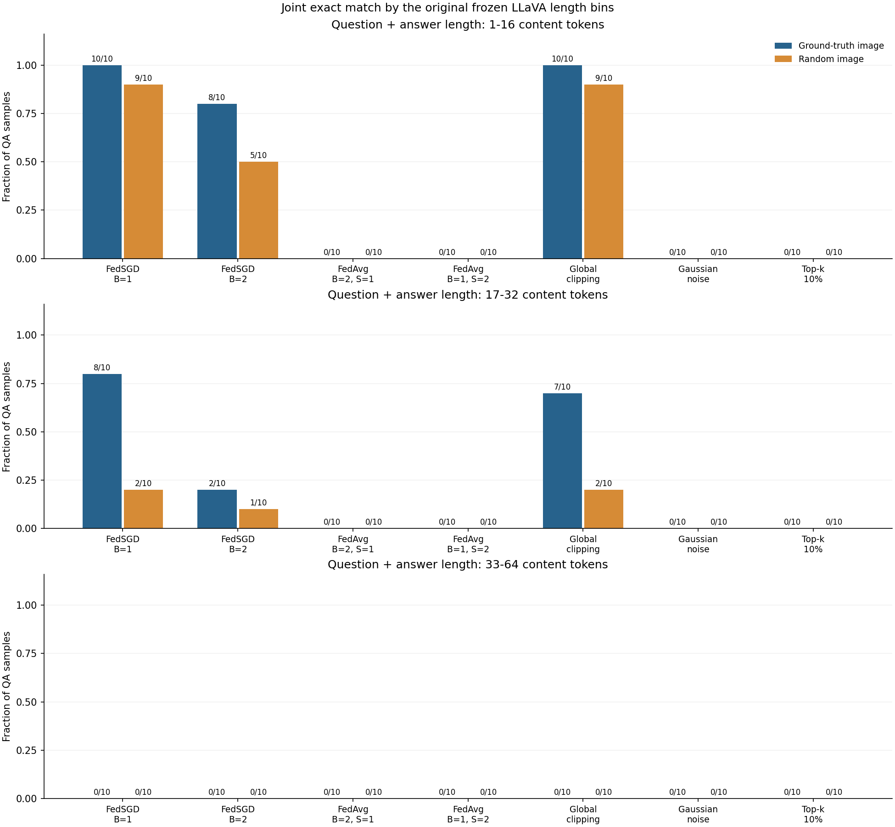
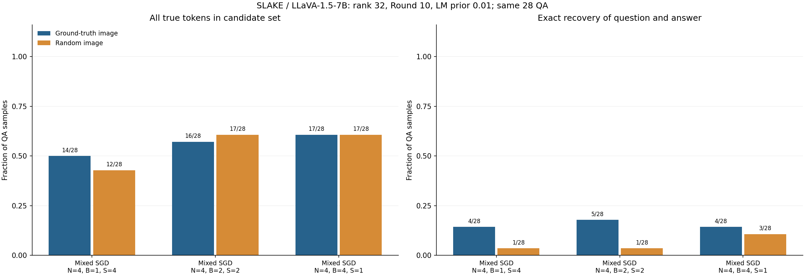

## 要点

- **bf16 参数更新是 SGD 差值恢复归零的主因**：同一梯度下，bf16 SGD 差值为 0/30；改用 FP32 参数更新后回到 GT 10/30、Random 6/30，与直接上传梯度相同。
- **双样本混合降低但没有阻断泄露**：B2S1 仍恢复 GT 10/30、Random 6/30；单样本时为 18/30、11/30。
- **多步本地 SGD 也没有阻断泄露**：每份上传 4 条问答时，B1S4 仍恢复 GT 4/28、Random 1/28，三种划分之间没有一致的趋势。
- **AdamW 差值无法直接用于 DAGER**：Pilot4 上 FP32 与 bf16、单步与双步的 Joint EM 都是 0/4，候选提案阶段就漏了 token。
- **长问答在所有条件下都没有完整恢复**：33–64 token 的 10 条全部为 0/10，即使单样本时有 6/10 候选完整。

本页记录客户端本地更新方式对 DAGER 文本恢复的影响：多条问答混合、参数更新精度、本地步数与优化器。上传防御（裁剪、加噪、稀疏化）的结果见 [[dager-upload-defense]]。

## 关键数字

**同一梯度、不同参数更新算术**：SLAKE30，B2S1，每行分母 30。

| Upload | Parameter arithmetic | Joint EM (GT) | Joint EM (Random) | FullCoverage (GT) | FullCoverage (Random) |
|---|---|---:|---:|---:|---:|
| Gradient | None | 10/30 | 6/30 | 21/30 | 20/30 |
| SGD delta | bf16 | 0/30 | 0/30 | 0/30 | 0/30 |
| SGD delta | FP32 | 10/30 | 6/30 | 21/30 | 20/30 |
| Ideal delta | FP64 | 10/30 | 6/30 | 21/30 | 20/30 |

**本地划分**：B1S1 来自原矩阵（上传梯度）；其余为 FP32 LoRA 参数更新的 SGD 差值。

| Cohort | Split | QA per upload | Joint EM (GT) | Joint EM (Random) | FullCoverage (GT) | FullCoverage (Random) |
|---|---|---:|---:|---:|---:|---:|
| SLAKE30 | B1S1 | 1 | 18/30 | 11/30 | 26/30 | 26/30 |
| SLAKE30 | B2S1 | 2 | 10/30 | 6/30 | 23/30 | 21/30 |
| SLAKE30 | B1S2 | 2 | 9/30 | 5/30 | 20/30 | 19/30 |
| SLAKE28 | B4S1 | 4 | 4/28 | 3/28 | 17/28 | 17/28 |
| SLAKE28 | B2S2 | 4 | 5/28 | 1/28 | 16/28 | 17/28 |
| SLAKE28 | B1S4 | 4 | 4/28 | 1/28 | 14/28 | 12/28 |

## 研究问题

- **多样本混合**：两条问答混合为一份上传后，token 筛选与序列搜索各损失多少？
- **参数精度**：为什么 bf16 参数更新的 SGD 差值几乎无法恢复？
- **本地步数**：多步本地 SGD 能否阻断文本泄露？
- **AdamW**：AdamW 的参数差值能否用 DAGER 恢复文本？

## 实验设置

| Item | Setting |
|---|---|
| Model | [[crossmodel-text-benchmark]] 的 SLAKE LLaVA-1.5-7B 第 10 轮模型：F-L，rank 32，alpha 64；各条件只改变本次捕获的客户端更新，不重新跑联邦训练 |
| Method | `dager_adapted` 的 `public_residual` 筛选加 LM prior 0.01（DAGER-Erasure-LM）；beam 16，`rerank_candidates=0`（AdamW 阶段除外） |
| Candidates | informative top-100，另加固定保留的 ambiguous ID |
| Knowledge | GT 为 `image_known`，Random 为 `private`（random surrogate）；问题与答案的内容长度公开 |
| Pairing | GT 与 Random 攻击同一份上传；多样本上传按冻结顺序取相邻问答，同一阶段各条件使用同样分组 |
| Local optimizer | SGD，lr=0.01，weight decay=0，无梯度累积（AdamW 阶段除外） |
| Budget | 每条问答 200000 次评分、3600 秒，按上传内问答数同比例增加；beam 不随样本数增加 |
| Evaluation | 全部重构保存后才读取参考文本，一对一 Hungarian 匹配；总体与长度桶分开汇总 |

完整矩阵、参考实现及调度说明见[执行计划](../plans/2026-10-23-federated-text-pilot.md)。

### 样本集、记号与精度

| Item | Setting |
|---|---|
| SLAKE30 | 原 benchmark 冻结的 30 条问答与 30 张图，短（1–16 token）、中（17–32）、长（33–64）各 10 条，同一客户端 |
| SLAKE28 | SLAKE30 去掉短、中桶各自最后一条：短 9、中 9、长 10；按原顺序每 4 条一组，共 7 组 |
| Pilot4 | SLAKE30 冻结顺序中前两条短、前两条中等问答；是 SLAKE30 的子集 |
| Split | BxSy：每步 minibatch 含 x 条问答，本地做 y 步；一份上传含 x×y 条不同问答，每条只访问一次 |
| Upload | Gradient：直接上传梯度（FedSGD）；SGD delta：上传本地更新后的参数差值 |
| bf16 parameters | 原实现：模型、梯度和参数更新都是 bf16 |
| FP32 LoRA | 混合精度：冻结主干 bf16、bf16 autocast；LoRA 参数、梯度、更新与上传为 FP32 |

### SLAKE30 矩阵（2026-10-23 至 2026-10-24）

- 七个条件共 165 份上传、330 次攻击：B1S1 梯度、B2S1 梯度、bf16 参数下 B2S1 与 B1S2 的差值，以及三种防御（见 [[dager-upload-defense]]）。
- 先在 Pilot4 上跑 22 份上传、44 次攻击，核对更新公式与接口；Pilot4 包含在 SLAKE30 中，两者不是独立重复。

### 参数精度对照（2026-10-25）

- 复用 SLAKE30 中 15 组 B2S1 的同一份 bf16 梯度，只改变参数更新算术：理想 FP64 缩放、标准 bf16 SGD、标准 FP32 SGD；不重新计算前后向。
- 数值审计只检查前两层 q/k/v 的 6 个 LoRA-A 块，共 11796480 个坐标。

### 混合精度多步（2026-10-25）

- 在 FP32 LoRA 精度下重新捕获全部上传：B2S1 梯度、B2S1 差值、B1S2 差值，共 45 份上传、90 次攻击。
- 双步时第二步在第一步更新后的参数上重新计算梯度。

### 固定四条问答（2026-10-26）

- SLAKE28 的 7 组，每组分别按 B1S4、B2S2、B4S1 捕获，共 21 份上传、42 次攻击；每份上传从相同的第 10 轮初值出发。
- FP32 LoRA 精度、普通 SGD；每份上传 800000 次评分、14400 秒。

### AdamW（2026-10-25）

| Item | Setting |
|---|---|
| Optimizer | AdamW lr=1e-4、betas=(0.9, 0.999)、eps=1e-8、weight_decay=0，初始 moments 为零；参照 FedVLMBench 的默认配置 |
| Rounding audit | CPU 上复用 15 组 B2S1 bf16 梯度，同样 6 个 LoRA-A 块；只做一步，不重构文本 |
| Text pilot | Pilot4；条件为 FP32 LoRA 的 B2S1 梯度对照，以及 FP32 和 bf16 参数下的 AdamW B2S1、B1S2 |
| Proposal | 以 AdamW 差值的行空间作为启发式候选提案（`adamw_delta_proposals=true`）；`rerank_candidates=16`，按真实优化器重放的上传误差选择 |

## 结果

### 多样本混合

**回答**：B2S1 降低了候选完整覆盖和最终恢复，但仍恢复 GT 10/30、Random 6/30；损失同时来自 token 漏检和候选完整后的序列搜索。

| Split | Image | Candidate recall | FullCoverage | Question EM | Answer EM | Joint EM | ROUGE-L |
|---|---|---:|---:|---:|---:|---:|---:|
| B1S1 | GT | 0.9943 | 26/30 | 19/30 | 19/30 | 18/30 | 0.8104 |
| B1S1 | Random | 0.9906 | 26/30 | 12/30 | 16/30 | 11/30 | 0.7354 |
| B2S1 | GT | 0.9830 | 21/30 | 13/30 | 12/30 | 10/30 | 0.6186 |
| B2S1 | Random | 0.9728 | 20/30 | 6/30 | 10/30 | 6/30 | 0.4393 |

- B1S1 的结果与 [[crossmodel-text-benchmark]] 的 SLAKE LLaVA 完全一致，本轮设置可复现。
- B2S1 的平均召回仍有 0.98，但只要漏一个 token 就不计入 FullCoverage，所以完整覆盖降到 21/30。
- 候选完整却没有精确恢复的问答，B2S1 为 GT 11 条、Random 14 条；序列搜索是另一个瓶颈。
- 联合 beam 中两条问答的分支互相竞争，也可能造成一部分损失。

#### 文本长度

下表为 Joint EM，每个桶 10 条；长度为问题与答案的内容 token 总数。

| Split | Image | 1–16 | 17–32 | 33–64 |
|---|---|---:|---:|---:|
| B1S1 | GT | 10/10 | 8/10 | 0/10 |
| B1S1 | Random | 9/10 | 2/10 | 0/10 |
| B2S1 | GT | 8/10 | 2/10 | 0/10 |
| B2S1 | Random | 5/10 | 1/10 | 0/10 |

- 中等长度对图像条件和混合最敏感：B1S1 下 GT 8/10、Random 2/10。
- 长桶全部失败，但 B1S1 下两种图像各有 6/10 候选完整，漏检解释不了全部长文本失败。
- 内容和长度同时变化，这不是受控的因果比较。

### 参数精度

**回答**：bf16 参数更新把大部分小更新舍入为零。同一梯度下，bf16 SGD 差值的 Joint EM 为 0/30；改用 FP32 参数更新后回到与梯度相同的 GT 10/30、Random 6/30。

| Upload | Parameter arithmetic | Image | Candidate recall | FullCoverage | Joint EM | ROUGE-L |
|---|---|---|---:|---:|---:|---:|
| Gradient | None | GT | 0.9830 | 21/30 | 10/30 | 0.6186 |
| Gradient | None | Random | 0.9728 | 20/30 | 6/30 | 0.4393 |
| Legacy delta | bf16 | GT | 0.2313 | 0/30 | 0/30 | 0.0856 |
| Legacy delta | bf16 | Random | 0.2372 | 0/30 | 0/30 | 0.0861 |
| Standard SGD delta | bf16 | GT | 0.2316 | 0/30 | 0/30 | 0.0830 |
| Standard SGD delta | bf16 | Random | 0.2362 | 0/30 | 0/30 | 0.0860 |
| Standard SGD delta | FP32 | GT | 0.9804 | 21/30 | 10/30 | 0.6186 |
| Standard SGD delta | FP32 | Random | 0.9728 | 20/30 | 6/30 | 0.4548 |
| Ideal delta | FP64 | GT | 0.9830 | 21/30 | 10/30 | 0.6186 |
| Ideal delta | FP64 | Random | 0.9728 | 20/30 | 6/30 | 0.4393 |

- Legacy delta 是原实现的 `(theta - lr * G) - theta`；Standard SGD 是 PyTorch 的 `add(..., alpha=-lr)`。两者都是 0/30，原写法中多出的一次乘法舍入不是主要原因。
- 理想差值 `-lr×G` 的候选与最终输出在全部 15 组、两种图像下都与梯度相同，验证了单步时差值与梯度等价。
- 原 bf16 实现的 B1S2 同样为 0/30，候选召回只有约 0.27。

[完整 CSV](data/federated-text-pilot/precision-comparison.csv) · [聚合 JSON](data/federated-text-pilot/precision-comparison.json) · [来源与 SHA256](data/federated-text-pilot/precision-manifest.json)

#### 舍入机制

下表统计 15 组上传的 6 个 LoRA-A 块；原梯度在这些坐标上全部非零。

| Update arithmetic | Delta nonzero fraction | Relative L2 vs ideal delta |
|---|---:|---:|
| Legacy bf16 | 0.06712 | 0.13433 |
| Standard bf16 SGD | 0.06726 | 0.13431 |
| Standard FP32 SGD | 0.99837 | 0.00001916 |
| Ideal FP64 scaling | 1.00000 | 0 |

- bf16 只有 7 位尾数。决定一个更新能否改变参数的，是它相对该参数处浮点间隔的大小，而不是更新本身能否表示。
- 所检坐标的参数绝对值中位数为 0.0078125，理想更新绝对值中位数约 5.7e-7；逐坐标相对更新量的中位数为 0.009375%。
- 93.2743% 的理想更新小于相邻 bf16 间隔的一半，实际 bf16 差值的零比例也正好是 93.2743%，逐坐标 100% 对应。
- 统计只覆盖所检的 LoRA-A 块；CPU 与 CUDA 的 bf16 差值逐坐标一致率为 99.9473%，FP32 为 100%。

### 本地步数

**回答**：不能。FP32 LoRA 参数更新下，B1S2 仍恢复 GT 9/30、Random 5/30；每份上传 4 条问答时 B1S4 仍恢复 GT 4/28、Random 1/28，三种划分之间没有一致的趋势。

#### 两步更新

| Upload | Split | Image | Candidate recall | FullCoverage | Joint EM | ROUGE-L |
|---|---|---|---:|---:|---:|---:|
| Gradient | B2S1 | GT | 0.9886 | 23/30 | 10/30 | 0.6122 |
| Gradient | B2S1 | Random | 0.9759 | 21/30 | 6/30 | 0.4496 |
| SGD delta | B2S1 | GT | 0.9886 | 23/30 | 10/30 | 0.6012 |
| SGD delta | B2S1 | Random | 0.9740 | 21/30 | 6/30 | 0.4500 |
| SGD delta | B1S2 | GT | 0.9792 | 20/30 | 9/30 | 0.5147 |
| SGD delta | B1S2 | Random | 0.9675 | 19/30 | 5/30 | 0.3711 |

- B2S1 的差值与梯度在 30 条问答上的 Joint EM 成败逐条一致。
- B1S2 比 B2S1 在两种图像下各少恢复 1 条，没有新增成功；损失同时出现在候选覆盖和序列搜索。
- B2S1 与 B1S2 同时改变了 batch 和 loss 加权，差异不能只归因于步数。
- 长桶在全部条件下仍为 0/10；B1S2 下两种图像都只有 2/10 候选完整。

[总体 CSV](data/federated-text-pilot/mixed-summary.csv) · [长度桶 CSV](data/federated-text-pilot/mixed-by-length.csv) · [来源与 SHA256](data/federated-text-pilot/mixed-manifest.json)

#### 每份上传四条问答

| Split | Image | Candidate recall | FullCoverage | Joint EM | ROUGE-L |
|---|---|---:|---:|---:|---:|
| B4S1 | GT | 0.9295 | 17/28 | 4/28 | 0.3499 |
| B4S1 | Random | 0.9212 | 17/28 | 3/28 | 0.2755 |
| B2S2 | GT | 0.9565 | 16/28 | 5/28 | 0.4179 |
| B2S2 | Random | 0.9447 | 17/28 | 1/28 | 0.2872 |
| B1S4 | GT | 0.9352 | 14/28 | 4/28 | 0.3412 |
| B1S4 | Random | 0.9196 | 12/28 | 1/28 | 0.2717 |

- 四步更新仍泄露完整问答。GT 下三种划分只差 1 条，Random 下 B4S1 比另两种多 2 条；只有 7 组独立上传，不判断最优步数。
- 候选完整却没有精确恢复的问答，GT 下为 13、11、10 条（B4S1、B2S2、B1S4）；候选覆盖和序列搜索都有限制。
- 长桶全部为 0/10；B1S4 和 B2S2 的长桶 FullCoverage 也为 0/10，B4S1 为 1/10，此时漏检也是长文本失败的原因。
- 固定学习率下，三种划分还改变了累计更新幅度和 loss 加权。

[总体 CSV](data/federated-text-pilot/fixed4-summary.csv) · [长度桶 CSV](data/federated-text-pilot/fixed4-by-length.csv) · [来源与 SHA256](data/federated-text-pilot/fixed4-manifest.json)

### AdamW

**回答**：不能直接恢复。AdamW 的单步更新基本不会被舍入为零，但它逐坐标归一化，破坏了 DAGER 依赖的梯度子空间；Pilot4 上所有 AdamW 条件的 Joint EM 都是 0/4。

#### 舍入

| Optimizer | LR | Parameter dtype | Moment dtype | Median absolute delta | Zero delta fraction | Relative L2 vs ideal |
|---|---:|---|---|---:|---:|---:|
| SGD | 0.01 | bf16 | None | 0 | 0.932743 | 0.0283350 |
| SGD | 0.01 | FP32 | None | 5.7463e-7 | 0.001628 | 1.46054e-6 |
| AdamW | 0.0001 | bf16 | bf16 | 1.0681e-4 | 0.000165 | 0.164890 |
| AdamW | 0.0001 | FP32 | FP32 | 9.9983e-5 | 0 | 2.24404e-6 |

- 零动量的第一步 AdamW 更新为 `-lr·g/(abs(g)+eps)`，梯度远大于 eps 时幅度接近 lr；逐坐标相对 SGD 更新的幅度比中位数约 174，所以很少被舍入为零。
- AdamW FP32 差值与负梯度的余弦只有约 0.048，更新方向已经和梯度结构不同。

#### 文本重构

| Upload | Parameter dtype | Split | FullCoverage (GT) | FullCoverage (Random) | Joint EM (GT) | Joint EM (Random) |
|---|---|---|---:|---:|---:|---:|
| Gradient control | FP32 | B2S1 | 3/4 | 3/4 | 2/4 | 0/4 |
| AdamW delta | FP32 | B2S1 | 0/4 | 0/4 | 0/4 | 0/4 |
| AdamW delta | FP32 | B1S2 | 1/4 | 1/4 | 0/4 | 0/4 |
| AdamW delta | bf16 | B2S1 | 0/4 | 0/4 | 0/4 | 0/4 |
| AdamW delta | bf16 | B1S2 | 1/4 | 1/4 | 0/4 | 0/4 |

- FP32 下同样失败，所以原因不是舍入。单步时候选完整覆盖为 0/4，真实问答无法由候选拼出。
- 事后对每份上传最终的 16 个完整候选评分，所有 AdamW 条件中都没有完整正确的问答；重排改变了部分 winner，但没有改善 Joint EM。
- 梯度对照在 Random 下也是 0/4；4 条样本无法比较步数，也不能把失败当作 AdamW 的隐私保证。

#### 直接反变换

零动量单步 AdamW 在理论上可以反解梯度：`r=-delta/lr`，`g=eps·r/(1-abs(r))`。下表只检查已有两份上传的 6 个 LoRA-A 块。

| Parameter dtype | Invalid or saturated fraction | Relative L2 on finite coordinates | Cosine on finite coordinates | Median error amplification |
|---|---:|---:|---:|---:|
| FP32 | 0.0001113 | 0.8002 | 0.6194 | 1837.6 |
| bf16 | 0.6274490 | 0.99997 | 0.0559 | 11.8 |

- FP32 下几乎所有坐标都能反解，但相对误差仍约 80%：分母 `1-abs(r)` 让误差放大上千倍。
- bf16 下约 63% 的坐标无法反解。直接套用闭式公式不能恢复可用的梯度。

## 结论

- SGD 参数差值能否被 DAGER 利用，首先取决于参数更新精度：bf16 参数会抹掉所检坐标中约 93% 的更新，FP32 下差值与梯度等价。
- 在 FP32 参数更新下，双样本混合与多步本地 SGD 都没有阻断泄露，只是降低了恢复率。
- AdamW 差值不能直接沿用 DAGER 的行空间提案；单步反变换也数值病态。
- 长问答在所有条件下都没有完整恢复，序列搜索与候选覆盖都需要改进。

## 局限

- 只有一个模型、一个数据集、一个 rank、一个随机种子；每个长度桶 10 条，SLAKE28 只有 7 组独立上传。
- 沿用 [[crossmodel-text-benchmark]] 的训练设置：图像按组隔离，但相同的问答文本可能出现在训练池中。
- 固定学习率时，不同划分同时改变累计更新幅度和 loss 加权，不是纯步数效应；没有多个 local epoch 或多客户端聚合。
- AdamW 只覆盖 Pilot4 的 4 条问答和零初始动量，不代表训练中途的动量状态。
- 全 FP32 前后向的多步实验因速度原因中止，只有混合精度结果；CPU 与 CUDA 的 bf16 更新有少量差异。
- 运行中做过存储迁移和暂停续跑，耗时不能用于严格的速度比较。

## 下一步

- 研究单步 FP32 AdamW 的候选生成，先确认能否恢复接近梯度对照的 token 覆盖，再考虑序列搜索和多步；见[执行计划](../plans/2026-10-23-federated-text-pilot.md#fedvlmbench-adamw)。
- 多步 FedAvg 先固定参数更新精度、客户端数据和 loss 归一化，再改变本地步数。
- B2S1 用相同候选和每样本预算，对照逐样本独立搜索，检查联合 beam 的分支竞争。
- 对中长文本区分候选漏检、正确前缀被剪和最终排名失败。

??? note "运行记录"

    - 用户于 2026-10-25 授权只提交代码，commit `aba0a9f` 包含十八个源码、配置及测试文件；独立的暂存代码快照全量回归 382 通过、4 跳过，Ruff 通过。文档、聚合结果、图和全部 paper 文件未纳入提交，因此本页仍标记 uncommitted；原冻结实验产物不改写。

    - 代码基于 `31ef506`，本轮修改尚未提交；参考仓库 `llm_privacy_eval` 只读。环境为共享 NAS 上的 `gia`，GPU 程序在 WN-A100 上运行，同时最多占两张卡。

    **四样本 pilot**

    - 源码固定在 `outputs/diagnostics/federated_text_pilot_20261023/source-v1`。首次 capture PID 5249 成功退出，22 份更新全部保留。
    - controller 5245 在捕获后的 GPU 利用率残留检查处停止；controller 5294 发现 GPU 3 已被占用而停止。两次都没有启动攻击，记录在 `controller-capture.json` 和 `controller-preflight-2.json`；没有重试捕获，也没有改实验参数。
    - controller 5306 先在 GPU 2 串行执行；GPU 3 释放后，新调度器 5350 接管原 GT worker 5312，并在 GPU 3 启动 Random worker 5354，GT 没有中断或重跑。巡检校验 controller PID，避免启动竞态读到旧终态。
    - watcher 每十分钟检查一次，完成、失败或 controller 消失时退出，不自动重试 OOM，也不改条件。完成后关闭 watcher 5351 并立即做最后一次巡检，终态为 completed、44/44；没有终止 GPU worker。
    - 44 份结果均为 completed；源码指纹一致，GT 与 Random 上传哈希全部配对一致。统一评分没有按恢复结果重选样本或调整参数。
    - 离线回归 130 项通过、2 项跳过，Ruff 通过；测试覆盖多样本上下文边界、单步恒等式、裁剪不变性、噪声复现、默认支持边界与先提交后评分。配置入口与文档索引检查 27 项通过，Hydra 可以显式开启多样本和 defense-unaware 模式并创建 gaussian_noise 防御。

    **SLAKE 30 样本扩展**

    - 2026-10-23 启动 controller 5434、watcher 5435、capture worker 5439，捕获使用 GPU 2。固定源码 `outputs/diagnostics/federated_text_slake30_20261023/source-v1`，指纹 `eeb1c28574d7a0ce6f8b3199c621e6d2dbe78838363786068a6d1cc5770480e3`，基础 commit 仍为 `31ef506`。
    - 首份捕获审计通过：448 个 BF16 张量，配对哈希一致，Random 不含公开图像。定向回归 134 项通过、2 项跳过，Ruff 通过；自动报告入口在四样本聚合上完成生成检查，没有覆盖原报告。
    - 165 份捕获完成后，GT worker 5537 在 GPU 2 运行；GPU 3 被其他任务占用，Random 一度等待。
    - GT 曾处于 `nfs_wait_bit_killable`，GPU 2 利用率偏低：DAGER 每个 prefix batch 都把完整检查点写到 NAS。按用户要求改用 GPU 1，并把运行存储切到 WN-A100 的 `/tmp/giavlm-slake30-20261023-io`，由独立进程异步镜像最新检查点和完成结果到 NAS。
    - 迁移时 GT worker 5537 没有重启，只在无输出文件打开时暂停约 0.09 秒，预算仍计入墙钟时间。原 NAS 检查点保存在各 run 的 `attacks-nas/`，NAS 历史不删除；已完成结果不重跑，源码、预算和攻击参数不变。
    - 新 controller 6003、watcher 6010 接管 GT，Random worker 6008 使用 GPU 1，GPU 3 不再用于本实验。迁移后 GPU 1、2 瞬时利用率为 91%、93%，两边检查点张量 SHA256 校验通过，见 `setup/io-fix/verification.json`。
    - 用户要求停止以修复 NAS，6003、6010、5537、6008 全部退出，GPU 1、2 显存归零。当时 GT 完成 32/165、Random 完成 12/165；在途的 GT `fedsgd-b2-02` 与 Random `fedsgd-b1-12` 检查点完整，并已镜像到 NAS，见 `setup/io-fix/stopped-by-user.json`。
    - NAS 修复后，先核验 44 份完成结果和两个暂停检查点的本地与 NAS 副本，源码、模型和签名一致。续跑入口 `setup/resume-1/worker.py` 调用原冻结攻击的 `resume=True` 路径，冻结源码未改；累计时间与 evaluations 计数不清零，暂停期间不计入预算。
    - controller 6732、watcher 6749、GT worker 6737（GPU 2）、Random worker 6740（GPU 1）启动，没有使用第三张卡。续跑相关测试 5 项和包装入口一致性测试 1 项通过，`setup/resume-1/verified.json` 为 passed。
    - 2026-10-24 02:39 完成全部 330 次攻击、统一评分和九个报告文件；330 次均为 completed，无预算耗尽，原 44 份结果哈希未变，见 `setup/completion-audit.json`。
    - 2026-10-25 收尾：上述 controller、watcher、worker 以及评分 6803、报告 6813 均已退出，GPU 1、2 显存为零。九个报告 SHA256 和文档中十一份聚合副本的 SHA256 均通过；实验索引测试 24 项通过，15 份记录与产物检查通过，MkDocs 严格构建通过。

    - 用户质疑单步梯度与参数差值等价性后，完成十五组公开上传的 CPU 数值审计及标准 PyTorch SGD 对照；一项高精度单步恒等式测试通过。保存到 `setup/delta-audit/`，没有修改运行代码、重跑攻击或提交 Git。

    - 用户授权单步精度验证后，修正 core.fl 的 SGD 数值路径；定向回归 114 通过、2 跳过，Ruff 通过。原三十样本结果与冻结源码不覆盖；新产物目录 `outputs/diagnostics/sgd_precision_slake30_20261025/`。

    - 单步精度对照的完整 CPU 回归为 378 通过、4 跳过；源码冻结为 `a2c3e9d3f0d4e5907a78510832f320ae4312e2e7ae7667ca1a40b3200d0cfdd5`。准备阶段 GPU 0 被占用，新 controller 6877、watcher 6881 接管原 CPU worker 6851，后续预选 GPU 2、5；没有重算梯度或重跑准备。

    - 对照阶段的 CPU prepare 已完成，GT worker 6892（GPU 2）、Random worker 6895（GPU 5）已进入过滤；两边 CUDA SGD 一致性均为 passed。首份公开上传及过滤检查点已核验，控制器 6877、巡检 6881 正常，尚无本阶段最终恢复率。

    - 用户关注显存后，核验 GPU 2、5 各只有本实验一个 GPU worker，接近满卡但首组检查点仍持续推进，未见 OOM。暂停额外 CUDA 检查，新增仅调用 nvidia-smi 的三十秒显存与错误巡检 PID 7034，不占 CUDA 上下文，不自动重试或改变 batch、精度、预算。
    - 对照阶段全部九十份 token filter 已完成，开始序列阶段。仅比较公开候选集合时，理想差值与原梯度的十五组候选在两种图像下均完全相同；FP32 更新与原梯度的平均 Jaccard 为 GT 0.936、Random 0.943，标准 bf16 为 0.266、0.255。该比较未读取真实 token，不等同于候选召回或 Joint EM，未用于修改候选或参数。

    - 首组理想差值的 GT 与 Random 搜索均 completed，PyTorch 记录的 peak allocated 均约 18.9 GiB；之后 NVML 用量回落至约 37.5 GiB，空余约 41.8 GiB。两种指标口径不同，前者不包含缓存及框架外分配；不能仅据满卡截图断言真实张量即将 OOM。首组运行记录见 `setup/first-search-memory.json`。

    - 精度对照于 2026-10-25 18:41 完成；九十次新攻击全部 completed，无预算耗尽、无 OOM，评分在全部重构保存后执行。源码、上传配对哈希和原比较来源通过核验，九份自动报告文件 SHA256 通过。
    - controller 6877、watcher 6881、prepare 6851、worker 6892、6895、显存巡检 7034、评分 7526、报告 7538 均已退出。空闲 GPU 2 上补做 CPU/CUDA 张量算术检查，峰值 allocated 约 2.5 MiB，检查后退出；没有重跑攻击。
    - 本轮修正代码与原数值路径记录同时保留，新增聚合表图归档到 precision-manifest.json；未提交 Git。

    - 精度对照收尾：15 份记录及产物检查通过，文档索引测试 24 项通过，MkDocs 严格构建通过，八份新增聚合副本 SHA256 通过；最终复核 GPU 2、5 显存均为零。

    - 用户进一步询问 bf16 动态范围后，补充公开张量的参数分辨率审计；无需 GPU、没有重跑攻击。全部所检坐标的零差值可由更新是否小于半个相邻 bf16 间隔精确解释；脚本与原始统计在 `setup/update-resolution.py`、`setup/update-resolution.json`。

    - 用户授权真实 FP32 多步实验后，新增 fp32_multistep_study 入口及逐步参数轨迹；定向回归 94 通过、2 跳过，Ruff 通过。代码及新产物仍未提交。

    - 真实 FP32 多步阶段已启动：WN-A100 controller 7651、十分钟 watcher 7657、三十秒显存巡检 7659；捕获用 GPU 2，攻击预选 GPU 2、5。独立源码 `33f41d5766f96e0e720090ffc976d8e41179296fcd466219ae87f4e405c3ca21`，共享 gia 环境未改，原实验不覆盖。

    - 首份全 FP32 实际捕获通过审计：448 个 F32 张量，配对哈希一致、Random 无公开图像；peak allocated 约 45.0 GiB，peak reserved 约 47.7 GiB。公开合成双步 smoke 为 passed，第二次前向所检参数变化范数 0.06396；capture worker 7663 正常，当前尚未完成攻击。

    - 真实 FP32 阶段捕获已完成：45 份上传全部成功，capture worker 7663 返回码为 0；十五份双步轨迹均确认第二次前向使用更新后的参数。GT worker 7803 在 GPU 2、Random worker 7806 在 GPU 5 重新加载模型，当前没有 OOM 或失败日志；阶段切换时显存会短暂降低。捕获汇总见 `setup/capture-completion-audit.json`。

    - 用户要求切换到混合精度：全 FP32 controller 7651、worker 7803/7806 与两种巡检已停止；45 份上传、2 次完整攻击及 2 份在途搜索全部保留并镜像 NAS，GPU 2/5 已释放。停止原因是速度，不是 OOM；见旧目录 `setup/stop-audit.json`。旧结果不补零、不计为完整矩阵。

    - 混合精度新源码已冻结为 `529566c53e748be0941f0720c73b15a112e232f09f62be6becfbcebf748e28e3`，CPU 定向 24 通过，全量 382 通过、4 跳过，Ruff 通过；新阶段重新捕获并配对攻击，沿用 gia，不提交 Git。

    - 混合精度已在 WN-A100 启动 controller 8132、capture 8137（GPU 2）、watcher 8139 与显存巡检 8141。GPU 公共双步 smoke 和首份真实上传审计 passed：bf16 投影输出、FP32 LoRA 参数及 448 个 F32 上传张量，第二步参数距初值范数 0.0470182（公开 smoke）；首捕获 peak allocated 约 29.0 GiB、耗时 5.19 秒，当前继续捕获。未提前读取参考评分或报告恢复率。

    - AdamW 舍入小验证已完成：原十五组公开 bf16 梯度、六个选定 LoRA-A 块，CPU 实际优化器及 FP64 参数舍入控制，运行 45.57 秒。首步公式与实际 FP64 AdamW 一致，原 SGD bf16 零差值比例精确复现；全部结果有限，来源 SHA256 已验证。脚本及结果在 `outputs/diagnostics/adamw_rounding_slake30_20261025/`，只读公开数据，没有新 GPU 任务、重构或 Git 提交。

    - 混合精度三条件于 2026-10-25 23:19 完成：45 捕获、90 次攻击全部 completed，无预算耗尽或 OOM；统一评分有 180 个条件内 QA 行，六个总体与十八个分桶行。controller、worker 及两种巡检全部退出，WN-A100 GPU 2/5 显存为零。标准 attacks 路径全部切回 NAS，九个自动报告哈希和六组聚合指标重算通过，收尾审计在新目录 `setup/finalization-audit.json`。

    - 混合精度全阶段墙钟约 2 小时 40 分钟，平均每次攻击约 190.3 秒。首组 GT/Random 分别约 313/317 秒，原全 FP32 首组约 2011/1978 秒；约快 6.4/6.2 倍，仅为首组运行比较，不是严格的算子性能测试。捕获 peak allocated 最大约 29.24 GiB，攻击最大约 18.97 GiB；缓存 reserved 与实际 allocated 分开解释。聚合表图及审计十二份副本 SHA256 全部核验，未提交 Git，未自动启动 AdamW。

    - 用户已授权执行 AdamW 重构 pilot。新增显式差值提案与强制原生优化器重排、原生 AdamW 算术对齐及研究入口；定向 97 通过、2 跳过，新研究测试 12 通过，最终 CPU 全量 394 通过、4 跳过，Ruff 通过。冻结源码 `3c7cbf286c6f4e8b334069254e3da10df802a57d18c11e9c02959fa9d3d264b5`，新输出 `outputs/diagnostics/adamw_text_pilot_20261025/`；本轮没有 Git 提交或 paper 修改。

    - AdamW 主条件 GPU smoke 已 passed：公开合成双步更新与实际 torch.optim.AdamW 逐项完全一致，moments 与参数均为 FP32，投影输出为 bf16，第二次前向所检参数距初值范数 0.0886441；峰值 allocated 约 22.3 GiB。controller 9199、capture 9204（GPU 2）、watcher 9206、显存巡检 9208 正常，当前准备真实捕获；这不是重构恢复率。

    - AdamW pilot 首份真实捕获审计 passed：448 个 F32 张量、GT/Random 上传哈希一致、Random 无公开图像，首捕获 allocated 约 29.0 GiB。已捕获 3/10，BF16 参数对照的原生 smoke 及攻击尚待执行；当前无 OOM 或失败，不提前报告恢复率。

    - AdamW pilot 于 2026-10-26 00:24 完成，总墙钟 35.4 分钟，十份捕获和二十次攻击全部 completed，执行 320 次真实优化器重放，无预算耗尽或 OOM。controller 9199、capture 9204、GT 9351、Random 9354、watcher 9206、显存巡检 9208、评分 9503、报告 9513 均退出，GPU 2/5 显存为零；攻击 peak allocated 约 29.93 GiB。

    - 收尾已核验源码、模型精度指纹、GT/Random 上传及 Random 无公开图像、双步参数变化、十份 NAS 归档和九个报告哈希，重算十组总体指标。事后评分既有候选及公开上传反变换审计未启动新 GPU、未改动实际输出；聚合十份副本及来源 SHA256 一致，数据和 paper 保留，本轮代码及新结果未提交 Git。

    **固定四 QA 的划分对照**

    - 用户于 2026-10-26 确认执行 B1S4、B2S2、B4S1；预先固定 28 QA 和七组。CPU 三条件 native SGD 精确对照及协议定向测试 24 通过，全量 401 通过、4 跳过，Ruff 通过。
    - 根目录 `outputs/diagnostics/fixed4_multistep_slake28_20261026/`，源码 SHA256 `7a7437639c07b900443d8c7232bffca1a9f8de5db885404fb8bad8fba4d0e567`，基础 commit aba0a9f。WN-A100 controller 9550、capture 9555、十分钟 watcher 9557、三十秒无 CUDA 上下文显存巡检 9559；只使用 GPU 2、5，环境不变，未提交 Git。
    - GPU 原生三条件公开合成检查全部逐项一致，峰值 allocated 43.61 GiB。首份真实四步捕获已核验 448 个 F32 上传张量、后续步骤参数变化、GT/Random 哈希一致及 Random 无公开图像。先完成全部捕获，再由两卡执行 42 次重构；全部提交后统一评分，不在运行中按真值改方法或分组。

    - 21 份捕获及全部逐步轨迹已通过审计，capture peak allocated 43.31 GiB，初值未变；capture 9555 成功退出，GT worker 9718（GPU 2）和 Random worker 9721（GPU 5）随后启动。源代码、分组、恢复参数与预算不变，GT/Random 首个搜索检查点已镜像 NAS，并核验 schema 与张量 SHA256。

    - 2026-10-26 12:27 本阶段完成，墙钟 147.82 分钟；42 次重构全部 completed，无预算耗尽或 OOM。全部攻击切回 NAS；九个自动报告哈希、最终检查点、六组总体及十八组长度指标重算通过，十一份文档聚合副本 SHA256 一致。收尾审计只读取既有结果和聚合数据，不读取私有参考，不重跑 GPU。
    - controller 9550、capture 9555、GT 9718、Random 9721、评分 10775、报告 10789、watcher 9557、显存巡检 9559 全部退出，本项目释放两卡；GPU 5 随后被另一个进程占用，没有停止该进程。CPU 回归仍为 401 通过、4 跳过，环境及代码未进一步改变，本轮未提交 Git。

    **记录拆分**

    - 2026-11-02 将防御、退化诊断、部分消除、谱加权与动态候选的结果和运行记录移到 [[dager-upload-defense]]；拆分前的完整页面备份在 `outputs/diagnostics/docs_backup_20261102/2026-10-23-federated-text-pilot.md`。
