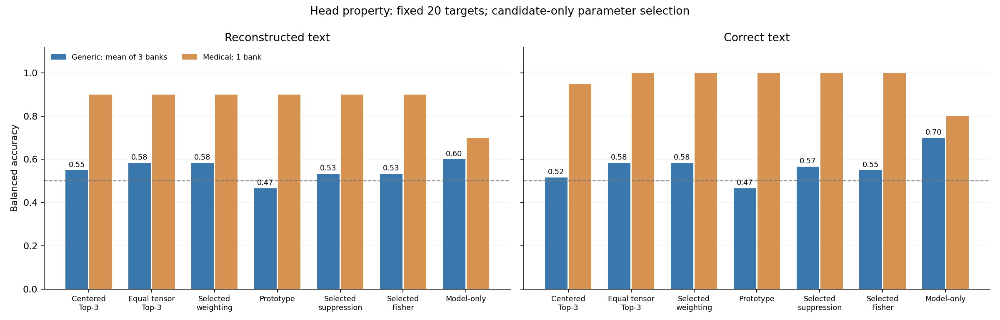

## 要点

- **张量加权没有提高评分**：A 批二十图上，公开选出的加权与等权基线同为 0.583，配对差异为 0.000。
- **类内抑制和 Fisher 也没有稳定收益**：两者都为 0.533，低于等权；抑制相对未抑制的原型聚合，差异区间跨零。
- **跨风格公开开发没有方法过门槛**：三种留出风格上，加权与投影的 Balanced accuracy 和等权完全相同。
- **内容覆盖可能比风格多样性更重要**：每个内容组只取一图的混合库把摄影留出提到 1.000，但其他留出没有一致改善，是后验审计。

本页验证[原始计划](../plans/2026-10-28-image-property-ideas.md#scoring-design)中的前两个 idea：张量判别加权（Tensor Discriminability Weighting）与类内变化抑制（Within-Class Variation Suppression）。候选库基线见 [[synthetic-property]]，各 idea 的状态见 [[image-property-ideas]]。

## 关键数字

**A 批二十图**：三套通用摄影候选库分别预测再取平均；正确文本为独立诊断。

| Method | Reconstructed accuracy | Correct accuracy |
|---|---:|---:|
| Centered Top-3 | 0.550 | 0.517 |
| Centered equal-tensor Top-3 | 0.583 | 0.583 |
| Selected weighting | 0.583 | 0.583 |
| Prototype equal | 0.467 | 0.467 |
| Selected suppression | 0.533 | 0.567 |
| Selected Fisher | 0.533 | 0.550 |
| Model-only | 0.600 | 0.700 |

## 研究问题

- **候选评分**：张量判别加权、类内抑制或 Fisher，能否改善 A 批二十图上的部位判断？
- **跨风格开发**：在公开数据的风格留出上，这些方法能否超过等权基线？

## 实验设置

### 候选评分（2026-10-28）

| Item | Setting |
|---|---|
| Targets | A 批二十张医学图（定义见 [[gradient-prototype-transfer]]），Head 与 non-head 各 10 张 |
| Fixed inputs | 原模型、上传、重构问答和四套候选库；不重新训练或生成 |
| Primary comparison | 判别加权对比 Centered equal-tensor，固定 Top-3 |
| Weighting | 每个张量的有界比值 B/(B+W)；beta 取 0、0.5、1 |
| Suppression | 每个张量做类内 SVD，k 取 1、4，alpha 取 0.5、1；与未抑制的等权原型对比 |
| Fisher | 每个张量的正则化连续分数，按类间距离归一化后等权；ridge 取类内平均能量的 0.1、1 倍 |
| Public selection | 重构问答下，每套摄影库拟合、另两套留出；不用医学库或目标标签 |
| Controls | 4 种旧评分、原型聚合、Model-only、Text-only、其他 19 份上传、打乱标签、置换张量权重 |

三套摄影库只有随机种子不同，提示家族和领域相同；摄影库之间的留出不是跨领域验证。

### 跨风格公开开发（2026-10-28）

| Item | Setting |
|---|---|
| Public bank | 摄影、线稿、黏土渲染三种风格的非医学合成图，Head 与 non-head 各半 |
| Split | 每次留出一种风格；拟合与开发按内容组隔离 |
| Budget | 多风格库与每个单风格库都是 16 个候选 |
| QA | 固定已知的 `Describe the image.` → `The image is shown.` |
| Gate | 两折改善、平均 Balanced accuracy 至少增加 0.05，且平均 AUROC 不下降 |

## 结果

### 候选评分

**回答**：没有改善。公开选出的加权与等权基线相同，类内抑制和 Fisher 都低于等权，也没有超过 Model-only。

| Method | Reconstructed accuracy | Correct accuracy | Head recall | Head AUROC | Wrong-gradient accuracy |
|---|---:|---:|---:|---:|---:|
| Centered Top-3 | 0.550 | 0.517 | 0.600 | 0.583 | 0.533 |
| Centered equal-tensor Top-3 | 0.583 | 0.583 | 0.700 | 0.583 | 0.599 |
| Selected weighting | 0.583 | 0.583 | 0.700 | 0.583 | 0.599 |
| Prototype equal | 0.467 | 0.467 | 0.500 | 0.503 | 0.596 |
| Selected suppression | 0.533 | 0.567 | 0.567 | 0.613 | 0.550 |
| Selected Fisher | 0.533 | 0.550 | 0.600 | 0.587 | 0.534 |
| Model-only | 0.600 | 0.700 | 0.667 | 0.713 | — |
| Text-only | 0.500 | 0.500 | 0.000 | 0.640 | — |

- 公开选出的配置为 `weighted_b0`、`suppress_k4_a1`、`fisher_r0.1`。Head recall、Head AUROC 和 Wrong-gradient 列使用重构文本。
- 加权的准确率区间为 [0.383, 0.767]；相对等权的配对差异为 0.000，相对 Model-only 的差异区间为 [−0.283, 0.267]。
- 抑制相对未抑制的同一原型聚合，配对差异为 0.067，区间 [−0.067, 0.217]。

#### 各候选库

| Candidate bank | Centered | Equal tensor, centered | Selected weighting | Prototype | Selected suppression | Selected Fisher |
|---|---:|---:|---:|---:|---:|---:|
| Generic 1 | 0.550 | 0.550 | 0.550 | 0.500 | 0.450 | 0.450 |
| Generic 2 | 0.600 | 0.650 | 0.650 | 0.450 | 0.650 | 0.650 |
| Generic 3 | 0.500 | 0.550 | 0.550 | 0.450 | 0.500 | 0.500 |
| Medical | 0.900 | 0.900 | 0.900 | 0.900 | 0.900 | 0.900 |

医学候选库下所有方法都是 0.900，说明候选领域的影响远大于评分方式。

#### 公开留出与抑制效果

公开摄影库之间几乎所有配置都接近满分，所以公开留出无法区分它们。

| Configuration | Public heldout accuracy |
|---|---:|
| fisher_r0.1 | 1.000 |
| fisher_r1 | 0.991 |
| prototype_equal | 0.960 |
| suppress_k1_a0.5 | 0.988 |
| suppress_k1_a1 | 0.995 |
| suppress_k4_a0.5 | 0.989 |
| suppress_k4_a1 | 1.000 |
| weighted_b0 | 0.999 |
| weighted_b0.5 | 0.999 |
| weighted_b1 | 0.999 |

| Suppression | Fitting within variation retained | Heldout within variation retained | Between-class separation retained |
|---|---:|---:|---:|
| suppress_k1_a0.5 | 0.513 | 0.536 | 0.698 |
| suppress_k1_a1 | 0.350 | 0.381 | 0.598 |
| suppress_k4_a0.5 | 0.324 | 0.367 | 0.569 |
| suppress_k4_a1 | 0.098 | 0.156 | 0.425 |

- 抑制在去掉类内变化的同时也去掉了类间间隔；最强配置只保留 42.5% 的类间间隔。
- 散度比例与留出逐张量准确率的 Spearman 相关均值为 0.281，三套摄影库之间散度排序的相关为 0.886。

#### 反证对照

| Control | Reconstructed generic accuracy | Correct generic accuracy |
|---|---:|---:|
| weighted_b0.5 | 0.583 | 0.583 |
| shuffled_labels_b0.5 | 0.583 | 0.583 |
| permuted_weights_b0.5 | 0.583 | 0.583 |

打乱标签或置换权重后结果完全不变，说明这些权重对最终判断几乎没有作用。

### 跨风格开发

**回答**：不能。没有方法通过预定门槛（选择结果为 `None`）；加权与投影在三种留出风格上的结果都和等权相同。

下表为 Balanced accuracy，列为留出的风格；单风格库在自身风格上留出时记为 —。

| Bank | Method | Line | Photo | Render |
|---|---|---:|---:|---:|
| Multi-style | equal | 0.938 | 0.562 | 0.875 |
| Multi-style | consistency_b0.5 | 0.938 | 0.562 | 0.875 |
| Multi-style | consistency_b1 | 0.938 | 0.562 | 0.875 |
| Multi-style | prototype | 0.938 | 0.562 | 0.875 |
| Multi-style | domain_kall_a0.5 | 0.938 | 0.562 | 0.875 |
| Multi-style | domain_kall_a1 | 0.938 | 0.562 | 0.875 |
| Multi-style | equal_wrong_gradient | 0.062 | 0.438 | 0.125 |
| Photo only | equal | 0.750 | — | 0.812 |
| Line only | equal | — | 0.688 | 1.000 |
| Render only | equal | 0.938 | 0.625 | — |
| Mixed, one image per content group | equal | 0.938 | 1.000 | 0.875 |

- 原多风格库的 16 个候选来自 8 个内容组、每组两种风格；单风格库覆盖 16 个内容组。两者同时改变了风格和内容覆盖。
- 最后一行是事后审计：每个内容组只取一图、两种风格交替，内容覆盖与单风格库相同。它改善了摄影留出，其他留出没有一致超过单风格库，不改原选择结果。
- 多风格库的 Head AUROC 在三种留出上为 0.984–1.000，问题主要在阈值偏移而不是排序。

## 结论

- 张量判别加权、类内抑制和 Fisher 都没有超过等权基线；打乱标签和置换权重也不改变结果。
- 候选库的领域决定了大部分效果：同一批图上医学候选库为 0.900，通用摄影库只有 0.5 左右。
- 跨风格公开开发中没有方法通过门槛；事后审计提示内容覆盖值得控制，但尚未确认。

## 局限

- A 批二十图被反复分析，且与此前 pilot 有重叠；不是新的确认集，患者独立性未知。
- 三套摄影库只换了随机种子，公开留出表现不等于对未见成像领域的泛化。
- Wrong-gradient 对照换的上传也带着不同的原始问答，不能单独分解出视觉的作用。
- 跨风格开发的每个内容组在三种风格中重复，不是 48 个独立目标；问答固定且已知。

## 下一步

- 本方向不再扩展。如需继续，先冻结主规则，再在未分析过的新目标和真正留出的领域上确认。
- 后续构建候选库时同时控制风格与内容覆盖。

??? note "运行记录"

    **候选评分**

    - 用户将执行卡从共享 GPU 5 调整到空闲 GPU 6；迁移保留首份九十六次回放的完整缓存，停止本实验旧进程，丢弃未提交的在途回放。实验参数未变，无 OOM。
    - source-v1 与 source-v2-gpu6 保留两次代码快照及迁移记录；原模型、上传、候选与文本哈希核验一致。首份旧评分复现最大误差小于 2.4e-8。
    - 共 2400 次有效回放，25 份不同问答；GPU 6 阶段墙钟 2512.31 秒，峰值 allocated 20587.48 MiB，另有迁移前启动开销与未提交回放。
    - 一百六十份预测及公开选择保存后才读取目标标签；输入、源码与模型未改变。GPU 回放结束即释放显存，评分和报告采用独立 CPU 进程。
    - 候选与上传的 float64 内积按问答复用，不保存高维稠密投影；先验对照复用经过哈希核验的既有结果。

    **跨风格公开开发**

    - 跨风格首轮在完成九十六个公开图像读出后，于首个查询的 Observation 校验处停止：新捕获声明 FedSGD，但元数据仍继承模型训练时的 AdamW。失败状态与 source-development-v1 保留，未生成合法查询 Observation，也未进入属性评分；无 OOM 或静默重试。
    - 显式修正诊断捕获的 local_optimizer=sgd、weight_decay=0，并在回放前验证配置。source-development-v2 沿用相同模型、数据、受控问答、原生 bf16 梯度、参数网格与优化预算；复用九十六图的 tokens、特征和读出，只补回放未持久化的完整梯度。
    - 等内容覆盖审计只复用现有 Gram，没有新增模型回放。公开数据的生成与修订记录见 [[convex-token-recovery]] 的运行记录。
