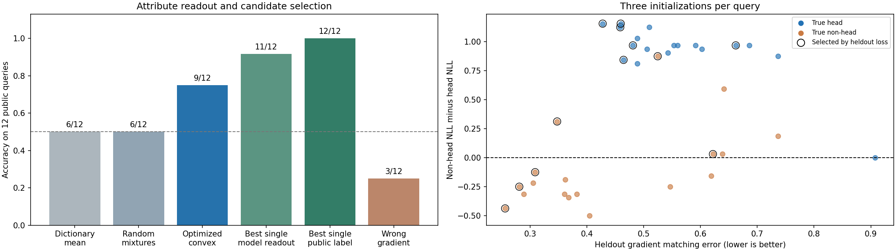

## 要点

- **凸组合恢复不如直接选一个候选**：12 个公开查询上，优化后的凸组合判对 9/12，按梯度误差选出的最佳单候选判对 11/12，直接用其公开标签为 12/12。
- **优化确实利用了上传梯度**：凸组合比不看上传的字典均值高 0.250，错配上传下只有 3/12。
- **二阶梯度链可以计算**：D0 的 4 个工程样本上，注入误差为零，有限差分误差 0.000419；小步长下 3/4 例拟合误差下降。

本页验证[原始计划](../plans/2026-10-28-image-property-ideas.md)中的"视觉 tokens 恢复"：在一组公开图像的视觉 tokens 张成的凸组合里，优化系数使梯度匹配上传，再读出部位。查询都是公开合成图，问答固定且已知，不是真实医学目标。注入接口的验证见 [[visual-concept-probe]]。

## 关键数字

12 个独立的黏土渲染查询，Head 与 non-head 各 6 个；字典为 32 张摄影和线稿图。

| Method | Correct | Balanced accuracy | Head AUROC |
|---|---:|---:|---:|
| mean | 6/12 | 0.500 | 0.500 |
| random_initial_mean | 6/12 | 0.500 | 0.500 |
| optimized | 9/12 | 0.750 | 0.972 |
| best_single | 11/12 | 0.917 | 1.000 |
| best_single_public_label | 12/12 | 1.000 | 1.000 |
| wrong_gradient | 3/12 | 0.250 | 0.028 |

## 研究问题

- **工程校准**：二阶梯度能否支持视觉 tokens 的系数优化？
- **凸组合恢复**：优化出的凸组合能否比同字典的单候选选择更好地判断部位？

## 实验设置

### D0 工程检查（2026-10-28）

| Item | Setting |
|---|---|
| Inputs | 公开摄影库与医学库各取 2 个预定样本，不读取私有目标 |
| QA | `Describe the image.` → `The image is shown.`，作为已知条件 |
| Upload | 单样本单步原生梯度，全部 448 个 LoRA 张量 |
| Matching | 359 个块用于拟合、89 个块用于验证，按模块名与层号分层划分 |
| Objective | 按观测块能量归一化的平方误差；分母加平均块能量的 1e-6 |
| Initialization | 公开真实 tokens 加 5% 标准差噪声，仅用于工程诊断 |
| Precision | 视觉变量 FP32 master，模型原生 bf16 与 eager attention |

### D1 凸组合恢复（2026-10-28）

| Item | Setting |
|---|---|
| Queries | 12 张独立黏土渲染图，Head 与 non-head 各 6 张，不在字典中 |
| Dictionary | 摄影与线稿拟合组的 32 张图的视觉 tokens |
| Optimization | Adam 优化凸组合系数，学习率 0.05（D0 冻结）；3 次固定随机初始化，各 100 步，只拟合拟合块 |
| Selection | 按验证块误差选择初始化；属性读出在全部恢复结果保存后才执行 |
| Baselines | `mean`（字典均值）、`random_initial_mean`（初始混合）、`best_single`（按验证块误差选一个候选再读出）、`best_single_public_label`（直接用该候选的公开标签） |
| Control | `wrong_gradient`：换成同问答、同风格、相反属性查询的上传 |

## 结果

### 工程校准

**回答**：可以计算，但需要小步长。首个相对步长 0.005 让 4 例误差全部上升；改为 1e-4 后 4 例拟合误差都下降。

| Public case | Fit loss before | Fit loss after | Heldout loss before | Heldout loss after | Convex fit before | Convex fit after |
|---|---:|---:|---:|---:|---:|---:|
| 1 | 0.032962 | 0.010997 | 0.030638 | 0.013626 | 0.564244 | 0.576331 |
| 2 | 0.010489 | 0.008427 | 0.006198 | 0.008105 | 0.973309 | 0.924713 |
| 3 | 0.017732 | 0.008366 | 0.007380 | 0.006719 | 0.530950 | 0.520008 |
| 4 | 0.002790 | 0.002404 | 0.003138 | 0.002258 | 0.600847 | 0.596407 |

- 4 例的 logits、训练 loss 与 448 块上传梯度的注入误差均为零，模型参数未变。
- 小型 FP32 网络上方向有限差分的相对误差为 0.000419，低于预定容差 0.02。
- 第 2 例的验证块误差在小步长下上升；单步下降不保证百步收敛。
- 凸组合检查用另外两张公开图的 tokens，按预定规则 3/4 例下降，通过工程门槛。

#### 首个步长的结果

| Public case | Fit loss before | Fit loss after | Heldout loss before | Heldout loss after | Second-order norm |
|---|---:|---:|---:|---:|---:|
| 1 | 0.032962 | 1.422149 | 0.030638 | 1.899520 | 1.708102 |
| 2 | 0.010489 | 0.286518 | 0.006198 | 0.277661 | 0.163902 |
| 3 | 0.017732 | 0.085298 | 0.007380 | 0.060042 | 0.981429 |
| 4 | 0.002790 | 0.120507 | 0.003138 | 0.107218 | 0.017800 |

### 凸组合恢复

**回答**：不能。凸组合判对 9/12，低于最佳单候选的 11/12 和其公开标签的 12/12；它只比不看上传的基线好。

| Baseline | Paired gain of optimized | CI95 |
|---|---:|---|
| best_single | −0.167 | [−0.333, 0.000] |
| best_single_public_label | −0.250 | [−0.417, −0.083] |
| mean | 0.250 | [0.083, 0.417] |
| random_initial_mean | 0.250 | [0.083, 0.417] |
| wrong_gradient | 0.500 | [0.167, 0.833] |

- 只有 2/12 个查询的凸组合在验证块误差上优于最佳单候选；现有结果还不足以判断失败来自字典表达能力还是优化。
- 近最优解（验证块误差在最优的 5% 内）中有 1/12 例出现属性冲突；三次初始化全部解的冲突率为 0.167。
- 12 个查询样本很少：相对均值和最佳单候选各只有 3 例不一致，精确双侧配对检验都是 p=0.25。

图中每个查询有 3 次初始化，黑圈为按验证块误差选出的解；36 个解来自 12 个查询，不是 36 个独立目标。

#### 读出诊断

- 把选定系数按字典的公开类别求和、以 0.5 为阈值投票，得到 11/12。说明混合 tokens 的语言读出额外引入了错误，但仍不如单候选的 12/12。
- 若对近最优解冲突的查询拒答，覆盖率 0.917，剩余 9/11 正确；这是后验诊断，主结果仍为 9/12。

## 结论

- 二阶梯度链与视觉 tokens 注入已经可以计算，但在受控公开任务上，按上传选择一个带公开标签的候选最有效。
- 凸组合优化超过了不看上传的先验，没有带来超出离散选择的部位判断收益。
- 当前证据不足以支持扩展到 PCA 或自由 tokens 优化。

## 局限

- 查询是公开合成图，问答固定且已知；没有测试自然问答、重构文本或真实医学目标。
- 字典主要覆盖外观上的头部与肢体；凸组合只限制搜索空间，不保证对应合法图像。
- 12 个查询的 percentile bootstrap 区间可能偏窄；错配交换复用成对输出，已按 6 组重采样。
- 优化追踪分数与独立一阶重放并非逐位一致，验证块误差最大差 0.001288，原因尚未查明；选择仍按原追踪分数。
- 读出投票和拒答都是后验诊断，不替换主结果。

## 下一步

- 若继续 tokens 优化，先查清优化与只读重放的数值差异，再把最佳单候选作为可观察的初始化和回退输出。
- 在有增量证据之前，不扩展到 PCA 或自由 tokens。

??? note "运行记录"

    **D0 与公开数据准备**

    - 基础 commit 2fd25b6，新增评估代码尚未提交，冻结 source-d0-v1；未修改核心攻击或模型实现。代码后续提交为 2573d8e；原冻结快照及其哈希不变。
    - 按用户"启动前优先空闲卡，否则共享 GPU 0"的规则，在 WN-A100 重新核验后选择空闲 GPU 1，UUID `GPU-6a309ac1-08fa-062a-b449-e8de39ba4d09`。D0 PID 21403、watcher 21404 已完成；墙钟 210.52 秒，峰值 allocated 30537.20 MiB，无 OOM 或后端替换。
    - 同卡顺序启动本地 Qwen-Image-2.1-Turbo，generation PID 21471、watcher 21472；新图仅用于公开库与查询，未使用或外发私有问答。生成过程使用独立 qwen-image-21 环境，不修改 gia。
    - 第一版 108 图生成完成，但四个负例明显含头部，部分渲染过于接近摄影；未进入评分。保留全部原始产物，另冻结一次 52 次尝试的修订，替换四个完整躯干内容组、全部渲染与独立查询；后续不再补图。
    - 工程校准 source-d0-calibration-v1 已完成，新增 137.16 秒，峰值 allocated 30595.20 MiB；四个小步长和系数学习率在查询评分前冻结，未改 bf16、后端或容差。

    **D1 凸组合恢复**

    - 恢复准备队列曾因脚本导入路径缺少 core 而退出，尚未开始优化；显式设置冻结源码 PYTHONPATH 后运行，失败日志保留。恢复输入匿名化并一次性打乱，原始顺序和错配映射只留在评估端；GPU worker 的输入不含目标图像、属性、模态或原始编号。
    - D1 全部三十六次初始化完成，预测提交后首次只读步骤触发已预先检查的 dtype 错误；source-readout-v2 从原系数接续读出，没有重做优化。原错误、源码和权重全部保留，最终 complete 与 postprocess-pipeline/complete 为本轮完成标记。
    - 恢复优化的模型输入一直按原 bf16 计算；只读属性步骤的 FP32→bf16 转换经同环境微型 LLaMA CPU 检查确认，未转换会触发 same dtype 错误，显式转换后 logits 有限。保持正在运行的优化源码不变，从完整提交的系数单独执行修复后的只读阶段，优化预算和 checkpoint 选择不变。
    - 优化末尾的进程内模型指纹未记录；源代码仅对系数执行 Adam，公开模型文件哈希保持一致，只读接续的重载模型指纹检查通过。
    - D1 共 3600 个二阶优化步、4044 次参数梯度回放；匹配与只读阶段合计 55.82 分钟，峰值 allocated 33829.54 MiB。耗时不含图像生成、公开采集与失败准备阶段。
    - 收尾仅修正错配对照的统计单位：按六组共享输出的上传对计算区间，点估计、系数和预测均未变化。原聚合与完成标记保留为 before-pair-audit 备份；最终统计源码为 source-report-v3-statistics。
    - 最终完整 CPU 回归 423 通过、4 跳过；Ruff、十六份记录及本地产物检查、MkDocs 严格构建通过。全部本轮远端进程已退出，未提交或推送。
