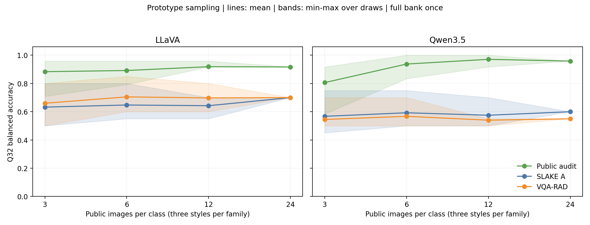
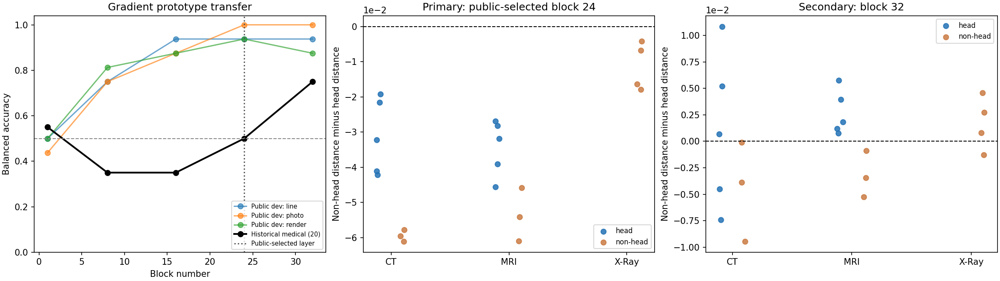
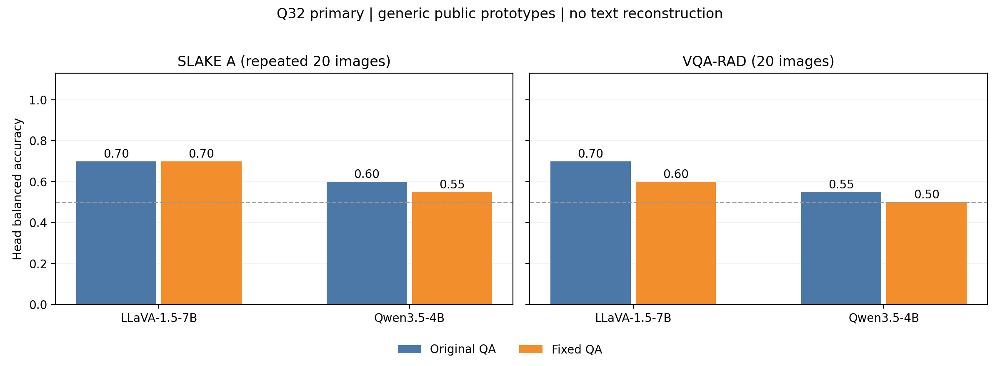
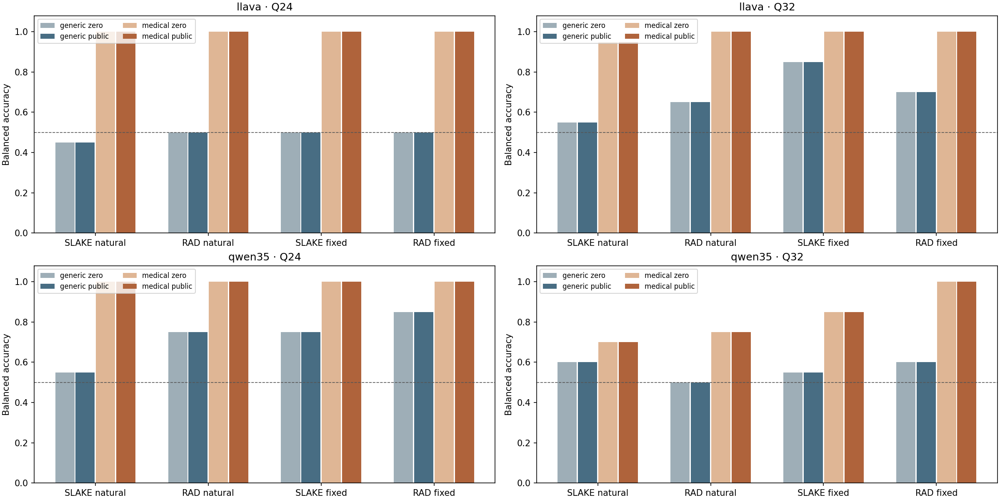
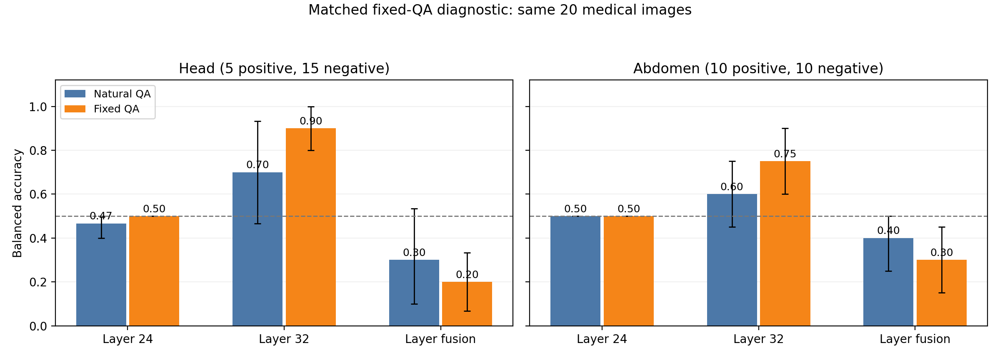
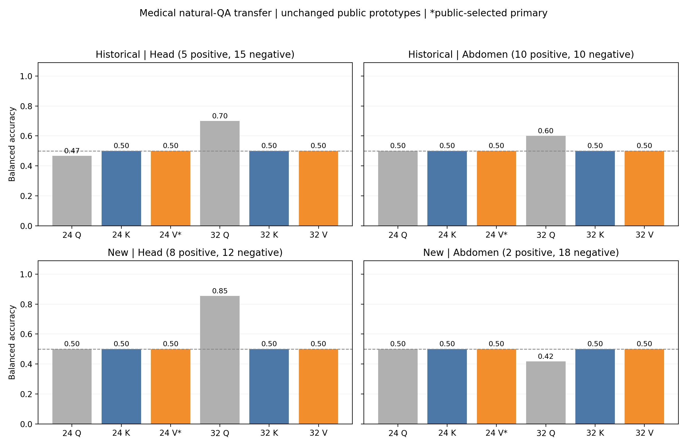

## 要点

- **医学合成原型让 Q24 迁移到满分**：声明医学外观先验后，预定 Q24 在 LLaVA、Qwen 两模型、SLAKE 与 VQA-RAD 的原始问答四格均为 20/20；等数量通用摄影原型只有 9/20、10/20、11/20、15/20。
- **Q32 的头部信号不随模态或字面词消失**：A 批首次出现后，B、C 两批作为预定对照仍为 0.700、0.854 Balanced accuracy；CT、MRI 模态内与去部位词子集都保留信号。
- **原型与目标的匹配是主因，不是阈值拟合**：两库公开阈值都选为零，换医学外观原型才改善；尚未单独隔离外观、语义、负类覆盖与生成器偏好。
- **层不能通用选择**：同一医学库下 Qwen Q32 原始问答只有 14/20、15/20 且 CT 小组较差；非医学原型下的公开选层、多层聚合、多问答校准、边界校准全部失败。
- **当前仍是重复目标的条件性正结果**：四十张 SLAKE/VQA-RAD 已反复分析，只测 Head 属性，需新目标确认，不代表临床有效性或理论恢复保证。

本页记录 [[image-property-ideas]] 中“视觉子空间概念探针”的深层梯度原型这条线：用公开非医学合成图或显式声明的医学合成图建立部位原型，从医学客户端的上传梯度判断成像部位。首层词向量探针和真实视觉 tokens 读出留在原页。

## 关键数字

**医学合成原型续测主结果**：Q24、Natural QA；每格二十图、正负各十，Accuracy 与 Balanced accuracy 相等。两库都使用每类八张拟合图、四张校准图、四张审核图，本轮公开准则选出的阈值均为零。

| Model | Dataset | Generic correct | Medical correct | Generic balanced accuracy | Medical balanced accuracy |
|---|---|---:|---:|---:|---:|
| LLaVA | SLAKE A | 9/20 | 20/20 | 0.450 | 1.000 |
| LLaVA | VQA-RAD | 10/20 | 20/20 | 0.500 | 1.000 |
| Qwen3.5 | SLAKE A | 11/20 | 20/20 | 0.550 | 1.000 |
| Qwen3.5 | VQA-RAD | 15/20 | 20/20 | 0.750 | 1.000 |

Medical 指 Medical synthetic，Generic 指 Generic photo，均为合成辅助图；不能把跨模型重复算作八十张独立目标。

**第 32 层 Q 的头部信号不随模态或字面词消失**：A 批头部 CT、MRI 各 5 张，模态平衡；“无字面词”指问答中不出现预定的部位词。

| Group | Images | Head positives | Correct | Head balanced accuracy |
|---|---:|---:|---:|---:|
| A 批 CT | 8 | 5 | 6/8 | 0.800 |
| A 批 MRI | 8 | 5 | 8/8 | 1.000 |
| A 批无字面词 | 16 | 6 | 11/16 | 0.683 |
| B 批无字面词 | 18 | 3 | 14/18 | 0.733 |
| C 批无字面词 | 14 | 2 | 11/14 | 0.667 |

其余各阶段的完整结果表见下方对应的 `###` 小节，不在此重复。

## 研究问题

- **公开可分**：深层梯度原型能否在公开合成图上区分头部与非头部，原型抽样是否稳定？
- **医学迁移**：冻结的原型规则能否在 A、B、C 三批及其他模型和数据集上判断成像部位？
- **聚合与校准**：多层、公开选层、公开校准与医学外观原型能否改善医学迁移？
- **问答影响**：客户端问答如何改变末层 Q 的判断？
- **换用 K、V**：公开图上对问答更稳的 K、V 模块，能否在医学图像上替代 Q？

## 实验设置

**不变条件**（所有阶段共用，下文不再重复）：

| Item | Setting |
|---|---|
| Model | LLaVA-1.5-7B；跨模型阶段加 Qwen3.5-4B；均 F-L、LoRA rank 32、alpha 64、round 10、原生 bf16 |
| Upload | 单样本单步 FedSGD 的 LoRA 梯度；private Observation，攻击端只拿到上传张量，不恢复文本 |
| Attributes | Head 与 Abdomen 两个二分类；按主要成像部位定义，胸腹混合视野判为 Chest |
| Method | [梯度原型探针](../glossary.md)：公开图在某层投影模块输入处的视觉位置均值作为类别原型，比较两类原型到上传 LoRA-A 梯度行空间的距离，判为较近的一类；零阈值，不拟合 |
| Notation | 模块字母加层号：Q32 指第 32 层 q_proj，V24 指第 24 层 v_proj |
| Selection boundary | 层、模块、聚合与校准规则都只用公开数据冻结；医学标签在全部预测提交后才读取 |
| Metric | 以 Balanced accuracy 为主；正类少时全判负类的 Accuracy 会虚高，而 Balanced accuracy 只有 0.500 |

### 医学批次

三批都来自 SLAKE，图像 ID 互不重叠，但患者独立性未知。

| Cohort | Images | Head | Abdomen | Chest | Modality | Token lengths | Artifact label |
|---|---:|---:|---:|---:|---|---|---|
| A | 20 | 10 | 6 | 4 | CT 8、MRI 8、X-Ray 4 | 公开 | 深层诊断与多层聚合中的 historical |
| B | 20 | 5 | 10 | 5 | CT 9、MRI 6、X-Ray 5 | 未知 | 多层阶段的 fresh；K、V 迁移中的 historical |
| C | 20 | 8 | 2 | 10 | CT 5、MRI 8、X-Ray 7 | 未知 | K、V 迁移中的 new |

- A 是最早医学候选梯度匹配用过的一批（当时 18/20），后续被多次分析；B 的头部全是 MRI、胸部全是 X-Ray；C 的头部全是 MRI、腹部只有 2 张。
- A 的原上传协议公开 token 长度（学习率配置 0.01），B、C 长度未知（学习率配置 0.0001）。分类器不读取长度；FedSGD 上传原始梯度，学习率不参与本次捕获。

### 阶段时间线

每个阶段的完整参数见 `docs/plans/` 下对应验证计划，详细产物见 frontmatter 的 artifacts 与运行记录；下表给出每阶段改了什么、用哪批、得到什么。

| 阶段（date） | 原型库 / 模块 | Cohort | 关键设置与本阶段结论 |
|---|---|---|---|
| 公开选层与 A 批（2026-10-28） | 三风格非医学合成图，留一验证选 Q24，Q32 预定次要 | A | 公开可分；Q24 未迁移，Q32 首次出现头部信号 |
| 多层聚合与 B 批（2026-11-01） | 第 8/16/24/32 层 `mean_standardized` 融合 | A→B | 融合与单层都未改善医学迁移 |
| 问答诊断（2026-11-01） | B 批固定问答重捕获、文本依赖、QA 类型谱、12 组问答交叉 | B | 问答本身就改变末层 Q 的判断 |
| 多问答校准（2026-11-01） | 66 公开图岭回归（λ=0.1）校准 | B | 公开留出有效，医学迁移无效 |
| 换用 K、V（2026-11-01） | 公开按最差问答选 V24，报告六模块 | A/B/C | K、V 未能替代 Q |
| 跨模型与数据集（2026-11-04） | Q32 明确为主条件，LLaVA+Qwen × SLAKE+VQA-RAD | A + VQA-RAD 20 | 直接固定 Q32 没有稳定跨模型分类 |
| 原型抽样与公开规则（2026-11-05） | 每类 1/2/4/8 家族抽样；公开选层/校准四算法 | A + VQA-RAD | 更多图减少波动不保证准确率；公开校准不迁移 |
| 边界偏移查证（2026-11-05） | 统一问答、Relative energy、共同/类别方向分解 | A + VQA-RAD | 问答不是唯一原因，简单能量归一不够；真实公开医学 CT 不足而停止 |
| 医学合成原型续测（2026-11-05） | 用户授权文生图，32 图等量医学库 vs 摄影库，零阈值 | A + VQA-RAD | Q24 四格 20/20，当前正结果 |

### 医学合成原型续测的设置（2026-11-05）

当前正结果的条件，保留关键的协议与隔离说明：

| Item | Setting |
|---|---|
| Authorization | 用户明确允许以文生图补足辅助数据；全新 Medical synthetic 替代未能入组的真实公开医学库，不改写此前停止记录 |
| Equal-size banks | Generic photo 与 Medical synthetic 各三十二图，每库 fit 16、calibration 8、audit 8、每类各半；Generic photo 是原摄影子集，不是原四十八图多风格满库 |
| Generator | Qwen-Image-2.1-Turbo、bf16、1024 方图、CFG 1；固定三十二提示与种子，每图一次，不接收目标图、问答或梯度 |
| Medical prompts | 每类 CT、MRI 各八张并在各 split 内平衡。CT/MRI 是提示分组，不是经核验的真实医学模态；一张为孤立心脏解剖渲染 |
| Pixel isolation | 三十二图像素哈希互不相同，与一百四十九张目标或排除图无解码像素重叠 |
| Decision | 每库在自己的公开 calibration 上冻结阈值并同时保留零阈值；两模型全部目标分数提交后才评价，主比较为 Natural、Fixed 为机制诊断 |

本阶段已完成。条件卡 n=80 统计 A、B、C 的六十张图及新增 VQA-RAD 二十图；跨模型与问答重复不增加独立图像数。本轮实际配对测试四十图，SLAKE A 为重复目标；原始问答为实际任务，固定问答为诊断任务。

## 结果

### 公开可分

**回答**：可以，但原型选择会影响预测。增加每类公开图像数量通常减少抽样波动，却不保证医学准确率提高；公开可分性不能替代迁移验证。

下表为梯度原型的 Balanced accuracy，列为留出的风格。

| Layer | Line | Photo | Render |
|---:|---:|---:|---:|
| 1 | 0.500 | 0.438 | 0.500 |
| 8 | 0.750 | 0.750 | 0.812 |
| 16 | 0.938 | 0.875 | 0.875 |
| 24 | 0.938 | 1.000 | 0.938 |
| 32 | 0.938 | 1.000 | 0.875 |

- 同位置的前向激活从第 8 层起就有 0.938 以上，梯度到第 16 层后才接近；公开图全部用同一条固定问答捕获，没有覆盖自然问答的变化。
- 每个开发内容组在三种风格中重复，不是 48 个独立目标。

#### 原型抽样稳定性

固定 Q32 与零阈值，报告二十个抽样种子的平均值；满库只算一次。每类图像数包含三种风格，Flip rate 是相对同模型满库预测的平均翻转比例。

| Model | Dataset | Images per class | Mean balanced accuracy | Min balanced accuracy | Max balanced accuracy | Mean flip rate |
|---|---|---:|---:|---:|---:|---:|
| LLaVA | SLAKE A | 3 | 0.633 | 0.500 | 0.800 | 0.188 |
| LLaVA | SLAKE A | 24 | 0.700 | 0.700 | 0.700 | 0.000 |
| LLaVA | VQA-RAD | 3 | 0.660 | 0.500 | 0.800 | 0.215 |
| LLaVA | VQA-RAD | 24 | 0.700 | 0.700 | 0.700 | 0.000 |
| Qwen3.5 | SLAKE A | 3 | 0.568 | 0.450 | 0.750 | 0.373 |
| Qwen3.5 | SLAKE A | 24 | 0.600 | 0.600 | 0.600 | 0.000 |
| Qwen3.5 | VQA-RAD | 3 | 0.545 | 0.500 | 0.700 | 0.445 |
| Qwen3.5 | VQA-RAD | 24 | 0.550 | 0.550 | 0.550 | 0.000 |

- Qwen 的 VQA-RAD 从每类三张增至二十四张，平均翻转从 0.445 降到 0，平均准确率仍约 0.55：模型可以稳定地产生不准确的分类。中间档（6、12 张）见聚合，不呈严格单调。
- 二十套标签置换库的 Q32 平均医学 Balanced accuracy 接近随机（LLaVA 0.495/0.480，Qwen 0.503/0.500），但单次置换可能很高，不能挑有利种子作对照。
- 原型变化稳定性界在数值核验中没有违反，但对三档抽样能被该界保证不翻转的比例均为 0%，目前过于保守，不能当作实用可靠性保证。

### 医学迁移

**回答**：在显式声明医学外观先验的续测中，预定 Q24 对两个模型、两个数据集的原始问答均为 20/20，但仍需新目标确认。此前非医学原型阶段的 Q32 与三批结果保留如下，说明固定末层并非通用读出。

| Cohort | Layer | Head correct | Head balanced accuracy | Abdomen correct | Abdomen balanced accuracy |
|---|---:|---:|---:|---:|---:|
| A | 24 | 10/20 | 0.500 | 14/20 | 0.500 |
| A | 32 | 15/20 | 0.750 | 12/20 | 0.524 |
| B | 24 | 14/20 | 0.467 | 10/20 | 0.500 |
| B | 32 | 15/20 | 0.700 | 12/20 | 0.600 |
| C | 24 | 12/20 | 0.500 | 18/20 | 0.500 |
| C | 32 | 17/20 | 0.854 | 15/20 | 0.417 |

- 正例少时 Accuracy 会误导：C 批腹部只有 2 个正例，第 24 层的 18/20 就是全部判负。
- 第 24 层的问题是判别偏移而非没有排序：A 批 CT、MRI 各 8 张，组内 Head AUROC 都是 1.000，合并后只有 0.600，所有分数都落在零阈值负侧。
- 公开选层（固定描述问答，第 24 层最好）和医学结果（自然问答，第 32 层更好）相反，可能来自问答不同，尚未单独检验。

#### 第 32 层的头部信号

Q32 在 A 批首次显示头部信号后，B、C 两批才捕获；这两批里 Q32 都是事先声明的对照，所以 0.700 和 0.854 是样本外复现，不是事后挑选。

| Cohort | Group | Images | Head positives | Correct | Head balanced accuracy | Head AUROC |
|---|---|---:|---:|---:|---:|---:|
| A | All | 20 | 10 | 15/20 | 0.750 | 0.720 |
| A | CT | 8 | 5 | 6/8 | 0.800 | 0.733 |
| A | MRI | 8 | 5 | 8/8 | 1.000 | 1.000 |
| A | 无字面词 | 16 | 6 | 11/16 | 0.683 | 0.667 |
| B | All | 20 | 5 | 15/20 | 0.700 | 0.773 |
| B | MRI | 6 | 5 | 4/6 | 0.800 | 1.000 |
| B | 无字面词 | 18 | 3 | 14/18 | 0.733 | 0.689 |
| C | All | 20 | 8 | 17/20 | 0.854 | 0.896 |
| C | 无字面词 | 14 | 2 | 11/14 | 0.667 | 0.667 |

- **模态解释不了**：A 批头部 CT、MRI 各 5 张，两种模态内部都能分出头部；B、C 批头部全是 MRI，单看分不开部位和模态。
- **字面词解释不了**：三批去掉问答中直接提到部位的样本后，Balanced accuracy 仍为 0.667–0.733。
- **文本作用没有完全排除**：去字面词只排除直接提及，而第 32 层 Q 又对问答最敏感，问题语义仍可能带部位线索；每组样本很小（同模态只有 A 批 16 张、B 批 6 张）。

#### A 批对照

A 批 Head 正负各 10 张，Accuracy 等于 Balanced accuracy。

| Condition | Layer | Balanced accuracy | Head AUROC | AUROC image CI95 |
|---|---:|---:|---:|---|
| Public-selected | 24 | 0.500 | 0.600 | [0.30, 0.90] |
| Secondary | 32 | 0.750 | 0.720 | [0.47, 0.94] |
| First layer | 1 | 0.550 | 0.560 | [0.29, 0.81] |
| Shuffled public labels | 24 | 0.100 | 0.010 | [0.00, 0.06] |
| Random subspace | 24 | 0.500 | 0.500 | [0.50, 0.50] |

- 打乱公开标签后排序几乎完全反转，说明分数确实跟随公开原型的类别方向；等秩随机子空间只有 0.500，排除了“任意子空间都能分开”的解释。

#### 跨模型与数据集

**回答**：同一原型评分流程可以在 Qwen3.5 与 VQA-RAD 上执行，但直接固定 Q32 没有得到稳定的跨模型分类。原始问答下 LLaVA 两数据集均为 14/20，Qwen 为 12/20、11/20；不因次要配置更好而替换主条件。

| Model | Dataset | Correct | Balanced accuracy | Image CI95 |
|---|---|---:|---:|---|
| LLaVA | SLAKE A | 14/20 | 0.700 | [0.500, 0.850] |
| LLaVA | VQA-RAD | 14/20 | 0.700 | [0.500, 0.850] |
| Qwen3.5 | SLAKE A | 12/20 | 0.600 | [0.500, 0.750] |
| Qwen3.5 | VQA-RAD | 11/20 | 0.550 | [0.500, 0.650] |

- 每模型固定同一 SLAKE 训练快照测两个数据集，未用 VQA-RAD 微调；本轮 LLaVA 的 Q64/A64 权重与历史属性快照不同，A 批从旧 15/20 到本轮 14/20 不应解释为只改变输入长度或架构。
- 公开 dev 图上 Q32 仍高（LLaVA 44/48、Qwen 46/48），但公开高分没有自动转化为医学分类高分。
- 固定问答改善排序却没改善分类：LLaVA 两数据集 AUROC 升到 1.000、Head Recall 1.000，却误报六、八张非头部，正确率仅 0.700、0.600；Qwen VQA-RAD AUROC 从 0.590 升至 0.920，但十张头部全漏检，仍 0.500。高 AUROC 不等于分类修复，也不在目标标签上重拟合边界。

**层与模块并不通用**。下表完整保留原始问答的所有预定条件，Q32 为主、其余五组只作对照，不按本表挑赢家当正式新方法。

=== "SLAKE A"

    | Model | Layer | Module | Primary | Correct | Balanced accuracy | Head AUROC |
    |---|---:|---|---|---:|---:|---:|
    | LLaVA | 24 | Q | No | 10/20 | 0.500 | 0.600 |
    | LLaVA | 24 | K | No | 10/20 | 0.500 | 0.680 |
    | LLaVA | 24 | V | No | 10/20 | 0.500 | 0.710 |
    | LLaVA | 32 | Q | Yes | 14/20 | 0.700 | 0.740 |
    | LLaVA | 32 | K | No | 10/20 | 0.500 | 0.710 |
    | LLaVA | 32 | V | No | 10/20 | 0.500 | 0.680 |
    | Qwen3.5 | 24 | Q | No | 14/20 | 0.700 | 0.900 |
    | Qwen3.5 | 24 | K | No | 15/20 | 0.750 | 0.920 |
    | Qwen3.5 | 24 | V | No | 13/20 | 0.650 | 0.920 |
    | Qwen3.5 | 32 | Q | Yes | 12/20 | 0.600 | 0.820 |
    | Qwen3.5 | 32 | K | No | 12/20 | 0.600 | 0.910 |
    | Qwen3.5 | 32 | V | No | 14/20 | 0.700 | 0.910 |

=== "VQA-RAD"

    | Model | Layer | Module | Primary | Correct | Balanced accuracy | Head AUROC |
    |---|---:|---|---|---:|---:|---:|
    | LLaVA | 24 | Q | No | 10/20 | 0.500 | 0.760 |
    | LLaVA | 24 | K | No | 10/20 | 0.500 | 0.950 |
    | LLaVA | 24 | V | No | 10/20 | 0.500 | 0.870 |
    | LLaVA | 32 | Q | Yes | 14/20 | 0.700 | 0.810 |
    | LLaVA | 32 | K | No | 10/20 | 0.500 | 0.820 |
    | LLaVA | 32 | V | No | 10/20 | 0.500 | 0.880 |
    | Qwen3.5 | 24 | Q | No | 16/20 | 0.800 | 0.910 |
    | Qwen3.5 | 24 | K | No | 16/20 | 0.800 | 0.920 |
    | Qwen3.5 | 24 | V | No | 18/20 | 0.900 | 0.910 |
    | Qwen3.5 | 32 | Q | Yes | 11/20 | 0.550 | 0.590 |
    | Qwen3.5 | 32 | K | No | 13/20 | 0.650 | 0.940 |
    | Qwen3.5 | 32 | V | No | 14/20 | 0.700 | 1.000 |

原先“换 K/V 仍失败”的结论限于历史 LLaVA 条件，不能外推为所有模型；全部四十八个医学条件见 `crossmodel-summary.csv`。

**同模态梯度交换**（固定问答，按预定模态内成对规则交换相反属性图像的已提交梯度分数；每对输出相互依赖，不是额外独立目标，不用标签重新选方法）：

| Model | Dataset | Paired images | Correct gradient | Swapped gradient | Original AUROC | Swapped AUROC |
|---|---|---:|---:|---:|---:|---:|
| LLaVA | SLAKE A | 12 | 10/12 | 2/12 | 1.000 | 0.000 |
| LLaVA | VQA-RAD | 6 | 4/6 | 2/6 | 1.000 | 0.000 |
| Qwen3.5 | SLAKE A | 12 | 6/12 | 6/12 | 0.778 | 0.222 |
| Qwen3.5 | VQA-RAD | 6 | 3/6 | 3/6 | 0.778 | 0.222 |

LLaVA 的排序随图像梯度交换而反向，支持其分数包含图像差异；Qwen 的 Q32 在这两个子集恒判负类，交换只改排序，尚无有效分类。独立核验 160 份医学上传、96 份公开回放、十二原型、1,536 组距离，最大误差零（`crossmodel-aggregate.json`、`crossmodel-audit.json`）。

### 聚合与校准

**回答**：单靠通用原型下的公开选层、校准没有解决迁移；换成等数量医学合成原型后，预定 Q24 在两模型、两数据集的原始问答中均为 20/20。改善发生在未按目标调参的零阈值条件，说明原型匹配值得继续验证，但目前仍是重复目标诊断。

**非医学原型下的各种改进都失败**。B 批 Balanced accuracy：

| Method | Kind | Head balanced accuracy | Abdomen balanced accuracy |
|---|---|---:|---:|
| Layer 24 | Single layer | 0.467 | 0.500 |
| Layer 32 | Single layer | 0.700 | 0.600 |
| `mean_standardized` | Fusion | 0.300 | 0.400 |
| `majority` | Fusion | 0.400 | 0.500 |
| `mean_raw` | Fusion | 0.400 | 0.400 |
| Single-QA ridge | Calibration | 0.433 | 0.450 |
| Multi-QA ridge | Calibration | 0.433 | 0.350 |

- 多层融合与校准都低于第 32 层单层。第 24、32 层的错误互补：若事后知道每张图信哪一层，A 批最多 18/20，但该上界用了真实标签，不可执行。
- 多问答校准把权重主要放在第 24 层，而医学图像的正信号主要来自第 32 层。
- 公开留出上校准有效（Abdomen 两种新问句从 0.861 升到 1.000、翻转从 6/21 降到 0/21），但迁移到 B 批无效：两种 ridge 都漏掉 B 批全部 10 张腹部正例。详见 `multi-qa-summary.csv`。

**公开选层与边界校准同样不迁移**。两模型按冻结规则都选出 Q24，但选择包含大量指标并列（LLaVA 五模块 calibration 满分、Qwen 六模块指标完全相同，最后由“较浅层、Q 优先”决定），不能说公开分数已识别最佳医学模块。

| Model | Algorithm | Calibration balanced accuracy | Audit balanced accuracy |
|---|---|---:|---:|
| LLaVA | Fixed Q32 | 0.917 | 0.917 |
| LLaVA | Public selection | 1.000 | 0.958 |
| LLaVA | Public selection calibration | 1.000 | 0.958 |
| Qwen3.5 | Fixed Q32 | 0.958 | 0.958 |
| Qwen3.5 | Public selection | 0.958 | 0.958 |
| Qwen3.5 | Public selection calibration | 1.000 | 0.917 |

- 加入公开阈值后，Q32 calibration 与候选主方案在两模型全部医学条件都只预测非头部（Head recall 0），预定主方案失败，不事后把 Qwen 未校准分数改称主结果。
- 同一模块 AUROC 经平移不变（如 Qwen Q24 VQA-RAD 仍 0.910），分类却从 0.800 降到 0.500：排序保留，公开边界没有迁移。完整数据见 [method-summary.csv](data/gradient-prototype-transfer/method-summary.csv)、[method-audit.json](data/gradient-prototype-transfer/method-audit.json)。

**边界偏移的配对查证**：统一问答后，两类医学图的分差仍整体靠近零或落负侧（LLaVA Q24 SLAKE 头部中位分差从公开正值变医学 −0.036283），简单总体能量归一化（Relative energy）也不足以修复——Q24、Q32 的十六个医学条件下 Raw public 与 Relative public 全部 10/20、Head recall 0。共同方向与类别方向分解说明原始判断依赖两者投影耦合，不能把类别方向投影能量单独当作 Head 证据。原真实公开医学原型对照因头部 CT 入组不足（十五张只六张明确头部）在数据门槛停止，没有领域原型结果；这一缺口不代表医学原型方法无效。详见 [boundary-summary.csv](data/gradient-prototype-transfer/boundary-summary.csv)。

**医学合成原型的等数量对照（当前正结果）**：声明医学外观先验后，预定 Q24 两模型、两数据集 Natural QA 四格均 20/20，Fixed QA 四格也均 20/20。

阈值不是收益来源——两库、两模型、六模块在各自八张 calibration 图上按冻结准则都选出零阈值，图中 zero 与 public 两柱完全一致：

| Model | Q24 audit images | Generic balanced accuracy | Medical balanced accuracy |
|---|---|---:|---:|
| LLaVA | Generic photo | 1.000 | 0.875 |
| LLaVA | Medical synthetic | 0.500 | 1.000 |
| Qwen3.5 | Generic photo | 1.000 | 1.000 |
| Qwen3.5 | Medical synthetic | 0.875 | 1.000 |

同模态内仍能区分（原始问答、Q24，六小组都同时有头部与非头部）：

| Model | Dataset | Modality | Images | Head positives | Generic balanced accuracy | Medical balanced accuracy |
|---|---|---|---:|---:|---:|---:|
| LLaVA | SLAKE A | CT | 8 | 5 | 0.500 | 1.000 |
| LLaVA | SLAKE A | MRI | 8 | 5 | 0.500 | 1.000 |
| LLaVA | VQA-RAD | CT | 8 | 3 | 0.500 | 1.000 |
| Qwen3.5 | SLAKE A | CT | 8 | 5 | 0.500 | 1.000 |
| Qwen3.5 | SLAKE A | MRI | 8 | 5 | 0.633 | 1.000 |
| Qwen3.5 | VQA-RAD | CT | 8 | 3 | 0.567 | 1.000 |

- Q24 医学库相对通用库的 Balanced accuracy 增益：LLaVA SLAKE 0.550、VQA-RAD 0.500，Qwen 0.450、0.250，只描述本批经验差值。变化直接体现在分差（LLaVA Q24 SLAKE 头部中位数从 −0.050424 变 0.068988），支持原型外观或语义匹配影响边界，而非只改变分数尺度。
- 末层仍不通用：预定 Q32 的 Natural QA 里 Qwen 同模态 CT 小组仍差（SLAKE 3/8、0.367，VQA-RAD 4/8、0.400）。
- 通用 non-head 含肢体与躯干，医学 non-head 专门覆盖胸腹，不能把全部增益唯一归于医学风格；它引入明确医学先验，非领域未知下的通用属性恢复，二十图满分也不代表总体真实准确率 100%。完整产物见 [synthetic-medical-summary.csv](data/gradient-prototype-transfer/synthetic-medical-summary.csv)、[synthetic-medical-integrity-audit.json](data/gradient-prototype-transfer/synthetic-medical-integrity-audit.json)。

### 问答影响

**回答**：问题上下文本身就能改变末层 Q 的判断。公开图上固定回答、只换问题，Head 从 0.917 降到 0.500，加长回答不能恢复；同一批医学图像改用固定问答后，Q32 的 Head 从 0.700 升到 0.900。

公开 33 张图上第 32 层 Q 的 Balanced accuracy：

| Question | Answer | Supervised tokens | Head balanced accuracy | Abdomen balanced accuracy |
|---|---|---:|---:|---:|
| Describe the image. | The image is shown. | 6 | 0.917 | 0.750 |
| Is there an image to inspect? | The image is shown. | 6 | 0.500 | 0.500 |
| Can this picture be examined? | The image is shown. | 6 | 0.500 | 0.500 |
| Is there an image to inspect? | Yes. | 3 | 0.500 | 0.500 |
| Is there an image to inspect? | Yes, an image is shown. | 8 | 0.500 | 0.500 |
| Describe the image. | Yes. | 3 | 0.917 | 0.792 |

- 回答不变时问题就能改变结果，短回答也能在描述问题下得到 0.917，所以答案长度不是主要原因；问题的词语、有效长度和内容一起改变，尚未分开各自作用。

#### 末层 Q 的梯度结构

在因果解码器的最后一层，Q 只从受监督的答案位置获得梯度。理想精度下末层 LoRA-A 梯度是监督位置的外积和：

\[
G_A=\sum_{t\in\mathcal S}u_t h_t^\top,\qquad
\operatorname{rank}(G_A)\le\min(32,|\mathcal S|).
\]

其中 \(h_t\) 是答案预测位置进入 Q 的隐状态，同时受图像和问答影响。

| Condition | Layer | Module | Mean visual output-gradient energy fraction | Nonzero visual positions |
|---|---:|---|---:|---:|
| present | 32 | Q | 0.0000 | 0/576 |
| present | 32 | K | 0.3057 | 576/576 |
| present | 32 | V | 0.0104 | 576/576 |
| present | 24 | Q | 0.0218 | 576/576 |

- 7B 模型上末层 Q 在 576 个视觉位置输出梯度全为零；第 24 层 Q 和末层 K、V 在全部视觉位置都有梯度。
- 末层 Q 梯度能量集中在少数方向（Yes/No 回答 1–2 个、描述回答 4–7 个）；换成 Yes/No 后两类平均分差间隔缩小约 7–8 倍，两类都落负分侧，截掉弱方向也不能修复。

#### 视觉原型不依赖问答

固定前置模板 `USER: `、槽位长度和精度后，更换后置问题或回答，6 张公开图 32 层 q_proj 的视觉位置输入逐值相同；变化只出现在上传梯度中。

| Future text condition | Equal feature comparisons | Gradient relative L2 range | Rowspace distance range |
|---|---:|---|---|
| Question changed | 192/192 | [0.380, 0.932] | [0.901, 0.909] |
| Answer changed | 192/192 | [0.517, 0.831] | [0.936, 0.941] |
| Both changed | 192/192 | [0.615, 0.979] | [0.944, 0.947] |
| Identical input repeated | 192/192 | [0, 0] | [0, 0] |

- 提取原型不需要知道真实问答，但前置模板必须一致：把 `USER: ` 换成更长公开提示后，第 2–32 层特征全部改变。

#### 固定问答的医学对照

B 批同 20 张图，比较原自然问答与固定问答的上传。

| Method | QA | Head balanced accuracy | Abdomen balanced accuracy |
|---|---|---:|---:|
| Layer 24 | Natural | 0.467 | 0.500 |
| Layer 24 | Fixed | 0.500 | 0.500 |
| Layer 32 | Natural | 0.700 | 0.600 |
| Layer 32 | Fixed | 0.900 | 0.750 |
| `mean_standardized` | Natural | 0.300 | 0.400 |
| `mean_standardized` | Fixed | 0.200 | 0.300 |

- 第 32 层两项增益的配对区间都包含零（Head [−0.033, 0.433]，Abdomen [−0.050, 0.350]）；固定问答下 5 张胸部 X-Ray 全被判腹部，缺同模态胸腹对照，分不清是部位混淆还是 X-Ray 域偏移。
- 固定问答声明 text_known，同时改变内容、长度和监督任务，说明评分对问答敏感，不是未知问答下的攻击成绩。

### 换用 K、V

**回答**：在此前非医学原型条件下，公开规则选出的 V24 没有成功替代 Q，A、B、C 两部位几乎全部判负。这个结论限定于相应原型和模型；医学合成续测完整保留六模块结果，主条件仍是预定 Q24，不事后改选 K、V。

公开 33 张图、6 种问答下 K、V 很稳（Head 24/32 层 K、V 多问答 Balanced accuracy 均 1.000、翻转 0/24），但没有转化为医学迁移：第 24、32 层的 K、V 四个组合在三批上 Balanced accuracy 全为 0.500、正类 Recall 全为零。主条件 V24 的排序指标：

| Cohort | Head balanced accuracy | Head AUROC | Abdomen balanced accuracy | Abdomen AUROC |
|---|---:|---:|---:|---:|
| A | 0.500 | 0.670 | 0.500 | 0.714 |
| B | 0.500 | 0.493 | 0.500 | 0.500 |
| C | 0.500 | 0.469 | 0.500 | 0.500 |

- A 批 CT、MRI 各 8 张，组内 V24 两属性 AUROC 都是 1.000，但类别判断仍全部为负，与第 24 层 Q 的判别偏移相同。
- K、V 能直接从视觉位置获得梯度（末层 K 能量占比 0.306），但没转化为医学迁移。六个层模块组合完整结果见 `medical-kv-summary.csv`（B、C）与 `medical-kv-a-summary.csv`（A）。

## 结论

- 医学合成原型在当前重复队列上修复了 Q24 的迁移：两模型的 SLAKE、VQA-RAD 原始问答均 20/20，同目标固定问答也 20/20，同模态 CT、MRI 小组仍成立。这是声明医学先验后的条件性正结果，需要新目标确认。
- 原型与目标的匹配是重要影响因素：统一问答仍有分差偏移、简单相对能量也未修复，两库公开阈值都为零、换原型后才改善，不能把收益归于目标阈值拟合；当前对照没有单独隔离外观、语义、构图或生成器偏好。
- 层仍不能通用选择：医学合成库下 Qwen Q32 原始问答 14/20、15/20 且同模态 CT 较差；非医学原型下的公开选层、多层聚合、多问答校准负结果继续保留。
- 更多公开图像主要减少抽样波动、不保证准确率提高；公开高分、分数稳定、排序正确和目标分类正确是不同条件，不能由本批 Q24 满分推断文本上下文无影响。
- 理想 LoRA 的输入行空间包含关系不保证属性方向保留；已推导的原型扰动界成立但过松。当前正结果只证明所列条件下可读出部位信息，尚不是通用属性可恢复的理论保证。

## 局限

- 续测仍是已反复分析的 SLAKE A、VQA-RAD 各二十图，新增的只是一套公开生成库，没有新增独立目标；两模型、两问答共享图像，不把四格 20/20 当八十张独立图像，满分区间可能退化为 [1,1]，不能据此确认总体零误差。
- 医学库只有一组固定提示与种子，CT/MRI 是提示分组、部分图实际更像 X-Ray，一张为孤立心脏渲染；目视只检查部位与质量，未验证临床真实性、病理或严格模态。这是 Head 属性测试，不是模态推断性能，也只验证 Head，腹部仍接近随机。
- 两库的属性语义与负类覆盖不同（公开人像的 Head 与断层脑部不是同一视觉表征），本轮没有固定内容只改风格的因果对照；每类拟合只有四个医学家族对八个摄影家族，只控制了张数。
- 纯真实公开医学库因头部 CT 入组不足而未回放，不能把合成库正结果等同真实辅助库已验证；原辅助 CT 审核是单次保守目视，无独立复核者或患者标识，患者独立性未知。
- 两模型本身已在 SLAKE 训练、续测又明确用医学提示，不能称为无领域信息或领域未知攻击；旧非医学原型条件与新医学条件分别报告。选层范围只六个组合、公开分数常并列，当前数据不能证明公开规则总能选中最佳层。
- LLaVA、Qwen 规模、预训练、分辨率、训练轨迹不同，新 LLaVA 的 Q64/A64 也异于历史快照，分差不能独立归于架构、容量或问答；Qwen 仅测两 full-attention 层、固定 256 像素，未验证 DeltaNet、动态分辨率、其他 Rank、多样本或梯度防御。
- Fixed QA 是人工机制诊断，不能替代未知自然问答攻击条件；真实问答的分词、长度、末层答案位置梯度等作用仍未完全拆开。

## 下一步

- 冻结本轮 Medical synthetic、Q24、原始零阈值和两个模型快照，在新的医学图像上确认；先做同模态的正负类平衡，不继续在本批四十图上调原型、提示、层或阈值。
- 独立确认后再扩展 Abdomen 等属性，明确负类组成和属性定义；与头部结果分别报告，不默认共享最佳层或阈值。
- 如继续纯真实公开医学库对照，需另补符合定义且与目标隔离的头部 CT；不要将已完成的合成替代条件改称真实公开数据验证。
- 用新的公开条件检验模型专用选层规则及并列处理方式，重点解释 Qwen Q32 在 CT 小组失效；若研究领域未知场景，单独定义可用先验与原型库选择规则，不得用目标真实领域决定选哪套库后报告通用成功。
- 机制侧继续拆解原型共同方向、类别方向与上传位置支持的耦合，并补充等长问句控制；现有投影恒等式不替代可恢复条件。

??? note "运行记录"

    通用约定：各阶段均冻结 `source-*-v1` 源码、基础 commit 2fd25b6、既有 gia/gia-qwen35/qwen-image-21 环境未修改、只新增 evaluation 与测试与文档、不提交 Git；全部目标分数提交后才读取医学标签，原图、逐样本预测与映射只留在 outputs，文档仅发布聚合表图；进程完成后均退出，列出的 GPU 若事后被其他任务占用不写成整卡空闲。单卡执行，遵守 WN-A100 至多两卡限制。

    | 阶段 | 输出目录 | Host / GPU | 墙钟 | 核验 |
    |---|---|---|---|---|
    | 公开选层与 A 批 | `image_property_next_20261028/deep-probe` | WN-A100，仅 CPU | 100.95 s | 二十预测提交后评估私有标签 |
    | 多层聚合与 B 批 | `multilayer_property_20261101` | 本机 GPU1 | 生成 6.15 min + 推断 10.93 min，峰值 20526 MiB | CPU 回归 435 通过、4 跳过；B 批捕获前视觉核验排除颈部/心脏主导图并修正一张 Chest→上腹 MRI |
    | 固定问答 | `multilayer_property_20261101/fixed-qa` | 本机 GPU1 | 9.50 min，峰值 20527 MiB | CPU 回归 443 通过；聚合图不含私有问答 |
    | 文本依赖检查 | `multilayer_property_20261101/causal` | 本机 GPU1 | 247.56 s，峰值 20076 MiB | 1728 组均值特征、150 组梯度指标重算通过；裁剪问答改序列长度，第 2–32 层最大相对 L2≈0.018 未逐算子归因 |
    | 多问答校准 | `multilayer_property_20261101/multi-qa` | 本机 GPU3 | GPU 阶段约 198.96 s + CPU 评价 5.40 s | 2700 组公开逐层距离最大误差零；初始 fit 标签缺 dev 行，改用公开生成器声明标签，prepare-repair 留存 |
    | 问答类型审计 | `multi-qa/type-diagnosis` | 仅 CPU | 5.03 s | 复用 396 公开梯度、792 组谱，原距离重算误差零 |
    | 问答与模块控制 | `multilayer_property_20261101/qa-controls` | WN-A100 GPU0 | 198.90 s，峰值 20286 MiB | 4752 组距离重算最大误差 3.33e-16；逐 token BF16 加和与原生梯度最大相对 L2 差 0.02366，主结果用原生整体梯度 |
    | B、C 两批 K、V 迁移 | `multilayer_property_20261101/medical-kv` | WN-A100 GPU0 | 460.46 s，峰值 20526 MiB | 480 组距离重算误差零；八十三个旧 ID 与解码像素排除核验通过 |
    | A 批 K、V 补测 | `multilayer_property_20261101/medical-kv-a` | 仅 CPU | 14.26 s | 240 组 SVD 距离重算误差零；A 与 B、C 图像 ID 零重叠；修正一处缺失 os 导入 |
    | 跨模型准备 | `crossmodel_property_20261104`（v2 冻结） | WN-A100 GPU2 | — | 发现 core.capture 每份上传重算整模型指纹，改为首尾指纹+首份全张量核对；准备阶段回归 485 通过、4 跳过 |
    | 跨模型完成 | `crossmodel_property_20261104_v3` | WN-A100 GPU0 | 731.73 s，峰值 LLaVA 21099/ Qwen 12504 MiB | 160 份医学预测提交后合并真值；1536 组距离重算最大误差零，VQA-RAD 与全部 SLAKE 像素无重叠 |
    | 原型抽样与公开规则 | `prototype_method_20261105` | 仅 CPU | 184.79 s | 61 真实+20 置换库；1536 组满库复现误差 3.28e-15，7680 组残差等价检查误差 3.67e-15；method-audit pass |
    | 边界偏移查证 | `prototype_boundary_20261105` | 仅 CPU | 197.88 s | 1536 组距离复现最大误差 3.28e-15；医学原型对照在数据门槛停止，未启动 GPU；boundary-integrity-audit pass |
    | 医学合成原型续测 | `prototype_medical_synthetic_20261105` | 本机 GPU5 | 生成 405.54 s + probe LLaVA 196.61/ Qwen 183.67 s | 32 图先过可见属性审核与像素隔离；2688 组 SVD 距离、960 组手工分类重算，公开阈值全复现、最大距离误差零，CPU 回归 520 通过、4 跳过，MkDocs 严格构建通过 |
