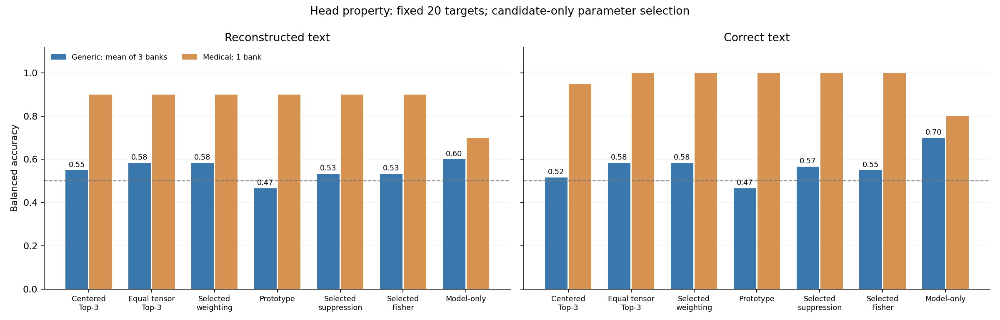
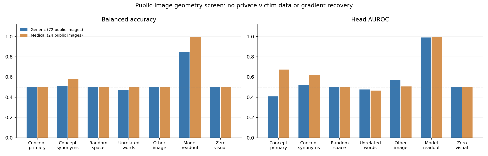

## 要点

- **评分改进未解决跨域迁移**：张量加权与中心化等权均为 0.583；类内抑制相对同一原型基线的增益区间包含零。
- **概念探针未通过前提检查**：预定主探针在摄影组与医学组均为 0.500，尚无稳定排序证据。
- **真实视觉 tokens 可读出属性**：摄影组为 61/72，医学组为 24/24；四个接口样本的 logits、loss 和 LoRA 梯度完全一致。
- **完整恢复路线尚未验证**：未执行 D2 梯度概念探针、E2 自由 tokens 优化或文本引导生成；本页不报告图像重构成功。
- **两阶段证据需区分**：评分阶段复用二十个私有目标，几何与接口阶段仅检查九十六张公开合成图像，均非新的真实图像确认集。

本页统一记录[图像属性方案](../plans/2026-10-28-image-property-ideas.md)的本轮验证。原医学与通用候选基线见 [[synthetic-property]]；本页的评分修改与几何检查分别使用不同输入，不能将两阶段准确率直接比较。

| Idea | Tested scope | Status |
|---|---|---|
| Tensor Discriminability Weighting | 原二十目标，公开候选跨库选参及反证对照 | 初步完成，未优于等权 |
| Within-Class Variation Suppression | 原型、软抑制、硬投影及 Fisher | 初步完成，未确认跨域增益 |
| Visual Subspace Concept Probing | D1 及相关空间、词簇对照 | 主条件未过门槛，D2 未执行 |
| Visual Token Recovery | E1 接口一致性与真实 tokens 属性读出 | 入口通过，E2 优化未执行 |
| Text-Guided Candidate Generation | 本轮未生成新的上下文条件候选 | 未执行 |

## 关键数字

**候选统计评分**：同一批二十目标，三套通用摄影库分别预测再取均值；正确文本为独立诊断。

| Method | Reconstructed accuracy | Correct accuracy |
|---|---:|---:|
| Centered Top-3 | 0.550 | 0.517 |
| Centered equal-tensor Top-3 | 0.583 | 0.583 |
| Selected weighting | 0.583 | 0.583 |
| Prototype equal | 0.467 | 0.467 |
| Selected suppression | 0.533 | 0.567 |
| Selected Fisher | 0.533 | 0.550 |

**公开视觉表征检查**：直接提供公开图像或其真实视觉 tokens，不使用目标上传。

| Public group | Images | Coverage | Primary balanced accuracy | Head AUROC | AUROC image CI95 | Model readout accuracy |
|---|---:|---:|---:|---:|---|---:|
| Generic | 72 | 1.000 | 0.500 | 0.409 | [0.275, 0.542] | 0.847 |
| Medical | 24 | 1.000 | 0.500 | 0.674 | [0.438, 0.875] | 1.000 |

## 研究问题

- **候选统计评分**：公开候选的张量判别加权、类内抑制或 Fisher，能否改善原二十目标上的属性判断和跨域迁移？
- **概念几何**：直接视觉子空间能否区分预先固定的头部与非头部概念？
- **空间对照**：结果能否排除随机高秩、无关概念和文本重叠的影响？
- **接口读出**：真实视觉 tokens 注入后能否复现原前向与梯度，原模型能否读出属性？

## 实验设置

| Item | Setting |
|---|---|
| Research plan | 一份原始 idea 计划，含评分验证与概念探针两阶段执行细案 |
| Target count | 本页条件卡 n=20 指评分阶段的旧目标；公开几何阶段另用 96 张合成候选 |
| Model | 两阶段共用原 LLaVA-1.5-7B，F-L，Rank 32，Round 10 |
| Selection boundary | 不按私有目标标签选方法、候选、词簇、秩或阈值 |
| Source artifacts | 原运行目录及聚合文件位置保留，避免改动冻结哈希；只统一文档入口 |

### 候选统计评分（2026-10-28）

执行方案见[原始计划的评分验证细案](../plans/2026-10-28-image-property-ideas.md#scoring-design)。本阶段沿用旧目标，定位为机制诊断，尚不是独立确认集。

| Item | Setting |
|---|---|
| Targets | 同一批二十图，Head 与 non-head 各十图 |
| Fixed inputs | 原模型、上传、重构问答及四套候选库；不重新训练或生成 |
| Primary comparison | 判别加权相对 Centered equal-tensor，固定 Top-3 |
| Weighting | 每张量 B/(B+W) 有界比值；beta 为 0、0.5、1 |
| Suppression | 每张量类内 SVD，k 为 1、4，alpha 为 0.5、1；与未抑制的等权原型对比 |
| Fisher | 每张量正则化连续分数，按类间距离归一化后等权；ridge 为 0.1、1 倍类内平均能量 |
| Public selection | 重构问答下，每套摄影库拟合、另两套摄影库留出；不用医学库或目标标签 |
| Controls | 四种旧评分、原型聚合、Model-only、Text-only、其他十九份上传、打乱标签、置换张量权重 |
| Cache | 候选与上传的 float64 内积；按问答复用，不保存高维稠密投影 |

留出库只有种子不同，提示家族与摄影领域相同；医学目标上的迁移另作诊断，不把摄影留出称为跨领域验证。参数选择只使用公开候选的分类正确率，两种文本下全部配置的预测保存后再读取目标标签。先验对照复用经过哈希核验的既有结果。

### 概念探针与接口检查（2026-10-28）

执行前的完整方案见[视觉概念检查](../plans/2026-10-28-image-property-ideas.md#concept-design)。

| Item | Setting |
|---|---|
| Public images | 三套通用摄影候选及一套医学候选，各二十四张，类别各半；复用已审核生成图 |
| Private inputs | 不读私有目标图像、问答、Observation 或重构结果 |
| Model | 原 LLaVA-1.5-7B，F-L，Rank 32，Round 10；不更新参数 |
| Primary probe | 首层 input RMSNorm 后的视觉特征；减去固定中性文本方向，前九十六个视觉方向 |
| Primary concepts | head、brain、skull、face 对 chest、abdomen、arm、leg |
| Synonyms | head、cranium、forehead、scalp 对 torso、belly、hand、foot |
| Unrelated concepts | table、chair、door、window 对 river、mountain、tree、cloud |
| Multi-token words | 各 token 经同一 RMSNorm 后取均值；词簇冻结，不按结果挑词 |
| Score | 概念在视觉空间外的相对残差；每类至少两个有效词，类别内均值较低者胜出 |
| Other conditions | 秩三十二、完整视觉秩；原始空间；固定 head 词面重叠上下文 |
| Controls | 等秩随机商空间、预定同库其他图像映射、无关词簇、概念分组置换 |
| Readout | 固定头部 yes/no 问句，比较原生答案 NLL，含 EOS；另输入全零视觉槽位 |
| Interface | 四个预定样本比较 logits、loss 和全部 LoRA 梯度，容差 1e-6；检查视觉变量梯度 |

所有概念、秩和映射在预测前冻结，不拟合阈值。进入 D2 的门槛是：摄影组与医学组的主探针 Balanced accuracy 均至少 0.65，图像级 Head AUROC 区间下限均高于 0.5，且三套摄影库分数方向一致。D1 不是梯度攻击，也不是其严格性能上界。

## 结果

### 候选统计评分

**回答**：公开候选选择的张量加权尚未显示相对等权评分的稳定增益。本轮只改变评分统计，未使用目标标签选择参数；医学库与通用库分别报告。

- 加权选择 `weighted_b0`；抑制选择 `suppress_k4_a1`；Fisher 选择 `fisher_r0.1`。选择依据为重构问答下公开摄影库之间的留出准确率。
- 正确文本不参与选择；同一份问答的候选回放在两种文本阶段间复用。所有配置先保存预测，再由独立评估读取目标标签。
- 三套摄影库是相同二十目标上的重复测量。以下通用库指标先逐库计算再取均值，区间按目标分层重采样；候选种子留出不能替代新领域验证。

| Method | Reconstructed accuracy | Correct accuracy | Head recall | Head AUROC | Wrong-gradient accuracy |
|---|---:|---:|---:|---:|---:|
| Centered Top-3 | 0.550 | 0.517 | 0.600 | 0.583 | 0.533 |
| Centered equal-tensor Top-3 | 0.583 | 0.583 | 0.700 | 0.583 | 0.599 |
| Selected weighting | 0.583 | 0.583 | 0.700 | 0.583 | 0.599 |
| Prototype equal | 0.467 | 0.467 | 0.500 | 0.503 | 0.596 |
| Selected suppression | 0.533 | 0.567 | 0.567 | 0.613 | 0.550 |
| Selected Fisher | 0.533 | 0.550 | 0.600 | 0.587 | 0.534 |
| Model-only | 0.600 | 0.700 | 0.667 | 0.713 | — |
| Text-only | 0.500 | 0.500 | 0.000 | 0.640 | — |

Head recall、Head AUROC 和 Wrong-gradient 列采用重构文本；均保留原二十目标。样本平衡时 Accuracy 等于 Balanced accuracy，Macro F1 及逐模态、文本恢复分组见聚合产物。

- 所选加权准确率的目标级 95% 区间为 [0.383, 0.767]。相对 Centered equal-tensor 的配对差异为 0.000，区间为 [0.000, 0.000]；相对 Model-only 的差异区间为 [-0.283, 0.267]。
- 所选抑制相对未抑制的相同原型聚合，配对差异为 0.067，区间为 [-0.067, 0.217]。不能把原型聚合自身的变化归因于投影。
- 所选 Fisher 准确率为 0.533；它使用连续判别分数，未使用退化的一维余弦。

| Candidate bank | Centered | Equal tensor, centered | Selected weighting | Prototype | Selected suppression | Selected Fisher |
|---|---:|---:|---:|---:|---:|---:|
| Generic 1 | 0.550 | 0.550 | 0.550 | 0.500 | 0.450 | 0.450 |
| Generic 2 | 0.600 | 0.650 | 0.650 | 0.450 | 0.650 | 0.650 |
| Generic 3 | 0.500 | 0.550 | 0.550 | 0.450 | 0.500 | 0.500 |
| Medical | 0.900 | 0.900 | 0.900 | 0.900 | 0.900 | 0.900 |

**公开留出与干扰抑制**

| Configuration | Public heldout accuracy |
|---|---:|
| fisher_r0.1 | 1.000 |
| fisher_r1 | 0.991 |
| prototype_equal | 0.960 |
| suppress_k1_a0.5 | 0.988 |
| suppress_k1_a1 | 0.995 |
| suppress_k4_a0.5 | 0.989 |
| suppress_k4_a1 | 1.000 |
| weighted_b0 | 0.999 |
| weighted_b0.5 | 0.999 |
| weighted_b1 | 0.999 |

- 候选库内散度比例与公开留出逐张量准确率的 Spearman 相关均值为 0.281；三套摄影库间散度比例排序的相关均值为 0.886。这些是候选侧诊断，不是视觉语义的因果解释。

| Suppression | Fitting within variation retained | Heldout within variation retained | Between-class separation retained |
|---|---:|---:|---:|
| suppress_k1_a0.5 | 0.513 | 0.536 | 0.698 |
| suppress_k1_a1 | 0.350 | 0.381 | 0.598 |
| suppress_k4_a0.5 | 0.324 | 0.367 | 0.569 |
| suppress_k4_a1 | 0.098 | 0.156 | 0.425 |

保留比例按各问答和摄影库分别计算再平均。投影天然不会增加向量范数；类内变化下降本身不足以证明改善迁移，必须结合类间保留与目标结果。逐张量权重、有效覆盖率、完整参数网格及配对区间见聚合 JSON。

**反证与适用范围**

| Control | Reconstructed generic accuracy | Correct generic accuracy |
|---|---:|---:|
| weighted_b0.5 | 0.583 | 0.583 |
| shuffled_labels_b0.5 | 0.583 | 0.583 |
| permuted_weights_b0.5 | 0.583 | 0.583 |

反证对照统一使用 beta=0.5，不与所选 beta 混为同一配置。Wrong-gradient 保持本目标问答固定，但另一份上传也具有不同的原始问答，不能单独证明视觉因果效应。本轮没有新增同问答配对目标，也未完成未见成像领域的公开开发验证。

本轮属于旧二十图上的机制诊断。若继续研究，先冻结主规则，在未分析的新目标和真正留出的领域确认；不根据本表挑选库、属性或配置再回报同批准确率。

### 概念几何

**回答**：预定主条件未通过推进门槛，当前词向量构造不足以支持继续进行梯度概念探针。以下保留全部预定秩和词簇，不用其中最好的条件替换主结果。

| Context | Rank | Concepts | Generic balanced accuracy | Generic Head AUROC | Medical balanced accuracy | Medical Head AUROC |
|---|---:|---|---:|---:|---:|---:|
| neutral | 32 | primary | 0.514 | 0.502 | 0.458 | 0.708 |
| neutral | 32 | synonyms | 0.681 | 0.749 | 0.667 | 0.757 |
| neutral | 96 | primary | 0.500 | 0.409 | 0.500 | 0.674 |
| neutral | 96 | synonyms | 0.514 | 0.518 | 0.583 | 0.618 |
| neutral | 576 | primary | 0.500 | 0.520 | 0.500 | 0.569 |
| neutral | 576 | synonyms | 0.472 | 0.505 | 0.500 | 0.528 |
| raw | 32 | primary | 0.500 | 0.193 | 0.500 | 0.556 |
| raw | 32 | synonyms | 0.486 | 0.228 | 0.500 | 0.444 |
| raw | 96 | primary | 0.500 | 0.120 | 0.500 | 0.792 |
| raw | 96 | synonyms | 0.500 | 0.325 | 0.500 | 0.444 |
| raw | 576 | primary | 0.500 | 0.377 | 0.500 | 0.604 |
| raw | 576 | synonyms | 0.500 | 0.438 | 0.500 | 0.458 |
| head_word | 32 | primary | 0.500 | 0.512 | 0.500 | 0.688 |
| head_word | 32 | synonyms | 0.500 | 0.850 | 0.500 | 0.715 |
| head_word | 96 | primary | 0.472 | 0.431 | 0.500 | 0.597 |
| head_word | 96 | synonyms | 0.500 | 0.367 | 0.500 | 0.479 |
| head_word | 576 | primary | 0.583 | 0.575 | 0.542 | 0.542 |
| head_word | 576 | synonyms | 0.500 | 0.516 | 0.500 | 0.465 |

- 主探针把九十六张图全部判为 non-head，因此两组准确率都是 0.500，Head recall 都是零。这是固定判别规则的偏向，不能把 50% 解读为每张图都在随机猜。
- 摄影组 Head AUROC 为 0.409，图像级区间为 [0.275, 0.542]；医学组为 0.674，区间为 [0.438, 0.875]。两者区间均包含 0.5，尚无稳定排序证据，不能只调整分类阈值就声称方案成立。

图像级区间将每张生成图视为采样单位；下面再按库内每个部位提示家族成组重采样，反映相似提示种子的依赖。医学组只有六个提示家族，区间仍不覆盖任意新领域。

| Public group | BA image CI95 | BA family CI95 | Head AUROC family CI95 |
|---|---|---|---|
| generic | [0.500, 0.500] | [0.500, 0.500] | [0.204, 0.619] |
| medical | [0.500, 0.500] | [0.500, 0.500] | [0.424, 0.917] |

### 空间对照

**回答**：等秩随机空间在摄影与医学组的 Head AUROC 分别为 0.500、0.500；改用其他图像空间后分别为 0.566、0.507。无关词和分组置换另列，不能只凭距离低就解释为正确语义。

| Condition | Generic balanced accuracy | Generic Head AUROC | Medical balanced accuracy | Medical Head AUROC |
|---|---:|---:|---:|---:|
| Primary | 0.500 | 0.409 | 0.500 | 0.674 |
| Random space | 0.500 | 0.500 | 0.500 | 0.500 |
| Other image | 0.500 | 0.566 | 0.500 | 0.507 |
| Unrelated concepts | 0.472 | 0.476 | 0.500 | 0.465 |
| Permuted concepts | 0.472 | 0.532 | 0.500 | 0.382 |
| Synonyms | 0.514 | 0.518 | 0.583 | 0.618 |

- 中性文本条件的有效词比例为 1.000；包含 head 的上下文中为 0.875。近零残差不会作为正证据，单类少于两个有效概念时拒答。
- 随机空间对相同秩和上下文固定，不携带图像信息；Other image 使用预测前固定的同库随机循环映射，不按类别选图。
- 完整逐词结果和数值秩、正交误差在聚合产物中。逐词结果只作敏感性诊断，不据此重新选择词簇。

### 接口读出

**回答**：四项接口一致性检查通过，logits 最大误差 0，LoRA 梯度最大相对误差 0；真实视觉 tokens 的属性读出准确率在摄影与医学组分别为 0.847、1.000。这只检查接口与识别能力，没有验证从上传梯度恢复它们。

| Public group | Real visual tokens accuracy | Real visual tokens Head AUROC | Zero visual accuracy | Zero visual Head AUROC |
|---|---:|---:|---:|---:|
| generic | 0.847 | 0.991 | 0.500 | 0.500 |
| medical | 1.000 | 1.000 | 0.500 | 0.500 |

读出使用真实公开图像的视觉 tokens，是模型识别能力检查，完全不使用目标梯度。Zero visual 保留原视觉槽位和位置但填零，属于消融，不等于标准 Text-only 或合法图像输入。未进行自由 tokens 优化，也没有生成或恢复私有图像。

## 结论

- 张量加权未优于中心化等权；类内抑制与 Fisher 未提供稳定的域外收益。候选侧接近满分不能直接推出医学目标上的有效迁移。
- 预定主概念探针未通过推进门槛；词簇、秩和文本方向都会影响几何结果，不能把次要配置最好的一项换成主结果。
- 真实视觉 tokens 能支持属性读出，接口也能复现原生梯度；这只建立后续表征恢复的工程入口，不代表已从上传恢复语义。
- 当前负结果不证明梯度或视觉表征没有属性信息；它限制的是本轮冻结的评分改进与原始词向量探针。

## 局限

- 评分阶段的二十目标已被反复分析，且存在历史样本重叠；不是新确认集，患者独立性未知。
- 三套摄影库仅更换种子、提示家族相同，公开留出表现不等于未见成像领域泛化。
- 错配梯度同时改变原图和问答，不能独立分解视觉因果效应；本轮没有新建同问答对照。
- 全部图像来自已有合成库，标签为大类外观核验；没有新真实公开图像，更不是私有目标确认集。
- 医学候选的模态按提示记录，部分 MRI 外观偏 CT；医学真实性没有专家复核。
- 非头部包含不同部位，词簇覆盖不完整；多 token 词片段均值只是启发式，同维度不意味着语义对齐。
- 高秩空间可以让无关概念也接近，不能只看距离低；主条件、随机空间与无关词必须一起解释。
- 秩九十六是预定筛查条件；真实 LoRA 梯度行空间不必等于视觉特征的前九十六主方向，不能把此截断空间当作严格上界。
- 接口中的非零视觉梯度是语言损失对 tokens 的一阶梯度；尚未验证梯度匹配优化所需的二阶链和收敛性。
- 图像级和提示家族区间都不能覆盖生成器、概念选择及真正未知领域的不确定性。

## 下一步

- 暂停按当前原始词向量直接推进 D2；如研究对齐层，单独声明公开图文训练数据与开发集，重新独立验证。
- 视觉 tokens 路线下一步先检查二阶梯度匹配链，再设计少量公开样本的 E2 优化；仅按可观察匹配分数选择，不按真实属性挑初始化。
- 候选统计评分如继续扩展，先固定方法再用新目标及真正留出的领域确认；不在本批样本上反复调整。
- 文本引导生成仍未执行；后续须对两类属性使用相同场景条件、相同候选预算，并保留模型与文本对照。

??? note "运行记录"

    - 代码后续提交为 2573d8e；270eb81 记录既有文本与优化器回放适配。报告、聚合文件和图随图像分析分支提交；下述源码清单中的未提交状态指运行当时，原冻结快照及其哈希不变。

    **候选统计评分阶段**

    - 用户将执行卡从共享 GPU 5 调整到空闲 GPU 6；迁移保留首份九十六次回放的完整缓存，停止本实验旧进程，丢弃未提交的在途回放。实验参数未变，无 OOM。
    - source-v1 与 source-v2-gpu6 保留两次代码快照及迁移记录；原模型、上传、候选与文本哈希核验一致。首份旧评分复现最大误差小于 2.4e-8。
    - 共 2400 次有效回放，25 份不同问答；GPU 6 阶段墙钟 2512.31 秒，峰值 allocated 20587.48 MiB，另有迁移前启动开销与未提交回放。
    - 一百六十份预测及公开选择保存后才读取目标标签；输入、源码与模型未改变。GPU 回放结束即释放显存，评分和报告采用独立 CPU 进程。

    **概念探针与接口阶段**

    - 服务器 WN-A100，GPU 1，UUID `GPU-6a309ac1-08fa-062a-b449-e8de39ba4d09`；启动前显存近零、利用率零，是当时最空闲的卡。
    - 使用共享 gia；controller 20932、worker 20935、watcher 20933，源码 source-v2、输入与计划全部冻结，基础 commit aba0a9f，新增代码未提交。
    - 首次接口检查的 logits 和梯度均完全一致，但融合交叉熵与原实现的词表维度归约相差 1.43e-6，触发既定容差并停止，未提交逐图预测。保留 attempt-1 与源码；对齐评估 loss 的原生归约后执行第二次检查，不放宽容差、不改模型或科学设置，无 OOM。
    - 全部九十六份预测保存后才加入公开标签；无私有参考，模型参数未改变。运行墙钟 648.07 秒，峰值 allocated 20278.35 MiB。
    - 五项几何、损失及区间测试、Ruff、十六份实验记录及本地产物核验、MkDocs 严格构建通过；原始公开图像和逐图基只保留在 outputs，文档只纳入聚合表图。
