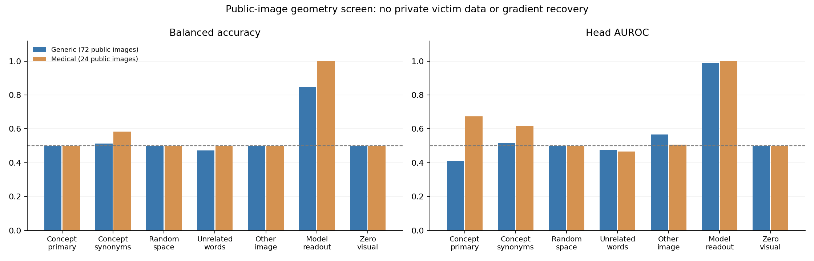

## 要点

- **首层词向量概念探针没有通过推进门槛**：主探针把 96 张公开图全部判为 non-head，摄影组与医学组的 Balanced accuracy 都是 0.500。
- **视觉表征本身含有部位信息**：直接把真实视觉 tokens 交给模型读出，摄影组 61/72、医学组 24/24 判对；失败更可能出在词向量探针的构造。
- **对照条件同样接近随机**：等秩随机空间、其他图像空间、无关词簇和分组置换的 Head AUROC 都在 0.38–0.57 之间。

本页验证[原始计划](../plans/2026-10-28-image-property-ideas.md#concept-design)中"视觉子空间概念探针"的第一步：在首层视觉特征空间里，用词向量判断图像是否属于头部。这一步没有通过，之后改用深层梯度原型，见 [[gradient-prototype-transfer]]。全部输入都是公开合成图，不读取私有目标。

## 关键数字

| Public group | Images | Primary balanced accuracy | Head AUROC | AUROC image CI95 | Model readout accuracy |
|---|---:|---:|---:|---|---:|
| Generic | 72 | 0.500 | 0.409 | [0.275, 0.542] | 0.847 |
| Medical | 24 | 0.500 | 0.674 | [0.438, 0.875] | 1.000 |

## 研究问题

- **概念几何**：首层视觉子空间能否区分预先固定的头部与非头部概念？
- **接口读出**：把真实视觉 tokens 注入模型，能否复现原计算并读出部位？

## 实验设置

### 概念探针与接口检查（2026-10-28）

| Item | Setting |
|---|---|
| Public images | 三套通用摄影候选与一套医学候选，各 24 张，类别各半；复用已审核的生成图 |
| Private inputs | 不读取私有目标图像、问答、Observation 或重构结果 |
| Model | LLaVA-1.5-7B，F-L，LoRA rank 32，round 10；不更新参数 |
| Primary probe | 首层 input RMSNorm 后的视觉特征；减去固定中性文本方向，取前 96 个视觉方向 |
| Primary concepts | head、brain、skull、face 对 chest、abdomen、arm、leg |
| Synonyms | head、cranium、forehead、scalp 对 torso、belly、hand、foot |
| Unrelated concepts | table、chair、door、window 对 river、mountain、tree、cloud |
| Score | 概念词在视觉空间外的相对残差；每类至少 2 个有效词，类内均值较低的一类胜出 |
| Other conditions | 秩 32、96、576；原始空间；含 head 词的上下文 |
| Controls | 等秩随机空间、同库其他图像的空间、无关词簇、概念分组置换 |
| Readout | 固定头部 yes/no 问句，比较答案 NLL（含 EOS）；另用全零视觉槽位作消融 |
| Interface | 4 个预定样本比较 logits、loss 和全部 LoRA 梯度，容差 1e-6 |
| Gate | 摄影组和医学组的主探针 Balanced accuracy 都至少 0.65，Head AUROC 区间下限高于 0.5，且三套摄影库方向一致 |

所有概念词、秩和映射在预测前冻结，不拟合阈值；多 token 词取各 token 经同一 RMSNorm 后的均值。

## 结果

### 概念几何

**回答**：不能。主条件未通过门槛；18 种预定组合中只有 neutral、秩 32、同义词一组在两组上都超过 0.65，其余都接近 0.5。

| Context | Rank | Concepts | Generic balanced accuracy | Generic Head AUROC | Medical balanced accuracy | Medical Head AUROC |
|---|---:|---|---:|---:|---:|---:|
| neutral | 32 | primary | 0.514 | 0.502 | 0.458 | 0.708 |
| neutral | 32 | synonyms | 0.681 | 0.749 | 0.667 | 0.757 |
| neutral | 96 | primary | 0.500 | 0.409 | 0.500 | 0.674 |
| neutral | 96 | synonyms | 0.514 | 0.518 | 0.583 | 0.618 |
| neutral | 576 | primary | 0.500 | 0.520 | 0.500 | 0.569 |
| neutral | 576 | synonyms | 0.472 | 0.505 | 0.500 | 0.528 |
| raw | 32 | primary | 0.500 | 0.193 | 0.500 | 0.556 |
| raw | 32 | synonyms | 0.486 | 0.228 | 0.500 | 0.444 |
| raw | 96 | primary | 0.500 | 0.120 | 0.500 | 0.792 |
| raw | 96 | synonyms | 0.500 | 0.325 | 0.500 | 0.444 |
| raw | 576 | primary | 0.500 | 0.377 | 0.500 | 0.604 |
| raw | 576 | synonyms | 0.500 | 0.438 | 0.500 | 0.458 |
| head_word | 32 | primary | 0.500 | 0.512 | 0.500 | 0.688 |
| head_word | 32 | synonyms | 0.500 | 0.850 | 0.500 | 0.715 |
| head_word | 96 | primary | 0.472 | 0.431 | 0.500 | 0.597 |
| head_word | 96 | synonyms | 0.500 | 0.367 | 0.500 | 0.479 |
| head_word | 576 | primary | 0.583 | 0.575 | 0.542 | 0.542 |
| head_word | 576 | synonyms | 0.500 | 0.516 | 0.500 | 0.465 |

- 主条件为 neutral、秩 96、primary。它把全部图判为 non-head，所以 Balanced accuracy 是 0.500、Head recall 为零。
- neutral、秩 32、同义词一组为 0.681 和 0.667，但它是预定对照之一，同一上下文换成主词簇只有 0.514 和 0.458，结果对词的选择很敏感。
- 排序也不稳定：摄影组 Head AUROC 0.409，医学组 0.674，两者区间都包含 0.5。
- 按提示家族成组重采样后，摄影组 AUROC 区间为 [0.204, 0.619]，医学组为 [0.424, 0.917]。

#### 空间对照

| Condition | Generic balanced accuracy | Generic Head AUROC | Medical balanced accuracy | Medical Head AUROC |
|---|---:|---:|---:|---:|
| Primary | 0.500 | 0.409 | 0.500 | 0.674 |
| Random space | 0.500 | 0.500 | 0.500 | 0.500 |
| Other image | 0.500 | 0.566 | 0.500 | 0.507 |
| Unrelated concepts | 0.472 | 0.476 | 0.500 | 0.465 |
| Permuted concepts | 0.472 | 0.532 | 0.500 | 0.382 |
| Synonyms | 0.514 | 0.518 | 0.583 | 0.618 |

- 主条件和各对照的差别不大，说明当前距离主要反映的不是部位语义。
- 中性上下文下有效词比例为 1.000，含 head 的上下文中为 0.875。

### 接口读出

**回答**：可以。真实视觉 tokens 注入后，模型能读出头部属性；接口的 logits、loss 和全部 LoRA 梯度与原计算一致。

| Public group | Real visual tokens accuracy | Real visual tokens Head AUROC | Zero visual accuracy | Zero visual Head AUROC |
|---|---:|---:|---:|---:|
| Generic | 0.847 | 0.991 | 0.500 | 0.500 |
| Medical | 1.000 | 1.000 | 0.500 | 0.500 |

- 这是模型识别能力的检查，没有使用任何上传梯度，也不是梯度攻击的上界。
- Zero visual 保留视觉槽位和位置但填零，属于消融，不等于标准的 Text-only 输入。
- 读出成功说明视觉 tokens 里有部位信息；概念几何的失败更可能出在词向量探针的构造。

## 结论

- 首层词向量几何不足以判断部位，这条路线不再继续。
- 真实视觉 tokens 含有可读出的部位信息，所以后续改在深层模块输入处用公开图像建原型（[[gradient-prototype-transfer]]）。
- 视觉 tokens 注入接口已验证，可用于后续的 tokens 恢复实验（[[convex-token-recovery]]）。

## 局限

- 非头部类包含多个部位，词簇覆盖不完整；多 token 词取均值只是启发式，同维度不代表语义对齐。
- 高秩空间会让无关概念也很接近，必须同时看主条件、随机空间和无关词。
- 秩 96 是预定的筛查条件；LoRA 梯度行空间不一定等于视觉特征的前 96 个主方向，不能当作严格上界。
- 医学候选的模态按生成提示记录，部分 MRI 外观偏 CT，没有经过专家复核。
- 图像级和提示家族区间都不覆盖生成器、概念选择和未知领域带来的不确定性。

## 下一步

- 本页路线已结束；部位推断的后续工作见 [[gradient-prototype-transfer]]。

??? note "运行记录"

    - 服务器 WN-A100，GPU 1，UUID `GPU-6a309ac1-08fa-062a-b449-e8de39ba4d09`；启动前显存近零、利用率零，是当时最空闲的卡。
    - 使用共享 gia；controller 20932、worker 20935、watcher 20933，源码 source-v2、输入与计划全部冻结，基础 commit aba0a9f，新增代码未提交。
    - 首次接口检查的 logits 和梯度均完全一致，但融合交叉熵与原实现的词表维度归约相差 1.43e-6，触发既定容差并停止，未提交逐图预测。保留 attempt-1 与源码；对齐评估 loss 的原生归约后执行第二次检查，不放宽容差、不改模型或科学设置，无 OOM。
    - 全部九十六份预测保存后才加入公开标签；无私有参考，模型参数未改变。运行墙钟 648.07 秒，峰值 allocated 20278.35 MiB。
    - 五项几何、损失及区间测试、Ruff、十六份实验记录及本地产物核验、MkDocs 严格构建通过；原始公开图像和逐图基只保留在 outputs，文档只纳入聚合表图。
