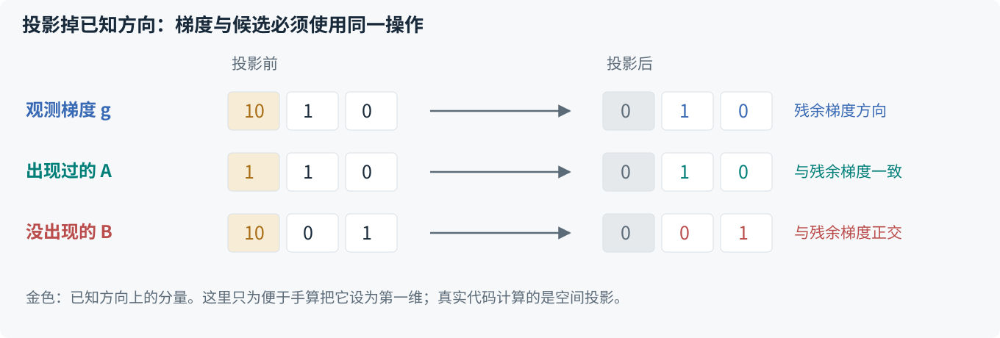
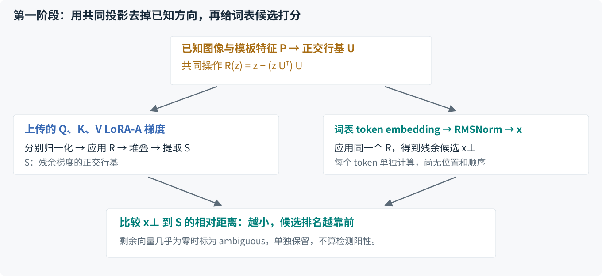

# Residual v1：去掉已知方向，再恢复文本

**核心想法**：梯度混合了已知输入和私有文本的贡献。先从梯度与候选特征中同时去掉已知输入张成的方向，再用剩余方向给 token 或前缀排序。

| Item | Setting |
|---|---|
| Documentation version | v1；2026-10-11 整理现有实现，未修改算法 |
| Implementation | `dager_adapted`；`mode=public_residual` |
| Current role | 当前采用的打分机制 |
| Model and task | 单设备 LLaVA/LLaMA；VQA；至少两个 decoder block |
| Observation | 单样本 FedSGD；F-L 或 F-CL；所需 LoRA-A 梯度可用且非零 |
| Knowledge | `image_known` 或 `image_question_known` 使用公开图像；`private` 可显式使用随机替代图 |
| Lengths | 必须公开每个样本的 token 长度 |
| Output | 问题及答案，或已知问题时只恢复答案；本方法不恢复图像 |

## 先分清三种输入

VLM 的语言模型接收同一隐藏维度的三类特征：固定模板文本、图像编码器输出的视觉向量，以及私有问题与答案的 token 向量。观测梯度混合了它们的贡献。

攻击者知道模型，可以计算词表里每一个 token 对应的候选特征；不知道的是哪些 ID 被实际使用。已知真实图像时，还可以准确计算该图像的输入特征。图像私有时，随机替代图只能提供一种估计。

[Raw 对照](raw.md) 解释了梯度为什么留下 token 线索。以一行梯度作示意：

```text
g = Σⱼ aⱼ pⱼ + Σᵢ bᵢ xᵢ
    已知输入贡献   私有文本贡献
```

`pⱼ` 是已知输入向量，`xᵢ` 是实际私有 token 的输入向量；系数 `aⱼ`、`bᵢ` 由反向传播决定。我们不知道这些系数，但知道所有 `pⱼ` 张成的方向。

## 为什么文本 x 也要投影？ {#why-project-text}

**文本来源与空间方向是两回事。** 第一阶段的 `x` 是 token embedding 经过输入 RMSNorm 后的特征，此时还没有经过图文注意力融合。但图像和文本特征位于同一隐藏空间，模型没有预先为两种模态分配互相正交的维度。

因此，纯文本向量也可以在图像方向上有投影；已知方向中还包含模板文本。令 `U` 表示这些已知方向的正交行基，则一个文本向量可以分成：

```text
x = x_parallel + x_perp
    落在 U 中的部分  与 U 正交的部分
```

对梯度去掉 `U` 后，真实文本向量在 `U` 中的部分也一起消失了：

```text
R(g) = Σⱼ aⱼ R(pⱼ) + Σᵢ bᵢ R(xᵢ)
     = 0             + Σᵢ bᵢ xᵢ_perp
```

所以，残余梯度对应的是**投影后的文本向量的组合**。如果拿原始 `x` 去比较，候选仍保留了梯度已经丢掉的分量，真实 token 也可能因此被判得更远。

!!! important "投影也会丢掉文本信息"
    Residual 去掉的是几何方向，不是精确分离出来的“图像内容”。私有文本与已知方向重叠的部分也会被删除。这是方法的代价，也是为什么它不能保证恢复所有 token。

## 一个可以手算的例子 {#worked-example}

下面的向量都是教学构造，不是实测特征，也不是私有样本。为了便于计算，把已知方向设为第一坐标；真实模型需要计算投影，不能直接把固定坐标清零。

| Vector | Coordinates | Meaning |
|---|---|---|
| 已知输入 p | `(1, 0, 0)` | 图像和模板方向在本例中合为一个方向 |
| 候选 A | `(1, 1, 0)` | 私有文本实际使用过 |
| 候选 B | `(10, 0, 1)` | 私有文本没有使用过 |
| 观测梯度 g | `(10, 1, 0)` | `g = 9p + A`，确实由实际输入组成 |

Raw 比较候选到 `g` 张成直线的相对距离。B 在第一维上的分量与梯度更相似，所以未出现的 B 反而排在前面。现在把第一维从梯度和候选中**同时去掉**：

[](../figures/residual-projection.svg)

| Candidate | Raw distance | Residual distance | Result |
|---|---:|---:|---|
| A | 0.633238 | 0 | 投影后与残余梯度方向一致 |
| B | 0.140371 | 1 | 投影后与残余梯度方向正交 |

这里不需要知道系数是 9：任何倍数的 `p`，投影到其正交补后都变成零。同一投影也删除了 A 原来的第一维分量。

这个例子已用当前 `SpanFilter` 核算。它说明一种可能的干扰机制，不能证明所有实验误排都由这一机制导致。

## 第一阶段：构造空间并筛选 token

[](../figures/residual-filter.svg)

### 1. 从已知特征得到 U

将第 0 层结构上已知的输入特征按行组成 `P`：包括声明公开的图像、模板，以及可由公开长度确定的 EOS 和 padding 位置。私有内容位置不能加入。

用 SVD 提取 `P` 的正交行基 `U`。`U` 只是同一组已知方向的一种稳定表示。定义：

```text
R(z) = z − (z Uᵀ) U
```

`(z Uᵀ) U` 是 `z` 在已知空间中的投影。`z` 可以是一行候选向量，也可以是整块梯度矩阵。

### 2. 从上传梯度得到残余空间 S

对第 0 层 Q、K、V 的 LoRA-A 梯度分别处理：

1. 除以该梯度**投影前**的 Frobenius 范数。
2. 应用 `R`，去掉已知方向。
3. 堆叠三组结果，用 SVD 提取正交行基 `S`。

```text
H = stack(R(G_Q / ‖G_Q‖F), R(G_K / ‖G_K‖F), R(G_V / ‖G_V‖F))
S = orth_rows(H)
```

归一化先于投影，避免把一块几乎完全由已知输入解释的梯度，其极小数值残差重新放大。实现不会在投影后再次逐块归一化。

### 3. 对每个词表候选打分

从已知模型取出 token embedding，经过第 0 层输入 RMSNorm 得到 `x`；对它应用相同的 `R`，得到 `x_perp`。

```text
x_perp = R(x)
d(x) = ‖x_perp − (x_perp Sᵀ) S‖₂ / ‖x_perp‖₂
```

分子是候选在 `S` 外的剩余长度；分母是投影后候选自身的长度。距离越小，表示越多的候选方向可由残余梯度空间解释。一般情况下，0 表示落在空间中，1 表示完全正交。

这个分数是排序线索，不是成员证明。低秩压缩和反传系数可能使真实 token 的方向没有完整保留在 `S` 中。

### 4. 保留候选与 ambiguous

如果投影后的向量几乎为零，就不能从剩余部分判断成员关系。例如候选 `C = (2, 0, 0)` 在教学例子中会完全消失。

代码把这种候选标为 `ambiguous`，在 informative 候选预算之外单独保留；它的占位分数为 0，**不表示检测阳性**。其余候选按阈值或 Top-K 选择。特殊 token、padding ID 和 tokenizer 范围外的 embedding 行被排除。

## 第二阶段：从候选集合恢复顺序

第一阶段只输出一个 token ID 集合，不提供位置、顺序或重复次数。第二阶段重复以下步骤：

1. 给当前保留的每个前缀追加候选 token。
2. 用所选图像、模板和候选前缀重放第 0 个 Transformer block。
3. 取新增 token 位置的第 1 层输入特征，用第 1 层对应的 Residual 空间打分。
4. 累加前缀扩展分数，每个深度保留指定 beam 数量。
5. 按公开长度填完所有私有位置，选择最终候选；保存后才读取真值评估。

当问题与答案均私有时，先填问题，再填答案。若问题已经公开，则问题保持固定。

| Stage | Candidate feature | Gradient layer | Known inputs used for U |
|---|---|---|---|
| Token filter | 输入 RMSNorm 后的静态词表 embedding | Layer 0 | 所有结构上已知的第 0 层输入位置 |
| Prefix search | 新增 token 经第一个 block 后的上下文特征 | Layer 1 | 首个未知位置之前的已知因果前缀 |

第 1 层中，未知问题后面的模板虽然文字固定，其特征也已受前文影响，不能把这些位置当作完全已知来投影。

实现支持可选的完整梯度重排；此前 rank 对比设置 `rerank_candidates=0`，只按前缀累计距离选最终序列。详见 [[dager-multisample]]。

## 真实图像与随机替代图

| Component | GT | Random |
|---|---|---|
| 图像来源 | 知识条件声明公开的真实图像 | 攻击者独立生成的随机 RGB 图像 |
| 第一阶段 U | 实际已知图像及模板的方向 | 使用替代图构造的方向估计 |
| 第二阶段前向 | 真实图像参与上下文计算 | 替代图参与上下文计算 |
| 主要限制 | 投影会删除重叠的文本信息，残余梯度仍可能不足 | 真实视觉成分可能残留，也可能误删有用文本方向；上下文继续失配 |

Random 条件不会用真实图像生成、挑选或优化替代图。它把同一评分算法用于近似的方向集合，不能解释成精确消除了真实图像影响。

## 默认配置与已跑实验的区别

当前预设并不默认使用实验中的 K=100。复现时必须同时记录配置与实际候选数。

| Parameter | Preset | Reported rank study |
|---|---|---|
| `token_selection` | `threshold` | `topk` |
| `token_threshold` | 0.05 | 不用于 Top-K 选择 |
| `max_candidates` | 256 | 100 |
| `beam_width` | 16 | 16 |
| `prefix_batch_size` | 16 | 32 |
| `rerank_candidates` | 0 | 0 |
| `analysis_dtype` | float64 | float64 |

`max_candidates` 只限制 informative 候选。rank 实验另保留了 9 个 ambiguous ID，实际候选为 109；这个 9 是本批观测的结果，不是算法写死的常数。阈值模式也受到 informative 上限约束，截断会记录在产物中。

## 证据与尚未解决的问题

- **候选覆盖改善**：与 Raw 的配对比较见 [[dager-multisample]]。
- **覆盖不等于序列恢复**：rank 变化与两阶段表现见 [[dager-multisample]]。
- **图像私有时还没有稳定替代方案**：冻结筛选规则后的验证见 [[dager-filter-phase]]。
- **数值精度与低秩信息仍有限制**：float64 分析不能恢复已经在受害模型计算或上传中丢失的信息。
- **完整恢复没有保证**：候选遗漏、方向误排、图像失配和 beam 剪枝都可能导致失败。

## 实现对应

| Component | Code |
|---|---|
| 正交基、共同投影、距离和 ambiguous | `attacks/analytic/dager_subspace.py`：`row_basis`、`residual`、`SpanFilter` |
| 候选选择 | 同文件：`select_tokens` |
| 图像条件、token filter、beam search | `attacks/analytic/dager_adapted.py` |
| 已知位置、层输入和前缀前向 | `core/adapters/llava.py`：`LlavaTextView` |
| 默认攻击预设 | `configs/attack/dager_adapted.yaml` |

后续修改方案时，使用[迭代模板](../iteration-template.md)记录具体变化，保留本页作为 v1 对照。
